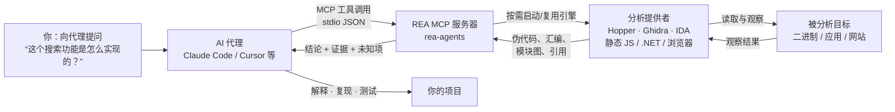
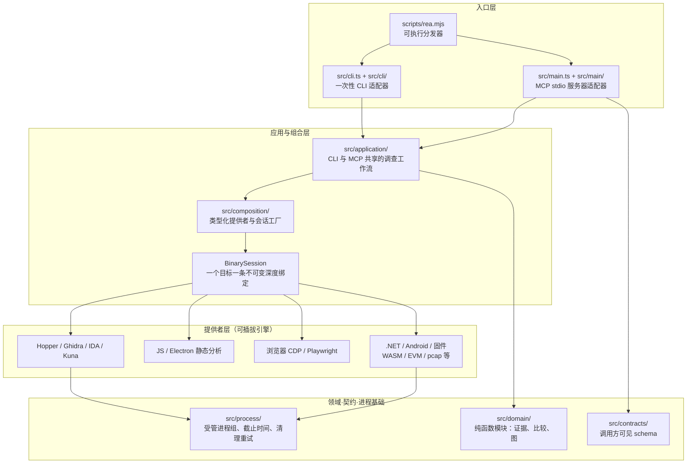

本页是整个文档站的起点，面向初次接触 REA 的开发者。你将在这里弄清三件事：REA 是什么、它能分析什么、你的 AI 代理（或你的终端）如何使用它。阅读完本页后，你可以沿着目录继续进入安装、CLI 使用与架构细节等章节。

## 一分钟认识 REA

REA 的全称是 **Reverse Engineer Anything**（逆向一切），它在 README 中的自我定位是"一个覆盖二进制、应用与运行时行为的逆向工程 MCP"。它以 npm 包 `rea-agents` 的形式发布，当前版本为 6.7.0，同时提供两个可执行入口 `rea` 和 `rea-agents`，本质上指向同一个程序。所有分析都在本地完成：REA 不会把你的应用上传到任何服务器，它把"观察结果、证据和局限"作为结构化结果交还给你的代理或终端。

| 项目 | 值 |
| --- | --- |
| npm 包名 | `rea-agents` |
| 当前版本 | 6.7.0 |
| 一句话描述 | 一个 CLI 与 MCP 服务器，从终端或 AI 代理逆向任何东西 |
| 可执行入口 | `rea`、`rea-agents` |
| Node.js 要求 | ^22.19.0 ∥ ^24.11.0 ∥ >=26.0.0 |
| MCP 传输方式 | stdio（标准输入输出） |
| 许可证 | MIT（REA 自有代码） |

Sources: [README.md](README.md#L11-L15), [package.json](package.json#L1-L13), [package.json](package.json#L33-L40), [server.json](server.json#L17-L30)

## 为什么需要 REA：没有源码，也能弄懂一个功能

REA 的核心使用场景是：当你看到一个应用里的某项功能，想理解它在二进制层面如何实现时，直接让代理去调查。代理调用 REA 检查目标（无需源代码），追踪相关代码，REA 返回结论**以及支撑每个结论的证据和局限**；代理再用这些材料去解释行为、编写并测试你自己的实现。对初学者而言，"结论附带证据与未知项"这一点尤为重要——你不会被一个看起来自信却无法验证的答案误导。

Sources: [README.md](README.md#L49-L60), [README.md](README.md#L159-L164)

值得注意的是，并不是所有分析都需要安装重型逆向引擎。静态 JavaScript/.NET 分析只读取你提供的文件而不运行应用，完全不需要原生分析引擎；只有深入的原生二进制分析才需要 Hopper、Ghidra 或 IDA 之一。运行时捕获类操作（浏览器、进程观察等）则以你当前用户的权限运行或与目标交互，每类操作的边界都在对应指南中说明。

Sources: [README.md](README.md#L203-L205), [README.md](README.md#L271-L278)

## 双入口设计：代理走 MCP，人走终端

初学者常问的第一个问题是：MCP 是什么？**MCP（Model Context Protocol，模型上下文协议）**是一个让 AI 代理调用本地工具的标准协议。REA 以 stdio（标准输入输出流上的 JSON 消息）方式运行一个 MCP 服务器，任何支持本地 MCP 服务器的代理都能连接它。安装后，`scripts/rea.mjs` 这个分发器会根据参数路由请求：传入 `mcp` 时加载 MCP 运行时，否则按一次性 CLI 命令处理。这两种入口共享同一套底层分析工作流，因此你在终端验证过的结论，代理也能得到。

| 维度 | MCP 服务器模式 | 一次性 CLI |
| --- | --- | --- |
| 主要使用者 | AI 代理（Claude Code、Cursor 等） | 人（终端）或脚本 |
| 启动方式 | 代理拉起 `rea-agents mcp` 常驻进程 | `rea <命令>` 直接执行后退出 |
| 通信方式 | stdio 上的 MCP 工具调用 | stdout 输出，支持 `--json` |
| 典型用途 | 多轮调查、追问、边分析边实现 | 单点检查、管道处理、CI 集成 |
| 就绪诊断 | `rea mcp doctor` | `rea doctor` |

Sources: [scripts/rea.mjs](scripts/rea.mjs#L16-L19), [scripts/rea.mjs](scripts/rea.mjs#L40-L50), [server.json](server.json#L17-L30), [README.md](README.md#L159-L164)

下面这张图概括了一次典型调查的完整链路——从你的提问，到代理经 MCP 调用 REA，再到 REA 驱动分析引擎检查目标，最后带着证据回到代理手中：



Sources: [README.md](README.md#L159-L168), [README.md](README.md#L49-L60)

在代码层面，MCP 服务器入口 `src/main.ts` 的启动流程被刻意保持得非常直观：解析环境配置 → 创建目标会话（BinarySession）→ 打开初始目标 → 启动 MCP 传输层 → 注册幂等的关闭处理器。整个进程生命周期内，这一个会话持有对目标"一条不可变的深度绑定"，EOF 或进程信号会触发桥资源的清理。

Sources: [src/main.ts](src/main.ts#L31-L75)

## 可以分析什么：一张目标矩阵

REA 的覆盖面是它最打动人的地方之一。下表从 README 的能力矩阵中提炼了初学者最容易上手的行（完整矩阵共 20 余类目标）。"要求"一列特别值得注意：不少目标是"内置静态检查、零外部依赖"的。

| 目标 | REA 返回什么 | 依赖要求 |
| --- | --- | --- |
| 原生二进制 | 伪代码、汇编、字符串、符号、调用与引用 | Hopper、Ghidra 或 IDA |
| Go 二进制 | 内嵌编译器版本、模块、替换与构建设置 | 内置静态检查，无需安装 Go |
| Rust 二进制 | cargo-auditable 的 crate 名称、版本与依赖边 | 内置静态检查 |
| JavaScript / Electron | 模块、导入、source map、路由、IPC 与原生插件关系 | Node.js 与 npm |
| 网站 | 页面结构、脚本、网络观察与截图 | 一个 Chrome 系浏览器 |
| .NET 程序集 | 元数据、CIL 指令、声明的原生依赖与构建对比 | 无（纯静态） |
| Android APK | 清单声明、类、反编译方法与引用 | Headless JADX + 完整 JDK |
| Android 设备 | 设备、包、进程、日志、dump、截屏与文件传输 | 调用方提供的 adb |
| WASM 工件 | 校验、节区、精确的导入/导出 WAT 与解码结果 | 调用方提供的 WABT 1.0.42 |
| EVM 字节码 | 分发选择器、字节偏移、推断参数与可变性 | Linux x64 上的本地 raw/hex 载体 |
| SQLite 数据库 | 表、列、索引、视图、触发器与选定行 | 本地数据库/WAL 快照 |
| 固件 | 区域、抽取结果与向原生分析的交接 | Linux 上的 Binwalk / Unblob |
| 记录的数据包 | 选定字段、重复值、过滤器与 decode-as 规则 | Linux：TShark 4.x + prlimit |

Sources: [README.md](README.md#L172-L201)

对于离线的原生二进制检查，REA 还支持调用方自行提供的 GNU objdump 和 Rizin——REA 既不安装也不更新它们，只在你已配置好时使用。这一"自带工具"（BYO）的设计贯穿全项目：REA 负责调度、超时、清理和证据结构化，而商业引擎的安装与授权始终由你掌控。

Sources: [README.md](README.md#L207-L210)

## 原生分析引擎：Hopper、Ghidra、IDA 与按需启动

深入的原生二进制分析需要三大引擎之一，但它们的接入方式各不相同：Hopper 可以在 `rea setup` 经你批准后由安装器自动安装（macOS 上校验官方 DMG 后原子化装入 `~/Applications`）；Ghidra 和 IDA 则复用你已有的安装。你也不需要提前手动启动 Hopper——REA 会在某个操作真正需要它时自动拉起引擎（macOS 首次运行可能弹出演示模式/授权选择框，需要在同一次用户会话中完成）。

Sources: [README.md](README.md#L271-L289), [README.md](README.md#L57-L60)

除三大引擎外，项目还内置了多条独立的提供者通道：面向上游 MCP 的 IDA 适配、Kuna 反编译器、Cutter 桥、GDB/Rizin/LLDB 调试会话、pwndbg 与 pwntools 桥等。每条通道都有独立文档，你可以在后续章节按需深入。

Sources: [README.md](README.md#L214-L221), [docs/architecture.mermaid](docs/architecture.mermaid#L47-L78)

## 连接你的 AI 代理：一条命令完成注册

真正把"逆向工程工具链"变成"代理可用工具"的关键一步是注册。在装有 Node.js 与 npm 的机器上运行：

```bash
npx rea-agents setup
```

安装过程是**事务式**的：先多选要配置的代理，再审阅计划中的确切路径与改动（包括检测到的引擎、外部软件与网络来源），你批准之前不会写入任何文件或安装 Hopper。已有配置会被备份，无关条目与注释会被保留，如果取消或按 Ctrl-C 则一切保持原样。完成后重启列出的代理即可开始第一次调查。

Sources: [README.md](README.md#L75-L92), [docs/installation.md](docs/installation.md#L6-L16)

REA 目前支持通过 setup 自动配置 25 种客户端，以下为节选（完整列表见安装页）：

| 客户端 | `--client` 值 | 客户端 | `--client` 值 |
| --- | --- | --- | --- |
| Claude Code | `claude_code` | GitHub Copilot CLI | `copilot_cli` |
| Claude Desktop | `claude_desktop` | VS Code | `vscode` |
| Codex | `codex` | Gemini CLI | `gemini_cli` |
| Cursor | `cursor` | Grok Build | `grok_build` |
| Windsurf | `windsurf` | Factory Droid | `droid` |
| OpenCode | `opencode` | DeepSeek Harness | `dsh` |
| Devin | `devin` | Kimi Code | `kimi` |

任何支持本地 MCP 服务器的其他代理，都可以通过手动 MCP 注册接入，`server.json` 中已经写好了注册所需的全部元数据（npm 包、stdio 传输、`mcp` 启动参数）。

Sources: [docs/installation.md](docs/installation.md#L480-L516), [README.md](README.md#L260-L269), [server.json](server.json#L1-L31)

如果你更习惯终端直用，无需注册任何代理即可验证安装：对提取出的 JavaScript/Electron 应用目录或 ASAR 文件执行一次静态分析，是官方推荐的第一条命令。确认体验后，可用 `npm install --global rea-agents` 安装常驻的 `rea` 命令，再配合 `rea --help` 探索全部子命令；后续升级用 `rea update` 一键完成。

```bash
npx -y rea-agents@latest analyze-javascript-application /absolute/path/to/app --json
```

Sources: [README.md](README.md#L102-L124)

## 代码仓库一瞥：分层架构总览

REA 的代码库组织为清晰的分层结构，`docs/architecture.mermaid` 是官方的架构地图。简化后的大局如下——入口层（MCP 与 CLI）经由组合层创建提供者，应用层承载两种入口共享的调查工作流，几十个提供者各自封装一种分析引擎或格式，最底部的进程基础层统一处理"受管进程、截止时间与清理"这类容易被忽视的安全性问题：



Sources: [docs/architecture.mermaid](docs/architecture.mermaid#L1-L96), [src/main.ts](src/main.ts#L21-L33)

这一分层的实际规模可以由 `src/cli.ts` 的命令注册直观感受：仅导入部分就登记了 capture、signal、wasm、evm、go、rust、sqlite、frida、managed、firmware、android、apktool、pcap、flutter、jeb、adb、browser、electron 等数十组命令——它们与 MCP 工具共用同一批应用层工作流，这正是"一次实现、两种入口"的架构红利。

Sources: [src/cli.ts](src/cli.ts#L1-L60), [docs/architecture.mermaid](docs/architecture.mermaid#L12-L14)

仓库中几个关键目录的速查：

```
rea/
├── scripts/rea.mjs       # 可执行分发器：路由 mcp / 一次性 CLI
├── src/main.ts           # MCP stdio 服务器入口（会话 + 传输 + 关闭）
├── src/cli.ts            # CLI 入口，注册各领域命令组
├── src/composition/      # 组合层：提供者与会话工厂
├── src/application/      # CLI/MCP 共享的分析与调查工作流
├── src/contracts/        # 工具契约：调用方可见的输入/输出 schema
├── src/domain/           # 纯函数领域模块（证据、比较、投影）
├── src/hopper|ghidra|ida # 各分析引擎的提供者实现
├── src/process/          # 进程所有权、截止时间与清理
├── bridge/               # 运行在 Hopper/Ghidra/JADX 等内部的桥
└── docs/                 # 面向用户的指南与 MCP 契约文档
```

Sources: [docs/architecture.mermaid](docs/architecture.mermaid#L2-L33), [package.json](package.json#L33-L36)

## 结果里有什么：证据、局限，以及能复现的展示

REA 返回的不只是代码。原生分析给出伪代码与汇编，JavaScript/Electron 分析恢复模块及其关系，同时保留每个结论的**证据与未知项**，供代理继续追问或动手实现。项目网站上的三个实战案例展示了这条链路的终点能走多远：DX-Ball 声音声场定位函数的 C 重构通过了 3,205 个原始 x86 用例并逐字节复现了全部 63 个编译后函数字节；Notion 案例追踪了 Electron 渲染进程到主进程的剪贴板 IPC 桥；TH04 案例从 PC-98 游戏的 16 位指令中恢复了 DOS 时代的子弹环形计算。

Sources: [README.md](README.md#L159-L164), [README.md](README.md#L226-L253)

## 合法使用边界与许可

作为逆向工程工具，REA 对使用边界有明确立场：它仅用于合法的研究、教育、互操作性、软件保存，以及你拥有或被授权分析的软件。项目代码以 MIT 许可发布，但第三方组件保留各自许可证；尤其要注意，**IDA Pro/Hex-Rays、Hopper、JEB 等商业工具必须由你合法获取并授权使用**——REA 不授予任何工具许可、密钥或激活权益，破解副本与绕过授权不在允许之列。

Sources: [README.md](README.md#L368-L376), [README.md](README.md#L388-L404)

## 建议阅读路径

依据本目录的结构，为初学者推荐以下递进顺序：

1. **[快速开始：注册代理、发起第一次调查与终端直用](2-kuai-su-kai-shi-zhu-ce-dai-li-fa-qi-di-ci-diao-cha-yu-zhong-duan-zhi-yong)** —— 跑通第一次端到端调查，把本页的概念落到操作上。
2. **[安装与代理配置：受支持客户端、事务式写入与原生引擎前置条件](3-an-zhuang-yu-dai-li-pei-zhi-shou-zhi-chi-ke-hu-duan-shi-wu-shi-xie-ru-yu-yuan-sheng-yin-qing-qian-zhi-tiao-jian)** —— 深入 setup 的事务式写入机制与 Hopper/Ghidra/IDA 前置条件。
3. **[CLI 使用与就绪诊断：rea 命令、JSON 输出与 doctor 检查](4-cli-shi-yong-yu-jiu-xu-zhen-duan-rea-ming-ling-json-shu-chu-yu-doctor-jian-cha)** —— 学会终端侧的命令体系与 `doctor` 就绪检查。
4. **[分层架构总览：入口、组合、应用、提供者与领域层的依赖规则](5-fen-ceng-jia-gou-zong-lan-ru-kou-zu-he-ying-yong-ti-gong-zhe-yu-ling-yu-ceng-de-yi-lai-gui-ze)** —— 本页架构图背后的完整依赖规则。
5. **[证据与不确定性模型：观察、推导、推断与未知的保留语义](6-zheng-ju-yu-bu-que-ding-xing-mo-xing-guan-cha-tui-dao-tui-duan-yu-wei-zhi-de-bao-liu-yu-yi)** —— 理解"结论附带证据"这一设计哲学的正式模型。

完成这五步后，你可以按兴趣分流：关注工具调用语义的读者继续读 **[MCP 工具设计原则：六种任务形状、原语优先与契约严格性](7-mcp-gong-ju-she-ji-yuan-ze-liu-chong-ren-wu-xing-zhuang-yuan-yu-you-xian-yu-qi-yue-yan-ge-xing)**；想做原生二进制分析的读者进入 **[原生二进制调查工作流：函数档案、引用与 Go/Rust 元数据、离线布局诊断](10-yuan-sheng-er-jin-zhi-diao-cha-gong-zuo-liu-han-shu-dang-an-yin-yong-yu-go-rust-yuan-shu-ju-chi-xian-bu-ju-zhen-duan)**；Web 方向的读者则从 **[JavaScript 与 Electron 静态分析：ASAR 读取、模块图与源码恢复](15-javascript-yu-electron-jing-tai-fen-xi-asar-du-qu-mo-kuai-tu-yu-yuan-ma-hui-fu)** 开始。