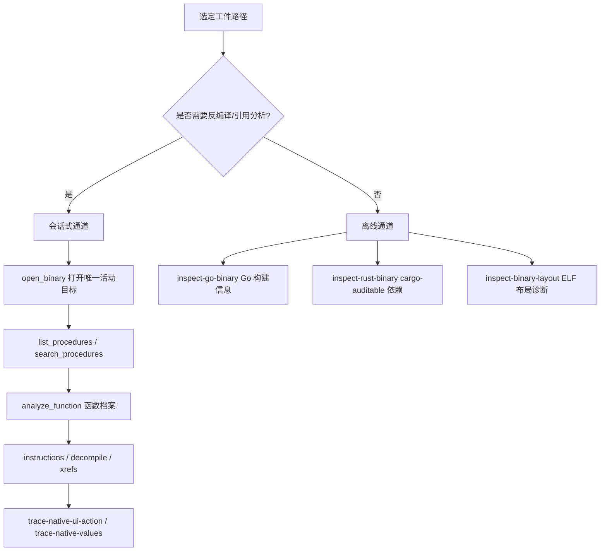

本页面向中级开发者，系统讲解 REA 中原生二进制调查的四条主干路径：以**函数档案（analyze_function）**为中心的会话式调查、**引用与调用语义**的精确解析、无需反编译引擎的 **Go/Rust 构建元数据读取**，以及**离线二进制布局诊断**。所有能力共享同一契约：观察绑定到选定工件的 SHA-256 身份，限制与未知显式保留，而非以推断填补。理解这一"证据优先"的语义，是正确解读每条工作流输出的前提。

## 工作流全景：会话式引擎与离线读取器

原生调查能力分为两条根本不同的通道。**会话式通道**需要一个已安装的分析引擎（Ghidra、Hopper、IDA 等）：CLI 或 MCP 打开一个目标后，针对该目标执行 `analyze_function`、`xrefs`、`trace_native_values` 等操作，由引擎完成反编译与引用分析。**离线通道**则完全不获取会话：`inspect_go_binary`、`inspect_rust_binary` 与 `inspect_binary_layout` 直接以 TypeScript 内置读取器（或受控的 Python 桥）解析选定文件，不需要任何引擎安装、不启动子进程、不访问网络。

两条通道在进程模型上同样分明。CLI 模式下每次调用都是刻意隔离的一次性执行：打开一个二进制、执行一个工具、始终释放提供者资源，不保留目标或客户端供后续命令使用。MCP 模式则由 `BinarySession` 持有 CLI 与 MCP 适配器共享的唯一活动目标，目标切换被串行化，因为切换会拆除活动提供者客户端。这解释了一个常见问题：为什么 CLI 每条命令都要重复传 `--provider`，而 MCP 中一次 `open_binary` 后续工具自动复用会话。

Sources: [DirectAnalysis.ts](src/application/DirectAnalysis.ts#L70-L88), [BinarySession.ts](src/application/binary/BinarySession.ts#L54-L95), [native-investigation.md](docs/native-investigation.md#L1-L13)

## 从函数开始：发现、选择与档案

官方推荐的调查起点是"从一个函数开始"：先用 `rea inspect` 获取目标概览，再用 `rea search PATH entry --kind procedures --provider ghidra --json` 在已分析清单中检索，然后从返回的清单中选取**精确的名称或地址**，交给 `rea function`、`rea instructions` 或 `rea decompile`。文档特别提醒：不要假设每个目标都把入口函数命名为 `entry`。MCP 侧使用 `open_binary` 与 `list_procedures`、`analyze_function` 等聚焦工具作用于同一会话。

Sources: [native-investigation.md](docs/native-investigation.md#L15-L33)

CLI 命令与底层操作的映射是固定的：`function` 命令路由到 `analyze_function` 操作，`instructions` 路由到 `read_function_instructions`，`search` 按 `--kind` 参数路由到 `search_strings` 或 `search_procedures`，`xrefs` 与 `trace` 分别对应 `xrefs` 与 `trace_feature`。每个命令都支持位置参数与命名选项两种选择器形式。

| 命令 | 底层操作 | 等值命名选择器 | 典型用途 |
| --- | --- | --- | --- |
| `rea function` | `analyze_function` | `--procedure=<名称或地址>` | 完整函数档案（伪代码+汇编+引用） |
| `rea instructions` | `read_function_instructions` | `--procedure=<名称或地址>` | 逐条原始指令，不反编译 |
| `rea decompile` | `procedure_pseudo_code` | `--procedure=<值>`；Ghidra 另支持 `--file-offset=0x…` | 单函数伪代码 |
| `rea search` | `search_strings` / `search_procedures` | `--pattern=<文本>` | 字面量默认、正则可选 |
| `rea xrefs` | `xrefs` | `--address=<名称或地址>` | 到某地址的有界引用 |
| `rea trace` | `trace_feature` | `--query=<文本>` | 通过引用追踪字面量特性 |

等值形式存在的目的是**保留以连字符开头的选择器**。文档给出的例子是 Objective-C 方法名：`rea function ./app '--procedure=-[REAWidget delegate]' --provider hopper --format json`。缺失选择器或位置/命名值冲突会在分析开始前失败；相同选择在两种形式下结果一致。`decompile` 还接受 Ghidra 源文件字节偏移 `--file-offset=0x…`，内部映射为分析地址。

Sources: [coreBinaryCommands.ts](src/cli/coreBinaryCommands.ts#L331-L387), [coreBinaryCommands.ts](src/cli/coreBinaryCommands.ts#L137-L175), [coreBinaryCommands.ts](src/cli/coreBinaryCommands.ts#L434-L507), [native-investigation.md](docs/native-investigation.md#L36-L55), [cliCommandNames.ts](src/cliCommandNames.ts#L27-L56)

## 函数档案的构成与证据绑定

`analyze_function` 是增强工具族的核心：为一个由符号名或提供者返回地址标识的原生函数构建档案，返回**身份与完整的包含式已分析函数体范围（或显式未知）**、提供者特定的伪代码与汇编、注释、调用、引用、被引用的字符串/名称、局部 CFG 块等。增强层在获得提供者原始结果后通过 `parseFunctionDossier` 校验档案结构，`inspect_native_api` 甚至直接以 `analyze_function` 的档案为基础投影出 API 边界视图（含跳转表映射与残余未知），而非发起第二次引擎查询。

Sources: [functionWorkflowToolContracts.ts](src/contracts/functionWorkflowToolContracts.ts#L26-L46), [EnhancedTools.ts](src/application/EnhancedTools.ts#L250-L283)

档案不是裸 JSON，而是被绑定为 Evidence：`executeFunctionAnalysisEvidence` 在执行成功后把提供者观察、参数、档案结果、原始结果、限制、位置以及关系覆盖度与分析配置档案（analysis profile）一并写入证据对象，使档案可被会话保留、后续分页或导出为证据包。当你用 `annotate_native_function` 原子地更新函数名或入口注释时，返回的正是**刷新后的完整档案**——且 Ghidra 只修改其临时会话分析数据库，原始可执行文件字节不变。

Sources: [FunctionAnalysisEvidence.ts](src/application/FunctionAnalysisEvidence.ts#L11-L58), [officialToolContracts.ts](src/contracts/officialToolContracts.ts#L34-L39)

一个关于完整性的重要细节：`batch_decompile` 在 `items[].address` 中保留调用者选定的原始符号或地址，独立的 `procedure` 字段才报告规范入口与提供者观察到的入口标签，因此**函数内部地址不会被误认为函数入口**。身份解析失败报告为 `procedure.status: "unknown"`，标签失败则保留 null 名并标记 `name_error`——两种失败都不丢弃可用的伪代码，也不会从伪代码中解析名称。该工具没有专用 CLI 命令，`decompile` 仍是单函数的 CLI 操作。Hopper 会话中的函数档案同样保留字符串证据（编码、字节长度、终止状态与原始显示文本），使字符串相关推理可追溯。

Sources: [native-investigation.md](docs/native-investigation.md#L152-L177), [native-investigation.md](docs/native-investigation.md#L179-L203)

## 引用语义：双向引用与调用目标解析

引用原语的**地址选择语义**经过精确定义：Ghidra 接受带或不带 `0x` 前缀、任意大小写的十六进制地址，以及 `EXTERNAL:0x1` 这类显式地址空间坐标；结果使用规范的小写十六进制偏移。对于过程标识符，显式 `0x` 或地址空间前缀选择地址，否则**精确数据库符号名优先于裸十六进制地址**——因此被重命名为 `dead` 的函数仍可按名选择。函数内的标签不是过程名选择器，需用其地址选择所属函数；重载可共享完全限定名，歧义错误会返回每个匹配条目的地址供调用者直接选择。

Sources: [native-investigation.md](docs/native-investigation.md#L57-L111)

引用覆盖的边界同样显式。Ghidra 函数引用覆盖完整函数体 AddressSet 及其精确入口，包括进入指令内部与来自嵌入数据的引用；`procedure_references` 返回内部与外部边，`analyze_function` 则省略来源属于同一函数的入边。`inspect_native_instruction` 还会返回指向被查询地址的 `incoming_references`（含数据、指令内部与不可解码地址），枚举 ReferenceManager、排除合成入口点引用并按源地址确定排序——`[]` 表示枚举未发现引用，而省略或 null 表示该侧写在旧捕获或其他提供者中不可用。空静态引用**不能证明**该地址在运行时未被使用。

Sources: [native-investigation.md](docs/native-investigation.md#L113-L136), [officialToolContracts.ts](src/contracts/officialToolContracts.ts#L161-L196)

紧凑引用保留源地址、操作数索引、DATA/READ/WRITE 分类、主引用状态、提供者 `provenance` 以及引用 `source`（Ghidra 为 `analysis`、`default`、`imported` 或 `user_defined`）。调用解析报告直接、已解析间接、歧义、未解析与非调用五类结果，但**不建立运行时执行**，也不从名称推断 Objective-C/Swift/vtable/闭包机制。`resolve_containing_procedure` 可把任意地址（含内部指令或精确外部条目）解析到所属过程，负结果区分"在段外"与"不在任何过程内"，绝不从邻近符号猜测。

Sources: [native-investigation.md](docs/native-investigation.md#L129-L151)

## 有界静态追踪：从 UI 线索到值流

`trace_native_ui_action`（`rea trace-native-ui-action`）接受一个作者设定的选择器/对象 ID、原生符号或精确函数地址作为种子，将 UI 接线连接到唯一匹配的类/选择器实现，并沿有界类型化调用引用展开。直接引用、已解析间接引用、歧义候选、推断的无类型提供者被调用者与无目标调用点保持**互相区别**；静态路径不建立运行时可达性。枚举失败时已知路由与未解析失败并存，节点上限省略时保留已知关系并将目标标记为未解析。

`trace_native_values`（`rea trace-native-values`）则跨静态解析调用组合高阶 p-code 定义-使用图：逻辑 CALL 参数绑定到恢复的参数序号，RETURN 值绑定到 CALL 输出。别名效应、持久状态、RNG 角色、缺失/可变参数绑定保持未知。预算控制深度、反编译次数、调用点解析数、节点与边数——节点载荷上限 8 MiB、序列化结果 32 MiB，分页返回源节点在当前页上的边并保留跨页稳定 ID。同一次值追踪中每个精确过程选择器至多尝试一次（含失败分析），失败保持为未知观察而不建立规范函数身份。

Sources: [native-investigation.md](docs/native-investigation.md#L208-L285), [cliCommandNames.ts](src/cliCommandNames.ts#L81-L84)

## Go 构建元数据：inspect_go_binary

`inspect_go_binary` / `rea inspect-go-binary` 回答一个问题：选定的本地可执行文件中嵌入了哪个 Go 编译器版本、哪些模块、替换与构建设置。它**只读文件、不运行文件**，不需要 Go 安装，也不需要活动二进制目标或 Hopper/Ghidra/IDA。内置读取器支持 ELF、PE 与**瘦 Mach-O**（通用 FAT 容器不支持，需先选薄片），覆盖 Go 的内联与历史指针式 build-info 编码；对无命名 build-info 节的 ELF，发现逻辑按程序头顺序检查每个非空可写、不可执行的加载段，从而覆盖无节 PIE 镜像。

Sources: [go-binaries.md](docs/go-binaries.md#L1-L24), [go-binaries.md](docs/go-binaries.md#L69-L99), [goCommands.ts](src/cli/goCommands.ts#L13-L41)

结果中的 `build_info` 记录包含：`go_version`（保留嵌入的 UTF-8 原文而非强制语义版本化，非 UTF-8 时为 null）、`go_version_bytes_base64`（精确字节）、头/编译器串/模块串的**精确文件偏移与长度**、`module.path`、主模块的版本/校验和/可选替换、按原始顺序的依赖数组、保留重复键与顺序的 `module.settings`，以及 `module.complete`（是否每行都被解析——它不证明依赖清单完整）。Go 字符串可含任意字节：非 UTF-8 记录以 base64 保留，其余可解码记录照常报告，读取器不插入替换字符、不因这些字符串拒绝整个工件。

Sources: [go-binaries.md](docs/go-binaries.md#L26-L67)

解读上有一个关键否定语义：`build_info: null` 表示**在被检查镜像中未发现可识别记录**，它不证明该二进制不是 Go——剥离、旧构建、刻意移除与混淆都会限制元数据。资源预算固定且分层：输入与累计头搜索各 256 MiB、嵌入字符串聚合 1 MiB、结构表解码 16 MiB、完整规范化报告 8 MiB；相同搜索跨度只搜一次，超限失败无部分成功。服务层再把提供者结果绑定到调用者选定的工件路径（不匹配即输出错误），并以 `go-build-info` 提供者身份产出观察级证据。生产者级验证通道 `npm run verify:go:binary` 用编译器构建的夹具对照 Go 标准 `debug/buildinfo` 读取器，但该通道只在验证时需要 Go。

Sources: [go-binaries.md](docs/go-binaries.md#L87-L113), [go-binaries.md](docs/go-binaries.md#L115-L121), [GoBinaryImage.ts](src/go/GoBinaryImage.ts#L18-L89), [GoBinaryService.ts](src/application/go/GoBinaryService.ts#L25-L113), [package.json](package.json#L291-L298)

## Rust 依赖元数据：inspect_rust_binary

`inspect_rust_binary` / `rea inspect-rust-binary` 回答哪些 crate 名称、版本、来源与依赖边被 cargo-auditable 嵌入选定文件。它同样只读、无 Rust 安装、无会话。当存在 `.dep-v0` 节（ELF/PE 为 `.dep-v0`，瘦 Mach-O 为 `__DATA,.dep-v0`）时，`auditable_metadata` 报告该节精确文件范围、压缩/解压字节数、嵌入的 `format_version`、按原始顺序的包列表（`name`/`version`/`source`/`kind`/`dependencies`/`root`）、唯一的 `root_package_index`、按"包序-依赖序"排列的依赖边对，以及参与环的排序去重索引——**环被报告但不被遍历**。

Sources: [rust-binaries.md](docs/rust-binaries.md#L1-L53)

资源预算与失败类型同样精确：选定文件 256 MiB、依赖节压缩后 1 MiB、解压 JSON 取 8 MiB 与 64 倍压缩比中的较小者、完整报告 8 MiB。空节、截断或尾部 zlib 字节、非法 JSON、未知字段、越界依赖索引、多于一个根包、嵌套压缩节都是类型化失败。读取器还从只读数据中的 `/rustc/<40-hex>/` 路径推导 `rustc_commit`，其 `evidence_kind` 为 `inferred`——**该哈希不声称是该编译器产出的证明**，多个不同哈希可能只留下一个未知提交。缺失 `.dep-v0` 返回成功与 `auditable_metadata: null` 加一条限制说明：缺席不等于没有依赖。

Sources: [rust-binaries.md](docs/rust-binaries.md#L55-L73), [RustAuditableReader.ts](src/rust/RustAuditableReader.ts#L15-L21), [RustAuditableReader.ts](src/rust/RustAuditableReader.ts#L88-L121)

与 Go 通道完全同构，Rust 服务层做精确输入校验、绝对路径强制、架构名归一（`386→x86`、`amd64→x86_64`）与工件身份绑定后产出证据，位置数组包含 `.dep-v0` 节的文件偏移范围。组合层注释明确说明这是"捆绑的离线检查，不获取工具链、不启动任何进程"。

Sources: [RustBinaryService.ts](src/application/rust/RustBinaryService.ts#L25-L122), [go.ts](src/composition/go.ts#L1-L7)

## 离线布局诊断：inspect_binary_layout

`inspect_binary_layout` / `rea inspect-binary-layout` 回答一个显式文件**包含什么**：节/段布局、原始符号与重定位、静态链接名称与缓解措施指标。它不需要活动的 Hopper/Ghidra/IDA 目标。初始真实验证范围是 **Linux x64 的 ELF64 x86-64 小端 EXEC/DYN/REL**。该通道采用"自带引擎"（BYO）模式：调用者通过 `REA_PWNTOOLS_PYTHON` 提供一个绝对 Python 可执行路径，其环境中须已包含未修改的 pwntools 4.15.0、pyelftools 0.33 与 Unicorn 2.1.2。REA 从不安装 Python/包/GDB、不改用户初始化文件、不把选定对象作为宿主进程启动；Python 进程以隔离模式与自有缓存运行。

Sources: [binary-diagnostics.md](docs/binary-diagnostics.md#L1-L28)

解读结果的锚点是"原始字节身份"：所有解析读取**自有稳定快照**，原始文件不变；地址、偏移、长度与标志为十六进制字符串，**链接地址不是运行时地址**，运行时加载基址保持 null。每个符号保留其表与条目索引，重复名称保持独立条目；RELR 压缩重定位保留完整原始字节，并且服务层会**逐字节校验**报告中声称的打包重定位字节与快照原始文件范围一致，不一致即输出错误。节名/符号表要求声明的 `SHT_STRTAB` 链接，畸形引用在无关字节变成名称之前失败。

Sources: [binary-diagnostics.md](docs/binary-diagnostics.md#L30-L66), [PwntoolsLayoutProvider.ts](src/native/pwntools/PwntoolsLayoutProvider.ts#L32-L58)

预算与投递是分开的两层：完整结果有 32 MiB 输入、64 MiB 回复、1 MiB 合并诊断与 30 秒自有命令截止时间；`REA_PWNTOOLS_MAX_INPUT_BYTES` 可单独把输入上限提到 1 GiB，回复与截止时间不变。MCP 传输层另有响应预算（文本+结构化内容合计），完整结果可能超出默认接收缓冲，需要调用方配置更大的缓冲并与服务端 `REA_MCP_MAX_RESPONSE_BYTES` 匹配——这些设置只影响投递，不改变解码覆盖面。Python 侧把资源软限制降至最多 3 GiB 虚拟地址空间、30 CPU 秒与 64 MiB 文件输出，实际生效值会返回在结果限制中；限制失败无部分成功，清理独立于取消完成。

Sources: [binary-diagnostics.md](docs/binary-diagnostics.md#L79-L99)

对 MCP 调用者有一个专门的分页设计：`detail: "summary"` 会把**完整布局证据保留在会话中**，只返回摘要视图，`normalized_result.parent_evidence_id` 指向被保留的完整证据；随后用 `inspect_analysis_view` 投影缓解措施、链接、单个节/符号或稳定分页，无需重新运行解码器。CLI 一次性调用则传入可移植的内联 Evidence JSON，`limit` 为必填且受预算约束。

Sources: [registerBinaryDiagnosticsTools.ts](src/server/registerBinaryDiagnosticsTools.ts#L29-L46), [binary-diagnostics.md](docs/binary-diagnostics.md#L68-L77)

## 离线通道对比与选择

三条离线通道与两个验证脚本共享同一工程模式，但读取对象与预算各不相同。选择原则：问题是**构建来源**用 Go/Rust 元数据；问题是**文件结构事实**（节、符号、重定位、缓解指标）用布局诊断；问题是**代码语义**（反编译、CFG、引用流）则必须回到会话式引擎。

| 维度 | inspect_go_binary | inspect_rust_binary | inspect_binary_layout |
| --- | --- | --- | --- |
| 回答的问题 | 编译器版本、模块、构建设置 | crate 名称/版本/依赖边 | 节/段布局、符号、重定位、缓解指标 |
| 数据来源 | Go build-info（内联/指针编码） | cargo-auditable `.dep-v0` 节 | ELF64 x86-64 头/节/段/动态表 |
| 支持容器 | ELF、PE、瘦 Mach-O | ELF、PE、瘦 Mach-O | ELF64 x86-64 LE EXEC/DYN/REL |
| 运行时依赖 | 无（TS 内置读取器） | 无（TS 内置读取器） | BYO Python + pwntools/pyelftools/Unicorn |
| 输入上限 | 256 MiB（搜索累计另 256 MiB） | 256 MiB | 32 MiB（可提升至 1 GiB） |
| 输出上限 | 8 MiB 报告 | 8 MiB 报告 | 64 MiB 回复 + 1 MiB 诊断 |
| 缺失语义 | `build_info: null`，不证明非 Go | `auditable_metadata: null`，不证明无依赖 | 上游启发式保留显式覆盖限制 |
| 验证通道 | `verify:go:binary` | （cargo-auditable 夹具） | `verify:binary:layout` |

Sources: [go-binaries.md](docs/go-binaries.md#L101-L113), [rust-binaries.md](docs/rust-binaries.md#L55-L73), [binary-diagnostics.md](docs/binary-diagnostics.md#L79-L95), [package.json](package.json#L291-L298)

需要强调三条离线通道共同的**证据边界**：嵌入元数据是文件内容的证据，它不认证编译器、依赖、提交或供应链，也不建立运行时行为。函数名、源码映射、类型与反编译代码在这些工具的覆盖范围之外——那些问题需要反编译器，即会话式工作流。这与仓库整体的证据模型一致：观察、推导、推断与未知被分层保留，null/省略表示"不可用"而非"为假"。

Sources: [go-binaries.md](docs/go-binaries.md#L101-L105), [binaryDiagnosticsCommands.ts](src/cli/binaryDiagnosticsCommands.ts#L40-L66)

## 延伸阅读

会话式通道的引擎细节在后续页面展开：Ghidra 的临时数据库与快照生命周期见 [Ghidra 集成](11-ghidra-ji-cheng-lin-shi-shu-ju-ku-kuai-zhao-sheng-ming-zhou-qi-yu-duo-jia-gou-yu-yi-pei-zhi)；Hopper 的 Python 桥与目标租约见 [Hopper 集成](12-hopper-ji-cheng-python-qiao-unix-tao-jie-zi-xie-yi-yu-mu-biao-zu-yue)；IDA/Cutter/Kuna 的只读绑定见 [IDA、Cutter 与 Kuna 提供者](13-ida-cutter-yu-kuna-ti-gong-zhe-zhi-du-bang-ding-yu-shang-you-mcp-gua-pei)。若你的调查涉及崩溃现场或调试器会话（pwndbg/pwntools 的布局与崩溃通道与本页的 `inspect-binary-layout` 组合使用），请继续阅读 [崩溃转储与调试器桥接](14-beng-kui-zhuan-chu-yu-diao-shi-qi-qiao-jie-pwndbg-pwntools-yu-gdb-rizin-lldb-hui-hua)。证据分级语义的完整定义见 [证据与不确定性模型](6-zheng-ju-yu-bu-que-ding-xing-mo-xing-guan-cha-tui-dao-tui-duan-yu-wei-zhi-de-bao-liu-yu-yi)。