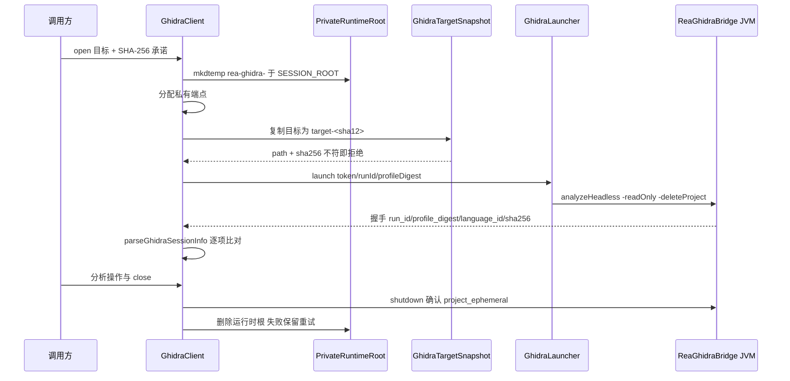
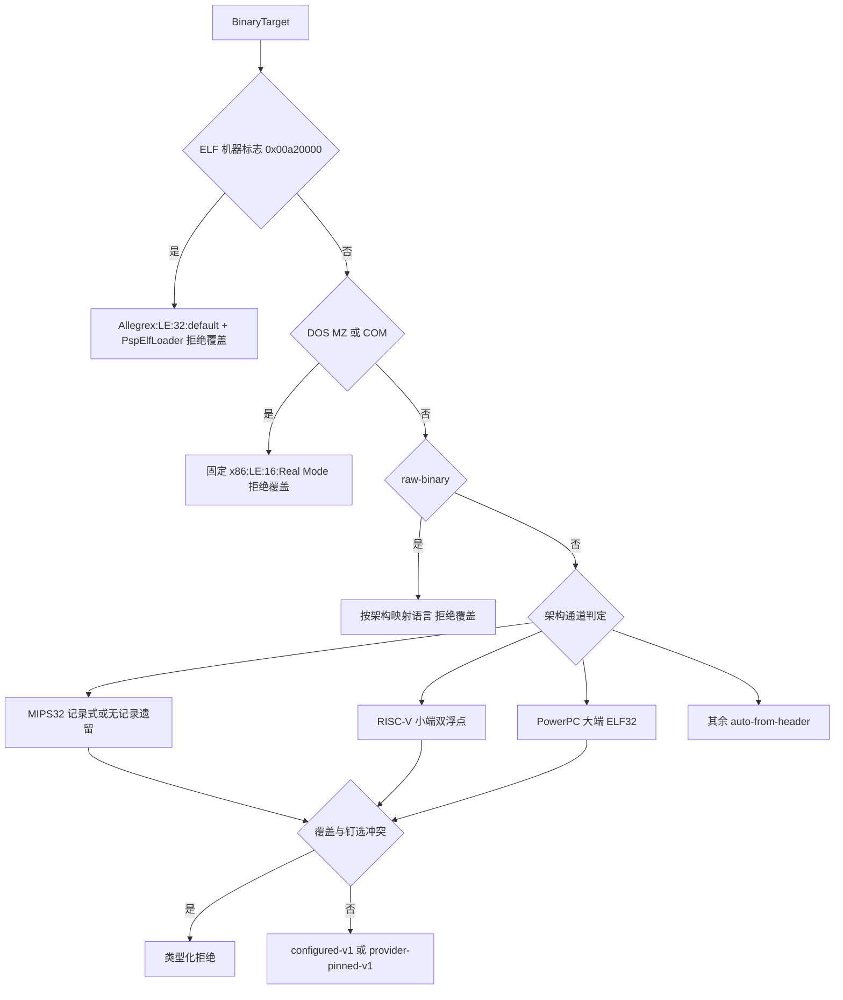

本页面向高级开发者，剖析 REA 如何把 Ghidra 变成一个"分析完即消失"的原生二进制引擎：**临时数据库**如何在私有运行时目录中建立与销毁、**目标快照**如何以字节级承诺贯穿一次会话的完整生命周期，以及 **多架构语义配置**如何把头部识别、语言钉选与调用方覆盖统一进一份可验证的分析画像。Hopper、IDA 等其他引擎的桥接机制不在本页范围内，如需对比请参阅 [Hopper 集成](12-hopper-ji-cheng-python-qiao-unix-tao-jie-zi-xie-yi-yu-mu-biao-zu-yue)。

## 临时数据库模型：一次导入、一份只读 Program

REA 对每个目标执行恰好一次 `analyzeHeadless` 导入，产生唯一一个 Ghidra Program——因此 `list_documents` 恒返回一个名称，整个分析会话都围绕这份**临时数据库**展开。Linux/macOS 上允许只读分析外加原子性的函数名与入口注释编辑；Windows P0 通道则完全只读，GUI 控制与持久化数据库变更均不可用，且可执行文件字节永远不被修改。这一边界声明直接写入提供者契约文档，作为所有 Ghidra 证据的前提。

Sources: [ghidra-provider.md](docs/ghidra-provider.md#L1-L8)

数据库的"临时性"由 headless 调用参数强制保证：`ghidraHeadlessArguments` 以 `<projectRoot> rea-project -import <target>` 开头，并总是追加 `-readOnly` 与 `-deleteProject`——项目建立在私有运行时目录的 `project/` 之下，分析会话结束后由 Ghidra 自身删除项目、再由 REA 递归删除整个运行时目录，形成双重清理。日志坐标（`ghidra.log`、`script.log`）也一并指向运行时根，保证没有文件散落到用户目录。

Sources: [GhidraLauncher.ts](src/ghidra/GhidraLauncher.ts#L750-L810)、[GhidraLauncher.ts](src/ghidra/GhidraLauncher.ts#L868-L879)

在语义层面，这份画像被提交为 `import_mode: "ephemeral-source-immutable"`：证据模型始终声明"导入来自一份源不可变的临时副本"。即便桥在会话内执行了函数名或注释编辑（其作用域被报告为 `session-analysis-database`，`persists_after_close: false`），这些变更也只存在于即将销毁的临时数据库中，不回写原始文件。

Sources: [GhidraAnalysisProfile.ts](src/ghidra/GhidraAnalysisProfile.ts#L210-L231)、[GhidraSnapshotCache.test.ts](src/ghidra/GhidraSnapshotCache.test.ts#L116-L121)

Windows P0 的只读性不止是文档声明：Java 桥对 `set_address_name`、`annotate_native_function` 等变更操作显式检查 `descriptor.transport`，非 `unix-socket` 传输直接返回 `method_unavailable`，把"Windows 不承认数据库变更"固化为协议级拒绝。

Sources: [ReaGhidraBridge.java](bridge/ghidra/ReaGhidraBridge.java#L462-L471)

## 会话根目录：绕开 Ghidra 的点前缀限制

临时项目的落点并非 `os.tmpdir()` 那么简单。Ghidra 用 `NamingUtilities.checkName` 校验项目路径的每一级元素，任何以 `.` 开头的元素都会让 headless 分析器以一条笼统的失败退出——而继承了形如 `~/.cache/<tool>` 的 `TMPDIR` 恰好会踩中这一点。`ghidraSessionRoot` 因此实现了一条三级回退链：优先使用可用的继承基目录；否则回退到平台的无点临时目录（POSIX 为 `/tmp`）；再否则向上回溯到最近一个不含点前缀元素的祖先目录。

Sources: [GhidraSessionRoot.ts](src/ghidra/GhidraSessionRoot.ts#L1-L56)

确定性行为测试钉住了这些角例：内部含点但非前缀的 `rea.run` 被接受、点前缀基目录迁移到 fallback、自身带点的 fallback 被忽略、Windows 无 fallback 时取最近安全祖先乃至文件系统根。这组测试把"路径元素安全性"从隐式约定变成可回归验证的契约。

Sources: [GhidraSessionRoot.test.ts](src/ghidra/GhidraSessionRoot.test.ts#L9-L62)

在会话根之下，`PrivateRuntimeRoot` 用 `mkdtemp(join(SESSION_ROOT, "rea-ghidra-"))` 建立一次性运行时目录：POSIX 上 `mkdtemp` 原子性地建立仅属主可访问的目录，无需事后的权限改写；Windows 上则改用原生 DACL 边界（`WindowsPrivateRuntime`），其可用性由 `windowsNativeCapabilities` 报告——能力不可用时启动直接失败而非降级。`close()` 递归删除目录，且失败不会被缓存：一次失败的删除不会阻止后续 close 重试。

Sources: [PrivateRuntimeRoot.ts](src/process/PrivateRuntimeRoot.ts#L28-L80)、[GhidraClient.ts](src/ghidra/GhidraClient.ts#L105-L108)

## 私有运行时布局与环境隔离

`GhidraClient.#startWithin` 在启动的第一步创建运行时根，随后 `ghidraRuntimePaths` 把一次会话的全部文件坐标都收纳进这棵私有树：

| 路径 | 用途 |
| --- | --- |
| `project/` | Ghidra 临时项目（配合 `-deleteProject`） |
| `home/`、`config/`、`cache/`、`data/`、`tmp/` | Ghidra/JVM 的隔离 home、配置、缓存、数据与临时目录 |
| `session.json` | 桥描述符（token、run_id、profile 摘要） |
| `ownership.json` | 进程所有权记录（PID、进程组/作业对象） |
| `ghidra.log`、`script.log` | headless 与脚本日志 |

Sources: [GhidraLauncher.ts](src/ghidra/GhidraLauncher.ts#L868-L879)

环境隔离是布局的镜像：`ghidraLaunchEnvironment` 把 `HOME`/`TMPDIR` 重定向到 `homeRoot`/`tempRoot`，`XDG_CACHE_HOME`/`XDG_CONFIG_HOME`/`XDG_DATA_HOME` 指向运行时对应子目录；Windows 上再覆盖 `USERPROFILE`、`APPDATA`、`LOCALAPPDATA`、`TEMP`/`TMP`，并因批处理包装器的缘故把 `ComSpec` 统一为反斜杠拼写。JVM 侧则通过 `-Duser.home` 与 `-Djava.io.tmpdir` 双通道钉住相同坐标，确保 Ghidra 的"启动支持"持久化（如 `<config>/ghidra/<release>`）也落在私有树内。

Sources: [GhidraLauncher.ts](src/ghidra/GhidraLauncher.ts#L937-L965)、[GhidraLauncher.ts](src/ghidra/GhidraLauncher.ts#L968-L987)

一个 Windows 特有的坑被记录在 `createGhidraRuntimeDirectories` 中：私有运行时里的子 JVM 无法自行建目录，启动会以 "Failed to create directory" 失败并误报"找不到受支持的 JDK"，因此启动器必须在进程仍拥有运行时时按"父目录先行"的顺序创建全部层级，包括 `config/ghidra/<release>` 发布目录。

Sources: [GhidraLauncher.ts](src/ghidra/GhidraLauncher.ts#L881-L923)

## 目标快照生命周期：从字节承诺到握手绑定

快照是连接"调用方的文件"与"桥里的 Program"的关键枢纽。下面的时序图概括了一次完整会话：

`createGhidraTargetSnapshot` 把源文件复制进运行时根，命名为 `target-<sha256 前 12 位><安全扩展名>`（扩展名必须是 1–12 位字母数字，否则降级为 `.bin`）。POSIX 路径上以 `wx` 独占模式创建 0o600 的目标描述符，边流式复制边计算 SHA-256，结束时同时校验：读覆盖完整、源文件 `stat` 未变、观测摘要等于调用方承诺——三者任一不满足即抛出 `AnalysisArtifactChangedError`，拒绝本次准入。

Sources: [GhidraTargetSnapshot.ts](src/ghidra/GhidraTargetSnapshot.ts#L29-L95)、[GhidraTargetSnapshot.ts](src/ghidra/GhidraTargetSnapshot.ts#L165-L174)

Windows 快照走独立通道：`windowsPrivateRuntime(runtimeRoot).snapshot(...)` 由原生属主完成复制与哈希，摘要不符同样拒绝；部分快照条目由私有运行时属主负责移除，错误分类把 `EACCES/EPERM` 映射为访问拒绝、`ENOENT/ENOTDIR/ELOOP` 映射为目标变更，非普通文件则明确报告"源不再是常规文件"。进程全局测试通过注入 `fs/promises` 故障验证了描述符关闭失败时快照保持"owned"并阻塞后续准入直至清理成功。

Sources: [GhidraTargetSnapshot.ts](src/ghidra/GhidraTargetSnapshot.ts#L50-L127)、[ghidraImportSnapshotLifetime.test.ts](tests/process-global/ghidraImportSnapshotLifetime.test.ts#L1-L79)

快照路径随后被传入 `GhidraLaunchSession`，与 32 字节随机 token、`runId`、`profileDigest` 一起成为启动契约；桥在 `sessionInfo` 中回显 `profile_digest`、`run_id`、目标 `sha256` 以及实际加载的 `language_id`/`compiler_spec_id`，客户端的 `parseGhidraSessionInfo` 对全部字段逐一比对，任何不一致都以"握手身份无效"整体拒绝——这就是"快照身份绑定"的落点：分析结果只能由同一字节、同一画像的会话产出。

Sources: [GhidraLauncher.ts](src/ghidra/GhidraLauncher.ts#L39-L51)、[GhidraClient.ts](src/ghidra/GhidraClient.ts#L864-L885)、[ReaGhidraBridge.java](bridge/ghidra/ReaGhidraBridge.java#L479-L524)、[GhidraSessionValues.ts](src/ghidra/GhidraSessionValues.ts#L147-L186)

会话结束同样分层：close 先以 10 秒超时请求 `shutdown`，桥必须应答 `{shutdown: true, project_ephemeral: true}` 才算确认"项目确属临时"；随后进程 supervisor 等待退出并停止，**清理不完整时刻意保留 supervisor 与私有文件**（活着的 JVM 可能在运行时被删后重建文件），再重试文件资源清理、删除运行时与套接字根。任一根删除失败都会以 `ProviderCleanupError` 保留 `leftover_paths` 留待后续 close 重试，而非虚报成功。

Sources: [GhidraClient.ts](src/ghidra/GhidraClient.ts#L1046-L1125)、[GhidraClient.ts](src/ghidra/GhidraClient.ts#L1131-L1169)、[GhidraSessionValues.ts](src/ghidra/GhidraSessionValues.ts#L188-L195)、[ReaGhidraBridge.java](bridge/ghidra/ReaGhidraBridge.java#L393-L400)

快照生命周期还决定了证据的**重放语义**：概览输出遵循"工作流修订版 3"绑定快照身份，旧序列化证据不会仅因源文件未变就被当作当前概览重放；会话内的清单缓存跟随目标/画像快照生存期，并被会话元数据编辑失效。活动取消会丢弃 Ghidra 的临时注释，下一次请求在同一画像下重新导入原始工件——测试断言了第二次执行不再触达桥。

Sources: [ghidra-provider.md](docs/ghidra-provider.md#L70-L121)、[GhidraSnapshotCache.test.ts](src/ghidra/GhidraSnapshotCache.test.ts#L87-L89)、[GhidraSnapshotCache.test.ts](src/ghidra/GhidraSnapshotCache.test.ts#L165-L198)

## 多架构语义配置：从目标识别到已提交的分析画像

所有分析语义（导入模式、语言、分析器开关、no-return 修复策略……）在 Ghidra 导入**之前**被解析为一份 `AnalysisProfileCommitment`：参数经 RFC 8785 规范化 JSON 序列化后计算 SHA-256 得到 `digest`，schema 在加载时校验摘要与参数一致。这份摘要就是握手绑定的 `profile_digest`——同一摘要意味着同一套已提交语义。

Sources: [analysisProfile.ts](src/domain/analysisProfile.ts#L16-L56)

`resolveGhidraAnalysisProfile` 是多架构配置的装配点。它先做门禁检查（取消信号、目标类型、安装可用性、处理器不支持的类型化原因），随后拒绝不可组合的配置：PSP 目标不接受 `REA_GHIDRA_LANGUAGE_ID` 覆盖，raw-binary 与 DOS 导入同样拒绝调用方覆盖。与已钉语言冲突的覆盖（例如对 RISC-V 请求非通用语言）返回类型化的 `AnalysisUnsupportedTargetError`，而不是悄悄改写请求。

Sources: [GhidraAnalysisProfile.ts](src/ghidra/GhidraAnalysisProfile.ts#L45-L123)、[GhidraAnalysisProfile.ts](src/ghidra/GhidraAnalysisProfile.ts#L141-L155)

语言选择遵循一条明确的优先级链：

各通道的准入边界与钉选结果汇总如下：

| 通道 | 准入要点 | 钉选语言 | 关键拒绝原因 |
| --- | --- | --- | --- |
| MIPS32 | ELF32、o32/32R2 或"无记录遗留"固件头 | `MIPS:<LE\|BE>:32:default` | MIPS64/n32、ASE 编码、FP64/NAN2008、机器专属变体 |
| RISC-V | 小端 ELF32/64、ET_EXEC、双浮点 ABI | `RISCV:LE:<32\|64>:default` + `gcc` | RVE/TSO/软或单/四浮点、未知 `e_flags` 位 |
| PowerPC | 大端 ELF32 ET_EXEC | `PowerPC:BE:32:default` | PPC64、小端、`EF_PPC_EMB` 嵌入式变体 |
| PSP Allegrex | LE ELF32 ET_EXEC 且 `e_flags=0x10a23001`、已检查 ABI 记录 | `Allegrex:LE:32:default` + `PspElfLoader` | PRX/共享镜像、任何其他旗标组合、语言覆盖 |

Sources: [GhidraMipsProfile.ts](src/ghidra/GhidraMipsProfile.ts#L18-L59)、[GhidraMipsProfile.ts](src/ghidra/GhidraMipsProfile.ts#L83-L200)、[GhidraRiscvProfile.ts](src/ghidra/GhidraRiscvProfile.ts#L44-L88)、[GhidraPowerPcProfile.ts](src/ghidra/GhidraPowerPcProfile.ts#L4-L41)、[GhidraPspProfile.ts](src/ghidra/GhidraPspProfile.ts#L11-L60)

钉选的动机各不相同且都有实证：MIPS 的"无记录遗留"通道针对头文件不含 ABI 声明的旧固件——Ghidra 的头部自动选择恰好会为这些文件挑一个 64 位语言，因此必须钉 32 位语言并以 `provider-pinned-v1` 记录；RISC-V 通道注释指出 Ghidra 12.1.4 会为普通 RV32 ELF 选中 `RISCV:LE:32:AndeStar_v5`；PowerPC 则因 ELF 装载器对普通 `EM_PPC` 头选择 e500 变体而钉通用大端语言。这些都以 `*_support_lane` 与 `*_elf` 参数写入画像，把"源 ELF 的解释"与"目标 ISA 语义"区分开。

Sources: [GhidraMipsProfile.ts](src/ghidra/GhidraMipsProfile.ts#L32-L59)、[GhidraRiscvProfile.ts](src/ghidra/GhidraRiscvProfile.ts#L27-L42)、[GhidraRiscvProfile.ts](src/ghidra/GhidraRiscvProfile.ts#L107-L115)、[GhidraPowerPcProfile.ts](src/ghidra/GhidraPowerPcProfile.ts#L4-L15)

调用方覆盖本身受 schema 约束：语言 ID 必须形如 `processor:LE|BE:size:variant` 的四段式（变体可含空格，如 `x86:LE:16:Real Mode`），编译器规约 ID 只允许受限字符集。画像提供 `ghidraProfileLanguageOverride` 与 `ghidraProfileDisabledAnalyzers` 两个读回函数，使"已提交画像"与"当前配置"之间的等价性可以程序化比较（`sameGhidraLanguageOverride`、`sameGhidraDisabledAnalyzers`）。

Sources: [ghidraLanguageOverride.ts](src/config/ghidraLanguageOverride.ts#L1-L29)、[GhidraAnalysisProfile.ts](src/ghidra/GhidraAnalysisProfile.ts#L341-L377)

## 种子文件、禁用分析器与脚本编排

两类会话前的语义输入同样进入画像承诺。**种子文件**（`REA_GHIDRA_SEED_FILE`，必须绝对路径）解析 `address<TAB>kind[<TAB>name]` 行，支持 `function`/`code`/`label` 三种种子，上限 100 万条、32 MiB；解析结果规范化为规范 TSV 并以 SHA-256 提交进画像。启动时 `snapshotGhidraAnalysisSeeds` 重新 `realpath` 并复读种子文件，摘要与承诺不符即失败——保证脚本应用的就是画像承诺的那份字节；桥握手再回报 `analysis_seeds`（应用计数），`ghidraSeedFailure` 比对承诺与回报，会话"多播或少播种子"都以适配器错误关闭。种子事实在证据中以限制条目标注为"调用方断言，非 Ghidra 发现"。

Sources: [GhidraAnalysisSeeds.ts](src/ghidra/GhidraAnalysisSeeds.ts#L13-L36)、[GhidraAnalysisSeeds.ts](src/ghidra/GhidraAnalysisSeeds.ts#L204-L258)、[GhidraAnalysisSeeds.ts](src/ghidra/GhidraAnalysisSeeds.ts#L260-L284)、[environment.ts](src/config/environment.ts#L64)

**禁用分析器**（`REA_GHIDRA_DISABLED_ANALYZERS`）最多 32 个名称、每个不超 120 字符，字符模式刻意排除了前导 `-` 与逗号——前者会被 headless 解析器当作自有选项，后者是 REA 拼接单参数的分隔符。这些名称经 `-preScript ReaGhidraAnalysisOptions` 在默认自动分析之前生效，并作为 `analyzer_preset: "ghidra-default+disabled:<names>"` 与 `analysis_options.disabled_analyzers` 写入画像。

Sources: [ghidraDisabledAnalyzers.ts](src/config/ghidraDisabledAnalyzers.ts#L1-L43)、[GhidraAnalysisProfile.ts](src/ghidra/GhidraAnalysisProfile.ts#L85-L91)

pre/post 脚本的顺序即语义依赖的顺序，全部由打包源清单按运行时角色选择而非顺序索引：

| 时机 | 脚本 | 作用 |
| --- | --- | --- |
| 预分析 | `ReaGhidraPrepareCom` / `ReaGhidraPrepareRaw` | DOS COM 或 raw-binary 的装载器准备 |
| 预分析 | `ReaGhidraApplySeeds` | 在自动分析前应用种子 |
| 预分析 | `ReaGhidraAnalysisOptions` | 在自动分析前禁用指定分析器 |
| 后分析 | `ReaGhidraNoReturnFix`（非 Windows） | 修复已知返回型外部导入的 no-return 旗标 |
| 后分析 | `ReaGhidraMipsSoftFloat`（按需） | MIPS 软浮点存储建模 |
| 服务前 | `ReaGhidraBridge.java` | 启动桥接服务 |

Sources: [GhidraLauncher.ts](src/ghidra/GhidraLauncher.ts#L812-L864)、[GhidraBridgeSources.ts](src/ghidra/GhidraBridgeSources.ts#L2-L13)

画像还把两条平台相关策略编码为版本化承诺：`no_return_repair` 在 Windows P0 上是 `disabled-windows-p0`、其他平台为 `returning-imports-decoded-return-v2`；`process_launch` 区分 Windows 的官方 headless 脚本路径与 POSIX 的受检 JVM 直启（后者避免脚本包装器把含空格的 JVM 属性路径拆散）。这些字段保证旧快照不会在语义升级后被静默重放。

Sources: [GhidraAnalysisProfile.ts](src/ghidra/GhidraAnalysisProfile.ts#L253-L262)、[GhidraLauncher.ts](src/ghidra/GhidraLauncher.ts#L449-L464)

## 验证闭环与阅读路径

以上机制都有对应的验证通道：`src/ghidra/*Profile.test.ts` 系列钉住各架构通道的准入与钉选矩阵；`tests/process-global/ghidraImportSnapshotLifetime.test.ts` 以故障注入验证快照描述符的生命周期；`scripts/lib/real-ghidra-snapshot-lifecycle.mjs` 在真实 Ghidra 上端到端检验快照行为；握手回显则被 `GhidraSessionValues` 的严格 schema 与等值断言覆盖。三层通道与真实工具链验证的整体策略在 [测试策略与验证通道](27-ce-shi-ce-lue-yu-yan-zheng-tong-dao-yuan-ma-bian-jie-yan-shou-zhi-yi-zhi-xing-ji-zhen-shi-gong-ju-lian-tong-dao) 中展开。

Sources: [ghidraImportSnapshotLifetime.test.ts](tests/process-global/ghidraImportSnapshotLifetime.test.ts#L1-L79)、[GhidraSessionValues.ts](src/ghidra/GhidraSessionValues.ts#L108-L186)

建议的后续阅读：先回到 [分层架构总览](5-fen-ceng-jia-gou-zong-lan-ru-kou-zu-he-ying-yong-ti-gong-zhe-yu-ling-yu-ceng-de-yi-lai-gui-ze) 理解 GhidraProvider 在提供者层的位置，再以 [证据与不确定性模型](6-zheng-ju-yu-bu-que-ding-xing-mo-xing-guan-cha-tui-dao-tui-duan-yu-wei-zhi-de-bao-liu-yu-yi) 对照本页的限制条目语义；工作流侧的使用入口在 [原生二进制调查工作流](10-yuan-sheng-er-jin-zhi-diao-cha-gong-zuo-liu-han-shu-dang-an-yin-yong-yu-go-rust-yuan-shu-ju-chi-xian-bu-ju-zhen-duan)；若关注运行时根与清理重试的跨提供者共性，请续读 [进程所有权与生命周期监督](25-jin-cheng-suo-you-quan-yu-sheng-ming-zhou-qi-jian-du-si-you-yun-xing-shi-jie-zhi-shi-jian-yu-qing-li-zhong-shi)；MIPS/RISC-V/PPC/PSP 各通道的完整准入文档分别见仓库内 `docs/ghidra-mips.md`、`docs/ghidra-riscv.md`、`docs/ghidra-ppc.md` 与 `docs/ghidra-psp.md`。