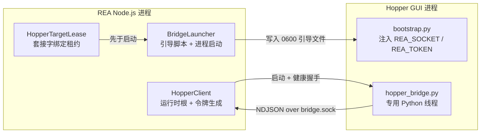
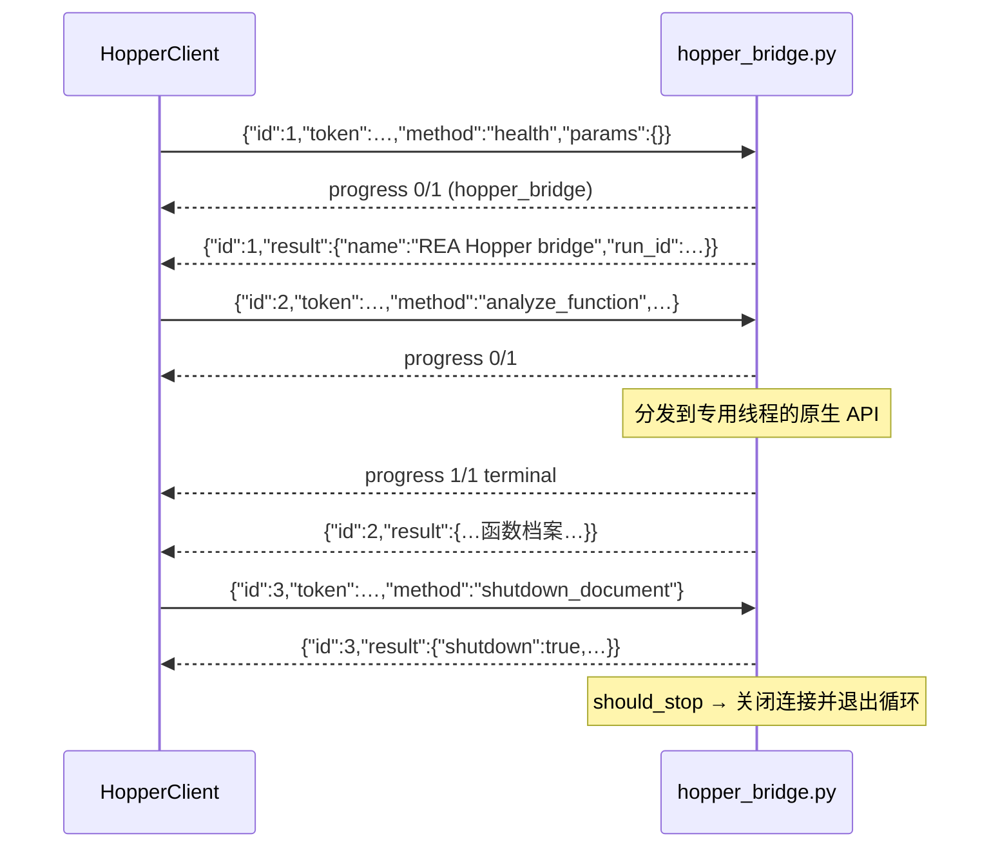
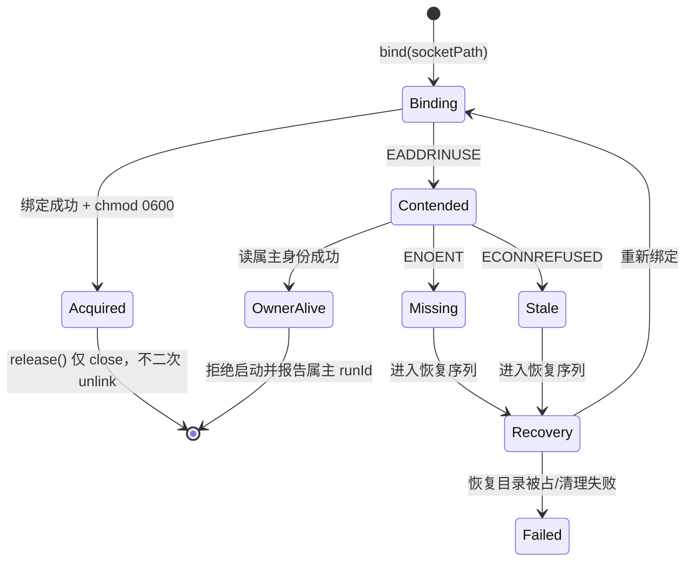

REA 对 Hopper 反汇编器的集成建立在三个相互支撑的机制之上：一个运行在 Hopper 内嵌 Python 解释器中的认证桥脚本、一条基于 Unix 域套接字的 NDJSON 请求/响应协议，以及一个防止多个 REA 会话并发操作同一 Hopper 文档的进程级目标租约。本文面向需要理解或扩展该集成的开发者，逐一剖析这三个支柱的实现边界、安全模型与生命周期语义。所有内容均直接源自仓库源码，不做任何推测性描述。

## 三支柱架构总览

Hopper 没有官方的进程外 API——它的全部分析能力只暴露给内嵌的 Python 解释器。REA 的应对方式是：通过 Hopper 支持的 `--python` 命令行入口注入一个由 REA 完全掌控的桥脚本，让 Hopper 进程自己充当服务器；TypeScript 侧的 `HopperClient` 随后通过一条私有的、能力认证的 Unix 套接字与之通信。目标租约则在更早的阶段介入——在 Hopper 应用被拉起之前，就确保同一目标二进制（或数据库）不会被两个 REA 会话同时打开，因为 Hopper 在部分平台上会把新启动转发给已存在的实例。

TypeScript 客户端不为 Hopper GUI 进程声明所有权——在 macOS 上它只拥有短生命周期的 `hopper` 启动器辅助进程的进程组，Hopper 应用本身可能被 macOS LaunchServices 创建或复用，其生命周期由 `bridge-request` 关闭模式通过协议握手来约束。

Sources: [BridgeLauncher.ts](src/hopper/BridgeLauncher.ts#L131-L144), [HopperClient.ts](src/hopper/HopperClient.ts#L108-L115)

## Python 桥：线程约束与会话文档绑定

桥脚本的第一行文档就指出了它最刚性的运行约束：引导程序在执行 `hopper_bridge.py` 之前注入 `REA_SOCKET` 与随机 `REA_TOKEN`，而**所有 Hopper API 调用必须留在 Hopper 的专用 Python 执行线程上**——把分发逻辑移到工作线程会导致 Hopper 死锁。这解释了桥的服务器循环为何是单线程、单客户端的串行设计：文件尾部的注释再次强调，Hopper 的公开对象绑定在专用线程上，`__main__` 入口先绑定会话文档再进入服务器循环。

桥通过 `_bind_session_document` 把自己绑定到启动它的那个具体文档：它将注入的 `REA_TARGET_PATH` 规范化为真实路径，优先检查 Hopper 的当前文档，否则在全部打开文档中按可执行文件路径或数据库路径匹配；命中多于一个文档时直接判定歧义并拒绝服务，避免把操作施加到错误的目标上。一旦绑定，`_session_document` 会**保留首次绑定的包装对象**——注释指出 Hopper 会重建 Python 包装器，相等性比较的是原生句柄，保留原包装可以让缓存身份在多次调用间保持稳定。当绑定的文档被用户手动关闭后，`_document` 守卫会拒绝后续请求并提示调用者重新执行 `open_binary`。

Sources: [hopper_bridge.py](bridge/hopper_bridge.py#L1-L6), [hopper_bridge.py](bridge/hopper_bridge.py#L87-L126), [hopper_bridge.py](bridge/hopper_bridge.py#L178-L192), [hopper_bridge.py](bridge/hopper_bridge.py#L1167-L1172)

## Python 桥：能力模型与操作面

桥只分发一个**封闭的操作集合**：`health`、`shutdown`/`shutdown_document`、文档枚举、以及 `EXHAUSTIVE_ANALYSIS_METHODS` 冻结集所列的十五种穷举分析方法（`analyze_function`、各类列表与搜索、过程导航与引用查询等），加上注释、书签、字节读取、地址到文件偏移映射等注记与检查操作。穷举方法在分发前统一调用 `require_analysis_complete`——若 Hopper 的后台分析仍在进行，抛出 `CapabilityUnavailableError` 而不是返回不完整的数据。

错误被建模为三种 Python 异常类型，各自映射到协议中的一个诊断类型：`CapabilityUnavailableError`（当前 Hopper 构建缺少某个已准入的公开 API 操作）、`InvalidRequestError`（调用方输入未通过校验）、`PermissionError`（认证失败）。这个分类直接决定了客户端如何投影错误——`capability_unavailable` 会被 `HopperClient` 转换为领域层的 `AnalysisCapabilityUnavailableError`。

`analyze_function` 是最重的复合操作，一次返回完整的函数档案：基本块 CFG（含后继地址）、汇编行、调用者/被调用者、出入引用边（合并原生 `CallReference` 与段级引用）、被引用字符串与名称、注释、局部变量以及伪代码。桥的**证据诚实性**在此集中体现：伪代码缺失、引用标志不可得等事实通过 `_unavailable(reason)` 显式声明（`{"available": false, "reason": ...}`），返回体还附带一个 `limitations` 列表，逐条说明公开 Python API 无法真实提供的部分，例如"Hopper 的公开 Python API 不暴露完整的函数体范围"、"没有解析目标地址的原生调用不表示为边；超出已报告 CallReference 对象的枚举是未知的"。

Sources: [hopper_bridge.py](bridge/hopper_bridge.py#L129-L155), [hopper_bridge.py](bridge/hopper_bridge.py#L560-L562), [hopper_bridge.py](bridge/hopper_bridge.py#L620-L723), [hopper_bridge.py](bridge/hopper_bridge.py#L726-L771), [HopperClient.ts](src/hopper/HopperClient.ts#L608-L630)

## Python 桥：缓存失效与批量写入语义

针对搜索与伪代码这两类高成本派生数据，桥维护两级缓存：`_search_inventory_cache` 保存按地址排序的过程/字符串/名称清单，`_pseudocode_cache` 保存每次 `procedure.decompile()` 的结果，键均为 `(id(document), 标识)`。任何注记性变更（改名、写注释）都会在 `finally` 块中失效相应缓存——即使 Hopper 原生调用抛错，也不让陈旧缓存跨变异存活。

批量改名 `set_addresses_names` 展示了**先全量验证、后统一提交**的写入纪律：先解析全部目标地址并校验符号名（含 UTF-16 码元上限 1024，对应原生标签设置器的截断行为），再逐个执行 `setNameAtAddress`；`_validate_name_targets` 拒绝同一地址被选择两次、同一名称被分配两次、以及名称已被批外地址占用的情形。每个名称写入后还用 `_name_matches` 回读验证，把"Hopper 报告成功"升级为"变更已被观察"。注释写入同样遵循回读验证模式，并且对空字符串与 `None` 的表示差异做了显式调和。

Sources: [hopper_bridge.py](bridge/hopper_bridge.py#L488-L509), [hopper_bridge.py](bridge/hopper_bridge.py#L208-L231), [hopper_bridge.py](bridge/hopper_bridge.py#L965-L995), [hopper_bridge.py](bridge/hopper_bridge.py#L15-L16)

## Unix 套接字协议：引导注入与凭证分发

TypeScript 侧的凭证分发采用**引导文件**而非环境变量：`BridgeLauncher` 在会话的私有运行时目录中写入 `bootstrap.py`（权限 `0600`），内容是一组扁平的 Python 全局赋值——`REA_SOCKET`（套接字路径）、`REA_TOKEN`（32 字节十六进制随机令牌）、`REA_RUN_ID`（本次启动的唯一运行标识）、`REA_TARGET_PATH`、`REA_OWNS_PROCESS_LIFETIME`（区分 Linux 拥有进程生命周期的演示构建与 macOS 外部 GUI 模式）和 `REA_RECONNECT_TIMEOUT_SECONDS`（由 `HOPPER_SHUTDOWN_TIMEOUT_MS` 即 30 秒换算而来）——随后以 `exec(compile(...))` 执行真正的桥脚本。引导文件的删除纪律非常严格：所有非成功路径（错误返回、早期取消、抛出的异常）都会移除这个含令牌的文件，只有已启动的进程需要它。

Hopper 随后以 `--analysis -Y bootstrap.py --executable|--database <target>` 的参数序列启动：`-Y` 指向引导脚本，`--analysis` 使后台分析自动开始。套接字路径位于 `PrivateRuntimeRoot` 创建的私有运行时目录下的 `bridge.sock`，整个目录树在会话关闭时被移除。

Sources: [BridgeLauncher.ts](src/hopper/BridgeLauncher.ts#L393-L417), [BridgeLauncher.ts](src/hopper/BridgeLauncher.ts#L451-L466), [BridgeLauncher.ts](src/hopper/BridgeLauncher.ts#L240-L249), [BridgeLauncher.ts](src/hopper/BridgeLauncher.ts#L344-L349), [HopperClient.ts](src/hopper/HopperClient.ts#L406-L426), [HopperSessionValues.ts](src/hopper/HopperSessionValues.ts#L5-L6)

## Unix 套接字协议：NDJSON 契约与认证

协议是严格对称的 NDJSON：请求形如 `{"id", "token", "method", "params"}`（四个键缺一不可），响应是 `{"id", "result"}` 或 `{"id", "error"}` 二选一，事件是 `{"id", "event": {type: "progress" | "diagnostic", ...}}`。TypeScript 侧用 zod 的 `.strict()` 模式解析每一行——未知字段直接判为协议违约；progress 事件还带一条 `superRefine` 校验：`total` 非 null 时 `completed` 不得超过 `total`。

认证采用**能力令牌**模型：桥对每个请求用 `hmac.compare_digest` 比对请求携带的 token 与注入的 `REA_TOKEN`，不匹配则返回 `authorization` 类型错误且不泄露原因细节（`_safe_diagnostic` 对授权失败固定返回 "Invalid bridge capability"，防止逐字节猜测；对未知桥异常只暴露异常类型名，排除传输层凭据）。认证失败不推进连接状态——连接的宽限期计时只约束**未认证**的空闲客户端；一旦令牌验证通过，`connection.settimeout(None)` 解除超时，注释明确说明原生分析与已连接属主的空闲时间不受此上限约束。

事件流是协议的进度通道：桥在每次分发前后各写一条 `hopper_bridge` 阶段的 progress 事件（completed 0/1 与 1/1，后者标记 `terminal: true`），认证后的异常则以 `diagnostic` 事件先行报告，再跟随错误响应。客户端据此向调用方转发进度并维持心跳活性。

Sources: [protocol.ts](src/hopper/protocol.ts#L11-L107), [hopper_bridge.py](bridge/hopper_bridge.py#L1029-L1076), [hopper_bridge.py](bridge/hopper_bridge.py#L1113-L1134), [hopper_bridge.py](bridge/hopper_bridge.py#L1050-L1053)

## Unix 套接字协议：客户端流水线与服务器循环

服务器端是一个**单客户端、可重连**的接受循环：桥绑定 AF_UNIX 套接字后 `chmod 0600`，`listen(1)`，并将 `accept` 与每个连接的初始读取都限制在 `REA_RECONNECT_TIMEOUT_SECONDS` 内——注释解释这是为了防止一个孤儿桥把 Hopper 的专用 Python 线程钉死，阻碍后续文档启动 REA。`_serve_connection` 在认证通过、shutdown 确认（三个确认字段齐全）时返回 `True` 使循环终止；客户端断开（`ConnectionError`/`OSError`）则静默退出本次服务，回到接受状态等待重连，套接字文件在 `finally` 中清理。

客户端侧由三个协作组件构成完整流水线：

| 组件 | 职责 | 关键语义 |
| --- | --- | --- |
| `HopperRequestQueue` | FIFO 序列化在线请求 | 调用方超时/取消只结算调用方 Promise，**活跃的在线请求继续等待 Hopper 回复**；deadline 从准入时刻起包含排队时间；`timeoutMs: 0` 直接返回 `not_started` |
| `HopperResponseStream` | 增量 NDJSON 帧校验 | 跨 TCP 分片缓冲至换行符；畸形 JSON 或未知响应 id 触发 `abort` 中止整个协议会话 |
| `HopperSocketConnection` | 中止感知的连接尝试 | `AbortSignal` 可在 `connect` 完成前销毁套接字，返回 `HopperCancelledError` |

启动序列在 `#startWithin` 中环环相扣：创建私有运行时根 → 生成套接字路径与令牌 → 调用 `launcher.launch`（此时目标租约已在启动器内部被获取）→ 落盘 `ownership.json`（记录 run_id、领导 PID、进程组、启动器命令）→ 连接套接字 → 在剩余启动预算内发送 `health` 请求 → 用 `parseHopperServerInfo` 验证响应中的 `name` 必须是 `"REA Hopper bridge"`、`run_id` 必须与本次运行的标识**逐字节匹配**。对 macOS 外部应用模式，还会观察桥报告的 `process_id` 并绑定进程身份，若同一次运行中桥进程发生变化则判定协议违约。

Sources: [hopper_bridge.py](bridge/hopper_bridge.py#L1137-L1164), [HopperRequestQueue.ts](src/hopper/HopperRequestQueue.ts#L65-L183), [HopperResponseStream.ts](src/hopper/HopperResponseStream.ts#L20-L54), [HopperSocketConnection.ts](src/hopper/HopperSocketConnection.ts#L9-L39), [HopperClient.ts](src/hopper/HopperClient.ts#L406-L506), [HopperSessionValues.ts](src/hopper/HopperSessionValues.ts#L15-L37)

## 目标租约：身份规范化与套接字绑定语义

目标租约的本质是把"谁能打开这个 Hopper 文档"的互斥仲裁交给文件系统：每个租约是一个绑定在 `/tmp/rea-hopper-<uid>` 私有目录下的 Unix 套接字文件，租约的寿命**恰好等于属主进程的寿命**——`server.unref()` 使租约服务器不阻止进程退出，注释说明这是刻意设计：未确认清理后残留的租约不能让已完成的一次性命令保持存活；进程退出留下的陈旧套接字由后来的获取者恢复。

租约身份由三元组构成：目标路径、目标类型与加载器参数。**路径规范化是身份正确性的前提**——`acquireHopperTargetLease` 先对目标路径执行 `realpath`，注释警示词法回退会让两个别名各自保留独立套接字却指向同一 Hopper 文档。身份 JSON 经 SHA-256 哈希截取前 32 个十六进制字符构成套接字文件名，获取即绑定：`bind` 成功（`EADDRINUSE` 表示已被占用）后立即 `chmod 0600`，任何连接者都会收到属主回显的 `{"runId", "processId"}` JSON。失败路径返回属主身份，使启动器能构造指出具体持有会话的错误消息（例如 Linux 演示构建的"已在 REA 会话 X 中激活"提示）。

除目标租约外还有两个变体：`acquireLinuxHopperApplicationLease` 以应用名 `linux-hopper-demo` 为身份，串行化整个单例应用；`acquireHopperReleaseCacheLease` 以缓存目录与启动器 SHA-256 为身份，串行化对单个已签名包条目的发布与修复。

Sources: [HopperLease.ts](src/process/HopperLease.ts#L29-L33), [HopperLease.ts](src/process/HopperLease.ts#L36-L62), [HopperLease.ts](src/process/HopperLease.ts#L148-L183), [HopperLease.ts](src/process/HopperLease.ts#L251-L269), [HopperLease.ts](src/process/HopperLease.ts#L271-L334), [HopperLease.ts](src/process/HopperLease.ts#L64-L84), [BridgeLauncher.ts](src/hopper/BridgeLauncher.ts#L373-L382)

## 目标租约：陈旧恢复与目录加固

陈旧租约的恢复被**恢复目录预留**串行化：恢复者先 `mkdir` 一个 `socketPath.recovery` 目录（`0700`，`EEXIST` 视为其他恢复者正在工作并直接失败），然后在恢复保护下重试绑定——注释解释若两方同时 `unlink` 套接字，可能移除其中一方刚刚获取的套接字。恢复序列为：重试绑定 → 若仍报 stale 则移除陈旧套接字后再试 → 成功则返回租约，最终失败则抛出"关闭竞争的 REA 会话后重试"的启动错误。`finally` 中移除恢复目录，若移除失败且已获取新租约，则先释放租约再报错，不留下半释放状态。

租约目录本身的防御达到描述符级别：`ensureLeaseDirectory` 以 `O_DIRECTORY|O_NOFOLLOW` 打开目录，在同一描述符上验证类型（非符号链接、确为目录）、属主 UID 与权限位（`0700` 以外的位被就地 `chmod` 修复并**在同一描述符上复验**），注释明确指出这消除了"检查与修复之间目录被调换"的第二个 TOCTOU 窗口，同时坦承后续的套接字操作仍走路径、不因目录校验而具备原子性。`hopperLeaseDescriptorPermissions.test.ts` 用模块打补丁的方式验证了这一语义：在 `open` 返回的瞬间将目录路径换成一个权限宽松的替代目录，断言只有最初被准入的描述符被加固，替换目录不受影响。测试注释还记录了一个平台约束：macOS 将 Unix 套接字路径限制在 104 字节，因此租约目录路径必须保持足够短。

Sources: [HopperLease.ts](src/process/HopperLease.ts#L86-L146), [HopperLease.ts](src/process/HopperLease.ts#L185-L249), [hopperLeaseDescriptorPermissions.test.ts](tests/process-global/hopperLeaseDescriptorPermissions.test.ts#L43-L60)

## 启动器集成：租约转移与进程生命周期双模式

`HopperApplicationLauncher.launch` 把租约获取放在最前面：macOS 原生模式获取目标租约，Linux 演示模式获取应用租约，其他平台组合不获取。租约随启动结果转移——`leaseTransferred` 仅在启动成功时置位，失败的启动路径在 `finally` 中立即释放租约；成功后租约的 `release` 被挂到 `BridgeLaunch.releaseLease` 能力上，由更上层的会话所有者在验证文档与进程清理完成后调用。这形成了一条明确的所有权链：**租约 → 进程组 → 文档 → 套接字**，每一环的释放都必须验证前一环已经终结。

`BridgeLaunch` 类型用可辨识联合编码了两种关闭模式：macOS 外部应用模式为 `shutdownMode: "bridge-request"`（依赖协议握手关停文档，`providerLifetime: "external-application"`），Linux 演示模式为 `shutdownMode: "process-cleanup"`（REA 拥有进程组，直接进程清理）。macOS 路径还体现了对上游缺陷的防御性建模：厂商启动辅助程序会把参数插入 AppleScript 字面量而不转义，因此只有当启动器路径与全部参数都不含 `" \` \r \n` 字符时，才允许保留 `authorizationDenialBeforeHandoff` 这一"交接前即可断定拒绝"的结论。类文档同时诚实地记录了无法抑制的行为：`hopper` 辅助程序内部调用 AppleScript `activate`，目标可能被带到前台——这是上游约束，不是分析失败的证据。

Sources: [BridgeLauncher.ts](src/hopper/BridgeLauncher.ts#L177-L223), [BridgeLauncher.ts](src/hopper/BridgeLauncher.ts#L54-L76), [BridgeLauncher.ts](src/hopper/BridgeLauncher.ts#L316-L340), [BridgeLauncher.ts](src/hopper/BridgeLauncher.ts#L131-L144)

## 关闭交接：shutdown 语义与清理握手

关闭是协议里语义最密集的方法。桥端的 `shutdown`/`shutdown_document` 按进程所有权与调用方法产生三种确认形态：

| 场景 | 返回形态 | 含义 |
| --- | --- | --- |
| 文档已不存在 | `shutdown + analysis_stopped + document_closed` 全真 | 无需操作，连接终止 |
| macOS `shutdown`（不拥有进程） | `shutdown + document_retained` | 停止后台分析但**保留文档**，GUI 归用户所有 |
| Linux `shutdown`（拥有进程） | `shutdown + cleanup_required` | 桥保持存活，需要属主做进程组清理 |
| `shutdown_document` | `shutdown + analysis_stopped + document_closed` | 请求后台停止、等待结束、关闭文档 |

客户端的 `isHopperShutdownAcknowledgement` 逐字段验证这些确认；`should_stop` 仅在确认形态完整时终止桥的服务循环——注释解释这是因为"丢失的客户端无法确认文档关闭或吊销本次运行"，任何传输层异常都不应让桥基于不可靠信号自行关停。

`cleanupHopperSession` 将整个交接编排为阶段化流程：先确认外部应用退出，再请求 shutdown，随后在确认已 shutdown 的外部应用模式下释放传输层，接着停止进程组、再次确认外部应用退出（防止迟到的认证应用恰好在 shutdown 进行中退出）、记录未确认的文档资源，最后移除私有运行时文件——任何未验证的清理都会使对应资源进入 `issues` 与 `resources` 集合并随错误传播，保证调用者知晓哪些清理只完成了尽力而为。清理路径还有一条独立的重连通道：若传输层已丢失但 shutdown 尚未确认，`#reconnectForCleanup` 会在 `HOPPER_SHUTDOWN_TIMEOUT_MS` 预算内对 `bridge.sock` 反复重试（仅对 `ENOENT`/`ECONNREFUSED` 重试），用同一令牌重新认证本次运行后再执行握手。

Sources: [hopper_bridge.py](bridge/hopper_bridge.py#L735-L764), [hopper_bridge.py](bridge/hopper_bridge.py#L1060-L1096), [HopperSessionValues.ts](src/hopper/HopperSessionValues.ts#L39-L56), [HopperCleanup.ts](src/hopper/HopperCleanup.ts#L71-L120), [HopperClient.ts](src/hopper/HopperClient.ts#L644-L700)

## 设计不变量小结

三个支柱共享一组贯穿性的设计不变量，值得在扩展该集成时作为验收基准：

| 不变量 | 体现位置 |
| --- | --- |
| 能力最小化 | 桥只暴露封闭方法集；未认证请求不推进任何状态；引导文件 0600 且失败即删 |
| 证据诚实性 | 不可得的能力以 `_unavailable` 显式声明而非静默省略；`limitations` 随档案返回 |
| 写入可验证 | 名称/注释写入后回读比对；批量操作先全量验证再提交 |
| 所有权链完整 | 租约 → 进程组 → 文档 → 套接字逐环验证释放；未验证的清理随错误传播 |
| 竞争安全 | 租约恢复经目录预留串行化；目录加固在同一描述符上完成并复验 |
| 线程与串行纪律 | Hopper API 只在专用 Python 线程调用；在线请求严格 FIFO；单客户端服务器循环 |

Sources: [hopper_bridge.py](bridge/hopper_bridge.py#L1017-L1134), [HopperLease.ts](src/process/HopperLease.ts#L86-L129), [HopperCleanup.ts](src/hopper/HopperCleanup.ts#L43-L55)

要继续深入相邻机制，可阅读 [Ghidra 集成：临时数据库、快照生命周期与多架构语义配置](11-ghidra-ji-cheng-lin-shi-shu-ju-ku-kuai-zhao-sheng-ming-zhou-qi-yu-duo-jia-gou-yu-yi-pei-zhi) 了解另一条基于 Java 扩展的集成路径，或参考 [进程所有权与生命周期监督：私有运行时、截止时间与清理重试](25-jin-cheng-suo-you-quan-yu-sheng-ming-zhou-qi-jian-du-si-you-yun-xing-shi-jie-zhi-shi-jian-yu-qing-li-zhong-shi) 中对私有运行时根与截止时间模型的完整论述；Hopper 提供者对外暴露的工具契约细节则属于 [MCP 契约参考：工具结果、保留证据、会话发现与取消恢复](8-mcp-qi-yue-can-kao-gong-ju-jie-guo-bao-liu-zheng-ju-hui-hua-fa-xian-yu-qu-xiao-hui-fu) 的范畴。