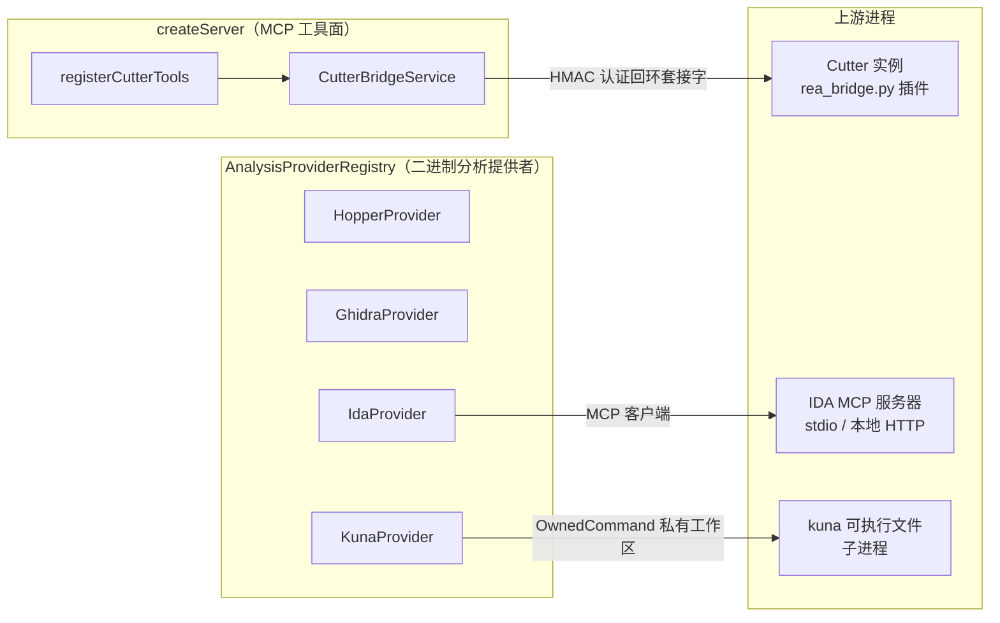
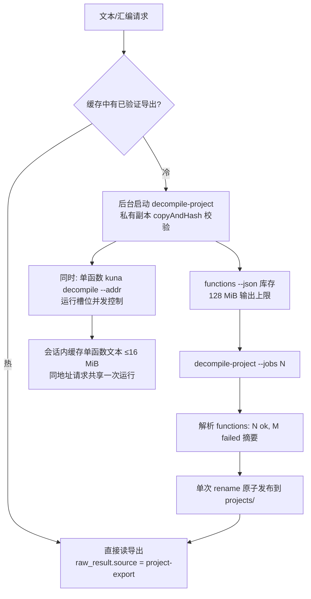

REA 的原生二进制分析后端中，Ghidra 与 Hopper 是完全托管的引擎（见 [Ghidra 集成](11-ghidra-ji-cheng-lin-shi-shu-ju-ku-kuai-zhao-sheng-ming-zhou-qi-yu-duo-jia-gou-yu-yi-pei-zhi) 与 [Hopper 集成](12-hopper-ji-cheng-python-qiao-unix-tao-jie-zi-xie-yi-yu-mu-biao-zu-yue)），而 IDA、Cutter 与 Kuna 走的是另一条路线：**自备引擎（bring-your-own）**。REA 不下载、不安装、不更新这三者中的任何一个，而是通过三种不同的适配形态将它们接入统一的 MCP 工具面：IDA 通过适配既有上游 MCP 服务器完成**只读绑定**；Cutter 通过本地 Python 插件桥实现**有鉴权的会话控制**；Kuna 通过受控子进程与 REA 自有的项目导出缓存完成**静态反编译管线**。本页从组合接线开始，逐一剖析这三条适配路径的传输协议、身份绑定、生命周期与证据语义。

## 组合位置：分析提供者与工具桥的角色划分

三种集成在 REA 分层架构中的接线点完全不同。`IdaProvider` 与 `KunaProvider` 实现了 `AnalysisProviderCandidate` 接口，与 Hopper、Ghidra 一起注册进 `AnalysisProviderRegistry`，参与统一的目标准入、`auto` 选择与配置文件解析（profile resolution）；而 Cutter 根本不是一个分析提供者——它以 `CutterBridgeService` 的形式在 MCP 服务器组装时单独构造，通过 `registerCutterTools` 暴露为两个独立的原语工具（`list_cutter_sessions` 与 `cutter_command`），并在服务器关闭时与其他提供者资源一起释放。

这种划分带来一个重要的选择语义差异：IDA 与 Kuna 参与 `open_binary` 的提供者选择，当同一目标有多个可用提供者时 `auto` 会显式报告 `ambiguous` 而不是擅自挑选；Cutter 则不参与目标绑定，其命令语义是"作用于一个已运行的上游 GUI 实例"。

Sources: [binary.ts](src/composition/binary.ts#L46-L64), [createServer.ts](src/server/createServer.ts#L372-L383), [createServer.ts](src/server/createServer.ts#L495-L502), [AnalysisProviderRegistry.ts](src/application/binary/AnalysisProviderRegistry.ts#L650-L656)

三种适配形态的关键差异可以先用一张表锚定，后文各节展开实现细节：

| 维度 | IDA | Cutter | Kuna |
| --- | --- | --- | --- |
| 集成形态 | 上游 MCP 适配器（分析提供者） | 本地插件桥（独立工具） | 受控子进程（分析提供者） |
| 配置入口 | `REA_IDA_MCP_CONFIG` JSON 注册 | 桥描述符文件自动发现 | `REA_KUNA_COMMAND` 路径 |
| 身份绑定 | 输入 SHA-256 + 图像基址 | 插件 UUID + 文档代数（partial） | 私有副本摘要 |
| 目标可变性 | GUI/数据库外部可变 | Rizin 命令可编辑分析状态 | 静态只读 |
| 进程所有权 | stdio 代理 / headless worker | 无（附着于 Cutter 进程） | REA 拥有的进程树 |

Sources: [IdaProvider.ts](src/ida/IdaProvider.ts#L38-L47), [CutterBridgeClient.ts](src/cutter/CutterBridgeClient.ts#L43-L47), [KunaProvider.ts](src/kuna/KunaProvider.ts#L53-L70)

## IDA：适配既有上游 MCP 服务器

### 注册解析与生命周期模式

IDA 集成的入口是一个 JSON 文件：用户将上游 MCP（如 `mrexodia/ida-pro-mcp`）的 `command`/`args`/`env` 或本地 `url` 写入 `REA_IDA_MCP_CONFIG` 指向的文件。配置模式（`IdaConfiguration`）用 zod 严格约束这个注册：stdio 注册要求非空 `command` 与字符串数组 `args`；HTTP 注册要求 host 限定为 `localhost`/`127.0.0.1`/`[::1]` 且不带 URL 凭据——这是一个刻意的安全边界，防止把观察数据发给远程端点。所有注册共享 `mode`（`attached` 附加到已打开的 GUI，或 `headless` 数据库监督器）、可选 `protocol: "native"`（仅允许 attached 模式）以及默认 300000 毫秒的 `timeoutMs`。文件本体超过 64 KiB 直接拒绝，且同时接受上游 `mcpServers["ida-pro-mcp"]` 信封或裸注册对象两种形态。

Sources: [IdaConfiguration.ts](src/ida/IdaConfiguration.ts#L6-L27), [IdaConfiguration.ts](src/ida/IdaConfiguration.ts#L45-L75), [ida-provider.md](docs/ida-provider.md#L5-L27)

与 Ghidra/Hopper 不同，IDA 提供者在**发现阶段不执行任何启动**：`IdaProvider` 的文档注释明确写着"Bring-your-own IDA MCP candidate; discovery performs no provider startup"，`inspectAvailability` 只读取配置并探测 headless 模式所需的私有运行时根（private runtime root）是否可用。引擎与上游分发版本在 profile 中一律为 `null`——`provider.version` 标识的是 REA 适配器自身（`version_scope: "rea-ida-adapter"`），MCP 握手的 `serverInfo` 单独上报，不能混同为 IDA 或 Python 发行版版本。profile 的 `compatibility_profile` 字段按配置推导出三个兼容档位：`native-ida-mcp`、`legacy-1.4`（attached 传统 GUI 工具）或 `database-supervisor`（headless），同时记录配置的 SHA-256 `registration_digest`，使注册内容的变更可被证据追踪。

Sources: [IdaProvider.ts](src/ida/IdaProvider.ts#L49-L83), [IdaProvider.ts](src/ida/IdaProvider.ts#L164-L201), [IdaProviderCapabilities.ts](src/ida/IdaProviderCapabilities.ts#L10-L13)

### 传输适配：MCP 客户端边界与输出解码

`IdaMcpConnection` 是一个可注入的 MCP 边界接口（`connect`/`call`/`readResource`/`serverInfo`/`close`/`detach`），生产实现基于 `@modelcontextprotocol/client`。stdio 注册使用 `StdioClientTransport`：环境变量先显式清空 SDK 的继承默认值，再叠加快照后的进程环境、注册内 `env`，并默认注入 `IDA_MCP_MAX_WORKERS=1`——这落实了"一个 REA 会话拥有一个数据库"的所有权约束；stderr 以管道捕获并只保留 16 KiB 的滚动诊断尾部，**绝不持久化环境变量**。消息缓冲上限为 64 MiB；HTTP 注册则使用 `StreamableHTTPClientTransport` 并以带诊断脱敏的 fetch 包装。`detach` 方法通过对 SDK 私有子进程句柄 `unref()`，让清理失败后长期持有的连接不再钉住宿主进程——一次性 CLI 可以退出，而长期存活的 MCP 服务器仍可经它重试。

Sources: [IdaMcpConnection.ts](src/ida/IdaMcpConnection.ts#L32-L46), [IdaMcpConnection.ts](src/ida/IdaMcpConnection.ts#L416-L445), [IdaMcpConnection.ts](src/ida/IdaMcpConnection.ts#L501-L511)

输出解码同样是适配器职责的一部分：`decodeIdaToolResult` 解析 FastMCP 的标量包装而不丢弃结构化字典，拒绝 `isError` 结果并把脱敏后的文本块作为诊断保留；当 `_meta.ida_mcp.output_truncated` 为真时直接抛协议错误——**预览不能建立完整观察**；native 协议下则要求恰好一个完整 JSON 文本块（因为上游 `structuredContent` 可能只是缩短的预览，而 `text` 才含完整结果）。`connect` 在握手后立即拉取 `tools/list` 目录用于上游版本档位校验，之后每次 `call` 都以 `min(config.timeoutMs, 请求级超时)` 为截止时间。

Sources: [IdaMcpConnection.ts](src/ida/IdaMcpConnection.ts#L87-L135), [IdaMcpConnection.ts](src/ida/IdaMcpConnection.ts#L446-L492), [ida-provider.md](docs/ida-provider.md#L44-L56)

### 只读绑定：每次请求都重新校验的身份

IDA 集成的核心承诺是**只读绑定**——REA 的观察绑定到"上游此刻分析的那份输入"，而不假设数据库未被修改。attached 模式下，每次操作前的 `#observe` 都会拉取元数据（legacy 的 `get_metadata` 或 native 的 `ida://idb/metadata` 资源），并将其记录的 `sha256` 与准入时的目标摘要逐字节比对，不匹配即抛出带恢复指引的协议错误；身份元组由 `[path, sha256, imagebase]` 组成。这也解释了一条目标准入规则：attached 模式拒绝 universal Mach-O，因为 whole-file 摘要被所有切片共享，无法证明 GUI 加载的正是准入选择的那个切片。

Sources: [IdaSessionClient.ts](src/ida/IdaSessionClient.ts#L634-L690), [IdaProvider.ts](src/ida/IdaProvider.ts#L147-L161)

headless 模式改用**私有副本绑定**：`IdaWorkspace` 在规范化的临时目录下分配 `rea-ida-` 前缀的私有运行时根，`copyInput` 以双哈希流式复制输入（源摘要用于检测准入后被篡改，切片内摘要作为引擎输入身份），universal 容器在此处被thin到选定切片。会话随后通过上游数据库监督器 API 执行 `idb_open`/`idb_list`/`idb_close`，并验证返回的是**活跃、owned、指向私有副本路径**的 worker——采纳的或意外的会话一律拒绝。此后的每次观察都会复核 `input_path` 与文件摘要，并要求 `auto_analysis_ready` 为真。

Sources: [IdaWorkspace.ts](src/ida/IdaWorkspace.ts#L43-L108), [IdaSessionClient.ts](src/ida/IdaSessionClient.ts#L600-L640), [IdaSessionClient.ts](src/ida/IdaSessionClient.ts#L691-L717)

能力声明如实刻画了这些生命周期效应：14 个分析操作中 `resolve_containing_procedure` 仅 headless 档位提供；`procedure_callers` 在 modern 与 native 档位不可用（代码/数据交叉引用标签不能证明直接调用边）；attached 模式的反汇编/伪代码/函数档案操作声明 `mayShowUi`，因为 legacy 生产者会跳动 GUI 焦点、打开伪代码视图。所有操作的 `cachePolicy` 均为 `live`——结果永不从分析快照重放，请求前后的目标检查也不构成对 GUI 并发修改的原子锁，这些共同写入了每个能力描述符的 `limitations`。

Sources: [IdaProviderCapabilities.ts](src/ida/IdaProviderCapabilities.ts#L15-L48), [IdaProviderCapabilities.ts](src/ida/IdaProviderCapabilities.ts#L68-L108), [ida-provider.md](docs/ida-provider.md#L29-L43)

## Cutter：本地插件桥与有鉴权会话发现

### 桥插件与描述符发布

Cutter 适配不走 MCP：`bridge/cutter/rea_bridge.py` 是一个安装进 Cutter 用户插件目录的 Python 插件，文件头即声明它是 **REA 自有的 IPC，而非上游 Cutter 传输**——只绑定回环地址，并要求把每进程随机令牌存入仅用户可读的描述符文件。桥服务线程绑定 `127.0.0.1:0`（随机端口），生成 `session_id` UUID 与 `token_urlsafe(32)` 令牌，然后把 `session_id`、`pid`、host/port、令牌、文档代数、当前文件与 Cutter 版本写入描述符 `cutter-<pid>-<session_id>.json`。描述符目录按平台确定：`REA_CUTTER_BRIDGE_DIR`、Windows 的 `%LOCALAPPDATA%\REA\CutterBridge`，或 POSIX 的 `~/.cache/rea/cutter-bridge`；POSIX 侧用 `mkstemp` + `fchmod 0600` + 属主/权限自检 + `os.replace` 原子发布，Windows 侧则由原生代码验证私有 DACL（后述）。

Sources: [rea_bridge.py](bridge/cutter/rea_bridge.py#L1-L8), [rea_bridge.py](bridge/cutter/rea_bridge.py#L308-L320), [rea_bridge.py](bridge/cutter/rea_bridge.py#L470-L507)

命令在 Qt 主线程上执行：服务线程把请求经 `dispatch` 信号投递给 `_RequestDispatcher`，后者在主线程检查请求类型与 `expected_generation`，再调用 `cutter.cmd`/`cutter.cmdj`。文档身份是**部分身份**：插件实例 UUID 加上"当前文件路径变化即递增"的 `document_generation` 计数器，切换标签页或重载未必可区分——这正是所有响应都携带 `identity_status: "partial"` 的原因。命令执行抛异常时返回 `execution_state: "unknown"` 并明确要求"不要自动重试"；每次命令的终态都会记录进最多 64 条的完成回执表，供跨调用恢复使用。

Sources: [rea_bridge.py](bridge/cutter/rea_bridge.py#L321-L341), [rea_bridge.py](bridge/cutter/rea_bridge.py#L342-L469)

### v2 握手：双向 HMAC 证明与毒性会话

REA 客户端与插件之间是自定义的 v2 有符号帧协议：客户端发送 64 位十六进制随机数的 `rea-auth-v2` 问候；服务器以 `HMAC-SHA256(token, "rea-cutter-server-v2:…")` 生成证明；客户端随后发送携带 `HMAC-SHA256(token, "rea-cutter-client-v2:…:{request_bytes}")` 证明的请求帧；响应同样以 `rea-cutter-response-v2` 逐字节签名。帧传输为换行分隔 JSON，任何一侧都强制 16 MiB 帧上限，超限响应降级为保留完成状态的截断回包。两个值得注意的防御设计：其一，UI 派发在 20 秒内未完成会把会话标记为 **poisoned**（此后除 `status`/`ack` 外一切命令被拒，提示重启 Cutter），因为命令可能仍在主线程上完成而产生部分效果；其二，完成回执容量耗尽时拒绝新命令而非静默丢弃历史回执。

Sources: [rea_bridge.py](bridge/cutter/rea_bridge.py#L529-L623), [rea_bridge.py](bridge/cutter/rea_bridge.py#L644-L666), [rea_bridge.py](bridge/cutter/rea_bridge.py#L690-L706)

### REA 侧：受限发现与终态回执恢复

TypeScript 侧的 `CutterBridgeClient` 以 zod 校验描述符（`host` 必须字面量 `"127.0.0.1"`、`token` 至少 20 字符），发现阶段最多接纳 256 个候选描述符（按 64 KiB 上限折算约 16 MiB），并发探测上限为 8——超限目录直接报告 `bridge_directory_capacity_exceeded`。每个候选都会收到一次 `status` 探测，只有响应的 `session_id` 与描述符一致的才进入会话列表，同时用响应中的最新 `document_generation`/`current_file` 合并描述符快照。Windows 上描述符目录与文件的私有性验证走原生权威（`cutter_bridge_verify_directory`/`cutter_bridge_read_descriptor`），与 POSIX 的 0600 属主检查等价。

Sources: [CutterBridgeClient.ts](src/cutter/CutterBridgeClient.ts#L27-L47), [CutterBridgeClient.ts](src/cutter/CutterBridgeClient.ts#L90-L100), [CutterBridgeClient.ts](src/cutter/CutterBridgeClient.ts#L283-L401)

执行侧的另一个关键机制是**终态回执恢复**：`CutterBridgeService` 为每个超时/中断的命令保留待确认条目，`retryCleanup` 只有在拿到生产者侧的终态回执证明后才释放清理责任；跨 CLI 调用也成立——一次全新的 `list_cutter_sessions` 的签名 `status` 响应同样能确认旧连接上命令的完成状态。失败的确认会保持 pending 并阻塞新命令直到重试成功。这样设计的原因在工具契约里写明：`cutter_command` 接受**任意单行 Rizin 命令**（契约层直接拒绝含 CR/LF 的输入），命令可能编辑并持久化分析状态，所以完成的不确定性必须作为证据返回且不得自动重试。

Sources: [CutterBridgeService.ts](src/cutter/CutterBridgeService.ts#L45-L80), [CutterBridgeService.ts](src/cutter/CutterBridgeService.ts#L148-L236), [cutterToolContracts.ts](src/contracts/cutterToolContracts.ts#L5-L23), [reverse-engineering-tools.md](docs/reverse-engineering-tools.md#L64-L86)

### 外部变更准入：命令会退役活跃分析会话

Rizin 命令可以改变 Cutter 正在分析的目标，因此共享 MCP 服务器中 `cutter_command` 被 `runWithExternalMutationAdmission` 包裹：命令执行前后，活跃的二进制分析会话会被显式退役，防止新的分析提供者被自动重绑到命令效果仍在写入的产物上；若退役失败，成功值会被改写为携带 `retirement_error` 的失败，部分观察证据仍然落盘。Evidence 的 `subjectUnavailableReason` 如实声明"Cutter 对未保存的活跃文档不提供已验证的稳定身份"，命令观察以 `rea.cutter.command-observation` 谓词类型记录。CLI 侧对应的命令是 `rea list-cutter-sessions` 与 `rea cutter-command`。

Sources: [registerCutterTools.ts](src/server/registerCutterTools.ts#L16-L83), [externalMutationAdmission.ts](src/server/externalMutationAdmission.ts#L13-L59), [CutterBridgeService.ts](src/cutter/CutterBridgeService.ts#L208-L236), [cutterCommands.ts](src/cli/cutterCommands.ts#L20-L99)

## Kuna：自备静态反编译器与项目导出缓存

### 配置、准入与诚实的默认值

Kuna 是以单个可执行文件分发的 Apache-2.0 反编译器，REA 通过 `REA_KUNA_COMMAND` 使用调用者提供的安装。与 IDA 一样，发现阶段只读配置与可执行文件元数据（`accessSync(X_OK)` + 常规文件检查），版本探测推迟到目标打开时。准入规则严格限定在验证过的范围：仅接受可执行目标、仅 ELF 与薄 Mach-O（universal 容器因无验证过的切片选择而被拒）、仅 x86-64/AArch64/ARM 三种架构，其余都以带原因的类型化拒绝返回。

Sources: [KunaProvider.ts](src/kuna/KunaProvider.ts#L53-L70), [KunaProvider.ts](src/kuna/KunaProvider.ts#L84-L168), [kuna-provider.md](docs/kuna-provider.md#L3-L14)

配置默认值全部带有实测依据，这是该模块源码的一个显著特征：项目导出超时 30 分钟（1.4 MB 的 sqlite3 shell 串行导出实测 66–108 秒）；单函数超时 120 秒（`sqlite3VdbeExec` 的 42 KB 函数实测 15–25 秒）；`REA_KUNA_JOBS` 默认 1——串行导出是 Kuna 的参考答案，它先反编译被调用者再反编译调用者，从而恢复并行 worker 无法得到的原型（在 coreutils sort 上实测 40–60% 的函数文本会因此不同）；缓存上限默认 4 GiB（sqlite3 导出约 25 MiB），下限 1 MiB（一个项目至少需要 .c/.h/.asm/清单/库存）。

Sources: [KunaConfiguration.ts](src/kuna/KunaConfiguration.ts#L9-L31), [KunaConfiguration.ts](src/kuna/KunaConfiguration.ts#L33-L56)

### 会话管线：导出构建期的单函数降级

Kuna 会话的核心是一个**冷/热缓存双通道**管线，其流程如下：

`exportKunaProject` 先把目标复制进私有工作区并逐块哈希——摘要与准入时不符立即以 `AnalysisArtifactChangedError` 失败；随后先跑 `kuna functions --json` 生成库存（128 MiB 输出上限约容纳 60 万函数），再跑 `decompile-project`，最后解析 Kuna 必须打印的 `functions: N ok, M failed` 摘要并登记各文件摘要。与此同时，等待导出的伪代码请求由**共享的单函数运行**满足：同一地址的请求合并到一次 `kuna decompile --addr` 进程，最后一个等待者离开即停止该运行；完成的文本在会话内以 LRU 保留（总量 16 MiB），等待导出的请求每 10 秒收到一次进度通知；若导出先完成，排队中的单函数请求直接改由导出应答。

Sources: [KunaProjectExport.ts](src/kuna/KunaProjectExport.ts#L188-L286), [KunaSessionClient.ts](src/kuna/KunaSessionClient.ts#L87-L120), [KunaSessionClient.ts](src/kuna/KunaSessionClient.ts#L1090-L1130), [KunaCommand.ts](src/kuna/KunaCommand.ts#L30-L31)

### 缓存所有权与进程树保留

`KunaProjectCache` 在 `REA_KUNA_CACHE_DIR` 下维护四类目录：`projects/<key>/` 存放按内容寻址、不可变的已发布导出；`staging/` 存放进程可能仍存活的构建；`trash/` 存放待删除的退役工作区与被逐出条目；`home/` 是 Kuna 自己的 HOME（其规格缓存也留在 REA 的所有权内）。发布通过**单次目录 rename** 完成——读取者要么看到完整条目要么看不到；文件摘要在发布时记录一次，并在每次首次读取时复核；逐出按条目目录 mtime 的 LRU 策略进行，且永不逐出本进程钉住的条目。进程所有权的语义与第 25 页一致：当进程树无法被证明已停止时，运行结果标记为 `retained`，工作区随调用者的清理责任保留，直到监督者重试成功——"证明进程退出不等于证明私有工作区已删除"。

Sources: [KunaProjectCache.ts](src/kuna/KunaProjectCache.ts#L220-L265), [KunaCommand.ts](src/kuna/KunaCommand.ts#L46-L88), [kuna-provider.md](docs/kuna-provider.md#L105-L121)

### 能力边界：调用边、字符串与引用的限制

Kuna 提供者声明 13 个操作（`list_documents`、库存/搜索、字符串、伪代码/汇编、`analyze_function`、调用者/被调用者、`xrefs`、地址/名称解析），每个能力的 `effects` 如实声明会启动进程、会写文件系统（仅限缓存）、不访问网络、无 UI。三个关键限制被显式文档化为类型化常量：调用关系只包含 Kuna 自身发现函数节点之间的 call-kind 边（跳转/数据边、未解析的间接调用保持未知）；字符串扫描要求映射段内至少 5 个可打印字符且跳过引用（空结果不是不存在的证明）；`xrefs` 统一转发别名并只保留精确地址的入边。字符串与引用查询各自基于一次延迟的全程序扫描（`kuna strings --json --encoding all --min-length 5 --termination any --no-xrefs` 与 `kuna decompile-graph --functions ''`），缓存按会话存活并在关闭时过期。所有答案的 `cachePolicy` 都是 `live`，因为冷缓存的单函数答案与导出答案可能不同——单函数答案会在其 `limitations` 中自我声明这一点。

Sources: [KunaProviderCapabilities.ts](src/kuna/KunaProviderCapabilities.ts#L14-L39), [KunaProviderCapabilities.ts](src/kuna/KunaProviderCapabilities.ts#L103-L140), [kuna-provider.md](docs/kuna-provider.md#L42-L79), [kuna-provider.md](docs/kuna-provider.md#L81-L103)

## 三种绑定的证据语义对比

三种适配在"证据与不确定性模型"（见 [证据与不确定性模型](6-zheng-ju-yu-bu-que-ding-xing-mo-xing-guan-cha-tui-dao-tui-duan-yu-wei-zhi-de-bao-liu-yu-yi)）下呈现出一条清晰的设计光谱——绑定强度与身份可信度成正比：

| 绑定机制 | IDA | Cutter | Kuna |
| --- | --- | --- | --- |
| 身份证据 | `[path, sha256, base]` / `[database, input_path, idb_path, imagebase]` | 插件 UUID + 代数，`identity_status: "partial"` | 私有副本 SHA-256（复制时与读取时双校验） |
| 变更检测 | 每请求复核摘要；GUI 修改不设防 | 仅文件路径变化递增代数 | 导出后输入不再被读取 |
| 快照策略 | `live`，永不重放 | 每次命令独立观察 | `live`（文本可能随导出完成而变化） |
| 已知不可证明项 | 数据库修订、完整函数体范围、类型化引用 | 未保存文档的稳定身份 | 类型化引用、基本块、CFG |

Sources: [IdaSessionClient.ts](src/ida/IdaSessionClient.ts#L678-L717), [CutterBridgeService.ts](src/cutter/CutterBridgeService.ts#L208-L236), [KunaProviderCapabilities.ts](src/kuna/KunaProviderCapabilities.ts#L29-L39)

一个容易忽视的共通点是：三者都把"上游能证明什么"与"REA 声称什么"严格分离。IDA 的 native 档位拒绝把 `structuredContent` 预览当作完整观察；Cutter 把命令异常标注为 `unknown` 状态并禁止自动重试；Kuna 把范围上限（extents clipped at the next entry）描述为"上界"而非精确边界。这种保守主义不是实现偶然，而是 REA 上游适配层的统一契约——空的不支持档案维度意味着**未知**，而非已观察到的缺席（参见 [MCP 契约参考](8-mcp-qi-yue-can-kao-gong-ju-jie-guo-bao-liu-zheng-ju-hui-hua-fa-xian-yu-qu-xiao-hui-fu)）。

Sources: [IdaMcpConnection.ts](src/ida/IdaMcpConnection.ts#L96-L135), [rea_bridge.py](bridge/cutter/rea_bridge.py#L438-L455), [IdaProviderCapabilities.ts](src/ida/IdaProviderCapabilities.ts#L41-L48)

## 验证通道：真实上游工具链

三个集成各有一条真实工具链验证通道（详见 [测试策略与验证通道](27-ce-shi-ce-lue-yu-yan-zheng-tong-dao-yuan-ma-bian-jie-yan-shou-zhi-xing-ji-zhen-shi-gong-ju-lian-tong-dao)）：`verify:ida` 针对已配置的上游服务器驱动生产 CLI 与 MCP 工具，校验输出契约、Evidence、原始输入保全与会话清理，native 档位还需 `--second-procedure` 与正文标记来验证函数切换后的视图恢复；`verify:kuna` 用宿主 C 编译器编译源码自有夹具并端到端验证 MCP 工作流，支持 `--compare-ghidra` 与调用者自建二进制对比；`verify:cutter` 则由 `.github/workflows/real-cutter.yml` 在三个平台的自托管 `cutter-upstream` runner 上冒烟，其中 Windows 通道先由交叉编译器构建"桥安全边界"原生工件（描述符私有性验证所依赖的 `cutter_bridge_*` 原生命令），再分发给 Windows 作业。

Sources: [package.json](package.json#L197-L199), [package.json](package.json#L275-L275), [real-cutter.yml](.github/workflows/real-cutter.yml#L1-L48), [ida-provider.md](docs/ida-provider.md#L144-L163)

## 下一步阅读

理解了这三个"轻适配"提供者之后，建议按以下路径继续：若要对比 REA 完全托管引擎时的差异，阅读 [Ghidra 集成](11-ghidra-ji-cheng-lin-shi-shu-ju-ku-kuai-zhao-sheng-ming-zhou-qi-yu-duo-jia-gou-yu-yi-pei-zhi)（临时数据库与快照生命周期）与 [Hopper 集成](12-hopper-ji-cheng-python-qiao-unix-tao-jie-zi-xie-yi-yu-mu-biao-zu-yue)（Python 桥与目标租约——它与 Cutter 桥同属"桥接 GUI 应用"形态，但所有权模型不同）；若要深挖共享的进程所有权机制（Kuna 的 retained 语义、IDA headless 工作区保留），阅读 [进程所有权与生命周期监督](25-jin-cheng-suo-you-quan-yu-sheng-ming-zhou-qi-jian-du-si-you-yun-xing-shi-jie-zhi-shi-jian-yu-qing-li-zhong-shi)；涉及调试器形态桥接（GDB/Rizin/LLDB 与 `cutter_command` 同受外部变更准入约束）的内容见 [崩溃转储与调试器桥接](14-beng-kui-zhuan-chu-yu-diao-shi-qi-qiao-jie-pwndbg-pwntools-yu-gdb-rizin-lldb-hui-hua)。