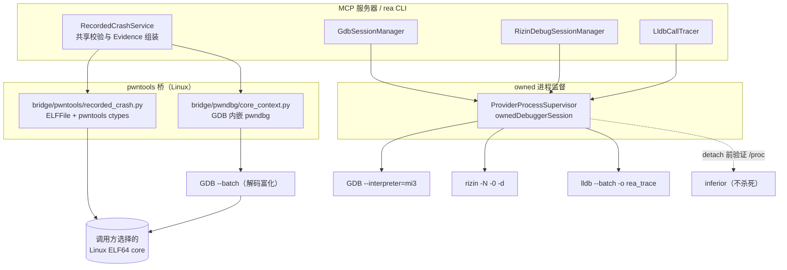
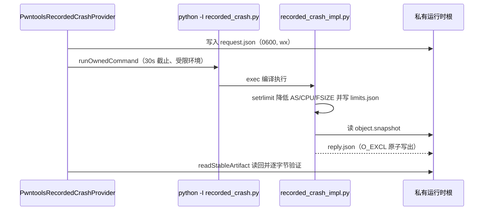
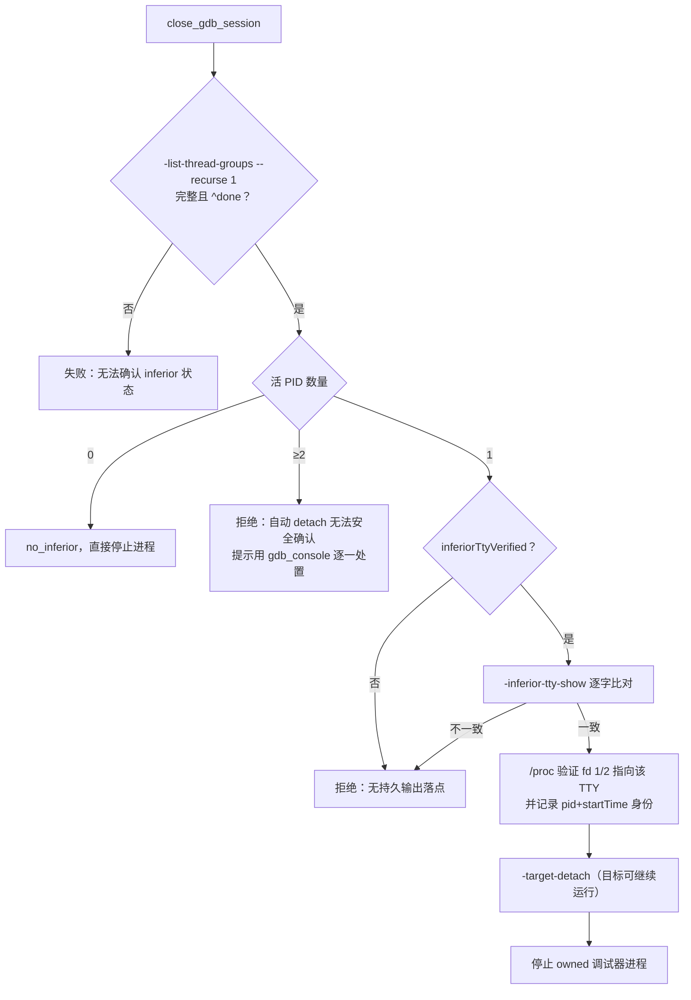

调试器是把静态逆向结论锚定到运行时事实的最强工具，但也是最容易产生"伪装成证据的副作用"的环节：被调试目标可能被启动、恢复或杀死，调试器本身可能加载不可信的初始化脚本与符号。REA 的调试器桥接层围绕一个核心不变量构建——**REA 只拥有它自己启动的进程，永远不根据历史 PID 或猜测的标识去控制外部目标**。本页覆盖四条彼此独立的桥接通道：`inspect_recorded_crash` 的 pwntools 崩溃转储解码、同一次检查中可选的 pwndbg/GDB 富化、Linux 上的持久 GDB/MI 与 Rizin 调试会话，以及 macOS 上通过 `lldb --batch` 执行的 LLDB 追踪桥。全部条目均遵循 [证据与不确定性模型](6-zheng-ju-yu-bu-que-ding-xing-mo-xing-guan-cha-tui-dao-tui-duan-yu-wei-zhi-de-bao-liu-yu-yi) 中"观察/推导/未知"的保留语义。

Sources: [recorded-crashes.md](docs/recorded-crashes.md#L1-L21)

## 四条通道的架构总览

理解本页内容的前提是明确"所有权边界"这个概念：REA 对每条通道区分三类进程——**调用方选择的产物**（如 core 文件，只读快照）、**REA 拥有的调试器进程**（可启动、可停止、可验证清理）与**调试器的 inferior**（被调试目标，只有在能证明其输出有持久落点时才允许 detach，从不主动杀死）。下图描绘了这四条通道如何共享同一套进程监督与证据原语（Mermaid 图中实线为命令/数据流，虚线为所有权验证流）：



四条通道的差异可以用一张表收敛。共同点是：所有进程都通过 `spawnOwnedProviderProcess` 以 owned 方式启动，输出有字节上限，结果一律绑定 Evidence 信封；差异在于会话语义（一次性 vs 持久）、平台约束与安全假设。

| 通道 | 会话形态 | 平台 | 调试器启动参数要点 | inferior 处置 |
| --- | --- | --- | --- | --- |
| `inspect_recorded_crash`（pwntools） | 一次性解码 | Linux | 不启动目标；只解析 core 文件 | 无 inferior，从不执行目标 |
| `include_debugger_context`（pwndbg） | 一次性 `--batch` | Linux | `-nx -nh --batch -iex` 关闭自动加载 | 无 inferior；`exec-file` 仅占位 |
| 持久 GDB/MI | 持久（最多 8 个） | 仅 Linux | `--nx --quiet --interpreter=mi3`（mi2 回退） | 验证 TTY 后 `-target-detach`，从不 kill |
| 持久 Rizin | 持久（最多 8 个） | 仅 Linux | `-N -0 -d -R stdout/stderr=<tty>` | `/proc` 描述符验证后 detach |
| LLDB 追踪桥 | 一次性 `--batch` | macOS | `--batch --no-lldbinit -o "rea_trace …"` | 记录后 kill 自己启动的目标 |

Sources: [GdbSessionManager.ts](src/gdb/GdbSessionManager.ts#L35-L50), [RizinDebugSessionManager.ts](src/rizin/RizinDebugSessionManager.ts#L30-L48), [LldbCallTracer.ts](src/native/LldbCallTracer.ts#L54-L64), [binaryDiagnostics.ts](src/composition/binaryDiagnostics.ts#L15-L23)

组合层的接线保持了 [分层架构总览](5-fen-ceng-jia-gou-zong-lan-ru-kou-zu-he-ying-yong-ti-gong-zhe-yu-ling-yu-ceng-de-yi-lai-gui-ze) 的依赖规则：`createServer` 在服务器启动时实例化 `GdbSessionManager` 与 `RizinDebugSessionManager` 并注入 `providerEnvironment`，而 `createRecordedCrashService` 延迟创建 `PwntoolsRecordedCrashProvider`，不做导入期 I/O，也不负责获取 pwntools 依赖——Python 环境由调用方通过 `REA_PWNTOOLS_PYTHON` 提供。

Sources: [createServer.ts](src/server/createServer.ts#L346-L350), [binaryDiagnostics.ts](src/composition/binaryDiagnostics.ts#L15-L23)

## 崩溃转储证据管线：recorded_crash 桥

`inspect_recorded_crash`（MCP 工具名）/ `rea inspect-recorded-crash`（CLI 命令名）独立于任何活动的二进制目标，检查调用方选择的 Linux ELF64 小端 core 文件。初始配置解释两种架构剖面——x86-64（`e_machine` 62）与 AArch64（`e_machine` 183）；其余 `e_machine` 在解释 note 之前即以 `unsupported_target` 拒绝。这个"先验剖面、后解释"的次序确保未知格式永远不会被部分猜测式解读。

Sources: [recorded-crashes.md](docs/recorded-crashes.md#L4-L21), [recorded_crash_impl.py](bridge/pwntools/recorded_crash_impl.py#L13-L27)

调用方必须通过 `REA_PWNTOOLS_PYTHON` 提供一个已装好 **pwntools 4.15.0、pyelftools 0.33、Unicorn 2.1.2** 且版本完全一致的 Python；REA 不安装这些依赖。桥内代码用 `importlib.metadata.version` 逐包核对，任何偏差都以 `unsupported`/`unavailable` 显式失败。ELF 层面接受 `ELFOSABI_NONE`（0）与 GNU/Linux（3）且 ABI 版本为 0 的声明；其他 OSABI 不允许选择 Linux note 的 ctypes 布局。这条约束的含义是：**未声明 OSABI 并不能证明核心来自 Linux**，因此未声明是允许的，但已声明的其他 OSABI 必须拒绝。

Sources: [recorded_crash_impl.py](bridge/pwntools/recorded_crash_impl.py#L30-L61), [recorded-crashes.md](docs/recorded-crashes.md#L14-L21)

解码产物是**记录证据**而非推断：原始程序头与各段的文件/内存范围；每一个 note 的原始身份、owner/descriptor 字节及其在快照中的源范围（包括陌生 owner 与未知 note 类型，原样保留字节）；每条 Linux CORE `NT_PRSTATUS` 作为一个独立记录线程，携带历史 PID、信号与无损 uint64 寄存器，且每个寄存器绑定到其源字节偏移（amd64 27 个寄存器/336 字节描述符，AArch64 34 个/392 字节，`pr_cursig@12`、`pr_pid@32`、`pr_reg@112` 为两剖面共享）。`NT_SIGINFO` 仅在 SIGSEGV code 1/2 时建立 fault-address 联合，其余变体保留原始字节并声明含义未知。历史 PID 只是元数据，永远不会被用于选择活动进程或授权 attach。

Sources: [recorded_crash_impl.py](bridge/pwntools/recorded_crash_impl.py#L100-L150), [recordedCrash.ts](src/domain/native/recordedCrash.ts#L78-L130), [recorded-crashes.md](docs/recorded-crashes.md#L28-L47)

TypeScript 侧的 `PwntoolsRecordedCrashProvider` 在接受 Python 回复前做**逐字节回验**：`validateRecordedCrashStructure` 核对结构边界，随后把每个 note 的 owner/descriptor base64 解码后与快照子序列比较，再用 `readBigUInt64LE` 逐一核对寄存器值与其声明的源位置——即 Python 层的每个事实都必须能在原始快照字节中复现，任何偏差以 `AnalysisOutputError` 失败。`RecordedCrashService` 最后校验回复中的 artifact 路径/摘要未被调包、`debugger.status === "available"` 与输入的 `include_debugger_context` 严格一致，然后才组装 Evidence（无富化时 `confidence: "observed"`）。

Sources: [PwntoolsRecordedCrashProvider.ts](src/native/pwntools/PwntoolsRecordedCrashProvider.ts#L43-L108), [RecordedCrashService.ts](src/application/binaryDiagnostics/RecordedCrashService.ts#L60-L127)

一次完整检查的进程拓扑如下（前提说明：`recorded_crash.py` 是外层"陷阱"脚本，捕获导入/编译期的 `MemoryError` 与 `OSError` 并以保留退出码 75/76 加标记文件报告资源失败；真正的解码逻辑在同目录 `recorded_crash_impl.py` 中）：



Sources: [recorded_crash.py](bridge/pwntools/recorded_crash.py#L1-L40), [decoder_runtime.py](bridge/pwntools/decoder_runtime.py#L17-L60), [PwntoolsDecoder.ts](src/native/pwntools/PwntoolsDecoder.ts#L86-L160)

## 可选调试器富化：pwndbg 核心上下文

基础解码只回答"core 里记录了什么"；可选的 `--debugger-context`（MCP 输入 `include_debugger_context: true`）追加"调试器视角的映射候选"。这一配置要求显式提供三个绝对路径环境变量，缺省值只有 GDB 一项：

| 环境变量 | 缺省 | 要求 |
| --- | --- | --- |
| `REA_PWNDBG_GDB` | `/usr/bin/gdb` | 绝对路径，可执行文件（X_OK） |
| `REA_PWNDBG_GDBINIT` | 无 | 绝对路径，未修改的 pwndbg `gdbinit.py` |
| `REA_PWNDBG_VENV_PATH` | 无 | 绝对路径，已存在的 pwndbg 虚拟环境目录 |

Sources: [PwndbgCoreContext.ts](src/native/pwndbg/PwndbgCoreContext.ts#L49-L103), [recorded-crashes.md](docs/recorded-crashes.md#L49-L63)

语义边界必须先讲清楚：省略 `include_debugger_context` 只请求记录证据；**请求了但环境不可用时返回可操作的失败，绝不静默降级为"看起来像有调试器覆盖"**。GDB/pwndbg 版本被逐字保留（pwndbg 强制为未修改的 2026.09.15），映射权限由报告的 flags 推导（flags 不在 1..7 时权限为 null），映射名是"生产者的显示元数据"，其当前文件身份恒为 `unknown`——这些地图不建立页面内容，也不证明可执行匹配。

Sources: [core_context.py](bridge/pwndbg/core_context.py#L31-L70), [recorded-crashes.md](docs/recorded-crashes.md#L71-L79)

启动链是三层接力：`PwndbgCoreContext` 用 `REA_PWNTOOLS_PYTHON -I bridge/pwndbg/launch.py` 启动 owned 启动器，环境被净化为 `HOME=stage`、`XDG_CACHE_HOME/XDG_CONFIG_HOME` 指向 stage、`PYTHONNOUSERSITE=1` 等；`launch.py` 捕获启动期资源失败；`launch_impl.py` 先降低继承的软限制，再 `os.execve` **替换自身**为 GDB，命令行为：

```
gdb -nx -nh --batch --quiet
    -iex "set auto-load off"
    -iex "set debuginfod enabled off"
    -iex "set auto-solib-add off"
    -ex "python exec(open(core_context.py)…)"
```

调用方输入全部留在 `request.json` 中，GDB 的 Python 命令只出现固定包内路径——选定的路径以 JSON 数据传递，绝不进入 GDB 命令语法。

Sources: [launch.py](bridge/pwndbg/launch.py#L13-L40), [launch_impl.py](bridge/pwndbg/launch_impl.py#L16-L35), [PwndbgCoreContext.ts](src/native/pwndbg/PwndbgCoreContext.ts#L122-L158)

`core_context.py` 在 GDB 内执行一段精心编排的边界构造，其中有三个值得逐条理解的防混淆步骤。第一，把 `sysroot`/`solib-search-path`/`debug-file-directory` 全部指向 owned 的空目录 `no-libraries`，关闭 history/pagination，使 GDB 无法从主机加载任何库符号。第二，**占位可执行文件**：GDB 16 会在无可执行 BFD 时经由 `AT_EXECFN`/`NT_FILE` 在 sysroot 之外自行定位记录的可执行文件，桥用 `exec-file /proc/self/exe` 把"已经在运行的调试器本身"塞进可执行槽位——不加载符号、不运行 inferior——随后显式 `set architecture`（复用解码器已验证的架构剖面，防止占位符反客为主）、`core-file ../object.snapshot`、再以 `file` 清除占位符，并验证连接类型确为 `core` 且主符号文件为空。第三，架构映射表是闭合的（`x86_64-little-endian → i386:x86-64`，`aarch64-little-endian → aarch64`），其他值直接 `unsupported` 失败。

Sources: [core_context.py](bridge/pwndbg/core_context.py#L15-L58)

在启动 GDB **之前**，`CoreFileMappingAuthority` 还会预检源绑定的 `NT_FILE` note：映射名必须是绝对 Unix 路径（首字节 `0x2f`）且不含 `.`/`..` 点段——相对路径会绕过 GDB 的 sysroot，点段可以逃逸其前缀。检查直接在快照字节上进行，不做有损 UTF-8 解码或主机路径解析；任何未解析覆盖都以 `capability_unavailable` 拒绝富化，同时**保留**基础解码观察与原始字节。

Sources: [CoreFileMappingAuthority.ts](src/native/pwndbg/CoreFileMappingAuthority.ts#L8-L64), [recorded-crashes.md](docs/recorded-crashes.md#L64-L70)

富化成功后同一份 Evidence 的 confidence 从 `observed` 升级为 `derived`（映射是调试器推导，寄存器/notes 仍是观察）；富化失败时 provider 通过 `retainPartialObservation` 把 `debugger: { status: "unavailable", requested: true }` 附加到错误的部分观察上，调用方仍能拿到已验证的记录证据。

Sources: [PwntoolsRecordedCrashProvider.ts](src/native/pwntools/PwntoolsRecordedCrashProvider.ts#L112-L168), [RecordedCrashService.ts](src/application/binaryDiagnostics/RecordedCrashService.ts#L98-L106)

## 持久 GDB/MI 会话

`GdbSessionManager` 提供基于 GDB/MI 的持久会话，四个 MCP 工具（`start_gdb_session`、`gdb_console`、`gdb_session_status`、`close_gdb_session`）与一个临时 CLI 命令（`rea debug-with-gdb`）共享同一个管理器。会话**仅在 Linux 上可用**，且这不是能力偷懒而是安全证明的需要：detach 前必须通过 `/proc/<pid>/fd` 读取 inferior 的实际输出描述符；Windows 上 owned Job Object 的清理可能连带终止被调试目标，因此被显式禁用。GDB 可执行文件由 `REA_GDB_COMMAND` 选择（默认 `gdb`），以 `--nx --quiet --interpreter=mi3` 启动；mi3 握手失败时对同一会话槽位回退 mi2。

Sources: [GdbSessionManager.ts](src/gdb/GdbSessionManager.ts#L35-L54), [GdbSessionManager.ts](src/gdb/GdbSessionManager.ts#L551-L600), [GdbSessionManager.ts](src/gdb/GdbSessionManager.ts#L667-L685), [gdbToolContracts.ts](src/contracts/gdbToolContracts.ts#L19-L44)

启动协议的目标是"在发布会话前把所有自动行为钉死"。管理器等待 MI 提示符（10 秒截止）后立即下发 `-gdb-set auto-load off`，GDB 拒绝该命令则整个启动失败——因为任何后续自动加载都可能引入不可信代码。若调用方提供 `inferior_tty`，则依次执行 `-inferior-tty-set` 与 `-inferior-tty-show`，并逐字比对 GDB 回报的 `inferior_tty_terminal` 与所选路径，只有完全一致才标记 `inferiorTtyVerified`——这个布尔值是后续 detach 安全性的前提。整个启动期间 GDB 未收到任何目标执行命令，因此会话发布时刻 `noInferiorVerified = true` 是成立的。

Sources: [GdbSessionManager.ts](src/gdb/GdbSessionManager.ts#L790-L875)

`gdb_console` 把调用方命令包装为 `-interpreter-exec console <quote(command)>` 执行，返回原始 MI、console、target、log 四类记录并绑定 `rea.debugger.console-observation` Evidence。契约层面它被明确标注为**不受限**命令：可以执行 shell、访问文件系统与网络、操控目标。命令超时（120 秒）不丢弃数据——已收集的记录以 `completion_status: "unknown"` 保留并停止 owned 调试器会话。输出预算为 16 MiB（测试可注入更小值），超长 MI 行在 64 KiB 处以 `[recent record truncated]` 标记截断，UTF-8 无效字节显式上报为 `output_invalid_utf8`。

Sources: [GdbSessionManager.ts](src/gdb/GdbSessionManager.ts#L1054-L1190), [gdbToolContracts.ts](src/contracts/gdbToolContracts.ts#L45-L69)

关闭会话是本页最关键的协议。下图描述 `close_gdb_session` 的决策流（前提说明：`-list-thread-groups --recurse 1` 返回的 MI 是嵌套列表，解析器 `gdbThreadGroupPids` 用栈式扫描提取活 PID，最深 256 层嵌套帧、64 KiB 单行预算，拒绝任何嵌套 `groups=` 复现，因此恶意或异常 MI 输出只会失败而不会误报）：



Sources: [GdbSessionManager.ts](src/gdb/GdbSessionManager.ts#L1260-L1370), [GdbSessionManager.ts](src/gdb/GdbSessionManager.ts#L1726-L1800), [GdbSessionManager.ts](src/gdb/GdbSessionManager.ts#L315-L378)

`verifyGdbInferiorOutputSink` 是"持久输出落点"的可执行定义：读取 `/proc/<pid>/stat` 解析进程启动时间（防止 PID 复用），`realpath` 所选 TTY 并确认其为字符设备，然后比对 inferior 的 fd 1/fd 2 经由 `/proc/<pid>/fd/N` readlink 后的设备号/inode。任何一步失败都会让 detach 变为不可确认，会话随之以 `incomplete` 收场并把清理失败保留在 `cleanupFailures` 集合中，供 `retryCleanupFailures` 重试。

Sources: [GdbSessionManager.ts](src/gdb/GdbSessionManager.ts#L380-L421), [LinuxProcessStat.ts](src/process/LinuxProcessStat.ts#L1-L40)

CLI 侧的 `rea debug-with-gdb` 是上述协议的"一次性封装"：启动会话、执行单条命令、finally 中关闭会话并 `closeAll()` 兜底。它拒绝那些会使已验证输出路由失效的命令（`gdbOneShotCommandMayInvalidateDetachProof`），并提示改用持久会话工作流——这是一次性通道与持久通道之间的责任划分。

Sources: [reverseEngineeringCommands.ts](src/cli/reverseEngineeringCommands.ts#L193-L287), [cliCommandNames.ts](src/cliCommandNames.ts#L56-L58)

## Rizin 调试器会话与 NUL 帧协议

Rizin 通道与 GDB 通道解决的问题相同——持久、可回收、不误伤目标的调试会话——但选择了一组不同的机制。启动参数为 `-N -0 -d -R stdout=<tty> -R stderr=<tty> -e dbg.exitkills=false [-D backend] <path>`：`-N` 抑制用户设置与脚本（保留插件），`-0` 启用 NUL 帧协议，`-R` 把 inferior 的 stdout/stderr 重定向到调用方 TTY，`dbg.exitkills=false` 禁止调试器退出时杀死目标，`-D` 允许调用方选择 IO 调试后端。与 GDB 一样，`inferior_tty` 是必填输入，并预先验证：`realpath` 后 `open(O_RDWR|O_NOCTTY|O_NONBLOCK)`，`isatty` 且为字符设备，记录 dev/ino 供后续比对。

Sources: [RizinDebugSessionManager.ts](src/rizin/RizinDebugSessionManager.ts#L30-L48), [RizinDebugSessionManager.ts](src/rizin/RizinDebugSessionManager.ts#L325-L400), [rizinDebugToolContracts.ts](src/contracts/rizinDebugToolContracts.ts#L9-L44)

Rizin 没有 MI 那样的结构化协议，REA 用**完成标记**重建命令边界：每条命令写入 stdin 后紧跟 `!echo __REA_<uuid>_COMPLETE__\n`，利用 Rizin 的 shell 转义产生一个无法被普通输出混淆的标记帧；帧收集在该标记处结束。由此带来两条硬约束：命令必须是单行（输入 schema 拒绝 `\r\n`），且当出现"命令前的不请自来帧"时协议失去关联能力，会话立即停止以防晚到输出被归因给后续命令。输出预算同样是 16 MiB/4096 帧，超出即 `output_truncated: true` 且 `completion_status: "unknown"`。Evidence 类型为 `rea.debugger.command-observation`，附带启动溯源（caller 路径与 resolved 路径）及一条固定限制声明：启动溯源不能在不受限调试命令之后确立当前目标身份。

Sources: [RizinDebugSessionManager.ts](src/rizin/RizinDebugSessionManager.ts#L546-L760), [RizinDebugSessionManager.ts](src/rizin/RizinDebugSessionManager.ts#L1248-L1263), [RizinDebugSessionManager.ts](src/rizin/RizinDebugSessionManager.ts#L60-L110)

关闭语义与 GDB 通道同构但验证点不同：detach 前读取 `/proc/<pid>/fd/1` 与 `/fd/2`，readlink 目标的 dev/ino 必须与启动时记录的 TTY 完全一致、必须仍是字符设备、`realpath` 必须还原为同一 TTY。清理内部命令（如 detach 回读）本身也走同一条标记协议，超时仅 1 秒。`close_rizin_debug_session` 的输出 schema 恒为 `{ target_state: "unknown" }`——这是刻意的不确定性保留：REA 从不基于 PID 信号 inferior，分离后目标是否仍在运行不可知，就如实报告 unknown。

Sources: [RizinDebugSessionManager.ts](src/rizin/RizinDebugSessionManager.ts#L1230-L1250), [rizinDebugToolContracts.ts](src/contracts/rizinDebugToolContracts.ts#L90-L109)

## macOS LLDB 批处理追踪桥

LLDB 通道面向 macOS 原生调用的动态观察（`observe_native_calls` / `rea observe-native-calls`），与会话型通道的形态完全不同：`LldbCallTracer` 经 `xcrun` 解析 `lldb` 后启动一次性批处理进程：

```
lldb --batch --no-lldbinit --no-use-colors
     -o "command script import <rea_lldb_tracer.py>"
     -o "rea_trace <config.json>"
```

调用方请求（可执行文件、断点函数/ObjC 方法、时长、事件上限等）写入 config JSON，桥以 JSON 文件回写结果；进程带 PID 文件与身份确认文件，支持崩溃后的部分证据回收（`LldbRetainedObservations` 读取 JSONL 观察日志与截断前缀）。

Sources: [LldbCallTracer.ts](src/native/LldbCallTracer.ts#L54-L70), [LldbCallTracer.ts](src/native/LldbCallTracer.ts#L441-L500)

`rea_lldb_tracer.py` 在 LLDB 内嵌 Python 中运行，其约束写在模块 docstring 里：启动**一个** owned 进程，在请求的函数/ObjC 方法处停下，**只从寄存器与内存读取**记录每次入口，不执行任何表达式求值、不代替目标运行任何代码，事件或聚合资源限额到达、时长耗尽或进程退出后 kill 该进程。目标输出经有界 FIFO 排干（每轮至多 1 MiB 排干量）。参数寄存器映射为 arm64/arm64e 的 `x0..x7` 与 x86_64/x86_64h 的 `rdi..r9`。聚合预算：8 MiB 追踪、65,536 帧、1 MiB 目标输出/流；`_ObservationJournal` 先 flush 有界 JSONL 前缀，保证追踪器自身失败时观察仍可回收。

Sources: [rea_lldb_tracer.py](bridge/native/rea_lldb_tracer.py#L1-L50)

与 [Apple 应用与原生 macOS 分析](20-apple-ying-yong-yu-yuan-sheng-macos-fen-xi-mach-o-objc-swift-yuan-shu-ju-yu-yuan-sheng-ui) 中静态 Mach-O/ObjC/Swift 元数据读取的关系是互补而非重叠：静态剖面回答"有哪些方法与类型"，LLDB 桥回答"这些入口在真实运行中收到了什么参数"——且后者在 Evidence 中始终记录 LLDB 版本与目标身份验证结果（文件摘要、设备/inode、模块 UUID），快照不稳定时显式标记 `stable: false`。

Sources: [LldbCallTracer.ts](src/native/LldbCallTracer.ts#L72-L120), [native-investigation.md](docs/native-investigation.md#L1-L42)

## inferior 处置与进程所有权

所有通道共享 `src/process/ownedDebuggerSession.ts` 中的处置语义，其设计目标是把"清理"从信念变成证明。`stopOwnedDebuggerProcess` 只停止**直接 owned 的调试器进程**，绝不触碰进程组或目标；detach 尝试以 `WeakMap` 去重并在 1 秒内未完成即放弃等待（不重复 detach）；调试器已退出但 detach 结果未确认时，改用 `verifyOwnedInferiorsEnded` 以 `/proc/<pid>/stat` 启动时间证明此前识别的 inferior 进程**已经结束**，否则报告 `incomplete` 并说明缺少所有者证明。调试器进程退出后仍可能 Late 输出，监督器把额外保留字节压到 64 KiB 并继续排干，Windows 上还要等 Job Object 完全结算才报告完成。

Sources: [ownedDebuggerSession.ts](src/process/ownedDebuggerSession.ts#L8-L49), [ownedDebuggerSession.ts](src/process/ownedDebuggerSession.ts#L96-L200)

这套语义直接对应 [进程所有权与生命周期监督](25-jin-cheng-suo-you-quan-yu-sheng-ming-zhou-qi-jian-du-si-you-yun-xing-shi-jie-zhi-shi-jian-yu-qing-li-zhong-shi) 中的通用机制（截止时间、清理租约、外部变异准入）：MCP 层的 `gdb_console`/`rizin_debug_command` 经 `runWithExternalMutationAdmission` 包装，`close_*` 经 `runOwnedCleanupWithExternalMutationAdmission` 包装，确保清理失败可重试且不与外部状态变异竞争。

Sources: [registerGdbTools.ts](src/server/registerGdbTools.ts#L36-L157), [registerRizinDebugTools.ts](src/server/registerRizinDebugTools.ts#L25-L147)

## 资源边界与失败分类

崩溃转储管线的预算是显式常量而非隐式配置，资源失败需要**成对的私有失败分支标记**——没有标记的启动器失败保留真实退出码/输出，资源原因保持未知，绝不猜测归类：

| 预算 | 值 | 可调性 |
| --- | --- | --- |
| 输入 core 大小 | 32 MiB | `REA_PWNTOOLS_MAX_INPUT_BYTES` 可升至 1 GiB（非十进制整数报 `provider_unavailable`） |
| 解码回复 | 64 MiB | 固定，超限整体失败而非部分成功 |
| 每阶段诊断 | 1 MiB | 固定 |
| 每阶段墙上时钟 | 30 s | 固定 owned 截止时间 |
| 地址空间软顶 | 3 GiB | 继承的更紧限制被保留，硬限制从不提高 |
| CPU 软顶 | 30 s | 同上 |

Sources: [PwntoolsRelease.ts](src/native/pwntools/PwntoolsRelease.ts#L1-L20), [recorded-crashes.md](docs/recorded-crashes.md#L85-L96)

保留退出码协议：Python 启动器在无法写出结构化回复时，以 **exit 75 + 标记 `M`** 报告观察到的分配失败（`MemoryError`/ENOMEM，包括导入与编译期），以 **exit 76 + 标记 `F`** 报告 `EFBIG`（含部分写）。`decoder_runtime.py` 在解释器内用 `setrlimit` 把 AS/CPU/FSIZE 软限制降到目标值与继承值中的最小者，先写 `limits.json` 再解码，并预留 1 MiB 紧急余量用于构造 MemoryError 回复。文档同时明确：这些进程限制**不构成**针对调用方引擎代码的沙箱。

Sources: [launch.py](bridge/pwndbg/launch.py#L13-L27), [decoder_runtime.py](bridge/pwntools/decoder_runtime.py#L9-L33), [recorded-crashes.md](docs/recorded-crashes.md#L91-L96)

验证通道方面，`npm run verify:recorded:crash` 使用源码自有的 fixture 与调用方提供的 GDB/Python/pwndbg/strace：fixture 生成显式启动自有测试程序产生 core，后续检查只读结果；真实验收覆盖记录线程、高位寄存器、缺失/畸形 note、不透明 owner、CLI/MCP 对等、可选调试器上下文，以及"历史 PID 与 owned 存活哨兵冲突"场景——syscall 追踪同时拒绝访问仍然存在的源可执行文件。CI 定义 Ubuntu 24.04 与 Debian 13（GDB 16）容器通道。测试通道的整体分类见 [测试策略与验证通道](27-ce-shi-ce-lue-yu-yan-zheng-tong-dao-yuan-ma-bian-jie-yan-shou-yi-zhi-xing-ji-zhen-shi-gong-ju-lian-tong-dao)。

Sources: [recorded-crashes.md](docs/recorded-crashes.md#L98-L111), [fixtures.mjs](scripts/verify/recorded-crash/fixtures.mjs#L1-L50)

## CLI 与 MCP 入口对照

| 能力 | CLI 命令 | MCP 工具 | 持久性 |
| --- | --- | --- | --- |
| 崩溃转储检查 | `rea inspect-recorded-crash` | `inspect_recorded_crash` | 一次性 |
| 调试器富化 | `--debugger-context` 标志 | `include_debugger_context` 输入 | 随同一次检查 |
| GDB 会话 | `rea debug-with-gdb`（临时） | `start_gdb_session` / `gdb_console` / `gdb_session_status` / `close_gdb_session` | MCP 持久，CLI 临时 |
| Rizin 会话 | `rea debug-with-rizin`（临时）、`rea execute-rizin-command` | `start_rizin_debug_session` / `rizin_debug_command` / `rizin_debug_session_status` / `close_rizin_debug_session` | MCP 持久，CLI 临时 |
| LLDB 调用追踪 | `rea observe-native-calls` | `observe_native_calls` | 一次性 |

Sources: [cliCommandNames.ts](src/cliCommandNames.ts#L50-L58), [cliCommandNames.ts](src/cliCommandNames.ts#L178-L182), [cliCommandNames.ts](src/cliCommandNames.ts#L243-L248), [registerRecordedCrashTools.ts](src/server/registerRecordedCrashTools.ts#L13-L33)

工具契约层为每个入口定义了严格的 zod 输入/输出 schema：GDB 结果包含 `mi/records/console/target/log`、`output_truncated`、`completion_status` 等字段；Rizin 结果的 `output_scope` 恒为 `command_and_interleaved_session_output`，显式承认标记帧之前的后端输出无法与命令输出区分。会话发现的契约语义（部分观察的记录、Evidence 信封、取消恢复）在 [MCP 契约参考](8-mcp-qi-yue-can-kao-gong-ju-jie-guo-bao-liu-zheng-ju-hui-hua-fa-xian-yu-qu-xiao-hui-fu) 中有系统性展开。

Sources: [gdbToolContracts.ts](src/contracts/gdbToolContracts.ts#L5-L17), [rizinDebugToolContracts.ts](src/contracts/rizinDebugToolContracts.ts#L9-L19)

## 深入阅读

- 想理解为什么寄存器必须"绑定源字节"、为什么 `target_state` 恒为 unknown，请先阅读 [证据与不确定性模型](6-zheng-ju-yu-bu-que-ding-xing-mo-xing-guan-cha-tui-dao-tui-duan-yu-wei-zhi-de-bao-liu-yu-yi)。
- 调试器会话只是原生调查的一个切面；函数档案、引用遍历与离线布局诊断见 [原生二进制调查工作流](10-yuan-sheng-er-jin-zhi-diao-cha-gong-zuo-liu-han-shu-dang-an-yin-yong-yu-go-rust-yuan-shu-ju-chi-xian-bu-ju-zhen-duan)。
- 进程启动、截止时间与清理重试的通用机制见 [进程所有权与生命周期监督](25-jin-cheng-suo-you-quan-yu-sheng-ming-zhou-qi-jian-du-si-you-yun-xing-shi-jie-zhi-shi-jian-yu-qing-li-zhong-shi)。
- 若要扩展或验证这些桥接通道，请遵循 [贡献流程与 PR 就绪规范](28-gong-xian-liu-cheng-yu-pr-jiu-xu-gui-fan-wen-ti-bao-gao-ren-gong-suo-you-quan-yu-ti-jiao-yue-ding)，并注意调试器通道属于真实工具链验证范畴。