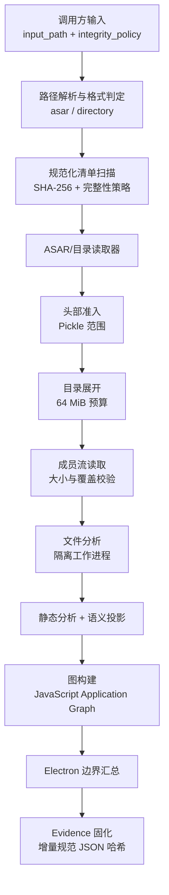
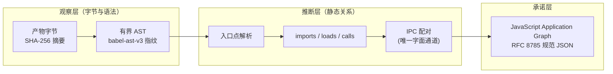
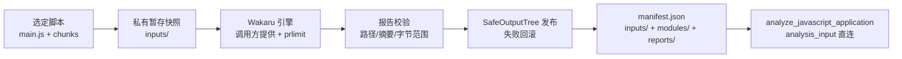

REA 对 Electron 与 JavaScript 应用的静态分析建立在一个反直觉却极具工程价值的前提上：**目标代码永远不被执行**。一个打包进 `app.asar` 的应用可能是恶意样本、闭源商业软件或混淆后的压缩产物——解析它的唯一安全方式是把字节当作纯粹的数据。本页覆盖这一能力的三个支柱：**ASAR 容器读取**（头部准入、目录展开、成员流校验）、**模块图构建**（`analyze_javascript_application` 从产物字节到 JavaScript Application Graph 的投影）与**源码恢复**（`recover_javascript_sources` 借助调用方提供的 Wakaru 引擎还原可读模块）。运行时侧的 CDP 观察与静态/动态调和属于下一层的职责，见[运行时观察与静态调和：V8 Inspector、Electron 边界与 Fuses 检查](17-yun-xing-shi-guan-cha-yu-jing-tai-diao-he-v8-inspector-electron-bian-jie-yu-fuses-jian-cha)。

Sources: [javascript-artifact-reconstruction.md](docs/javascript-artifact-reconstruction.md#L1-L11)

## 安全边界：解析而不执行

整个静态分析路径存在一条硬性红线：不使用 `eval`、`Function`、`vm.runInContext`、DOM、bundle 的 `push` 处理器或应用引导代码。测试套件中的 Webpack/Rspack 夹具会在被执行时修改全局状态并抛出异常，而重建流程能够完整恢复其四个模块工厂、却不触发任何一个副作用——这是“解析即数据”承诺的直接验证。目录读取器不跟随符号链接，产物路径经过共享规范化器与冲突注册表，ASAR 条目字节在解析前会再次与清单摘要核对。

Sources: [javascript-artifact-reconstruction.md](docs/javascript-artifact-reconstruction.md#L471-L482)

这一安全边界与**证据模型**深度绑定。产物字节与 AST 语法属于观察，而入口点解析、imports、loads、calls 与持久化关系属于静态推断——语法并不证明运行时执行。一个格式损坏或不可用的 JavaScript 文件、package 记录或 source map 会产出 `state: unavailable` 的未知图域，而不是被误读为“模块不存在”。这套观察/推断/未知的保留语义在[证据与不确定性模型：观察、推导、推断与未知的保留语义](6-zheng-ju-yu-bu-que-ding-xing-mo-xing-guan-cha-tui-dao-tui-duan-yu-wei-zhi-de-bao-liu-yu-yi)中有系统性论述。

Sources: [javascript-artifact-reconstruction.md](docs/javascript-artifact-reconstruction.md#L337-L346)

## 静态分析流水线总览

`analyze_javascript_application`（CLI 侧对应 `rea analyze-javascript-application` 与通用的 `rea analyze` 路由）把一次静态分析组织为四个协作阶段，每个阶段之间都有取消检查点与进度上报。服务入口先解析输入模式（`input_path` 必须为绝对路径，`format` 接受 `auto`/`asar`/`directory`，`integrity_policy` 接受 `fail`/`record-and-continue`），然后依次执行产物重建、结果校验与 Evidence 固化。

Sources: [JavaScriptApplicationService.ts](src/application/javascript/JavaScriptApplicationService.ts#L39-L96)

产物重建层返回的结果结构清晰地划分了职责：内容寻址清单清单 ID、完整性矛盾记录、JavaScript Application Graph、语义图、Electron 边界摘要与统计计数（相关文件数、嵌套 ASAR 数、已解析文件数、AST 访问节点数、模块数、解析失败数）。值得注意的是 `reconstructJavaScriptArtifact` 在文件读取完成后立即释放读取器的所有权——分析阶段消费的是已拥有的文件事实，读取器句柄不再滞留。

Sources: [JavaScriptArtifactReconstruction.ts](src/application/javascript/JavaScriptArtifactReconstruction.ts#L50-L76)
Sources: [JavaScriptArtifactReconstruction.ts](src/application/javascript/JavaScriptArtifactReconstruction.ts#L78-L133)

## ASAR 容器读取

ASAR 是 Electron 的打包格式：文件头部是一段描述目录树的 JSON，成员字节紧随其后顺序存放。REA 没有把信任完全交给上游 `@electron/asar` 库，而是在其外层叠加了一套**准入优先**的防御性读取协议——先用极小的固定前缀验证容器形状，再展开目录，最后流式校验每个成员。

Sources: [AsarArtifactReader.ts](src/artifacts/AsarArtifactReader.ts#L34-L37)

### 头部准入：Pickle 范围解析

ASAR 头部以固定的 16 字节双 Pickle 前缀开始，其中偏移 4、8、12 处分别编码头部字节数、载荷字节数与 JSON 字节数。`parseAsarHeaderExtents` 用四个不变量验证这一前缀：首字段必须为 4、头部不小于 8 字节、载荷必须等于头部减 4、JSON 不得超过载荷减 4。若同时提供实际容器大小，还会验证头部不会越过观测容器边界——这些检查只建立**字节范围**，JSON 有效性留给上游解码器在解释边界处理。

Sources: [AsarHeader.ts](src/artifacts/AsarHeader.ts#L71-L106)

`admitAsarHeader` 把这一解析升级为完整的准入协议：先 `stat` 确认容器是常规文件（拒绝目录与符号链接），再以循环补齐的方式读满 16 字节前缀（任何提前 EOF 都报出截断格式错误），解析范围后对超出 16 MiB 解码预算的头部直接拒绝。关键设计意图是**在为头部分配内存之前**就完成准入，把恶意构造的巨型头部挡在分配点之外。读取器打开句柄时还叠加了 `O_NOFOLLOW | O_NONBLOCK` 标志，防止符号链接替换与阻塞型文件（如 FIFO）混入。

Sources: [AsarHeader.ts](src/artifacts/AsarHeader.ts#L317-L357)
Sources: [AsarArtifactReader.ts](src/artifacts/AsarArtifactReader.ts#L149-L155)

### 签名探测与目录展开

准入之后，REA 用一个**流式签名探测器**做低成本指纹确认：它只保留 16 字节固定前缀，然后逐字节扫描声明的 JSON 区域，直到遇到第一个非 JSON 空白字节——若是 `{`（0x7b）则报告 `matched`，否则以 `json-not-object` 拒绝。探测全程不保留 JSON 内容，扫描总量受 16 MiB + 8 字节的探针上限约束，`finish(archiveBytes)` 还会把声明的头部范围与实际字节数对账，防止“签名通过但容器过短”的欺骗。

Sources: [AsarHeader.ts](src/artifacts/AsarHeader.ts#L113-L220)

目录展开由 `readAsarListing` 完成。它从 `@electron/asar` 的 `getRawHeader` 拿到已解析的头部对象后，用一个显式栈代替递归做广度展开，并在每检查 128 个节点后让出事件循环（`setImmediate`）以保持取消响应性。防御点有三：头部成员名不允许为空、`.`、`..` 或包含 `/`、`NUL`（Windows 上还包括反斜杠）——头部组件是逻辑路径组件而非宿主路径；展开后的路径与记录按 UTF-16 单元加每条 256 字节记账，累计超过 64 MiB 表示预算即报错；每个节点必须有目录、链接或文件三者之一的元数据。

Sources: [AsarListing.ts](src/artifacts/AsarListing.ts#L29-L70)
Sources: [AsarArtifactReader.ts](src/artifacts/AsarArtifactReader.ts#L81-L86)

### 成员流校验与完整性核对

成员读取是**范围流式**的：`readValidatedAsarEntry` 包装底层分块流，逐块检查已读覆盖量不会超过头部声明的大小，流结束时验证覆盖完整、且实际字节数与声明一致，任何偏差都转化为类型化的 `integrity` 诊断。取消语义同样精细——即使中断信号在最后一个数据块之后到达，只有读覆盖真正完整时才允许“已完成读取”的取消被吞掉，否则照常报错。

Sources: [AsarEntryStream.ts](src/artifacts/AsarEntryStream.ts#L13-L47)

`entries()` 迭代器把每个头部节点分类为 directory、symlink 或 file 条目：文件条目从完整性元数据（`algorithm: "SHA256"` + 64 位十六进制哈希）提取声明摘要，`unpacked` 标记与符号链接的限制说明（目标不被跟随或披露）随条目携带。这里有一条容易误解的语义：**`unpacked` 是元数据而非完整性豁免**——Electron 把这些字节存放在 `<archive>.unpacked` 旁路目录中，调用方仍须用归档声明的完整性值核对这些伴生字节。

Sources: [AsarArtifactReader.ts](src/artifacts/AsarArtifactReader.ts#L87-L110)

清单层随后执行完整的 ASAR 完整性核对：对内嵌条目与所提供的 `.asar.unpacked` 伴生文件比对声明与计算的 SHA-256。默认策略 `fail` 把不匹配作为失败返回；`record-and-continue` 允许在分析观测字节的同时保留每个矛盾的双方哈希与 `observed-untrusted` 信任标记，此时应用图覆盖变为 partial，且被否定的路径全部进入限制说明。**失配的嵌套 ASAR 保持不透明**而不被展开；缺少伴生字节的 unpacked 条目保持 `unavailable`，不为其创建内容寻址子产物。

Sources: [javascript-artifact-reconstruction.md](docs/javascript-artifact-reconstruction.md#L146-L163)

| ASAR 读取边界 | 值 | 防御目标 |
| --- | --- | --- |
| 头部解码预算 | 16 MiB（`MAX_ASAR_HEADER_BYTES`） | 恶意巨型头部在解码前被拒绝 |
| 签名探测上限 | 16 MiB + 8 字节 | 探测扫描自身的有界性 |
| 目录展开预算 | 64 MiB（UTF-16 记账） | 头部路径爆炸 |
| 成员大小 | 与头部声明逐块对账、终态复核 | 越界读取与截断 |
| 容器准入 | 常规文件 + `O_NOFOLLOW` | 符号链接/FIFO 替换 |

Sources: [AsarHeader.ts](src/artifacts/AsarHeader.ts#L7-L10)
Sources: [AsarListing.ts](src/artifacts/AsarListing.ts#L5)

## 模块图构建：从字节到 JavaScript Application Graph

文件进入分析阶段后，处理目标从“字节”升级为“语义”。`JavaScriptArtifactAnalysis` 把每个文本源解析为惰性数据：JavaScript（`.js`/`.jsx`/`.mjs`/`.cjs`）按含 JSX 的 JavaScript 语法解析，TypeScript（`.ts`/`.tsx`/`.mts`/`.cts`）按对应方言解析，且 `.ts` 永远不套用 TypeScript 语法去解读 JavaScript 文件。随后从选定的有界文本中恢复 package 元数据、Electron preload/renderer 入口、HTML 脚本引用、Webpack/Rspack 块注册、静态与动态导入、CommonJS `require`、路由与网络端点、source map 声明、BrowserWindow 选项、contextBridge 暴露键、IPC 操作及原生 `.node` 绑定请求。

Sources: [javascript-artifact-reconstruction.md](docs/javascript-artifact-reconstruction.md#L230-L254)

### 隔离的分析工作进程

源码解析、静态分析与语义投影运行在一个**独占的分析进程**中，跨文件顺序复用，分析结束后关闭。默认资源轮廓为每源 1024 MiB V8 老生代堆与 300000 ms 截止时间（含启动与事实传输）；调用方可通过 MCP 的 `max_heap_mb`/`analysis_timeout_ms` 或 CLI 的 `--max-heap-mb`/`--analysis-timeout-ms` 调整，但这些只约束分析器本身，CLI/MCP 进程的堆仍由调用方的 `NODE_OPTIONS` 控制。在 Bun 运行时上 V8 堆标志被忽略，Windows 侧改用作业对象把提交内存限制为 `max_heap_mb` 加 512 MiB 运行时预留。

Sources: [javascript-artifact-reconstruction.md](docs/javascript-artifact-reconstruction.md#L545-L559)
Sources: [javascriptAnalysisResourceControls.ts](src/domain/javascript/javascriptAnalysisResourceControls.ts#L6-L16)
Sources: [JavaScriptAnalysisWorker.ts](src/javascript/analysis/JavaScriptAnalysisWorker.ts#L59-L65)

隔离的价值在资源失败时体现得最充分：单个源耗尽分析器堆不会终止 CLI/MCP 进程——已完成的静态事实被保留，其余文件仍可分析，未检查的语义关系保留为显式未知。文件之间以 `setImmediate` 让出事件循环，让进度上报、取消与垃圾回收得以穿插；`analyzeAndAdoptJavaScriptArtifactFiles` 还会检查传输膨胀与累计结果对剩余堆的占用，才采纳语义事实。

Sources: [JavaScriptArtifactAnalysis.ts](src/application/javascript/JavaScriptArtifactAnalysis.ts#L73-L140)

### 图投影与实体词表

分析完成后，`JavaScriptArtifactGraphBuilder` 把产物清单、文件集与分析结果投影为 JavaScript Application Graph。投影本身也实现为分步生成器（容器 → 文件 → 关系 → Electron 边界），每步之间可取消——一次性投影所有模块关系曾把事件循环阻塞数秒，分步化是性能修复的直接产物。上下文维护 `filesByPath`、`sourceModuleNodes`、`chunkNodes`、`moduleNodes` 等索引，使内容相同的资产共享同一个内容摘要节点。

Sources: [JavaScriptArtifactGraphBuilder.ts](src/application/javascript/JavaScriptArtifactGraphBuilder.ts#L42-L92)

图的实体词表刻意保持**提供者中立**：package、安装器与产物、ASAR 条目、Electron main/preload/renderer/utility 进程代码、JavaScript 资产/块/模块、source map 与原始源模块、BrowserWindow/帧/目标、contextBridge API、IPC 通道与处理器、worker 与 service worker、端点与存储、原生插件与原生导出，以及一个显式的 `unknown` 种子。关系词表由 `contains`、`loads`、`imports`、`maps_to`、`exposes`、`sends`、`invokes`、`handles`、`calls`、`persists_to`、`observed_as`、`changed_from` 组成——提供者名称被刻意排除在两个词表之外。

Sources: [javascript-application-graph.md](docs/javascript-application-graph.md#L52-L70)

### 证据权威：观察与推断的边界

图中的每个观察与关系边都携带完整的权威元组：权威类型（产物字节、AST 分析、静态关系推断、被动 CDP 运行时、跨层调和、原生分析、历史引用或用户断言）、认知状态（`observed`/`inferred`/`unknown`/`unavailable`）、独立限定的置信度、内容寻址的产物引用、显式位置、提取器标识与覆盖状态。**权威与认知状态是分离的字段**：AST 观察不会变成运行时事实，被动运行时事实也不能证明哪个静态模块产出了它。

Sources: [javascript-application-graph.md](docs/javascript-application-graph.md#L97-L120)

这一原则落到了具体规则上：IPC 配对是推断而非观察——renderer 的 `invoke` 只与同字面通道上唯一的 `ipcMain.handle`/`handleOnce` 候选配对，动态通道永不配对，多个兼容处理器被报告为歧义而不添加边；`.node` 绑定的成员名只表示“JavaScript 语法请求”，已解析的插件路径不会转化为已验证的原生导出。静态侧的 Electron 边界事实（BrowserWindow 加载 preload、preload 暴露 contextBridge、IPC 调用/处理对）都作为静态推断保留，运行时侧的对应验证见[运行时观察与静态调和：V8 Inspector、Electron 边界与 Fuses 检查](17-yun-xing-shi-guan-cha-yu-jing-tai-diao-he-v8-inspector-electron-bian-jie-yu-fuses-jian-cha)。

Sources: [javascript-artifact-reconstruction.md](docs/javascript-artifact-reconstruction.md#L452-L461)

### 资源控制与调用方可调参数

分析器的资源控制是显式契约的一部分：语义节点与未知记录各有应用级与单文件级两个上限，超过即报告截断并给出两个生效上限，被省略的关系保持未知。这些上限与堆、截止时间、父进程结果准入相互独立——提高节点容量不会绕过堆限制。

| 控制项 | 默认值 | 可选上限 | CLI / MCP 参数 |
| --- | --- | --- | --- |
| 工作进程 V8 堆 | 1024 MiB | 16384 MiB | `--max-heap-mb` / `max_heap_mb` |
| 单源截止时间 | 300000 ms | — | `--analysis-timeout-ms` / `analysis_timeout_ms` |
| 语义节点（应用/每文件） | 100000 / 20000 | 各 1000000 | `--max-semantic-nodes(-per-file)` |
| 语义未知记录（应用/每文件） | 100000 / 20000 | 各 1000000 | `--max-semantic-unknowns(-per-file)` |

Sources: [javascriptAnalysisResourceControls.ts](src/domain/javascript/javascriptAnalysisResourceControls.ts#L15-L16)
Sources: [javascript-artifact-reconstruction.md](docs/javascript-artifact-reconstruction.md#L493-L496)

对于大型应用，`detail: "summary"` 只改变交付方式：完整 Evidence 保留在会话中，返回的 `parent_evidence_id` 可供 `inspect_analysis_view` 分页读取模块页与条目项；没有会话保留能力的服务器会以 `capability_unavailable` 拒绝 summary。源码选择（`source_paths`）则进一步减少文本获取——REA 始终清点并验证完整产物（含未选字节），但只为选中文件分配源文本与执行静态分析，未选文件报告 `text_status: "outside-analysis-scope"` 且应用覆盖保持 partial。

Sources: [javascript-artifact-reconstruction.md](docs/javascript-artifact-reconstruction.md#L64-L101)
Sources: [javascript-artifact-reconstruction.md](docs/javascript-artifact-reconstruction.md#L103-L113)

部分恢复同样有明确契约：源超时停止剩余分析并把已完成事实作为 partial Evidence 返回；文件分析中断的缺口携带 `analysis_status: interrupted`（已进入该阶段）或 `not-started`（中断阻止了阶段开始），两者都不确立解析已完成——剩余解析器不会为了填充结果而被继续运行。

Sources: [javascript-artifact-reconstruction.md](docs/javascript-artifact-reconstruction.md#L179-L197)

## 源码恢复：Wakaru 适配器

静态模块图回答“应用里有什么”，源码恢复回答“能否把它变回可读代码”。`recover_javascript_sources`（CLI 侧 `recover-javascript-sources`）从显式选定的 UTF-8 JavaScript 文件或 bundle 推导可读模块——典型输入正是 `analyze_javascript_application` 清点出的入口文件。与静态分析一样，**选定的与恢复的应用代码都不会被执行**。

Sources: [javascript-recovery.md](docs/javascript-recovery.md#L3-L6)

### 调用方提供的引擎

REA 不安装恢复引擎，也不捆绑二进制：恢复被请求时才检查配置，接受 Linux x64 上的 Wakaru ^1.13.0（报告解析器以 1.14.0 验证），通过 `REA_WAKARU_COMMAND` 指向调用方提供的绝对路径可执行文件，配合 util-linux `prlimit` 施加资源约束。上游源码以固定修订 `8219bf5016a063d7fb215101a8c45d5959ec733f`（v1.14.0，Apache-2.0）保留在 `third_party/wakaru` 供审计，而结果报告的是实际执行二进制的精确路径、SHA-256 与观测版本——**审计过的源码修订与实际执行的二进制是两回事**，版本字符串无法证明哪个源码产出了调用方提供的二进制。

Sources: [javascript-recovery.md](docs/javascript-recovery.md#L10-L28)
Sources: [WakaruRelease.ts](src/javascript/recovery/WakaruRelease.ts#L2-L17)

### 恢复工作流与产物发布

适配器本身是一个**串行化**的提供者：`recover` 把操作排入尾部 Promise 链，关闭中的提供者拒绝新操作，失败时保留进程、工作区与发布的清理责任。每次操作先解析引擎命令，在 `rea-wakaru-` 临时目录下建立 `inputs/` 与 `modules/` 暂存区，把每个输入源独立快照到私有工作区，再通过 `SafeOutputTree` 在调用方指定的**必须不存在**的绝对输出目录上创建独占树——已存在的输出永远不会被覆盖。

Sources: [WakaruProvider.ts](src/javascript/recovery/WakaruProvider.ts#L31-L37)
Sources: [WakaruProvider.ts](src/application/javascript/JavaScriptRecoveryService.ts#L0) 与 [WakaruProvider.ts](src/javascript/recovery/WakaruProvider.ts#L103-L123)

多输入恢复把相关的 code-split 块一起传给同一次 Wakaru 调用，使跨块模块 ID 得以解析；相对目录布局在 `inputs/` 下保留，`additional_paths` 最多接受 16 个附加文件。发布前有完整的验证闸门：报告的模块路径、输入身份、UTF-8 字节范围、常规文件与映射表示全部校验通过才写入验证过的字节，失败时回滚整个输出树，且提交前还会复核原始源与引擎字节未被更改。

Sources: [javascript-recovery.md](docs/javascript-recovery.md#L76-L89)

发布产物有固定布局：`inputs/`（原始快照）、`modules/`（派生模块与引擎产出的 source map）、`reports/`（stdout 与 provenance 的原样报告）、`manifest.json`（身份、模块、转换选择、警告与限制）。内联结果包含完整路径/摘要/大小、提取范围与 `analysis_input`——后者可直接作为 `analyze_javascript_application` 的参数，把恢复与再分析串成一条流水线。

Sources: [javascript-recovery.md](docs/javascript-recovery.md#L91-L107)

### 转换选择与认知边界

提取模式映射 Wakaru 的 `--unpack` 参数：`structural`（默认，严格边界）、`heuristic`（自动回退）与 `inspection`（可返回更细但不可执行的区域）；`rewrite_level` 接受 `minimal`、`standard`（默认）与 `aggressive`。真实夹具给出了实际的期望：webpack 5 夹具产出两个模块，esbuild scope-hoisted 夹具保持为单个未知格式脚本——返回的模块计数报告的是实际结果，而非理想化的声明。有效报告但含失败转换时返回 `partial` 并携带原始警告与文件。

Sources: [javascript-recovery.md](docs/javascript-recovery.md#L111-L121)

认知边界同样被显式声明：Evidence 置信度为 `derived`，提取范围是**原始快照中的半开 UTF-8 字节偏移**而非重写后的行位置或覆盖率断言；source map 按引擎报告原样保留、不声称独立验证过映射精度；原始变量名与任意运行时等价性保持未知；不发生任何网络抓取。

Sources: [javascript-recovery.md](docs/javascript-recovery.md#L123-L127)

### 资源策略

每次恢复操作的资源包络是固定且不可协商的，超限即显式失败并回滚；这些限制是**每操作**的，不声称跨并发调用方的聚合主机遏制。

| 恢复资源边界 | 值 |
| --- | --- |
| 工作进程 | 1 个 |
| 地址空间上限 | 1 GiB（prlimit） |
| 截止时间 | 120 秒 |
| 总输入 | 64 MiB（跨全部选定文件） |
| 暂存输出 | 128 MiB / 10000 条目 |
| 每诊断/报告流 | 8 MiB |

Sources: [WakaruRelease.ts](src/javascript/recovery/WakaruRelease.ts#L21-L41)
Sources: [javascript-recovery.md](docs/javascript-recovery.md#L131-L139)

CLI 侧的命令注册把这套契约映射为面向人的参数：`path` 与 `outputDirectory` 为位置参数，`--additional-path` 可重复传入相关块，`--extraction-mode` 与 `--rewrite-level` 分别对应提取模式与重写级别，命令描述明确标注“绝不执行”。

Sources: [javascriptRecoveryCommands.ts](src/cli/javascriptRecoveryCommands.ts#L13-L79)

## 两个工具的协作与下一步

静态分析与源码恢复构成一条完整的取证回路：先用 `analyze_javascript_application` 清点 ASAR/目录得到模块图与 Electron 边界，再选定关键 bundle 交给 `recover_javascript_sources` 还原为可读模块，最后把 `analysis_input` 直接喂回再分析以获得带源模块节点的完整图。验证层面，源码拥有的夹具覆盖了直接 ASAR（含/缺 unpacked 原生伴生）、目录下嵌套 ASAR、确定性重跑、parse-not-execute、遍历逃逸、超大文本、取消与 AST 截断等场景。

Sources: [javascript-artifact-reconstruction.md](docs/javascript-artifact-reconstruction.md#L598-L604)
Sources: [javascript-recovery.md](docs/javascript-recovery.md#L141-L143)

按目录继续阅读的推荐路径：

- 把恢复出的模块图与浏览器/Electron 运行时捕获做对比 → [浏览器场景与 CDP 观察：捕获存储、场景对比与截图证据](16-liu-lan-qi-chang-jing-yu-cdp-guan-cha-bu-huo-cun-chu-chang-jing-dui-bi-yu-jie-tu-zheng-ju) 与 [运行时观察与静态调和：V8 Inspector、Electron 边界与 Fuses 检查](17-yun-xing-shi-guan-cha-yu-jing-tai-diao-he-v8-inspector-electron-bian-jie-yu-fuses-jian-cha)；
- 深入应用级追踪与版本对比工作流（特征种子、快照对比） → 同一 JavaScript 章节的应用工作流文档；
- 了解这些资源限制在真实工具链通道中的验证方式 → [测试策略与验证通道：源码、边界、验收、一致性及真实工具链通道](27-ce-shi-ce-lue-yu-yan-zheng-tong-dao-yuan-ma-bian-jie-yan-shou-zhi-xing-ji-zhen-shi-gong-ju-lian-tong-dao)。