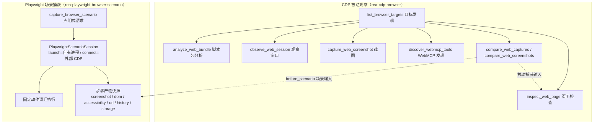
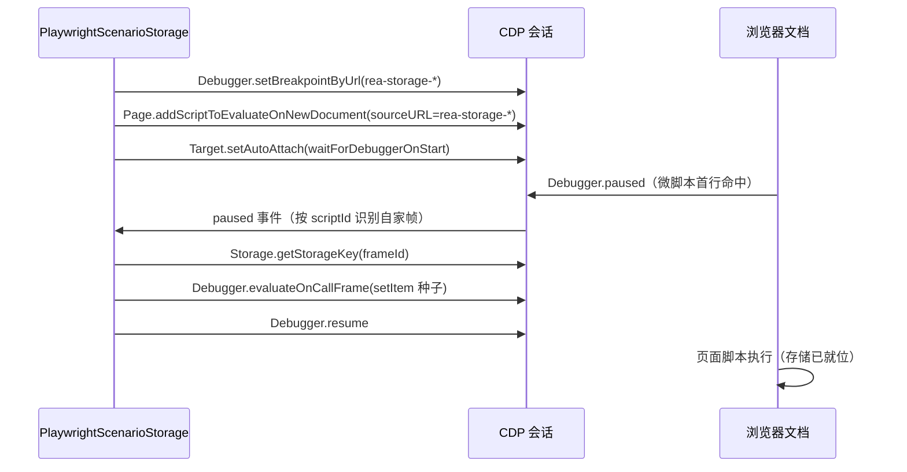
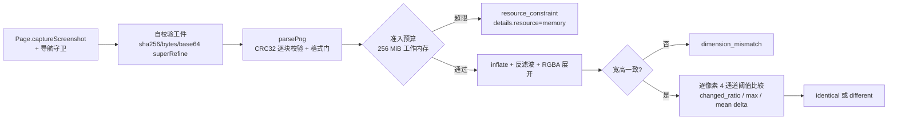

REA 对浏览器世界的观察建立在两条严格分离的通道之上：**CDP 被动观察**（附加到用户自有浏览器，不驱动、不评估、不导航）与 **Playwright 场景捕获**（在提供者自有或外部浏览器中以声明式动作词汇驱动页面）。两者产出的证据共享同一套脱敏词汇、完整性语义与对比协议，但权威边界截然不同——本页聚焦三块交叉区域：捕获存储如何以红acted 指纹而非原始值落地、两个场景捕获如何通过步骤对齐与归一化承诺得出可辩护的等值结论、以及截图如何从内容寻址工件演化为确定性的像素级差异证据。

## 双提供者权威模型：被动附加与主动驱动

REA 的浏览器能力由两个独立提供者承载，权威差异是其存在理由：`rea-cdp-browser` 只做**附加式观察**——列出目标、检查页面、分析脚本包、在观察窗口内记录外部用户动作引发的导航、捕获截图、发现 WebMCP 声明；`rea-playwright-browser-scenario` 则拥有**驱动权**——执行 `click`/`goto`/`wait_for` 等固定动作词汇并在每步边界捕获产物快照。文档明确指出"CDP page capture and V8 Inspector observation attach to an already-running target without launching it, driving actions, or evaluating target code"，而 Playwright scenarios "drive actions and capture step snapshots in either a provider-owned browser or a caller-selected external browser"，共享一个排除原因词汇表 `BrowserExclusionReason`。

两条通道在服务层汇合于同一组应用服务：`BrowserObservationService` 为每个 CDP 操作包装 `Evidence` 溯源，`BrowserScenarioCaptureService` 则将场景报告经 `browserScenarioCaptureSchema` 严格验证后转为证据，若提供者返回部分观察且所有步骤均已完成，仍会保留为完整证据而非报错丢弃。

Sources: [browser-observation.md](docs/browser-observation.md#L67-L79), [browser-observation.md](docs/browser-observation.md#L9-L26), [BrowserScenarioCaptureService.ts](src/application/BrowserScenarioCaptureService.ts#L18-L83)

场景请求是**声明式**的：固定动作词汇、显式 HTTP(S) 目标、确定性浏览器设置、显式存储种子与提供者自有的存活截止时间。导航跟随场景命名的目的地与页面自身的普通请求，不存在独立的源白名单或请求拦截层；服务工作者默认阻断，可用 `environment.service_workers` 显式放行。launch 模式要求调用者选定可执行文件并始终使用提供者自有临时配置（清理时关闭并删除）；connect 模式只接受显式端口的环回 CDP 端点，且只断开不销毁外部浏览器。

Sources: [browser-scenario-contract.md](docs/browser-scenario-contract.md#L1-L28), [browser-scenario-contract.md](docs/browser-scenario-contract.md#L137-L152)

## 场景捕获管线：会话生命周期与产物状态机

场景会话的核心不变量编码在 `PlaywrightScenarioSession` 的类型字段中：`mode: "launch" | "connect"` 决定 `processOwnership` 是 `"provider-owned"` 还是 `"external"`，进而决定清理语义是"终止自有进程"还是"断开外部连接"。会话打开时依次安装 Cookie（导航前经 `context.addCookies` 注入，值经密钥管理器解析）、初始化存储种子、挂接事件捕获（按场景选择的事件族与网络内容选择），此后每个动作经 `perform` 执行并在超时边界内受 `withPlaywrightExecutionBoundary` 保护，随后 `capture` 按请求集合捕获产物。

每个产物都是四态判别联合，而非布尔开关：`captured`（含自校验值）、`not_requested`（REA 根本没有看）、`missing`（请求了但捕获失败，附原因）、`truncated`（预算内只保留了部分）。这一区分是证据语义的基石——契约文档强调 `not_requested` "means REA did not look, not that the page had nothing to show"，一个只请求 URL 的捕获可以完全 `complete`，却无力回答任何关于渲染内容的问题。

| 产物类型 | 捕获方式 | 值形态 |
| --- | --- | --- |
| `screenshot` | `page.screenshot`（禁用动画、隐藏光标） | 内容寻址 PNG：`sha256` + `bytes` + base64 |
| `dom` / `accessibility` | `page.content()` / `ariaSnapshot()` | 密钥脱敏后的文本 + sha256 |
| `url` | `page.url()` 经 URL 消毒 | 净化后的结构化 URL |
| `history` | 页内 `performance.getEntriesByType("navigation")` | 条目类型 + 脱敏 URL |
| `storage` | `context.cookies()` + 页内 `localStorage`/`sessionStorage` 枚举 | 名称脱敏、值指纹化 |

Sources: [PlaywrightScenarioSession.ts](src/browser/PlaywrightScenarioSession.ts#L56-L105), [PlaywrightScenarioSession.ts](src/browser/PlaywrightScenarioSession.ts#L37-L48), [browserScenarioCaptureValues.ts](src/domain/browserScenarioCaptureValues.ts#L26-L43), [PlaywrightScenarioArtifacts.ts](src/browser/PlaywrightScenarioArtifacts.ts#L183-L212), [browser-scenario-contract.md](docs/browser-scenario-contract.md#L128-L140)

产物预算由 `capture.limits` 控制，默认值为事件 10,000 条、单事件 4 MiB、事件总量 16 MiB、网络事务 1,024 条、网络体 64 KiB 等——这些是**保留输出预算**，不会改变提供者自有的存活截止时间。事件预算超限时以带原因的省略记录（如 `max-network-transactions`）进入完整性账本，而不是静默丢弃。

Sources: [browserScenarioCaptureLimits.ts](src/domain/browserScenarioCaptureLimits.ts#L6-L15), [browserScenarioCaptureValues.ts](src/domain/browserScenarioCaptureValues.ts#L318-L334)

## 捕获存储：断点注入种子与红acted 快照

存储证据分两个方向：**写入**（种子注入）与**读出**（状态快照），各自在不同通道上有独立实现，但遵循同一脱敏纪律。

写入方向上，REA 必须保证存储条目在**首文档脚本执行之前**就位——否则页面初始化逻辑会读到空存储。Playwright 通道的解法是一次精巧的 CDP 断点编舞：`PlaywrightScenarioStorage` 在每个目标上启用 `Page`/`Runtime`/`Debugger` 域，用一个合成 URL（`rea-storage-<uuid>`）注册 `Debugger.setBreakpointByUrl` 断点，再经 `Page.addScriptToEvaluateOnNewDocument` 注入一行以该 URL 为 `sourceURL` 的微脚本，并开启 `Target.setAutoAttach`（`waitForDebuggerOnStart: true`）覆盖嵌套 iframe 目标。每个新文档加载时微脚本率先执行并命中断点，`Debugger.paused` 处理器通过 `scriptId` 识别自家栈帧后，在暂停态下调用 `Debugger.evaluateOnCallFrame` 执行 `localStorage.setItem` / `sessionStorage.setItem`，随后 `Debugger.resume` 放行页面脚本。

种子的一次性语义以键去重：local storage 每浏览器存储分区（`Storage.getStorageKey` 返回的分区键）只播种一次，session storage 每「顶层目标 + 分区键」组合只播种一次，且都发生在该区域的首文档脚本之前；后续动作才首次到达的源在其首次访问时补种。契约文档对此的承诺是"Cookies are installed before the initial navigation. Local storage entries are seeded once per browser storage partition"。

Sources: [PlaywrightScenarioStorage.ts](src/browser/PlaywrightScenarioStorage.ts#L289-L317), [PlaywrightScenarioStorage.ts](src/browser/PlaywrightScenarioStorage.ts#L411-L458), [PlaywrightScenarioStorage.ts](src/browser/PlaywrightScenarioStorage.ts#L461-L495), [browser-scenario-contract.md](docs/browser-scenario-contract.md#L195-L200)

读出方向上，场景快照在 `at_end` 或 `after_each_step` 时机枚举当前页面 URL 作用域内的 Cookie 与两级 Web 存储：Cookie 值经 `secrets.fingerprint` 转为 `value_state: "hashed"` 加 `value_sha256`，凡匹配已声明密钥的值则降级为 `value_state: "redacted-secret"` 且摘要置空——**存储值永不进入持久证据，只有身份与指纹**。名称字段同样经密钥脱敏（含 URL 编码变体与百分号大小写不敏感匹配）。

CDP 被动侧的存储检查受两级显式选择器约束：`include_storage_keys` 才会枚举键名（`DOMStorage.getDOMStorageItems`、`IndexedDB.requestDatabaseNames`、`CacheStorage.requestCacheNames`），`include_storage_fingerprints` 才会进一步计算稳定内容指纹——经 `Network.getCookies`（仅当前主帧 URL 适用的 Cookie）、IndexedDB 逐库对象仓库模式与逐仓内容、Cache Storage 逐条目汇总，最终以 `scope:identity_sha256` 的 Unicode 码点序排序输出，`fingerprint_algorithm` 固定为 `sha256`。任何枚举残缺都会将 `fingerprints_complete` 置假，而不是产出看似完整的清单。

| 维度 | 场景快照（Playwright） | 被动检查 |
| --- | --- | --- |
| Cookie 范围 | 当前页面 URL 适用集合 | 当前主帧 URL 适用集合 |
| Web 存储 | 页内 `Object.entries` 枚举 | `DOMStorage.getDOMStorageItems`（按源） |
| IndexedDB / Cache | 不覆盖 | `requestDatabaseNames` / `requestCacheNames` + 指纹 |
| 值保留策略 | `hashed` 摘要或 `redacted-secret` | 永不返回值，仅 sha256 指纹 |
| 完整性承诺 | `captured` / `missing` 四态 | `fingerprints_complete` + 分区排除原因 |

Sources: [PlaywrightScenarioArtifacts.ts](src/browser/PlaywrightScenarioArtifacts.ts#L138-L165), [BrowserScenarioSecrets.ts](src/browser/BrowserScenarioSecrets.ts#L392-L394), [browserScenarioCaptureValues.ts](src/domain/browserScenarioCaptureValues.ts#L59-L99), [CdpCaptureStorage.ts](src/browser/CdpCaptureStorage.ts#L23-L130), [CdpCaptureStorageFingerprints.ts](src/browser/CdpCaptureStorageFingerprints.ts#L80-L155)

## 场景对比：步骤对齐、归一化承诺与等值门槛

`compare_web_captures` 是单一入口下的双模式分发器：输入经 `browserCaptureComparisonInputSchema` 的互斥联合解析后，`compareBrowserCaptures` 以 `"before_scenario" in input` 一刀切分——场景输入走 `compareBrowserScenarios`，被动捕获输入走 `compareWebCaptures`。两者都是**纯领域函数**：不发起任何外部访问，只在已脱敏的持久证据上运算。

场景对比的第一道关卡是**步骤对齐**：两侧仅按「精确且唯一」的 `step_id` 匹配，重复 ID、单侧缺失、动作不匹配分别产生带 `code` 的对齐失败记录，浏览器产品/版本或场景起始源不一致则报 `capture_context_mismatch`。对齐失败不会中断比较——已对齐的步骤仍逐项产出差异，但整体状态最多只能是 `unknown`，因为"缺失的步骤无法证明未变化"。

第二道关卡是**归一化承诺**：调用者声明的字面量替换规则（`match` → `replacement`，限定工件族）与九条内建规则一起按 `rule_id` 规范排序，提交为带 sha256 摘要的规范化承诺写入对比结果——这意味着同一次对比使用的规则集本身是可复现、可审计的。内建规则表值得完整列出，因为它们定义了"什么波动不算变化"的判定边界：

| 内建规则 | 语义 |
| --- | --- |
| `ignore_step_elapsed_ms` | 步骤耗时为易变字段，排除 |
| `ignore_event_sequence` / `ignore_event_step_index` | 序号与步索引为捕获局部易变值 |
| `compare_screenshot_content_digest` | 截图按内容摘要比较，不嵌字节 |
| `compare_normalized_text_content` | 文本经声明的字面量规则归一后比较 |
| `ignore_capture_local_network_transaction_ids` | 事务 ID 为捕获局部标识 |
| `attribute_network_transactions_to_request_step` | 事务归因到发起请求的步骤 |
| `compare_network_transactions_as_unordered_collection` | 网络事务按无序集合比较 |
| `preserve_redirect_transaction_ancestry` | 保留重定向事务的祖先链 |

等值判定是**三层门槛**的合取：两侧捕获的 `equality_eligible` 均为真（即各自完整性为 `complete` 且无截断/缺失小节）、对齐无失败、且所有已对齐步骤的所有工件差异为空。任何一层不满足，整体状态落为 `unknown` 而非 `unchanged`——结果中的 `limitations` 数组原文写明："A changed status proves an observed normalized difference. Missing or truncated evidence, incompatible capture context, or alignment failure prevents an unchanged claim."

Sources: [browserCaptureComparison.ts](src/domain/browserCaptureComparison.ts#L40-L48), [browserScenarioDiff.ts](src/domain/browserScenarioDiff.ts#L65-L118), [browserScenarioDiff.ts](src/domain/browserScenarioDiff.ts#L266-L272), [browserScenarioNormalization.ts](src/domain/browserScenarioNormalization.ts#L13-L61), [browserScenarioDiffValues.ts](src/domain/browserScenarioDiffValues.ts#L127-L139), [browserScenarioDiffValues.ts](src/domain/browserScenarioDiffValues.ts#L141-L172)

每个对齐步骤比较八类工件：动作状态（`action`/`status`/`before_url`/`after_url`/`error` 五个稳定字段）、截图（投影为 `sha256` + `bytes` + `media_type`，不嵌图像字节）、DOM 与可访问性树（经归一化后的全文比较）、URL、历史、存储快照，以及事件族——事件经预构建的指纹索引比较，网络事务以无序指纹集合对齐，且两侧的事件族选择或网络内容选择不一致时，产出的是**不可比原因**而非"变化"判定："Different content selection is missing comparability, not an observed website change."（不同内容选择是缺乏可比性，不是观察到的网站变化）

Sources: [browserScenarioDiff.ts](src/domain/browserScenarioDiff.ts#L292-L352), [browserScenarioDiffEvidence.ts](src/domain/browserScenarioDiffEvidence.ts#L74-L105), [browserScenarioDiffEvidence.ts](src/domain/browserScenarioDiffEvidence.ts#L188-L196)

## 截图证据链：内容寻址工件与确定性像素对比

截图是 CDP 通道唯一的像素表面，其证据链由三环构成：**受保护捕获 → 自校验工件 → 本地确定性对比**。

捕获环（`capture_web_screenshot`）在 `Page.captureScreenshot` 前后各取一次 `Page.getFrameTree` 并挂接主帧导航事件监听，构造一个导航守卫：若捕获期间主帧发生导航（或离开允许源作用域），结果立即作废并返回 `target_changed` / `target_not_allowed`，而非交出一张语义不明的图。命令参数固定为 `{ format: "png", fromSurface: true, captureBeyondViewport: false }`——可见视口、不滚动、不评估 JS、不越界捕获，这些非目标同时写入结果的 `limitations`。

工件环是**自校验**的：`webScreenshotArtifactSchema` 的 `superRefine` 会从 `data_base64` 解码字节、重算 sha256 并核对字节长度，摘要或长度不匹配直接判为无效——"Self-verifying inline PNG artifact for CLI/MCP parity"。同一模式复用于场景通道的文本工件（DOM/可访问性树同样带 sha256 自校验），使得任何在证据管道中被篡改或截断的内容都无法通过模式验证。

对比环（`compare_web_screenshots`）是纯本地运算，无 OCR、无外部服务：两图先经头部校验的内存准入（估计值覆盖双解码缓冲、IDAT 聚合、inflate 输出块、扫描行存储与 RGBA 展开的总和，超预算返回带估计与上限字节数的 `resource_constraint`），PNG 逐块 CRC32 校验后解码，再对 RGBA 缓冲做逐像素、逐通道的确定性比较——`changed_pixels`、`changed_ratio`、`maximum_channel_delta`、`mean_absolute_channel_delta` 全部是可复现的数值指标，`channel_threshold` 允许调用者定义通道级容差。场景通道的截图快照复用同一工件模式（禁用动画与光标后内容寻址），场景对比中则只投影 `sha256`/`bytes`/`media_type` 三元组参与摘要比较。

Sources: [CdpScreenshot.ts](src/browser/CdpScreenshot.ts#L26-L123), [webScreenshot.ts](src/domain/webScreenshot.ts#L11-L29), [PngVisualDiff.ts](src/browser/PngVisualDiff.ts#L36-L37), [PngVisualDiff.ts](src/browser/PngVisualDiff.ts#L40-L102), [browser-observation.md](docs/browser-observation.md#L46-L63), [PlaywrightScenarioArtifacts.ts](src/browser/PlaywrightScenarioArtifacts.ts#L50-L63)

## 完整性账本：缺席语义与等值资格

两条通道各自维护一套显式的、非有损的完整性词汇，它们共同拒绝把"没看到"翻译成"没有"。被动侧 `BrowserCompleteness` 以四值状态刻画窗口内覆盖：`complete_within_window`、`policy_filtered`（被源作用域过滤）、`attach_limited`（CDP 附加能力受限或域不可用）、`truncated`（预算或验证边界截断），并逐小节列出受限原因、排除项与逐类丢弃事件计数——文档同时警告 `prior_activity_available` 恒为 `false`，REA 附加前发生的事件不在数组中不构成"事件从未发生"的证据。

场景侧的完整性更进一步：`complete` / `incomplete` / `truncated` 判别联合携带布尔字段 `equality_eligible`，只有 `complete` 才可能获得等值资格——这个字段就是场景对比等值门槛的第一道闸门的数据来源。工件级的四态（`not_requested` / `missing` / `truncated` / `captured`）与捕获级账本互为投影：`artifactEvidenceState` 在对比时把产物状态再次对账于步骤完整性小节，声明为 `truncated_sections` 成员的工件即使 `state: "captured"` 也会被投影为 `truncated`，确保截断的值永远无法冒充完整证据参与等值运算。

| 词汇表 | 值 | 关键字段 |
| --- | --- | --- |
| 场景完整性 | `complete` / `incomplete` / `truncated` | `equality_eligible`、`missing_sections`、`truncated_sections` |
| 被动完整性 | `complete_within_window` / `policy_filtered` / `attach_limited` / `truncated` | 分节列表、`excluded`、`dropped_events` |
| 产物状态 | `captured` / `not_requested` / `missing` / `truncated` | `reason`、`observed`/`retained` |

Sources: [browserCompleteness.ts](src/domain/browserCompleteness.ts#L69-L130), [browserScenarioCaptureValues.ts](src/domain/browserScenarioCaptureValues.ts#L354-L376), [browserScenarioDiffEvidence.ts](src/domain/browserScenarioDiffEvidence.ts#L28-L45), [browser-observation.md](docs/browser-observation.md#L340-L360)

## 验证通道与延伸阅读

上述语义均有真实浏览器验证通道背书：存储种子的分区语义由专门的端到端脚本检验——它同时在 `127.0.0.1` 与 `localhost`（两个不同浏览器存储分区）上播种同名键、驱动跨分区导航并断言种子的一次性作用域，清理阶段经 `verifier-cleanup` 归还资源；CI 中 `real-browser.yml` 工作流持续运行这组验证。契约文档也坦承残余边界：launch 模式在 POSIX `SIGKILL` 或 Windows 进程树终止下的配置残留回收仍在推进（issue #4659），Chromium 在页面 CDP 会话断开时可能清除他方客户端的 `navigator.platform` 仿真（issue #4089），这些限制以 `limitations` 字段随每份证据发布而非静默吞没。

若要将本页的捕获证据与静态分析调和，请继续阅读 [运行时观察与静态调和](17-yun-shi-guan-cha-yu-jing-tai-diao-he-v8-inspector-electron-bian-jie-yu-fuses-jian-cha)；被动捕获的脚本导出与模块图见 [JavaScript 与 Electron 静态分析](15-javascript-yu-electron-jing-tai-fen-xi-asar-du-qu-mo-kuai-tu-yu-yuan-ma-hui-fu)；把观察窗口扩展到网络层（pcap、mitmproxy、qlog）见 [网络捕获与数据包分析](18-wang-luo-bu-huo-yu-shu-ju-bao-fen-xi-pcap-mitmproxy-qlog-yu-http-3-shi-yan-shi)；真实浏览器验证通道的完整清单见 [测试策略与验证通道](27-ce-shi-ce-lue-yu-yan-zheng-tong-dao-yuan-ma-bian-jie-yan-shou-zhi-xing-ji-zhen-shi-gong-ju-lian-tong-dao)。