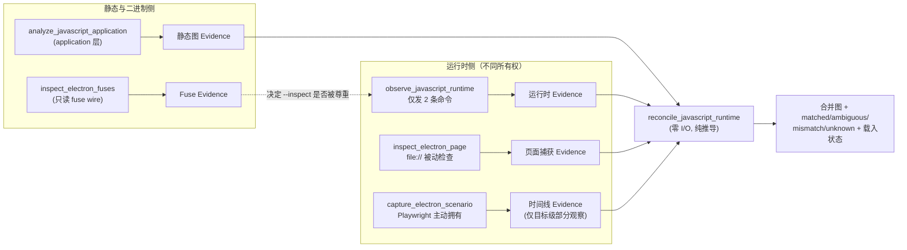
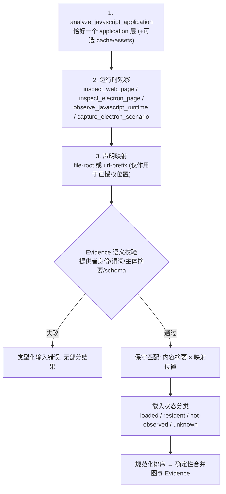

REA 对打包后的 JavaScript 应用提供三类彼此独立的证据面：附着式 **V8 Inspector 被动观察**（Node.js / Electron 主进程）、**Electron CDP 边界**（`file://` 页面被动检查与 Playwright 主动场景），以及针对 Electron 二进制的 **Fuses 静态读取**。三者产出的证据都不能单独宣称"哪个模块被初始化、哪个功能被执行"；要得到这类结论，必须把运行时证据与静态 JavaScript Application Graph 一起交给 `reconcile_javascript_runtime` 做调和。本页按"观察面 → 预算与确定性 → 边界 → Fuses → 调和"的顺序拆解这套机制，所有结论均以仓库内实现为准。

Sources: [javascript-runtime-observation.md](docs/javascript-runtime-observation.md#L1-L19), [electron-observation.md](docs/electron-observation.md#L11-L22)

## 三个互补的观察面：权威模型总览

三个运行时表面的关键差异在于**谁启动目标、谁拥有生命周期、以及证据的权威边界**。V8 Inspector 观察是纯被动的——目标进程由调用者启动并拥有，REA 只附着、只收事件；Electron 文件页面检查同样被动，但要求端点是字面回环地址且页面必须解析为本地常规文件；主动 Electron 场景则相反，REA 通过 Playwright 官方 API 启动应用并拥有其整个生命周期，因而会拦截并记录 shell、权限、下载等外部效应。Fuses 检查则完全不接触运行进程，只读二进制中的 fuse wire。下图给出了这四个入口如何汇入静态调和（阅读前提：`analyze_javascript_application` 产出的是静态 JavaScript Application Graph 证据，属第 15 页静态分析的内容；此处只关注它作为调和输入的角色）：

Fuses 与 Inspector 之间的虚线是实践中的关键顺序：打包应用若关闭了 `EnableNodeCliInspectArguments`，Electron 会静默忽略 `--inspect`/`--inspect-brk`，此时 `electron-main` 目标根本不会出现在目标列表里——而这个缺失本身不能证明 fuse 状态，必须先用 Fuses 检查确认。

Sources: [javascript-runtime-observation.md](docs/javascript-runtime-observation.md#L39-L43), [electron-fuses.md](docs/electron-fuses.md#L1-L18), [electron-observation.md](docs/electron-observation.md#L91-L101)

| 观察面 | MCP/CLI 操作 | 所有权 | 是否执行目标代码 | 证据权威 |
| --- | --- | --- | --- | --- |
| V8 Inspector 观察 | `observe_javascript_runtime` | 调用者拥有目标 | 否（仅 2 条 enable 命令） | 脚本存在性 + 上下文生命周期 |
| Electron 文件页面 | `inspect_electron_page` | 调用者拥有端点 | 否 | 本地脚本/资源/DOM 结构身份 |
| 主动 Electron 场景 | `capture_electron_scenario` | REA 启动并拥有 | 是（受控动作） | 时间线 + IPC 形状（非目标级载入覆盖） |
| Fuses 检查 | `inspect_electron_fuses` | 无进程接触 | 否 | 二进制字节观测 + 派生含义 |

Sources: [javascript-runtime-observation.md](docs/javascript-runtime-observation.md#L10-L19), [electron-observation.md](docs/electron-observation.md#L24-L34), [electron-fuses.md](docs/electron-fuses.md#L43-L52)

## 被动 V8 Inspector 观察：两命令协议

### 发现与连接校验

目标发现读取同端点的 `/json/version` 与 `/json/list`，解析出产品名、协议版本、V8 版本与目标数组，且单个目标的畸形字段（例如无直接 socket 的匿名 eval 目标）只降级该行，不丢弃端点上其余可用目标。拿到目标后，REA 还会对端点上报的 `webSocketDebuggerUrl` 做同端口校验：协议必须是 `ws:`，不得携带用户名/密码/查询/片段，路径只允许 `/<id>`、`/devtools/node/<id>`、`/devtools/page/<id>` 三种形态，主机名一律改写回受信端点的主机名。这意味着一个目标必须同时满足"精确目标 ID 匹配 + 同端口 WebSocket"才可被观察。

Sources: [V8InspectorEndpoint.ts](src/inspector/V8InspectorEndpoint.ts#L55-L84), [V8InspectorEndpoint.ts](src/inspector/V8InspectorEndpoint.ts#L86-L108), [javascript-runtime-observation.md](docs/javascript-runtime-observation.md#L45-L52)

### 协议边界：只发两条命令

`observe_javascript_runtime` 的协议面被刻意压缩到两条命令：`Runtime.enable` 与 `Debugger.enable`。实现类 `V8InspectorProvider` 的注释与文档共同锚定了"只附着"契约——从不发送 `Runtime.evaluate`、不读脚本源码、不打断点、不暂停或恢复执行、尤其不发送 `Runtime.runIfWaitingForDebugger`。因此用 `--inspect-brk` 启动的目标会停在启动前，REA 永远不会替它恢复；这类目标必须由调用者用自有的调试器恢复后再请求观察。每次 WebSocket 握手与每条命令响应各有独立的 20 秒截止时间，与调用者选择的观察窗口分离；握手或命令卡死报 `provider_timeout`，但已收到的事件仍被保留。

Sources: [V8InspectorProvider.ts](src/inspector/V8InspectorProvider.ts#L78-L82), [V8InspectorProvider.ts](src/inspector/V8InspectorProvider.ts#L318-L330), [javascript-runtime-observation.md](docs/javascript-runtime-observation.md#L86-L101)

### 直接观测与显式未知

事件摄取函数只接受五类事件：`Debugger.scriptParsed`（建立"某受限脚本位置在观察的执行上下文中被解析"这一存在性事实）、`Debugger.scriptFailedToParse`（仅保留计数）、以及三类执行上下文生命周期事件。缺失去失或非安全整数上下文 ID 的生命周期事件不产生上下文记录，只计入 `unknowns`。协议本身不暴露 require/import 调用边、EventEmitter 触发、Electron IPC 消息或脚本卸载——这些被写进结果的 `unavailable_without_instrumentation` 字段，作为永久性显式未知，而不是缺失推断。

Sources: [V8InspectorProvider.ts](src/inspector/V8InspectorProvider.ts#L613-L632), [V8InspectorCaptureProjection.ts](src/inspector/V8InspectorCaptureProjection.ts#L184-L218), [javascript-runtime-observation.md](docs/javascript-runtime-observation.md#L103-L121)

### 角色声明的权威边界

调用者可声明四种角色：`node`、`electron-main`、`electron-preload`、`electron-renderer`。前两种要求协议目标类型为 `node`，后两种要求 `page`，类型不匹配直接拒绝（`target_not_allowed`）。关键限制在于：Inspector 协议既不认证操作系统 PID，也不区分 Electron 角色，因此证据中角色权威记为 `caller-declared-unverified`。Electron 主进程、preload 与渲染器的行为只能作为**分离的 Inspector 目标**分别观察，提供者绝不推断两个目标属于同一 Electron 应用。

Sources: [V8InspectorProvider.ts](src/inspector/V8InspectorProvider.ts#L551-L559), [javascript-runtime-observation.md](docs/javascript-runtime-observation.md#L122-L133)

## 捕获预算、确定性与部分保留

捕获有两层字节预算：单条 CDP 消息 16 MiB 传输上限（超限直接 `payload_limit` 失败），以及 8 MiB 的**保留元数据**聚合预算——按 UTF-16 字符串、记录与集合开销保守估算。聚合预算耗尽后，后续元数据事件被丢弃，部分结果携带 `events_dropped`、`truncated: true` 与 `retained_metadata_budget_exceeded`；上下文的重复状态转换更新当前记录而非累积重复对象。

Sources: [V8InspectorProvider.ts](src/inspector/V8InspectorProvider.ts#L28-L31), [V8InspectorProvider.ts](src/inspector/V8InspectorProvider.ts#L643-L662), [javascript-runtime-observation.md](docs/javascript-runtime-observation.md#L135-L148)

确定性的来源是"投影时排除非稳定字段 + 规范化排序"：脚本按稳定元数据去重后生成 `v8_script_<sha256>` 键（输入为位置、上下文键、CDP 哈希、长度与 is_module 的 JSON 序列化），全部条目与上下文按 Unicode 码点排序；墙钟时间戳与协议脚本 ID 不进入持久结果，因此相同输入与捕获元数据必然产出相同 Evidence ID。收尾阶段用 8 个并发 worker 对去重后的 URL 组做位置授权，取消语义保证"当前文件系统操作完成后停止新的授权"，未检查的目标保持未知而非被排除；关闭连接只关闭 REA 自己的 WebSocket（宽限与强制确认各至多 2 秒），绝不终止调用者拥有的运行时。

Sources: [V8InspectorCaptureProjection.ts](src/inspector/V8InspectorCaptureProjection.ts#L52-L101), [V8InspectorCaptureProjection.ts](src/inspector/V8InspectorCaptureProjection.ts#L224-L242), [javascript-runtime-observation.md](docs/javascript-runtime-observation.md#L150-L162)

## Node 发现位置的损耗语义

Node 的 `/json/list` 上报的是**尽力而为的路径名**：以 `file://` 为前缀、不做 URI 编码，且 Node 会把反斜杠和双引号替换为下划线——这一变换不可逆，因为原始文件名可能本就含下划线。REA 的处理策略是"能验证才解析"：仅在 POSIX 上且路径不含 `_`、`"`、`\` 时按字面解释（保留 `#`、`%`）；Windows 路径、歧义下划线路径与无法核实的路径保持**可被观察**（凭端点 + 精确目标 ID），但目标位置降级为 `kind: "unresolved"`、`reason: "unverifiable-file-location"`，上报值原样保留。

Sources: [JavaScriptRuntimeScope.ts](src/inspector/JavaScriptRuntimeScope.ts#L120-L145), [javascript-runtime-observation.md](docs/javascript-runtime-observation.md#L54-L84)

这个 unresolved 位置不主张文件存在、也不授权读取内容；调和阶段会保留该对象并对该目标报 `runtime-location-unresolved`、置信度 unknown，绝不从上报路径名推导静态匹配。脚本位置的独立解析仍走 `scriptParsed` URL 的既有检查（本地文件授权、编码分隔符排除；`node:` 内建模块记为 builtin，http(s) 记为 URL 位置）。

Sources: [JavaScriptRuntimeScope.ts](src/inspector/JavaScriptRuntimeScope.ts#L82-L118), [javascript-runtime-observation.md](docs/javascript-runtime-observation.md#L74-L84)

## Electron 边界：文件页面检查与主动场景

### 被动 file:// 页面检查

`inspect_electron_page` 只接受字面端口回环 HTTP 端点，且只保留解析为**本地常规文件**的 `file://` 页面——包括打包应用从 `app.asar` 内部服务的页面：路径中第一个作为常规文件存在的 `.asar` 组件被视为归档，其余部分必须在该归档头部命中一个常规文件成员，报告路径为规范归档路径拼接成员名。远程主机、编码路径分隔符、ASAR 目录或链接、不存在的路径都被拒绝。检查不保留 DOM 取值、不执行渲染器代码、不导航点击、不调用 Electron IPC、不关闭目标。脚本源码收集默认关闭；开启后受 32 MiB UTF-8 总预算与 20 秒收集截止约束，单条 CDP 响应另有 64 MiB 上限。worker、service-worker、shared-worker 目标通过**被动目标元数据**盘点，REA 不附着、不在其中执行代码。

Sources: [electron-observation.md](docs/electron-observation.md#L24-L40), [electron-observation.md](docs/electron-observation.md#L76-L89)

### 主动场景与 Fuse 预检

主动场景通过 Playwright 官方 Electron API 启动可执行文件并拥有其生命周期：接受点击/等待、窗口级渲染器重载/崩溃动作，以及合成的 `open-url`、`second-instance` 深链投递；记录窗口与 WebContents 身份、进程指标、IPC 通道与**参数形状**元数据（载荷取值永不保留）。启动含初始状态快照共 60 秒截止；主动 hook 拦截并记录外部 shell/导航/权限/下载/弹窗/更新器/系统集成效应，被拦截的同步 shell API 仍维持返回契约（`showItemInFolder` 返回 `undefined`、`writeShortcutLink` 返回 `false`），但时间线中的 `shell-attempt` 事件只记录被拦截阶段与参数形状，不等于宿主操作真的发生了。

Sources: [electron-observation.md](docs/electron-observation.md#L91-L101), [electron-observation.md](docs/electron-observation.md#L109-L128)

主动场景与 Fuses 的交汇点是一个**启动前预检**：Playwright 依赖 Node CLI inspect 参数（`--inspect=0` / `--remote-debugging-port=0`）附着 Electron 进程；当 fuse wire 存在且 index 3（`EnableNodeCliInspectArguments`）为 disabled 或 removed 时，预检在任何子进程启动前快速失败（`AnalysisUnsupportedTargetError`），避免挂满 60 秒启动截止；fuse 状态未知（无哨兵、wire 版本非 1、容器不受支持）则照常启动。通用修复建议是改用被动的 `inspect_electron_page`，或对解包后的应用使用原生 Electron 开发运行时。这个预检同时会把 macOS 可执行文件向上回溯到 `.app` 包目录以解析真正的 fuse 载体。

Sources: [PlaywrightElectronActiveFuses.ts](src/browser/PlaywrightElectronActiveFuses.ts#L33-L43), [PlaywrightElectronActiveFuses.ts](src/browser/PlaywrightElectronActiveFuses.ts#L47-L107)

## Electron Fuses 静态读取：哨兵、wire 与推导

### 载体选择与容器识别

`inspect_electron_fuses` 接受 macOS `.app` 包、Electron Framework 二进制（解析顺序：顶层 `Electron Framework` → `Versions/Current/Electron Framework` → `Versions/A/Electron Framework`），或 Windows/Linux 的主 Electron 可执行文件——fuse wire 位于可执行文件内而非 `app.asar`。包与框架路径的符号链接只在 `Electron Framework.framework` 内部被跟随（至多 32 跳），越界即拒绝。读取器把文件识别为 `mach-o`、`mach-o-universal`、`pe` 或 `elf` 容器：通用 Mach-O 每个 slice 一个条目并校验 slice 不重叠；PE 通过 MZ 头 + `0x3c` 偏移 + `PE\0\0` 签名识别（头部偏移上限 1 MiB）。

Sources: [electron-fuses.md](docs/electron-fuses.md#L20-L41), [ElectronFusePath.ts](src/electron/ElectronFusePath.ts#L49-L76), [ElectronFuseReader.ts](src/electron/ElectronFuseReader.ts#L208-L256)

### Wire 解析

fuse wire 由 32 字节 ASCII 哨兵 `dL7pKGdnNz796PbbjQWNKmHXBZaB9tsX` 引导，其后依次是 1 字节 wire 版本、1 字节声明长度与 N 个 fuse 字节。扫描按 256 KiB 窗口流式进行（块间只保留哨兵长度减 1 的重叠），文件准入上限 1 GiB，每 slice 最多保留 32 个哨兵；wire 越过 slice 末尾时该哨兵报 `complete: false`，只保留实际存在的 fuse 字节。扫描全程对文件做前后 inode/设备/类型状态复核，文件被替换即抛 `RegularFileChangedError`，保证读到的是同一次打开的物理文件。

Sources: [electronFuses.ts](src/domain/electron/electronFuses.ts#L8-L15), [ElectronFuseReader.ts](src/electron/ElectronFuseReader.ts#L21-L26), [ElectronFuseReader.ts](src/electron/ElectronFuseReader.ts#L304-L344), [ElectronFuseReader.ts](src/electron/ElectronFuseReader.ts#L399-L431)

| wire 字段 | 位置 | 语义 |
| --- | --- | --- |
| 哨兵 | offset+0..31 | `dL7pKGdnNz796PbbjQWNKmHXBZaB9tsX`（ASCII，32 字节） |
| `wire_version` | offset+32 | 1 字节；非 1 时所有 fuse 保留 `name: null` |
| `declared_length` | offset+33 | 1 字节；声明的 fuse 字节数，可截断 |
| fuse 字节 | offset+34.. | 每个索引一字节，按序展开 |

### 状态字节、名称表与派生含义

fuse 字节只有三个已知值：`0x30` disabled、`0x31` enabled、`0x72` removed，其余一律 `unknown` 并保留原始字节。**removed 不等于 enabled**：被移除的 fuse 意味着 Inspector 旗标与 `ELECTRON_RUN_AS_NODE` 不被尊重、应用代码不被限制在 `app.asar`。版本 1 的九个名称按索引固定（`RunAsNode` … `WasmTrapHandlers`），表外索引或其他版本保持 `name: null`。四个 fuse 被映射为 `relationship: "derivation"` 的运行时含义——`node_cli_inspect_arguments`（索引 3）、`electron_run_as_node`（索引 0）、`embedded_asar_integrity_validation`（索引 4）、`only_load_app_from_asar`（索引 5）——每个派生都绑定其来源的 slice 索引与哨兵偏移；其中 ASAR 完整性校验只在 macOS/Windows 编译，Linux ELF 上的字节被保留但执行结果记 `unknown`。

Sources: [electronFuses.ts](src/domain/electron/electronFuses.ts#L19-L58), [electronFuses.ts](src/domain/electron/electronFuses.ts#L103-L119), [electron-fuses.md](docs/electron-fuses.md#L54-L68)

| 字节 | 状态 | 运行时含义 |
| --- | --- | --- |
| `0x30` | `disabled` | 对应能力关闭（如 Inspector 旗标不被尊重） |
| `0x31` | `enabled` | 对应能力开启（如 ASAR 完整性被强制） |
| `0x72` | `removed` | 等同 disabled 的运行时效果，但字节被显式抹除 |
| 其他 | `unknown` | 保留 raw_byte，派生结果为 `unknown` |

### 未知的正交语义

无哨兵意味着 fuse 状态**未知**，绝不等于全部禁用；同一 slice 内出现两个及以上哨兵时全部上报，REA 不做选择。fuse 字节也不能证明应用通过其他方式启用了 Inspector（例如应用代码里的 `app.commandLine` 或远程调试开关）。读取本身不创建临时文件、不修改选中字节，结果是纯只读观测加上明确标注的派生层。

Sources: [electron-fuses.md](docs/electron-fuses.md#L70-L88), [electronFuses.ts](src/domain/electron/electronFuses.ts#L204-L219)

## 静态调和：reconcile_javascript_runtime

### 输入校验与零 I/O 契约

调和操作不接受路径、不做任何文件系统/浏览器/Electron I/O，只接受**语义上已验证的完整 Evidence 对象**：`analyze_javascript_application`、`inspect_web_page`、`inspect_electron_page`、`observe_javascript_runtime` 或 `capture_electron_scenario` 的产出。服务层在解析前先过严格 schema，再校验提供者身份、谓词类型、主体摘要、目标参数与规范化结果 schema——仅操作名相同不足以通过。`capture_electron_scenario` 只提供目标级部分观察，不建立脚本载入覆盖。`static_layers` 要求恰好一个 `application` 角色，可附加 `cache`/`assets` 角色；映射只有两种：`file-root`（运行时规范文件系统根 → artifact 相对前缀）与 `url-prefix`（精确 HTTP(S) 源 + 路径前缀）。映射不能扩大 CDP 源、放宽 Electron 根、读文件或授权 source-map 访问——它们是应用于已授权位置之上的调用者声明推断输入。

Sources: [javascript-runtime-reconciliation.md](docs/javascript-runtime-reconciliation.md#L1-L19), [javascript-runtime-reconciliation.md](docs/javascript-runtime-reconciliation.md#L57-L63), [JavaScriptRuntimeReconciliationService.ts](src/application/javascript/JavaScriptRuntimeReconciliationService.ts#L13-L45)

### 工作流

下面的流程图给出从静态分析到确定性调和输出的完整路径（阅读前提：每一步产出的都是可序列化的 Evidence 对象，MCP 输入中 `analysis` 与 `runtime_observations` 字段要求完整对象而非 Evidence ID）：

Sources: [javascript-runtime-reconciliation.md](docs/javascript-runtime-reconciliation.md#L20-L85)

### 匹配规则：从强到弱的保守级联

匹配的核心实现把候选按"层×类别×路径"与"类别×内容摘要"建立索引，然后对每个运行时实体执行保守级联。带捕获源 SHA-256 的实体先看**映射位置上**是否有候选：有且恰好一个摘要吻合 → `content-and-location-match`（高置信）；映射位置上的候选摘要不符 → 显式 `captured-content-disagrees-with-static-location`（即使别处存在相同摘要也不能掩盖分歧，摘要缺失时保持 `unknown`）；映射位置无候选时才允许全局唯一内容摘要匹配。无捕获字节的实体只允许**唯一**映射路径产生中置信度位置匹配；多个候选一律 `ambiguous` 且不发出任何 `observed_as` 边，同时以 `candidate_static_count` 与 `candidate_static_nodes` 报告完整合格候选集。

Sources: [javascriptRuntimeReconciliationMatching.ts](src/domain/javascript/javascriptRuntimeReconciliationMatching.ts#L62-L99), [javascriptRuntimeReconciliationMatching.ts](src/domain/javascript/javascriptRuntimeReconciliationMatching.ts#L101-L150), [javascript-runtime-reconciliation.md](docs/javascript-runtime-reconciliation.md#L87-L114)

| 条件 | 状态 | basis | 置信度 |
| --- | --- | --- | --- |
| 捕获 SHA-256 + 唯一映射位置吻合 | matched | `content-and-location` | high |
| 映射位置无候选，全局唯一内容摘要 | matched | `content-sha256` | high |
| 无捕获字节，唯一映射 artifact 路径 | matched | 映射 basis | medium |
| 多个合格候选 | ambiguous | （无 `observed_as` 边） | unknown |
| 映射位置摘要不符（有捕获字节） | unmatched/mismatch | 位置 basis | high |
| 无授权映射或覆盖不完整 | unknown / truncated | none | unknown |

每条跨层 `observed_as` 边都带 `authority: cross-layer-reconciliation` 与 `state: inferred`；底层 artifact/AST 观察与运行时观察保持原样、各自保留自己的 Evidence 链接。

Sources: [javascript-runtime-reconciliation.md](docs/javascript-runtime-reconciliation.md#L111-L114), [javascriptRuntimeReconciliationMatching.ts](src/domain/javascript/javascriptRuntimeReconciliationMatching.ts#L24-L43)

### 载入状态：loaded、resident、not-observed 与 unknown

静态的 asset/chunk/module 节点在调和结果中获得独立的载入状态分类，其判定由 `classifyStaticLoadStates` 实现：有已接受的运行时脚本对应 → `loaded`；所在 asset 被观察到但内嵌模块未被独立观察 → 沿 `contains` 边传播 `resident-in-loaded-asset`；只有当"调和完整 + 静态层覆盖完整 + 作用域内所有捕获脚本完整"三个条件同时成立且节点位于已行使的映射前缀之下时，才能给出 `not-observed-in-capture`；其余一切（不完整捕获、层在运行时作用域之外、未解析对应）保持 `unknown`。四种状态都不证明功能执行、初始化顺序、可达性或因果性——尤其 `not-observed-in-capture` 绝不等于全局未载入。

Sources: [javascriptRuntimeLoadState.ts](src/domain/javascript/javascriptRuntimeLoadState.ts#L88-L123), [javascript-runtime-reconciliation.md](docs/javascript-runtime-reconciliation.md#L116-L134)

### 帧、worker 与 source map 权威

V8 Inspector 观察只暴露执行上下文 ID、没有经认证的帧关系，因此其脚本在合并图中附着到**精确运行时目标**；Electron 页面捕获则保留 CDP 提供的帧 ID，并盘点授权的 worker/service-worker/shared-worker 目标及其 opener 与父帧关系。source map 声明与原始源读取始终是静态证据，进 `source_map_authority` 字段，绝不用作主运行时字节匹配——source 名或 `sourcesContent` 摘要不会被静默等同于 CDP 观察到的生成字节。

Sources: [javascript-runtime-reconciliation.md](docs/javascript-runtime-reconciliation.md#L136-L154), [javascript-runtime-observation.md](docs/javascript-runtime-observation.md#L164-L175)

### 确定性与非目标

调和不对静态层、被动捕获、运行时实体、调和项、载入状态、映射声明或候选引用施加聚合数量上限（各集合仍受各自 Evidence 的结构校验约束），投影完整输入时报告零省略项。层、捕获、节点、边、匹配与证据链接全部规范化排序，重复提供相同已验证 Evidence 与映射必然产出相同的调和结果、图与 Evidence 标识。非目标同样明确：不附着 CDP、不抓取脚本或 source map、不执行 JavaScript、不调用 Electron IPC、不检查原生插件、不推断任意 URL 重写、不搜索文件系统；它也不取代旧的 `correlate_static_and_runtime` 调查工具——后者记录跨版本静态/运行时对比假设，而调和操作把 JavaScript 运行时实例映射到静态应用图实体。

Sources: [javascript-runtime-reconciliation.md](docs/javascript-runtime-reconciliation.md#L156-L178)

## 观察面的 MCP 注册方式

两个 Inspector 工具通过 `registerJavaScriptRuntimeObservationTools` 注册：即使可选提供者策略不可用，注册仍然发生，此时调用返回类型化的 `optionalProviderUnavailable` 错误而非工具缺失——这让代理能够区分"功能未启用"与"目标不可达"。执行路径统一经过 `runAdmittedToolOperation` 的准入与取消信号传递，再由 `deliverEvidenceResult` 按契约投递确定性 Evidence。

Sources: [registerJavaScriptRuntimeObservationTools.ts](src/server/registerJavaScriptRuntimeObservationTools.ts#L30-L48), [javascript-runtime-observation.md](docs/javascript-runtime-observation.md#L49-L52)

## 延伸阅读

- 若需要为运行时观察准备静态输入（ASAR 读取与模块图），请回到 [JavaScript 与 Electron 静态分析：ASAR 读取、模块图与源码恢复](15-javascript-yu-electron-jing-tai-fen-xi-asar-du-qu-mo-kuai-tu-yu-yuan-ma-hui-fu)。
- 若关注浏览器侧 CDP 捕获存储与场景对比（本页 Electron 文件页面检查的网页对应面），见 [浏览器场景与 CDP 观察：捕获存储、场景对比与截图证据](16-liu-lan-qi-chang-jing-yu-cdp-guan-cha-bu-huo-cun-chu-chang-jing-dui-bi-yu-jie-tu-zheng-ju)。
- 主动场景中 IPC 与进程时间线的完整事件分类、以及清理不确定性的处理，同样在 [浏览器场景与 CDP 观察：捕获存储、场景对比与截图证据](16-liu-lan-qi-chang-jing-yu-cdp-guan-cha-bu-huo-cun-chu-chang-jing-dui-bi-yu-jie-tu-zheng-ju) 与 [进程所有权与生命周期监督：私有运行时、截止时间与清理重试](25-jin-cheng-suo-you-quan-yu-sheng-ming-zhou-qi-jian-du-si-you-yun-xing-shi-jie-zhi-shi-jian-yu-qing-li-zhong-shi) 中展开。
- 观察到的运行时行为若涉及网络，请转向 [网络捕获与数据包分析：pcap、mitmproxy、qlog 与 HTTP/3 实验室](18-wang-luo-bu-huo-yu-shu-ju-bao-fen-xi-pcap-mitmproxy-qlog-yu-http-3-shi-yan-shi)。