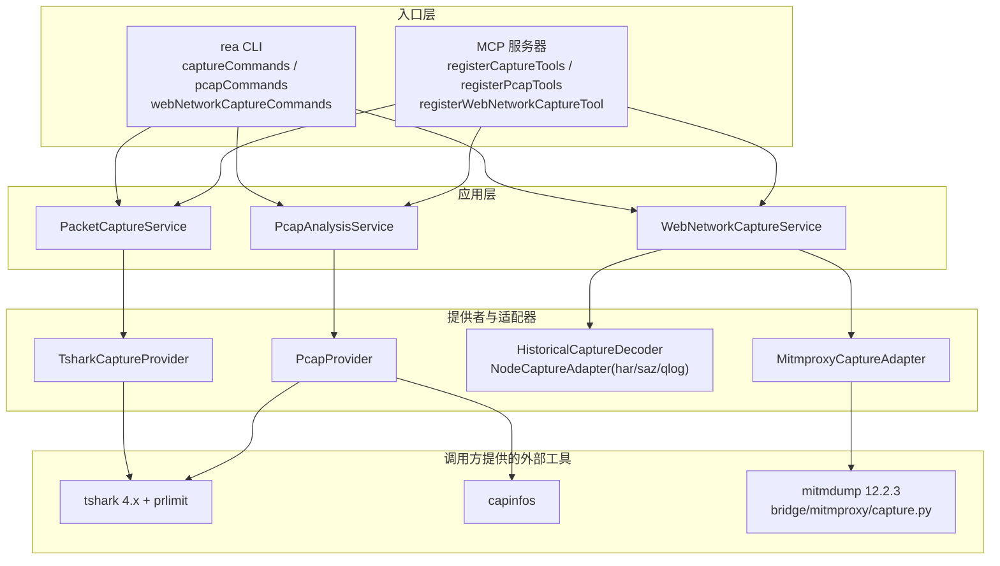
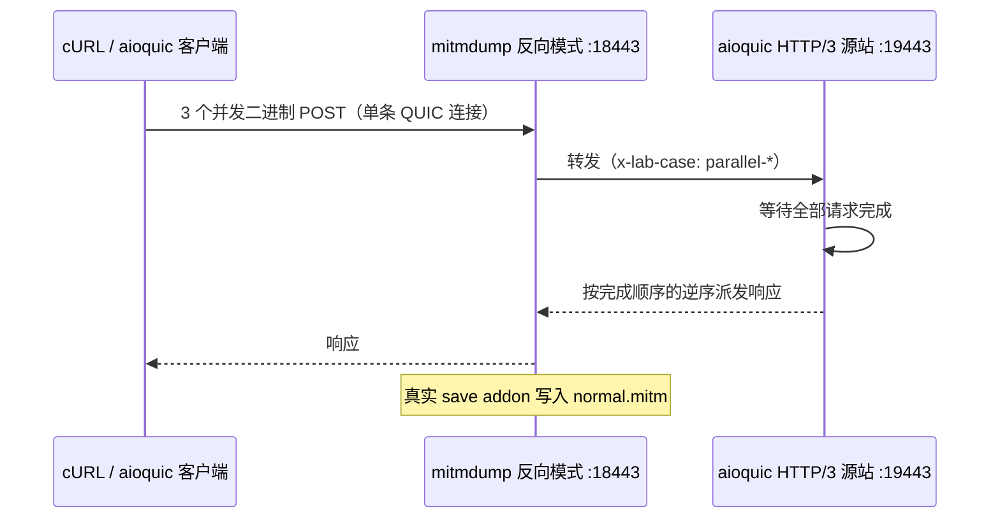

REA 的网络捕获能力遵循一条铁律：**离线检查，永不采集**。所有工具都作用于"已经存在"的捕获文件——pcap/pcapng、HAR、原生 mitmproxy 状态、Fiddler SAZ 或 aioquic qlog——而从不打开网络接口、发起请求或控制设备。本页覆盖四条检查通道：TShark 字段级检查、pcap 摘要族、多格式历史 Web 捕获检查，以及用于验证真实 HTTP/3 中间人捕获的可选 Linux 实验室。与实时浏览器观察相关的 CDP 流量事件属于另一条通道，请参阅[浏览器场景与 CDP 观察：捕获存储、场景对比与截图证据](16-liu-lan-qi-chang-jing-yu-cdp-guan-cha-bu-huo-cun-chu-chang-jing-dui-bi-yu-jie-tu-zheng-ju)。

Sources: [packet-captures.md](docs/packet-captures.md#L3-L7)

## 总览：四条离线检查通道

四条通道共享同一套分层结构：CLI 与 MCP 双入口收敛到应用服务，服务委托给平台绑定的提供者/适配器，最终只调用**调用方自带**的外部工具——REA 从不安装 Wireshark 或 mitmproxy。每条通道在执行前为源文件创建私有只读快照、以摘要绑定观察结果，并在失败时保留已完成的 Evidence 与资源所有权以便重试。

Sources: [captures.ts](src/composition/captures.ts#L1-L7), [pcap.ts](src/composition/pcap.ts#L1-L8), [webNetworkCaptures.ts](src/composition/webNetworkCaptures.ts#L9-L21)

四条通道的平台要求与资源边界差异显著，下表 summarises 了选择依据：

| 通道 | CLI / MCP 工具 | 平台 | 外部依赖 | 核心资源边界 |
| --- | --- | --- | --- | --- |
| 数据包字段检查 | `inspect-packet-capture` / `inspect_packet_capture`；`inspect-packet-fields` / `inspect_packet_fields` | 仅 Linux | TShark 4.x + util-linux prlimit | 32 MiB 输入、4 MiB 输出、30 s 墙钟、1 GiB 地址空间、30 s CPU |
| pcap 摘要族 | `inspect-pcap-client` / `inspect-pcap-capture` | Linux 或 Windows；macOS 有能力缺口 | tshark + capinfos | 2 GiB 磁盘快照、8 MiB tshark 输出、64 KiB capinfos、300 s 解析 |
| 历史 Web 捕获 | `inspect-web-network-capture` | HAR 全平台；mitmproxy 仅 Linux；SAZ/qlog 需可执行内存界限 | 仅 mitmproxy 格式需要 mitmdump 12.2.3 | 32 MiB 输入、96 MiB 解码回复、64 层嵌套、30 s |
| HTTP/3 实验室 | `npm run verify:web:http3` | 一次性 Linux 来宾 | mitmproxy 12.2.3 + aioquic + cURL | 每命令截止时间；SQLite 注册锁 |

Sources: [packet-captures.md](docs/packet-captures.md#L9-L13), [pcap-analysis.md](docs/pcap-analysis.md#L19-L25), [web-network-captures.md](docs/web-network-captures.md#L412-L431)

## 通道一：数据包字段检查

`inspect_packet_capture` 回答一个非常具体的问题：**TShark 在现有捕获中观察到了哪些选定协议字段**。网络、USB 或蓝牙录制都可以走同一套字段/过滤器接口，前提是已安装的 TShark 支持其封装与分 Congress器。每次调用通过 `REA_TSHARK_COMMAND` 提供的 TShark 4.x 运行，且宿主必须是 Linux——macOS 与 Windows 会在检查开始前被拒绝，因为该集成依赖可强制执行的地址空间限制。

Sources: [packet-captures.md](docs/packet-captures.md#L3-L13)

调用形态是"选定字段 + 显示过滤器 + 解码覆盖"的组合。`frame.number` 永远包含在结果中；重复值呈现为有序字符串数组（例如 `"ip.addr": ["192.0.2.1", "192.0.2.2"]`）；缺失字段保持缺席——不会被转换为零或空数组。选择器在 argv 展开前就受到预算约束：至多 1,024 个字段与 1,024 条 `decode_as` 规则、每选择器 8,192 个 UTF-16 码元、总编码选择器参数 32 KiB，为 Linux 的 execve 参数上限留出余量。

Sources: [packet-captures.md](docs/packet-captures.md#L35-L45)

输出在过滤后分页交付：`match_limit` 默认 50、`match_offset` 默认 0，结果报告 `output_window`（输入读取范围内匹配数、返回数与 `has_more`）。分页**不会**缩短输入读取或改变两遍重组——生产者输出仍必须装进资源限制，而每次调用都会校验录制的当前摘要，不同源摘要的页不允许混用。这一设计与 CLI 侧的 `--all_matches` / `match_limit: null` 全量语义一一对应。

Sources: [packet-captures.md](docs/packet-captures.md#L47-L55), [captureCommands.ts](src/cli/captureCommands.ts#L79-L99)

`packet_limit` 是最容易被误解的选项：它是**过滤前读取的输入包数上限**，而非输出行数。设为 1 时即使后续帧匹配也可能得到零条结果；报告中会记录 `to-eof` 或 `up-to-input-packet-limit`，从不从返回包数推断总捕获大小。对"已知输入前缀的有界问题"（例如前 2,000 帧内的 12 条 PostgreSQL TCP 包），正确组合是 `packet_limit: 2000` + 精选字段 + 匹配的输出窗口——这些控制回答有界问题，但**不得**用于推断全捕获的缺席。

Sources: [packet-captures.md](docs/packet-captures.md#L57-L65), [packet-captures.md](docs/packet-captures.md#L78-L84)

不熟悉的字段名通过 `inspect_packet_fields` 发现：以精确协议缩写与狭窄查询探测已安装 TShark 的注册词汇表（`tshark -G fields`）。词汇表适配器沿用同一套私有空配置与 Linux 进程限制，但输出上限放宽到 32 MiB（TShark 4.6.9 完整词汇表实测约 22.3 MB），并在构造选定记录前按"六倍源字节 + 512 字节"记账，消耗 **8 MiB 表示预算**；超限时会要求收窄查询，而不是静默截断。发现与捕获检查共享同一个准入槽位与清理所有者——每个提供者同时只容纳一次检查。

Sources: [packet-captures.md](docs/packet-captures.md#L67-L71), [TsharkCaptureProvider.ts](src/captures/TsharkCaptureProvider.ts#L94-L96)

执行边界由 `prlimit` 在启动前强制：每进程 **1 GiB 地址空间**、每文件 64 MiB、30 CPU 秒、禁止核心转储；更严格的继承软/硬限制会被保留并记入 Evidence。每次调用使用私有只读捕获副本与空的 `WIRESHARK_CONFIG_DIR`，禁用名称解析，执行后还会复查可执行文件、限制器与私有副本的身份。源文件永远不直接交给 TShark；溢出即失败而非截断成功。这些边界不是操作系统沙箱——已安装的库、全局配置与插件仍被信任且可能影响分 Congress。

Sources: [packet-captures.md](docs/packet-captures.md#L99-L120)

## 通道二：pcap 摘要族

与字段级检查互补，`inspect_pcap_capture` / `inspect-pcap-capture` 面向**清单式问题**：地址、DNS、TLS SNI、协议栈与 URI 的完整盘点。实现上由调用方选择的 Wireshark 4.x `tshark` 与 `capinfos` 共同产出，工具路径可通过 `REA_TSHARK_COMMAND` / `REA_CAPINFOS_COMMAND` 显式指定，否则经 PATH 解析并记录选择来源。捕获检查支持 Linux（prlimit）与 Windows（自有 Job Objects）；macOS 因新原生内存边界未验证而返回能力缺口，但其版本探测仍然可用。

Sources: [pcap-analysis.md](docs/pcap-analysis.md#L3-L6), [pcap-analysis.md](docs/pcap-analysis.md#L19-L25)

盘点内容在提供者中固定为一组精选 TShark 字段：`frame.protocols`、IP/IPv6 地址、DNS 问答、TLS SNI 扩展与 HTTP 完整请求 URI。MCP 端接受 `detail: "summary"`：摘要模式提交并保留**同一份完整 Evidence**，只返回身份、元数据、计数与诊断长度，再通过 `normalized_result.parent_evidence_id` 配合 `inspect_analysis_view` 的 `retained-evidence` 源按 facet 分页——`endpoints`、`dns-queries`、`dns-addresses`（需精确 question）、`tls-sni`、`protocols`、`http-uris`、`unattributed-addresses` 与 `diagnostics`。视图永不重读源文件或重新启动 Wireshark，原始文件删除后仍然可用。

Sources: [PcapProvider.ts](src/pcap/PcapProvider.ts#L42-L56), [pcap-analysis.md](docs/pcap-analysis.md#L29-L52)

解读结果时必须区分**观察与推导**：`target.sha256` 将观察绑定到被准入的稳定快照，捕获元数据与字面字段值是生产者观察，而地址/协议计数与 DNS 关联是推导。几个典型语义——地址按包计数一次（含环回与嵌套 IP）；DNS 地址只关联同一响应包内的一个问题，不证明最终解析；TLS SNI 是握手元数据，不是进程身份或目的端真实性证明；`coverage: "partial"` 记录未解决的 DNS 归因或 URI 项丢失。HTTP 传输凭据被结构性排除，且不重写其他 URI 字节。

Sources: [pcap-analysis.md](docs/pcap-analysis.md#L56-L80)

资源生命周期上，每个提供者一次只准入一项检查，并发调用返回容量错误；捕获被流式读入 2 GiB 磁盘预算的只读快照。原生命令在 Linux 上强制至多 1 GiB 地址空间、300 CPU 秒、每文件 64 MiB 且禁止核心转储；Windows 对每个自有工具树施加 1 GiB 提交内存限制。tshark 输出以 8 MiB 为界并在分配前检查已知形状与 128 MiB 图展开估算，capinfos 输出限 64 KiB，解析/元数据/探测的墙钟截止分别为 300/60/20 秒。畸形或超限输出不返回部分成功。

Sources: [pcap-analysis.md](docs/pcap-analysis.md#L84-L101)

## 通道三：历史 Web 捕获：HAR、原生 mitmproxy、SAZ 与 qlog

`inspect_web_network_capture` / `inspect-web-network-capture` 是格式最丰富的一条通道：同一工具名下支持四种格式，全部是**离线操作**——已记录的 URL 永远不会被重新请求，也不会启动任何浏览器或代理监听器。记录选择通过零基 `record_ordinals` 完成，显式选择保留调用方顺序与原始生产者序号，且每条记录都先完整验证再选择——选中一条不会隐藏他处的畸形条目。

Sources: [web-network-captures.md](docs/web-network-captures.md#L3-L26), [webNetworkCaptureCommands.ts](src/cli/webNetworkCaptureCommands.ts#L17-L30)

### 格式矩阵

| 格式 | `format` 值 | 解码方式 | 记录语义 |
| --- | --- | --- | --- |
| HAR 1.2 | `har` | 进程内适配器：`har-schema@2.0.0` + `ajv@8.20.0` + `lossless-json@4.3.1` | `log.entries` → records；保留数字词素与 `__proto__` 原样成员 |
| 原生 mitmproxy | `mitmproxy` | 调用方提供的 mitmdump 12.2.3 + 未修改的 tnetstring 解码器 | 保留原始 ID、状态版本、流类型、备份状态；不做 FlowReader 迁移、不转 HAR |
| Fiddler SAZ | `saz` | ZIP 成员按文件名词干配对 `_c.txt`/`_s.txt`/`_m.xml` | 零基序数按 ZIP 目录顺序，而非数字 ID 或捕获时间 |
| aioquic qlog | `qlog` | aioquic 1.5.0 JSON qlog 0.3 单对象配置 | 全局事件序数 + 原始 `/traces/T/events/E` 指针 |

Sources: [web-network-captures.md](docs/web-network-captures.md#L64-L101), [web-network-captures.md](docs/web-network-captures.md#L105-L123), [webNetworkCapture.ts](src/domain/webNetworkCapture.ts#L17-L22)

### 原生 mitmproxy 桥接

原生 mitmproxy 解码是四个格式中唯一需要外部进程的：适配器要求 **Linux 加绝对路径的 `REA_MITMDUMP_COMMAND`**，随后以 `--no-server`、私有配置目录和固定的桥接脚本启动 mitmdump——整个 mitmdump 进程及其配置目录都归 REA 所有。桥接脚本本身是离线适配器：它使用未修改的上游 `mitmproxy.io.tnetstring` 解码器读取原生状态，输出上限 96 MiB，并在上游解析器分配之前用 `BoundedReader` 拒绝声明长度超出保留捕获的恶意记录。

Sources: [MitmproxyCaptureAdapter.ts](src/browser/history/MitmproxyCaptureAdapter.ts#L18-L63), [capture.py](bridge/mitmproxy/capture.py#L1-L14), [capture.py](bridge/mitmproxy/capture.py#L28-L36)

桥接中的凭据处理与 WHATWG URL 解析规则逐条对齐：`authorization`、`proxy-authorization`、`cookie`、`set-cookie` 四类头结构性排除；userinfo 剥离遵循 `authority_start`/`without_userinfo` 中的特殊方案、反斜杠分隔符与 IPv4/IPv6 主机校验语义——包括"file URL 的 @ 属于主机因此整条 URL 被拒绝"这类边界。这些逻辑与 TypeScript 侧的 `src/domain/recordedTransportUrl.ts` 保持同一解析视图，保证 CLI/MCP 与桥接的脱敏结果一致。

Sources: [capture.py](bridge/mitmproxy/capture.py#L38-L135)

### qlog 事实模型

qlog 是四格式中最"克制"的：它只保留**确切的、源绑定的传输事实**，从不重建 HTTP 请求。配置文件固定为 aioquic 1.5.0 JSON qlog 0.3——JSON-SEQ、JSONL 与列式数组事件均不支持。每条流（trace）保留事件计数、ODCID、观察点、丢失声明（含包号/包类型/包号空间）与流级派生：`covered_ranges` 用精确整数运算合并帧区间，`unique_bytes`、`frame_length_sum` 与 `repeated_bytes` 三者互相解释重叠——但重叠本身**不证明重传**。QUIC 整数最多接受 2^62−1，派生总和以十进制字符串返回，绝不四舍五入为 JavaScript 数字；`body_bytes` 恒为 `"not-reported"`。

Sources: [web-network-captures.md](docs/web-network-captures.md#L462-L489), [qlogCapture.ts](src/domain/qlogCapture.ts#L17-L30)

qlog 还有专属的保留证据 facet 分页：`traces`、`streams`、`contributions`、`ranges`、`final-sizes`、`loss-declarations` 与 `incomplete-records`，全部要求三个流选择器（`trace_index`/`stream_id`/`direction`）精确匹配而不是猜测连接。这些视图分页的是**已解释的事实**，不重新解码、不打开源文件；事实范围始终是"选择前的全部已记录事件"，页耗尽不证明日志或网络完整性。

Sources: [web-network-captures.md](docs/web-network-captures.md#L553-L566)

### 敏感值声明与派生视图

四种格式共享一套敏感值机制：用 MCP `sensitive_values` 或 CLI `--sensitive-value` 声明的字面量会整体排除匹配字段（报告为 `null`）而非替换文本标记——这防止替换标记重新引入被声明的字面量。声明本身不持久化在 Evidence 参数中，只保留计数；若文件摘要本身命中声明，`artifact.sha256` 与 Evidence `subject` 将为 null 并附解释。

Sources: [web-network-captures.md](docs/web-network-captures.md#L200-L231), [webNetworkCapture.ts](src/domain/webNetworkCapture.ts#L36-L41)

在保留的 HAR Evidence 之上，`inspect_analysis_view` 提供两个派生视图。**api-surface** 视图按方法、WHATWG origin 与路径模板分组请求行，用四条格式规则（`numeric`/`uuid`/`hex`/`iso-date`）推断占位符；可选的 `include_query_parameter_names` 用 `URLSearchParams` 语义解码查询名。**environment-manifest** 视图进一步把分组投影为可回放的工具面，支持三条 opt-in 规则（`after-uid-literal`、`opaque-token`、`sibling-variance`）。两个视图都施加 96 MiB 投影表示预算，超限返回 `resource_constraint` 且无部分视图；原生 mitmproxy、SAZ 与 qlog 捕获返回类型化的不支持错误，未保留 `sensitive_value_count` 的父证据以规范令牌 `sensitive_values_unretained` 拒绝。

Sources: [web-network-captures.md](docs/web-network-captures.md#L233-L296), [web-network-captures.md](docs/web-network-captures.md#L404-L410)

资源边界按格式分层：完整证据统一为 32 MiB 输入、96 MiB 解码回复与 64 层嵌套；HAR/SAZ/qlog 在自有 **192 MiB Node 老生代堆**（单 V8 worker）中运行；mitmproxy 解码在 Linux 上限 768 MiB 地址空间、30 CPU 秒与 96 MiB 文件输出；Windows 上解码器的自有 Job Object 将提交内存限至 704 MiB（192 MiB 预算 + 512 MiB Bun 自身保留）。SAZ 与 qlog 在既无 Node 堆限制也无 Windows Job Object 界限时直接拒绝解码；SAZ 额外限制展开归档内容 32 MiB。

Sources: [web-network-captures.md](docs/web-network-captures.md#L412-L440), [web-network-captures.md](docs/web-network-captures.md#L125-L130)

## 通道四：HTTP/3 实验室

前三条通道检查**已有**文件；HTTP/3 实验室则负责**生成**最难的捕获：真实的 QUIC v1 中间人流量。这是一个可选的 Linux 实验室，通过 REA 公共 CLI 与 MCP 检查原生 mitmproxy 捕获——它不改变任何运行时契约或适配器，只确立本实验室实际演练的生产者、模式与客户端组合。

Sources: [http3-capture-lab.md](docs/http3-capture-lab.md#L3-L5)

### 一次性来宾环境

实验室的一切都发生在**密封的一次性来宾**里：以哈希锁定的 Omarchy 4.0.4 qcow2 为只读后备镜像创建全新 qcow2 覆盖层，用户态网络加绑定宿主环回的 SSH 转发，宿主目录不挂载；生成流量前先移除来宾默认路由。镜像自带 cURL 8.22.0（OpenSSL 3.6.4、ngtcp2 1.25.0、nghttp3 1.18.0）——发行版自带的 cURL 可能不含 HTTP/3，因此换镜像时需要按官方指引构建并记录全部构建输入。依赖清单全部显式固定：官方 mitmproxy 12.2.3 独立归档（SHA-256 锁定）、`http3-lab-requirements.txt` 的完整钉定 Python 依赖图、以及宣告 HTTP3/HTTP2 特性的 cURL。

Sources: [http3-capture-lab.md](docs/http3-capture-lab.md#L9-L45), [http3-capture-lab.md](docs/http3-capture-lab.md#L58-L76)

### 窄配置文件与回退运行

核心场景刻意制造**流完成顺序与响应派发顺序不一致**的压力：生产者通过 mitmproxy 反向模式（来宾 `lab.test:18443` → 源站 `19443`）向 aioquic HTTP/3 源站发送**单连接上的三个并发二进制 POST**；源站等待全部请求完成后按**完成顺序的逆序**派发响应。第二个客户端（cURL HTTP/3-only 请求）交叉验证不同实现。关键的正向保证是：`normal.mitm` 由 mitmproxy **真实 save addon** 写入，没有任何原生流被合成。

Sources: [http3-capture-lab.md](docs/http3-capture-lab.md#L80-L99), [http3-lab.py](scripts/fixtures/http3-lab.py#L86-L104)

反向回退运行同样是验收的一部分：第二次代理运行禁用 HTTP/3，cURL `--http3` 回退到 HTTP/2 并抵达 HTTP/1.1 TLS 测试源站，`fallback.mitm` 必须保留这些低层协议——**一条成功的 HTTP 请求不能伪装成 HTTP/3 成功**。验证观察由 `observe-mitmproxy-http3.py` 附加组件独立采集：TLS 两腿的 ALPN、`tls_version`、`timestamp_tls_setup`、连接错误，以及请求/响应消息的 base64+长度+SHA-256 三元组，全部以 JSONL 落盘供交叉比对。

Sources: [http3-capture-lab.md](docs/http3-capture-lab.md#L97-L99), [observe-mitmproxy-http3.py](scripts/fixtures/observe-mitmproxy-http3.py#L31-L46)

一个值得注意的实现细节：握手事件中记录的是 aioquic 的 `_quic._version`——**协商后的运行时值**——而非配置中的 `supported_versions`，也不是 mitmproxy 12.2.3 单纯的 `QUICv1` 标签；后者本身不构成协商证明。

Sources: [http3-lab.py](scripts/fixtures/http3-lab.py#L86-L99)

### 验收与证据生命周期

每次执行在 `verifications/<run-UUID>/` 下创建独立诊断；`verification-latest.json` 以原子方式从 `running` 变为 `passed` 或 `failed`，注册与所有权检查/替换共用同一 SQLite 事务锁，且锁获取无限等待、不抢租约——被杀掉的验证器留下的 `running` **绝不能**解释为成功。`--inspect-existing` 允许对既有捕获复检而不再产生新流量。

Sources: [http3-capture-lab.md](docs/http3-capture-lab.md#L103-L124)

当前运行的验收清单覆盖五组断言：每条正向原生记录在两腿上均报告 HTTP/3、UDP、ALPN h3 与成功 TLS 时间戳，且与 UUID 匹配的生产者观察一致；端点握手独立观察到 QUIC v1；三条端点流在每腿共享一条连接，源站派发逆序于完成接收；CLI 与 MCP 在字节、长度、SHA-256、有序重复头、方法/scheme/authority/path 与 ALPN 上完全一致；回退捕获报告客户端 HTTP/2 over TCP 与源站 HTTP/1.1。覆盖范围就此为止：空/缺失/不完整/脱敏正文、取消、证书失败、HAR 与 qlog 属于独立增量——通过本配置文件**不等于** REA 具备一般性 HTTP/3 支持。

Sources: [http3-capture-lab.md](docs/http3-capture-lab.md#L126-L145), [http3-capture-lab.md](docs/http3-capture-lab.md#L153-L160)

## 验证通道与 CI

每条通道都有对应的真实工具验证脚本与 CI 触发。`verify-packet-capture.mjs` 自行生成 Ethernet/IPv4/UDP/DNS 与蓝牙 HCI PCAP，演练真实编译产物的 CLI/MCP 对等性、通告模式、重复/缺失字段、两种 pass 模式、Evidence 持久化与清理；`real-packet-capture.yml` 工作流在 `src/captures/**`、`src/pcap/**` 等路径变更时于 ubuntu-24.04 上用发行版 tshark 运行它。pcap 族用 `npm run verify:pcap -- --pcap <file>` 对照私有真实语料的独立原始帧解析；qlog 通道用 `npm run verify:web:qlog` 校验已知控制/丢失事实；HTTP/3 实验室额外提供三个回归测试入口（verifier 生命周期、捕获断言与夹具脚本），覆盖不同流完成顺序、过期成功报告与部分获取资源等验证器语义。

Sources: [packet-captures.md](docs/packet-captures.md#L122-L133), [real-packet-capture.yml](.github/workflows/real-packet-capture.yml#L1-L61), [web-network-captures.md](docs/web-network-captures.md#L526-L532), [http3-capture-lab.md](docs/http3-capture-lab.md#L166-L184)

需要强调的是验证范围声明：现有 pcap 族验证基于 Linux/Node 24.18.0 与 Wireshark 4.0.17；早期提案报告的 macOS/Windows 4.6.9 验证**不覆盖**最终内存边界；USB、BLE ATT 与真实物理捕获也不在这些夹具的确认范围内。对中间读者而言，最可靠的操作准则是：把每条通道的"验证范围"章节当作其结论的边界条件来阅读。

Sources: [pcap-analysis.md](docs/pcap-analysis.md#L103-L119)

## 下一步阅读

四条通道只是 REA 证据体系在网络维度的投影。若要理解捕获结果如何进入会话级证据链与视图分页，继续阅读 [MCP 契约参考：工具结果、保留证据、会话发现与取消恢复](8-mcp-qi-yue-can-kao-gong-ju-jie-guo-bao-liu-zheng-ju-hui-hua-fa-xian-yu-qu-xiao-hui-fu)；若关心捕获所依赖的进程所有权与资源清理机制（私有运行时、截止时间与清理重试），请转到[进程所有权与生命周期监督](25-jin-cheng-suo-you-quan-yu-sheng-ming-zhou-qi-jian-du-si-you-yun-xing-shi-jie-zhi-shi-jian-yu-qing-li-zhong-shi)；而 HTTP/3 实验室所依托的一次性来宾与真实工具链通道的全景，见[测试策略与验证通道](27-ce-shi-ce-lue-yu-yan-zheng-tong-dao-yuan-ma-bian-jie-yan-shou-zhi-xing-ji-zhen-shi-gong-ju-lian-tong-dao)。