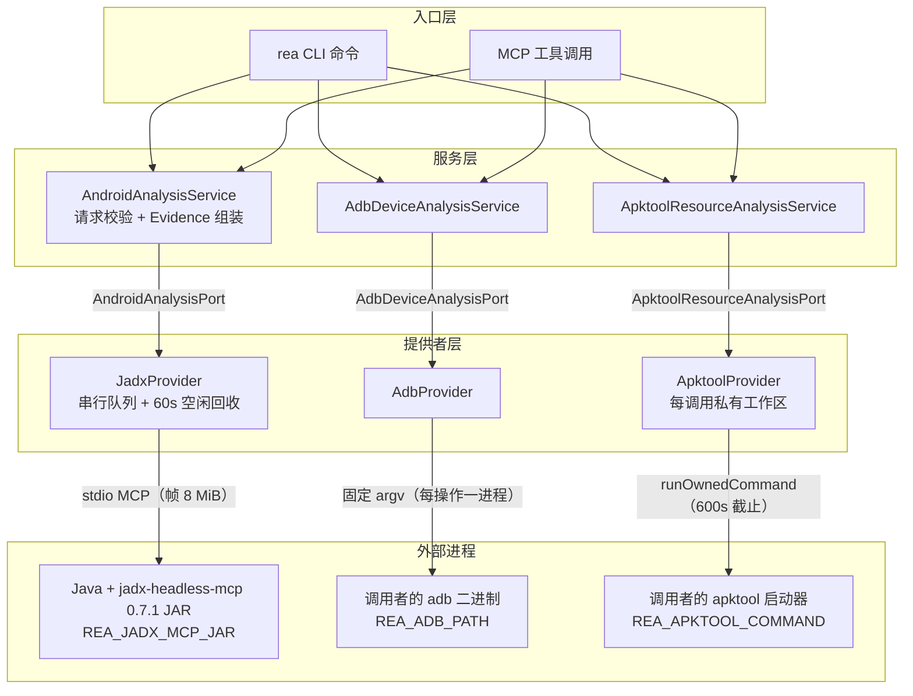
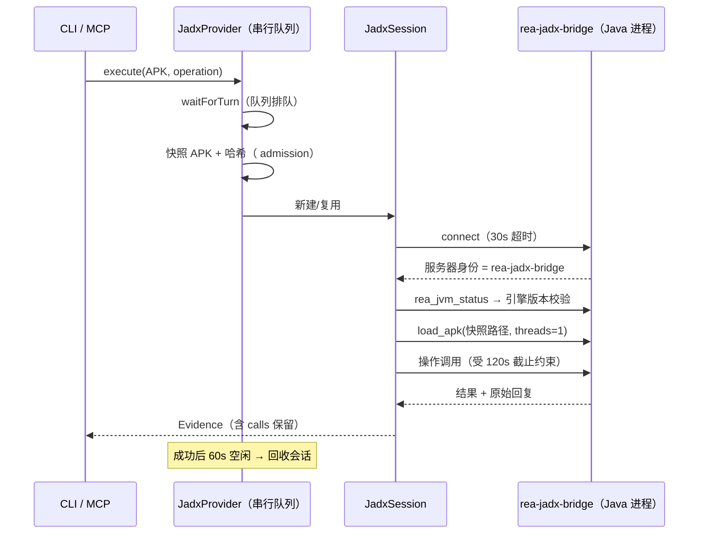

REA 的 Android 能力由三个相互独立的提供者家族构成：**JADX 家族**负责 Java/Kotlin 源码级反编译，**Apktool 家族**负责资源表与二进制清单解码，**ADB 家族**负责真实设备上的检查与取证采集。三者的共同设计立场是：REA 从不安装 Android SDK、模拟器或任何分析引擎——所有外部工具都由调用者供给，REA 只负责进程所有权、不可变快照、预算边界与证据保留。每个操作返回与制品绑定的 Evidence，原始生产者回复内联保留，静态观察永不执行目标 APK。本页面向已熟悉 REA 分层架构与证据模型的读者，逐一拆解三大家族的实现机制、工具面与资源边界。

Sources: [android-analysis.md](docs/android-analysis.md#L1-L14), [adb-device-analysis.md](docs/adb-device-analysis.md#L1-L8), [apktool-resource-analysis.md](docs/apktool-resource-analysis.md#L1-L6)

## 三大家族架构总览

三个家族遵循同一分层模式：CLI 与 MCP 共享同一应用服务（Application Service），服务通过端口接口（Port）调用提供者适配器，适配器再驱动调用者选定的外部进程。唯一的结构性差异在于进程边界：JADX 是一条**长生命周期 stdio MCP 连接**（Java 进程内运行 REA 编写的元数据桥），而 Apktool 与 ADB 是**每次调用一个短生命周期有界进程**。

组合根是三个单行工厂：`createAndroidAnalysisProvider` 接受可选的 `JadxLauncher` 注入缝（测试用），`createAdbDeviceAnalysisProvider` 与 `createApktoolResourceAnalysisProvider` 仅绑定环境快照。服务器侧，`createServer` 构造三个提供者、在关闭时通过 `Promise.allSettled` 汇聚三者的 `close()`，并把三个 `inspectAvailability` 回调接入会话工具供 doctor 使用。

Sources: [composition/android.ts](src/composition/android.ts#L1-L10), [composition/adb.ts](src/composition/adb.ts#L1-L8), [composition/apktool.ts](src/composition/apktool.ts#L1-L8), [createServer.ts](src/server/createServer.ts#L350-L371), [createServer.ts](src/server/createServer.ts#L377-L388), [createServer.ts](src/server/createServer.ts#L603-L608)

三个端口接口刻意保持最小：`inspectAvailability`（不打开目标即可探测前提条件）、`close`（取消活动工作并清理保留资源）、`execute`（返回 `Result<AnalysisExecution, AnalysisError>`）。这种统一形状让 doctor、binary_session 清单与 MCP 工具处理器可以无差别对待三个家族。

Sources: [AndroidAnalysisPort.ts](src/application/android/AndroidAnalysisPort.ts#L11-L23), [AdbDeviceAnalysisPort.ts](src/application/adb/AdbDeviceAnalysisPort.ts#L14-L24), [ApktoolResourceAnalysisPort.ts](src/application/apktool/ApktoolResourceAnalysisPort.ts#L14-L24)

| 维度 | JADX 家族 | Apktool 家族 | ADB 家族 |
| --- | --- | --- | --- |
| 职责 | Java/Kotlin 源码反编译、类/方法检查、引用追踪 | 资源表 + 二进制清单解码（跳过 smali） | 设备检查、文件/包采集、动态分析生命周期 |
| 外部依赖 | 完整 JDK 17+、jadx-headless-mcp 0.7.1 JAR | Apktool ≥2.7.0 启动器 + Java 运行时 | 平台工具 adb（34.0.5 验证） |
| 环境变量 | `REA_JADX_MCP_JAR`、`JAVA_HOME` | `REA_APKTOOL_COMMAND` | `REA_ADB_PATH` |
| 进程模型 | 保留式 stdio MCP 会话（60s 空闲回收） | 每次解码一个有界进程 | 每次调用一个有界进程，无长驻进程 |
| MCP 工具数 | 5 | 2 | 24 |
| 目标可变性 | 只读，永不执行 APK | 只读，工作区用后即删 | 5 个工具显式声明 `mutatesTarget` |

Sources: [JadxRelease.ts](src/android/JadxRelease.ts#L16-L20), [ApktoolConfiguration.ts](src/apktool/ApktoolConfiguration.ts#L35), [AdbConfiguration.ts](src/adb/AdbConfiguration.ts#L19), [adb-device-analysis.md](docs/adb-device-analysis.md#L102-L133), [registerAdbTools.ts](src/server/registerAdbTools.ts#L23-L47)

## JADX 家族：静态 Java/Kotlin 反编译

### 引擎供给与身份锚定

JADX 家族封装一个**未修改、按提交锁定**的上游引擎 `jadx-headless-mcp 0.7.1`，其源码以 Git 子模块形式存放。REA 通过 `JadxRelease.ts` 中的冻结常量锚定身份：版本 `0.7.1`、上游修订 `5844800a…`、SHA-256 `6e5eacf5…` 与发布 URL。调用者必须自行下载 JAR 并通过 `REA_JADX_MCP_JAR` 提供绝对路径；`source_revision` 字段只有当实际加载的 JAR 哈希与审计发布完全匹配时才会填充，否则保持 `null`——这是"字节级 provenance"而非版本号的口头声明。

Sources: [android-analysis.md](docs/android-analysis.md#L1-L4), [JadxRelease.ts](src/android/JadxRelease.ts#L2-L7), [JadxSession.ts](src/android/JadxSession.ts#L139-L148)

REA 不直接使用引擎的 MCP 工具面，而是运行自己编写的 `ReaJadxBridge.java`——一个"REA 拥有的元数据边界"（以源文件模式对未修改 JAR 编译运行）。桥的身份独立于引擎：`rea-jadx-bridge` 协议版本 `4`。会话建立时执行双重身份校验：MCP 服务器名/版本必须等于桥身份，`rea_jvm_status` 报告的引擎版本必须等于锁定的 JADX 版本，任一不匹配立即抛出 `capability_unavailable`。桥还负责在异常身份被上游吞掉之前翻译类型化结果——例如把 `OutOfMemoryError` 的 "Java heap space"/"GC overhead limit exceeded" 翻译为堆故障分类。

Sources: [JadxRelease.ts](src/android/JadxRelease.ts#L9-L13), [ReaJadxBridge.java](bridge/android/ReaJadxBridge.java#L27-L28), [ReaJadxBridge.java](bridge/android/ReaJadxBridge.java#L52-L60), [JadxSession.ts](src/android/JadxSession.ts#L104-L123)

### 五个操作的契约形状

领域层用 Zod 判别联合定义五个操作，全部以 `path`（本地 APK 路径，"目标永不执行"）为根：

| 操作 | 输入要点 | 语义锚点 |
| --- | --- | --- |
| `inspect_android_package` | `path`，可选 `detail: "complete" \| "summary"` | 返回清单 XML、权限、类/资源计数；`signature_verification` 恒为字面量 `"not_performed"` |
| `search_android_classes` | 大小写敏感子串，空串列出全部 | 重复名保持重复，`duplicate_names` 显式标注 |
| `inspect_android_class` | 精确全限定类名 | 用于挑选重载索引 |
| `inspect_android_method` | 类名 + 方法名，可选 `overload_index` | **歧义时拒绝**而非静默取第一个；证据置信度标为 `derived`（反编译文本是派生表示） |
| `trace_android_references` | 类名，可选方法名 + 重载索引 | `total` 计数的是包含性 JADX 节点，非逐条 invoke 指令 |

`dex_descriptor` 字段以正则严格校验 DEX 原型格式（如 `(I)V)`），防止显示别名被误当方法标识。重载索引只绑定当前制品与引擎，不跨构建稳定；smali 回退按原始方法名 + DEX 描述符选择完整代码块，即使 Java 代码生成重命名方法也保持选中的重载，并在 Java 体缺失时返回带 `java_body_unavailable` 标记的原始 smali。

Sources: [androidAnalysis.ts](src/domain/android/androidAnalysis.ts#L14-L60), [androidAnalysis.ts](src/domain/android/androidAnalysis.ts#L101-L106), [androidAnalysis.ts](src/domain/android/androidAnalysis.ts#L126-L139), [android-analysis.md](docs/android-analysis.md#L81-L121)

MCP 注册层为两个操作叠加了**保留式交付**：`inspect_android_package` 在 `detail: "summary"` 时返回摘要并保留完整原始 Evidence，调用者用返回的 `parent_evidence_id` 通过 `inspect_analysis_view` 分页读取完整清单（UTF-16 码单元偏移）；`search_android_classes` 同样内联交付有界摘要、保留完整清单于会话记录。这改变的是交付形状，不是 JADX 分析本身。

Sources: [registerAndroidTools.ts](src/server/registerAndroidTools.ts#L18-L43), [android-analysis.md](docs/android-analysis.md#L9-L25)

### 会话生命周期与串行化

`JadxProvider` 对每个 REA 实例维护**一条串行队列与一个不可变会话**：`#tail` promise 链保证操作逐个执行；成功后启动 60 秒空闲计时器，到期即回收引擎进程与私有工作区。请求重用前会核对 APK/引擎摘要与 JVM 配置，任一变化即退役旧会话。每个操作有 120 秒默认整体截止时间（`REA_JADX_OPERATION_TIMEOUT_MS` 可覆盖，上限 2147483647 ms），同时约束每次上游调用；桥的启动握手为 30 秒，上游反编译限制 90 秒。

传输层实现 MCP SDK 的 `Transport` 接口，帧上限 8 MiB、单操作 stdout+stderr 合计 32 MiB，超限以诊断失败而非把不完整清单当完整返回；stdin 写入保留流背压。若后续步骤失败，错误的 `details.partial_observation` 保留选定的 APK 路径、摘要、提供者身份与失败前收集的每条上游请求/回复——失败的回复即便无法解释也保持可用。

Sources: [JadxProvider.ts](src/android/JadxProvider.ts#L242-L266), [JadxProvider.ts](src/android/JadxProvider.ts#L285-L334), [JadxProvider.ts](src/android/JadxProvider.ts#L401-L408), [JadxSession.ts](src/android/JadxSession.ts#L66-L168), [JadxMcpTransport.ts](src/android/JadxMcpTransport.ts#L21-L27), [JadxMcpTransport.ts](src/android/JadxMcpTransport.ts#L59-L100), [android-analysis.md](docs/android-analysis.md#L216-L220), [android-analysis.md](docs/android-analysis.md#L328-L353)

JVM 资源可通过 `REA_JADX_HEAP_MIB` 与 `REA_JADX_ACTIVE_PROCESSOR_COUNT` 显式注入（两者必须为正整数，后者须在 JVM 有符号 32 位范围内）；REA 保留 `JAVA_TOOL_OPTIONS` 等标准 Java 环境变量而不替换。Evidence 报告 worker 观测到的 `Runtime.maxMemory()` 向下取整 MiB，并在其原始运行时响应中保留精确字节——观测到的可分配堆可以不同于配置的 `-Xmx`。诊断期间对 JAR 中央目录的读取上限为 8 MiB（审计过的 0.7.1 JAR 目录占 2,294,350 字节，只读元数据不读类体）。

Sources: [JadxConfiguration.ts](src/android/JadxConfiguration.ts#L45-L54), [android-analysis.md](docs/android-analysis.md#L298-L326), [android-analysis.md](docs/android-analysis.md#L349-L353)

## Apktool 家族：资源表解码

Apktool 家族补齐 Android 静态三联的第三条边：JADX 管源码、JEB 管引擎级反编译、Apktool 管资源。解码固定携带 `--no-src`（跳过 smali），因为 Java 源恢复属于 JADX 家族的职责。提供者身份为 `apktool`（版本 `null`，因为版本由调用者的启动器报告）。

Sources: [apktool-resource-analysis.md](docs/apktool-resource-analysis.md#L1-L6), [ApktoolProvider.ts](src/apktool/ApktoolProvider.ts#L72-L83)

每次解码运行在**提供者拥有的私有工作区**：输入 APK 先被流式快照为工作区内独占创建的 `input.apk`（`wx` 标志 + `0o600` 权限），同时计算 SHA-256——`target.sha256` 与 `target.bytes` 把观察绑定到被解码的确切字节，即使原始文件在解码期间变化。工作区在结果返回前删除；删除失败时结果命名残留路径，提供者保留所有权供关闭时清理重试。`close()` 语义严格：只要还有属于该工作区的命令未确认停止，就抛错拒绝删除。

Sources: [ApktoolWorkspace.ts](src/apktool/ApktoolWorkspace.ts#L26-L55), [ApktoolWorkspace.ts](src/apktool/ApktoolWorkspace.ts#L57-L80), [apktool-resource-analysis.md](docs/apktool-resource-analysis.md#L83-L88)

进程执行通过 `runOwnedCommand`，且 `expectedCommand` 设为 `null`——因为 Apktool 启动器通常是解释器脚本（包装器或 `java -jar` 脚本），所有权由运行令牌证明而非 argv 前缀。Windows 上的 `.bat`/`.cmd` 启动器经由显式 `cmd.exe /d /s /c` 调用（无 AutoRun、无延迟扩展、逐参数引用）；含 `"`, `%`, `^`, `!`, `&`, `|`, `<`, `>` 的启动器路径直接以 `not_configured` 拒绝而非传给 cmd.exe。

Sources: [ApktoolProvider.ts](src/apktool/ApktoolProvider.ts#L98-L157), [apktool-resource-analysis.md](docs/apktool-resource-analysis.md#L56-L62)

解码请求支持多语言环境投影：主 `locale` 选择 `res/values-<locale>/strings.xml`，`locales` 数组在同一次解码中投影多张字符串表，`string_tables_only` 避免主表条目重复计费。区域格式遵循 Android 语法（`pt-BR` → `values-pt-rBR`，三位区域 `es-419` → `values-b+es+419`）。每张表记录状态（`present`/`missing`/`oversized`/`malformed`/`skipped`）、条目数与覆盖度，聚合预算为 10,000 条字符串与 32 MiB XML；畸形 XML 是整文档投影失败而非算作一条不支持的字符串。

Sources: [apktool-resource-analysis.md](docs/apktool-resource-analysis.md#L75-L100), [apktool-resource-analysis.md](docs/apktool-resource-analysis.md#L50-L62)

版本咨询表是透明的"报告窗口"而非兼容性强制：

| 公告 | 报告版本窗口 | 主机范围 |
| --- | --- | --- |
| CVE-2024-21633 | 早于 2.9.2 | 全部 |
| GHSA-vgwr-4w3p-xmjv | 早于 2.9.3 | Windows |
| CVE-2026-39973 | 3.0.0 发布线至 3.0.2 之前 | 全部 |

REA 不在运行时拉取公告；缺失警告只说明没有匹配的版本/主机窗口，不构成对所选解码器的安全认定。资源与生命周期硬边界：解码 600 秒截止、4 MiB 输出捕获、清单读取 512 KiB、字符串 XML 读取 8 MiB、解码文件计数上限 100,000；普通非零退出归类为 `unsupported_target`（附带 Apktool 诊断），而启动器失败、信号终止、输出收集不完整保持为提供者故障——两者从不混淆。

Sources: [apktool-resource-analysis.md](docs/apktool-resource-analysis.md#L30-L54), [ApktoolProvider.ts](src/apktool/ApktoolProvider.ts#L79-L83), [apktool-resource-analysis.md](docs/apktool-resource-analysis.md#L141-L155)

## ADB 家族：设备取证与采集

### 固定向量与参数卫生

ADB 家族通过调用者的 `adb` 二进制检查已连接设备、读取设备状态、传输文件与包。REA 既不启动也不管理设备，`inspect_adb_client` 只探测二进制本身而绝不联系 adb 服务器。注入防御的结构性选择是：**调用者值只占据固定 argv 中的位置参数**，没有任何工具接受任意 shell 命令行、`input` 或 `monkey`。唯一需要引用的边界是 `adb shell` 把操作数拼接为远端 POSIX 命令之处——`quoteShellOperand` 对含特殊字符的值做 POSIX 单引号转义；序列号 schema 禁止空白与引号，注释明确这是"准入卫生而非注入防御"（argv 是位置式的）。

Sources: [adb-device-analysis.md](docs/adb-device-analysis.md#L1-L13), [AdbCommand.ts](src/adb/AdbCommand.ts#L69-L84), [adbDeviceAnalysis.ts](src/domain/adb/adbDeviceAnalysis.ts#L5-L18), [adb-device-analysis.md](docs/adb-device-analysis.md#L131-L135)

### 二十四工具操作面

24 个工具按只读/变异二分注册（`registerAdbTools` 循环绑定到共享契约处理器）：

| 类别 | 只读工具 | 变异工具（显式 `mutatesTarget`） |
| --- | --- | --- |
| 客户端与设备 | `inspect_adb_client`、`list_adb_devices`、`inspect_adb_device`、`inspect_adb_display`、`list_adb_features`、`list_adb_services` | — |
| 进程与状态 | `list_adb_processes`、`inspect_adb_window`、`read_adb_setting`、`read_adb_logcat` | — |
| 包发现 | `list_adb_packages`、`resolve_adb_packages`、`inspect_adb_package` | `install_adb_package`、`uninstall_adb_package` |
| 采集 | `list_adb_directory`、`pull_adb_package`、`pull_adb_file`、`capture_adb_screen`、`collect_adb_bugreport` | — |
| 动态分析 | — | `push_adb_file`、`start_adb_app`、`start_adb_activity`、`stop_adb_app` |

变异从不隐式运行：`push_adb_file` 先做存在性探测，仅当 `test -e` 干净返回退出码 1 且无输出才判定缺失，已存在目标无显式 `overwrite` 即拒绝（检查非原子，注释明确披露竞态窗口）；设备侧 `sha256sum` 可用时用于验证传输。`install_adb_package` 保留设备 Success/Failure 判词原文，`replace_requested` 记录是否发送了 `-r`，而 `replaced` 恒为 `null`——安装成功响应不说明是全新安装还是替换，REA 也不预先查询设备，于是不虚构这个事实。

Sources: [registerAdbTools.ts](src/server/registerAdbTools.ts#L23-L47), [adb-device-analysis.md](docs/adb-device-analysis.md#L102-L133), [adb-device-analysis.md](docs/adb-device-analysis.md#L138-L148)

### 每操作预算与故障分类

每个操作是一次有界的 adb 运行，预算常量集中声明在提供者头部：

| 操作类别 | 截止时间 | 捕获上限 |
| --- | --- | --- |
| 客户端/设备列表 | 20 s | 1 MiB |
| shell 读取 | 20–60 s | 64 KiB – 8 MiB（logcat 4 MiB，截屏 32 MiB） |
| 传输与 bugreport | 600 s | 1 MiB |
| 包列表 / dumpsys | 60 s | 8 MiB |

超预算报 `resource_constraint`；截止到期报 `provider_timeout`。命令失败投影保持精确形状：stderr 被裁剪为 512 字符摘录，adb 守护进程启动通知从诊断中剥离（那是成功信息不是故障），设备状态词匹配 `unauthorized`/`offline`/`not found` 等归类为 `unsupported_target`；本地文件诊断词表（"cannot create"、"failed to open" 等十一组动词-后缀对）把主机侧故障归因到确切本地路径而非误报设备路径。取消保留调用者的确切原因，后续 abort 不能替换已完成的命令失败。

Sources: [AdbProvider.ts](src/adb/AdbProvider.ts#L126-L155), [AdbCommand.ts](src/adb/AdbCommand.ts#L22-L39), [AdbCommand.ts](src/adb/AdbCommand.ts#L100-L200), [adb-device-analysis.md](docs/adb-device-analysis.md#L131-L140)

### 采集语义：推断携带依据，部分结果保留事实

ADB 结果的解释规则把不确定性显式化。设备 `kind` 携带 `kind_basis`（序列号前缀或 USB 传输）；模拟器判定 `emulator_observed` 取自构建自己的 `ro.kernel.qemu` 值，缺失即为 `null` 而非猜测。设备路径不是主机路径：`base_apk_device_path` 存在于设备文件系统，只有 pull/capture 产生配对字节数与 SHA-256 的主机路径；包名拉取在创建输出前核对目标文件系统，拒绝会共享本地路径的名字。`pull_adb_package` 经 `pm path` 枚举 base APK 与全部 split 并整组拉取——**splits 是答案的一部分**；单个拉取失败返回 `coverage: "partial"` 加逐文件 failures，而非整体失败丢掉已完成制品。无法识别的清单行进入 `unparsed_lines` 并标记部分覆盖，绝不静默丢弃。推送与安装消费本地输入的私有快照，报告的尺寸与摘要标识被消费的字节，`local_path` 保留可能随后变化的原路径。

Sources: [adb-device-analysis.md](docs/adb-device-analysis.md#L137-L160), [adb-device-analysis.md](docs/adb-device-analysis.md#L162-L182)

## 执行-free 应用图投影

三大家族之外，Android 目标还有一条纯投影通道：`project_android_application_graph` 消费制品清单 Evidence，产出**确定性、无执行**的 Android 应用投影（投影 ID 前缀 `adp`）。组件按七类精确报告路径与哈希：manifests、resources、dex、jvm_classes、native_libraries、javascript、signing；运行时家族提示枚举七种（`dalvik-art`、`java-kotlin`、`native`、`javascript`、`react-native`、`flutter`、`unity`）。框架匹配要求完整原生库名——`libreactnativejni.so`、`libhermes.so`、`libflutter.so`、`libunity.so` 等，`libcommunity.so` 这类无关名字不会误判。桥接候选形成 DEX/JVM 类 × 原生库的笛卡尔积，投影在创建候选对象前计算精确序列化尺寸，在 2 MiB UTF-8 JSON 预算内保留确定性前缀；被省略时 `bridge_candidate_coverage` 报告 total/emitted/omitted 计数。投影明确声明：路径对不确立托管声明命名、加载或调用了该原生库。

Sources: [android-analysis.md](docs/android-analysis.md#L222-L267), [androidApplication.ts](src/domain/android/androidApplication.ts#L28-L75), [androidApplication.ts](src/domain/android/androidApplication.ts#L86-L100)

## 证据语义：三家族共享的不确定性纪律

Android 三家族是"证据与不确定性模型"在移动领域的最完整实例。共享纪律包括：

- **显式未执行声明**：JADX 包检查的 `signature_verification` 用字面量 `"not_performed"` 占位，签名的 APK 从不被验证；反编译文本置信度标 `derived`，完整文本结果不确立完整语义或字节级重建。
- **部分观察保留**：JADX 失败时保留失败前的每条上游请求/回复；ADB 包拉取取消时错误携带已完成制品清单与被中断的本地路径。
- **清理失败可归属**：清理失败通过 `ProviderCleanupError` 绑定确切资源路径列表（会话 runId、工作区、文件句柄），并保留重试权。
- **生产者身份内联**：每个 ADB 结果嵌入产出的 adb 客户端（`binary_path`、`path_source`、`version`）；JADX Evidence 携带引擎名、版本、JAR SHA-256 与条件性 `source_revision`。

Sources: [androidAnalysis.ts](src/domain/android/androidAnalysis.ts#L126-L139), [AndroidAnalysisService.ts](src/application/android/AndroidAnalysisService.ts#L47-L59), [JadxSession.ts](src/android/JadxSession.ts#L170-L194), [JadxRelease.ts](src/android/JadxRelease.ts#L45-L58), [adb-device-analysis.md](docs/adb-device-analysis.md#L176-L180)

## 真实工具链验证通道

三个家族各有一条真实验证通道，与合成协议回归分离：

- **`npm run verify:android`**：用公开 fixture（ApiDemos）对真实引擎驱动 CLI/MCP 结果、Windows x64 上的 Job Object + 双向 stdio、突然终止后的 Java 退出与工作区移除，并用 `jlink` 制造缺编译模块的一次性 JRE 检查真实 Java 启动故障。下载脚本校验固定 SHA-256 且拒绝覆盖不同的既有文件。
- **`npm run verify:apktool -- --apk PATH`**：对真实启动器验证版本探测、磁盘摘要一致、apktool.yml 元数据、清单包名一致与默认/`de` 字符串表投影。
- **`npm run verify:adb`**：对真实设备验证全部 24 个操作，`--pull PACKAGE` 校验返回摘要与磁盘文件字节一致，`--install-apk` 驱动完整 install → resolve → uninstall 生命周期。

记录：Apktool 2.7.0-dirty + OpenJDK 25 与 3.0.3/JDK 21 多 locale 投影；ADB 34.0.5 对 Android 14 x86_64 模拟器（224 包清单、287 服务、92 特性、真实双 split 拉取字节一致摘要）；JADX 协议 2 桥在 Linux x86-64 + Temurin 21 用 ApiDemos 6.0.18 与 NewPipe 0.29.1 验证。

Sources: [android-analysis.md](docs/android-analysis.md#L355-L391), [apktool-resource-analysis.md](docs/apktool-resource-analysis.md#L157-L167), [adb-device-analysis.md](docs/adb-device-analysis.md#L219-L233), [android-analysis.md](docs/android-analysis.md#L57-L67)

## 与其他页面的衔接

Android 三家族不是孤岛：拉取的 APK 集直接喂给既有分析家族（`rea inspect-android-package /tmp/acq/<pkg>/base.apk`）；引擎级 DEX 反编译走 [JEB 提供者](13-ida-cutter-yu-kuna-ti-gong-zhe-zhi-du-bang-ding-yu-shang-you-mcp-gua-pei)；Flutter APK 的 DART ELF 载荷扫描见 [Flutter 与鸿蒙应用分析](21-flutter-yu-hong-meng-ying-yong-fen-xi-dart-elf-zai-he-yu-harmonyos-bao-jian-cha)；进程所有权与清理重试的通用机制在[进程所有权与生命周期监督](25-jin-cheng-suo-you-quan-yu-sheng-ming-zhou-qi-jian-du-si-you-yun-xing-shi-jie-zhi-shi-jian-yu-qing-li-zhong-shi)中展开；证据模型的完整定义见[证据与不确定性模型](6-zheng-ju-yu-bu-que-ding-xing-mo-xing-guan-cha-tui-dao-tui-duan-yu-wei-zhi-de-bao-liu-yu-yi)。验证通道的总体组织见[测试策略与验证通道](27-ce-shi-ce-lue-yu-yan-zheng-tong-dao-yuan-ma-bian-jie-yan-shou-zhi-xing-ji-zhen-shi-gong-ju-lian-tong-dao)。