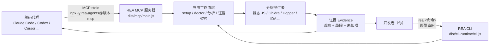
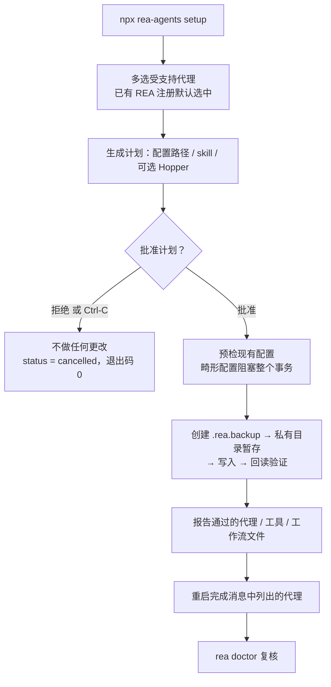
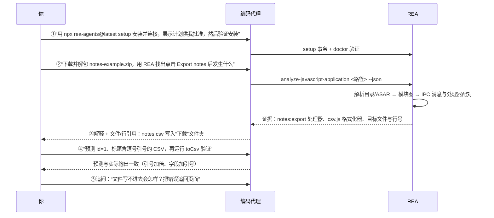

本页是 REA（Reverse Engineer Anything）的实战入门教程，面向第一次接触本工具的开发者。你将完成三件事：**用一条命令把 REA 注册到你的 AI 编码代理**、**借助一个内置示例发起第一次逆向调查**、以及**绕过代理直接在终端使用同一条命令族的 CLI 能力**。全页内容只覆盖这三条路径的必要操作与验证方法；代理候选、事务写入的完整规范与原生引擎前置条件等更深的主题交给后续页面。

## 5 分钟全景：REA 的三条使用路径

REA 是一个同时暴露为 **MCP 服务器**与 **CLI** 的本地逆向工程工具。同一个分析工作流与证据契约既服务代理调用，也服务你的终端脚本——区别只在入口（[cli.md](docs/cli.md#L3-L5)）。注册的本质是：setup 在所选代理的配置文件里写入一个 stdio MCP 服务器条目（形如 `npx -y rea-agents@<版本> mcp`），并随附一份工作流说明（skill），代理重启后即可发现并调用 REA 的工具（[README.md](README.md#L65-L65)、[installation.md](docs/installation.md#L39-L40)）。

先通过下图建立整体认知：图中左侧是两个入口，中间是共享的应用工作流层，右侧是具体分析提供者与最终产出的证据（Evidence）。MCP 入口由代理进程拉起，CLI 入口由你在终端拉起，两者最终落到同一套分析能力（[rea.mjs](scripts/rea.mjs#L13-L58)、[README.md](README.md#L159-L167)）。



两个入口共用同一个包 `rea-agents`：`rea` 与 `rea-agents` 两个可执行名都指向 `scripts/rea.mjs`，该入口在 `mcp`/`--mcp` 参数时加载 `dist/mcp/main.js` 启动服务器，其余参数全部路由给 CLI 运行时（[rea.mjs](scripts/rea.mjs#L13-L51)、[package.json](package.json#L28-L31)）。

Sources: [README.md](README.md#L61-L65) [README.md](README.md#L159-L167) [cli.md](docs/cli.md#L3-L5) [installation.md](docs/installation.md#L39-L40) [rea.mjs](scripts/rea.mjs#L13-L58) [package.json](package.json#L28-L34)

## 准备工作：运行时要求

REA 对宿主环境的要求非常低：**Node.js 22.x（≥22.19）、24.x（≥24.11）或 26+，外加 npm**；23、25 与预发布版本不受支持，REA 也从不擅自升级 Node、npm 或 Homebrew（[README.md](README.md#L174-L175)、[installation.md](docs/installation.md#L1258-L1262)、[package.json](package.json#L32-L34)）。静态 JavaScript/Electron 分析不需要任何原生反汇编引擎，这意味着你完全可以零依赖完成第一次调查（[index.md](docs/index.md#L26-L30)）。

唯一的平台特例在 Linux：进程所有权监督依赖 `PATH` 上 procps 兼容的 `ps`，Ghidra、JADX、固件工具与静态 JavaScript/Electron 分析都会用到；缺失时会在子进程启动前直接拒绝并报 `capability_unavailable`、`provider_unavailable` 或 `execution_failure` 之一。用发行版包管理器安装 `procps`/`procps-ng` 即可解决（[installation.md](docs/installation.md#L348-L357)）。

| 检查项 | 要求 | 说明 |
| --- | --- | --- |
| Node.js | 22.x（≥22.19）/ 24.x（≥24.11）/ 26+ | 23、25 与预发布版不支持 |
| npm | 随 Node 配对版本 | setup 通过 npx 获取最新发布版 |
| Linux `ps` | procps 兼容，须在 `PATH` 上 | 仅 Linux 需要；缺失会在启动受监督子进程前被拒绝 |
| 原生分析引擎 | Hopper / Ghidra / IDA 任一 | **可选**；静态 JavaScript 分析不需要 |

Sources: [README.md](README.md#L172-L176) [installation.md](docs/installation.md#L348-L357) [package.json](package.json#L32-L34) [index.md](docs/index.md#L21-L33)

## 第一步：注册代理

安装 Node.js 与 npm 后，在终端运行一条命令即可开始注册（[README.md](README.md#L78-L82)）：

```bash
npx rea-agents setup
```

setup 首先以**多选列表**列出它支持的代理：已有的 REA 注册默认选中；新检测到的客户端保持可见但不选中——检测只是给你提供上下文，不等于授权新增注册；完全没有配置文件的客户端同样可以手动勾选（[installation.md](docs/installation.md#L31-L38)）。随后 setup 展示一份**精确到路径的变更计划**：包含检测到的代理配置文件、skill 安装目的地、外部软件与网络来源、完整性证据与包管理器命令，你必须批准后 REA 才会写任何文件或安装 Hopper；Hopper 是独立的可选项，需要单独的明确批准，任何提示处都可以取消（[installation.md](docs/installation.md#L41-L53)）。

一次值得注意的细节：如果你要配置 Claude Desktop，请在批准前**完全退出该应用**——运行中的 Claude Desktop 可能会用内存里的旧配置覆盖刚写入的注册（[installation.md](docs/installation.md#L23-L24)）。交互界面的引导语（"REA setup · Understand local apps and binaries from your terminal or agent."）与确认项（"Yes, apply" / "No, cancel"）都渲染在 stderr 上，stdout 始终保留给结构化结果（[interactiveSetup.ts](src/cli/interactiveSetup.ts#L17-L35)、[installation.md](docs/installation.md#L110-L113)）。

下图概括 setup 的事务式流程。要点是"先计划、后批准、再原子化写入"：预检发现畸形或不安全的现有配置会**阻塞整个事务**（包括 Hopper 安装在内的任何写入都不会发生）；批准后写入会保留无关条目与注释、创建 `.rea.backup` 备份、在私有目录中暂存变更并回读验证，失败时报告手工恢复路径而不是留下半成品（[installation.md](docs/installation.md#L56-L66)、[installation.md](docs/installation.md#L97-L101)）。



Sources: [README.md](README.md#L70-L92) [installation.md](docs/installation.md#L14-L27) [installation.md](docs/installation.md#L31-L53) [installation.md](docs/installation.md#L56-L66) [installation.md](docs/installation.md#L97-L113) [interactiveSetup.ts](src/cli/interactiveSetup.ts#L17-L65)

### setup 实际写入了什么

对每个选中的客户端，setup 做两件事。**其一，写入 MCP 注册**：通过 npx 运行 setup 时注册形如 `npx -y rea-agents@<精确版本> mcp`，通过 bunx 运行时注册 `bunx rea-agents@<精确版本> mcp`；在 Windows 上两种命令都会再包一层 `cmd.exe /d /c`，以便客户端能拉起包运行器的 `.cmd` 垫片——注册永远钉死在执行 setup 的那个精确版本，不指向包运行器的临时缓存（[installation.md](docs/installation.md#L1221-L1226)、[installation.md](docs/installation.md#L1252-L1257)、[ClientRegistrationIdentity.ts](src/application/ClientRegistrationIdentity.ts#L48-L56)）。**其二，默认安装 REA 内置的工作流说明（skill）**到该客户端的个人 skill 目录；不想随附时用 `--skill=false` 省略。如果最终没有选中任何代理，setup 会改为单独询问是否为 CLI 用途安装这份工作流，默认 No（[installation.md](docs/installation.md#L39-L41)、[installation.md](docs/installation.md#L128-L137)）。

手动注册（例如客户端不支持交互 setup 时）所需的服务器配置形如下方 JSON，核心就是 `npx -y rea-agents@<版本> mcp` 这一条 stdio 命令（[installation.md](docs/installation.md#L1204-L1215)）：

```json
{
  "mcpServers": {
    "rea": {
      "command": "npx",
      "args": ["-y", "rea-agents@6.7.0", "mcp"]
    }
  }
}
```

Sources: [installation.md](docs/installation.md#L39-L41) [installation.md](docs/installation.md#L1204-L1226) [installation.md](docs/installation.md#L1252-L1257) [installation.md](docs/installation.md#L128-L137) [ClientRegistrationIdentity.ts](src/application/ClientRegistrationIdentity.ts#L48-L56)

### 当前受支持的代理

下表列出全部可直接配置的客户端与其 `--client` 标识，来自官方文档与源码中的稳定定义表；`droid`、`dsh`、`kimi`、`qoder`、`trae`、`workbuddy`、`zcode` 需要 `rea-agents@6.5.0` 或更高版本（[installation.md](docs/installation.md#L480-L513)）。

| 客户端 | `--client` 值 | 客户端 | `--client` 值 |
| --- | --- | --- | --- |
| Claude Code | `claude_code` | Command Code | `commandcode` |
| Claude Desktop | `claude_desktop` | Qwen Code | `qwen_code` |
| Codex | `codex` | Kimi Code | `kimi` |
| Cursor | `cursor` | VS Code | `vscode` |
| Gemini CLI | `gemini_cli` | Grok Build | `grok_build` |
| Windsurf | `windsurf` | OMP | `omp` |
| Devin | `devin` | Pi | `pi` |
| OpenCode | `opencode` | Hermes | `hermes` |
| Antigravity | `antigravity` | Qoder | `qoder` |
| GitHub Copilot CLI | `copilot_cli` | Factory Droid | `droid` |
| Trae | `trae` | WorkBuddy | `workbuddy` |
| ZCode | `zcode` | DeepSeek Harness | `dsh` |

源码中每一条定义都精确声明了该客户端的配置路径探测规则（含 `CLAUDE_CONFIG_DIR`、`CODEX_HOME` 等环境变量覆盖）与配置格式（JSON/TOML/JSONC 等），这正是 setup 能"检测已有注册"却**不擅自动新客户端**的基础（[SupportedClients.ts](src/application/SupportedClients.ts#L481-L746)）。

Sources: [installation.md](docs/installation.md#L480-L513) [SupportedClients.ts](src/application/SupportedClients.ts#L481-L746)

### 脚本化与无人值守注册

交互流程之外，setup 的全部能力都有对应旗标（[installation.md](docs/installation.md#L100-L127)、[setupCommands.ts](src/cli/setupCommands.ts#L56-L97)）：

| 参数 | 作用 |
| --- | --- |
| `--client <id>`（可重复） | 跳过交互多选，精确选择客户端；脚本中可重复 |
| `--all-detected` | 配置**所有**检测到的受支持客户端，仅在确有此意时使用 |
| `--skill=false` | 只注册 MCP，不安装工作流说明 |
| `--dry-run` | 只读输出计划，状态 `planned`、退出码 0，不写任何文件 |
| `--yes` / `-y` | 免确认执行；**必须**配合显式范围（如 `--client codex`）；无范围时仅限已存在的 REA 自有注册 |
| `--install-hopper` | 非交互模式下额外批准安装缺失的 Hopper |
| `--json` | 输出计划与紧凑的 `.doctor` 就绪投影，不实际应用 |
| `--accessible` | 使用顺序化、垂直排版的可访问提示 |

未获批准的实际应用会报告 `needs_confirmation` 并以退出码 1 结束；升级已有注册或刷新 skill 用 `rea setup --skill-client <id> --yes --json`。例如先演练再落地（[installation.md](docs/installation.md#L118-L127)）：

```bash
rea setup --client codex --client cursor --skill=false --dry-run
rea setup --yes --all-detected --install-hopper --json
```

Sources: [installation.md](docs/installation.md#L100-L127) [setupCommands.ts](src/cli/setupCommands.ts#L56-L104)

## 第二步：验证安装（rea doctor）

setup 结束后会报告哪些代理、分析工具与工作流文件通过了最终检查，并**点名需要重启的代理**——重启之前代理进程不会加载新的注册。此后随时可以运行 `rea doctor` 做只读诊断：它读取宿主前置条件与代理配置但**不修改任何东西**；不带参数时审计所有检测到的注册、已装 skill 与可选分析引擎，整体 `healthy` 为 false 并不代表你选定的那条工作流不可用（[installation.md](docs/installation.md#L97-L101)、[installation.md](docs/installation.md#L313-L326)）。

按需选择范围检查能让输出聚焦单个任务；范围化报告带 `scope.mode: "explicit"`，由 `scope_checks` 决定 `healthy` 与退出状态，其余检查归入 `informational_checks`（[installation.md](docs/installation.md#L327-L340)）：

| 任务 | 就绪检查 |
| --- | --- |
| 静态 JavaScript/Electron 分析 | 直接运行 `rea analyze-javascript-application PATH --json` |
| 单个分析引擎 | `rea doctor --provider ghidra --json`（或 `hopper`、`ida`） |
| 单个代理注册 | `rea doctor --client codex --json` |
| 已安装的工作流说明 | `rea doctor --skill --json` |

注意一条容易踩的坑：`doctor` 校验的是**文件与前置条件**，不含"活动连接"——注册对齐但工具未出现在会话里时，需要的动作是重启/重连代理，而不是反复跑 doctor（[installation.md](docs/installation.md#L460-L463)）。失败的检查会附带修复建议；若某原生目标有多个可用提供者，失败原因 `ambiguous` 表示请从 `details.candidate_ids` 中选择一个，`provider_unavailable` 则要求先修复所选引擎（[installation.md](docs/installation.md#L341-L346)）。

Sources: [installation.md](docs/installation.md#L97-L101) [installation.md](docs/installation.md#L313-L346) [installation.md](docs/installation.md#L460-L463) [setupCommands.ts](src/cli/setupCommands.ts#L106-L135)

## 第三步：发起第一次调查

官方教程为第一次调查准备了一个六文件的 Electron 小示例——一个带 **Export notes** 按钮的笔记应用。它足够小到能一眼读懂，又能完整展示 REA 的核心价值：**不安装、不启动目标应用**，直接从代码回答"点击按钮后发生了什么"（[index.html](website/public/first-investigation/index.html#L259-L263)）。

完整旅程共五步，全部通过与代理对话完成。代理把解包后的目录交给 REA 检查，再把返回的证据组织成带文件与行号引用的解释（[index.html](website/public/first-investigation/index.html#L246-L289)）：



第③步的答案示例值得仔细看：*“按钮发送 `notes:export` 消息。主进程把笔记格式化为 CSV，并把 `notes.csv` 写入用户的下载文件夹。列为 `id` 与 `title`。”* 结论的每一环都能落到具体代码——消息从渲染进程的按钮经 preload 桥接到主进程处理器，路径、格式化器与写文件调用同处一个 handler（[index.html](website/public/first-investigation/index.html#L313-L364)）：

```js
ipcMain.handle("notes:export", () => {
  const destination = path.join(app.getPath("downloads"), "notes.csv");
  writeFileSync(destination, toCsv(notes), "utf8");
  return destination;
});
```

第④步是**核对预测**：标题 `Hello, "REA"` 会被格式化为 `1,"Hello, ""REA"""`——标题留在同一个带引号字段里，每个引号加倍。你可以让代理预测后用 Node 运行示例的 `toCsv` 直接验证；如果答案遗漏了关键行，直接要求代理把这些行展示出来即可（[index.html](website/public/first-investigation/index.html#L366-L419)）。第⑤步只需在同一会话里继续追问，或者换成你自己的应用，问一个按钮、文件或行为（[index.html](website/public/first-investigation/index.html#L475-L486)）。

如果你更愿意不用示例、从自己的目标起步，一条命令就能对本地任意解包的 JavaScript/Electron 应用目录或 ASAR 产出第一份结果（[index.md](docs/index.md#L26-L30)）：

```bash
npx -y rea-agents@latest analyze-javascript-application /absolute/path/to/app --json
```

Sources: [index.html](website/public/first-investigation/index.html#L246-L289) [index.html](website/public/first-investigation/index.html#L313-L364) [index.html](website/public/first-investigation/index.html#L366-L419) [index.html](website/public/first-investigation/index.html#L475-L486) [index.md](docs/index.md#L21-L33)

## 终端直用：不经过代理的 CLI 工作流

REA 的 CLI 与 MCP 服务器共享同一套应用工作流和证据契约；每次 CLI 调用都是**独立进程**，所以要把结果存下来供后续命令使用（[cli.md](docs/cli.md#L3-L5)）。全局安装后使用 `rea`，也可以不安装直接通过 npx 一次性运行（[cli.md](docs/cli.md#L7-L13)、[README.md](README.md#L103-L115)）：

```bash
npm install --global rea-agents
rea --help
npx -y rea-agents@latest analyze-javascript-application /absolute/path/to/app --json
```

真实应用的完整证据可达数百 MB，直接阅读既慢又费上下文。推荐模式是**保存证据、再投影视图**：334 MB 的 Obsidian 证据文件可以投影出约 10 KB 的摘要视图（[cli.md](docs/cli.md#L16-L28)）：

```bash
rea analyze-javascript-application /absolute/path/to/app --json > app-evidence.json
jq -c '{source: {kind: "inline", evidence: .}, view: {kind: "summary"}}' app-evidence.json > app-view.json
rea inspect-analysis-view app-view.json
```

不需要原生引擎的命令覆盖了最常见的静态检查需求；原生二进制命令则要求先配置 Hopper、Ghidra、IDA 等提供者（[cli.md](docs/cli.md#L41-L118)）：

| 目标 | 命令 | 原生引擎 |
| --- | --- | --- |
| 解包 JS/Electron 应用、ASAR | `rea analyze-javascript-application PATH --json` | 不需要 |
| .NET 程序集 | `rea inspect-managed-artifact` / `rea inspect-managed-members [--type N]` | 不需要 |
| SQLite 数据库 | `rea inspect-sqlite-database PATH --json`（可加 `--table --row-limit`） | 不需要 |
| Go 二进制 | `rea inspect-go-binary PATH --json` | 不需要 |
| Rust 二进制 | `rea inspect-rust-binary PATH --json` | 不需要 |
| 原生二进制总览 | `rea analyze PATH --provider ghidra --json` | 需要 |
| 搜索 / 函数档案 / 伪代码 / 引用 / 追踪 | `rea search` / `function` / `decompile` / `xrefs` / `trace`（同上带 `--provider`） | 需要 |

用 `rea providers --json` 与 `rea capabilities --json` 查看可用提供者及其支持的操作。只有一个提供者支持目标时自动选择；多个提供者都支持时**必须显式选择**——命令行用 `--provider hopper`，或设置 `REA_ANALYSIS_PROVIDER` 作为长期偏好；MCP 侧则向 `open_binary` 传 `provider_id`。选定的提供者在会话内保持绑定，直到显式切换或关闭（[cli.md](docs/cli.md#L120-L150)）。重复性的调查还可以用 `--snapshot` 把成功结果落盘，目标字节、操作、参数、提供者与设置完全一致时直接复用缓存结果（[cli.md](docs/cli.md#L162-L199)）：

```bash
rea analyze /absolute/path/to/program --provider ghidra --snapshot /absolute/path/to/analysis/program.json
```

Sources: [cli.md](docs/cli.md#L3-L28) [cli.md](docs/cli.md#L41-L118) [cli.md](docs/cli.md#L120-L150) [cli.md](docs/cli.md#L162-L199) [README.md](README.md#L103-L115)

## 更新、刷新与卸载

REA 迭代很快，新版本包含频繁的修复，官方建议保持更新（[README.md](README.md#L124-L127)）。对 `npm install --global` 或 Bun 全局安装的 CLI，用 `rea update`（`--update` 是其别名）；更新器只更新**拥有当前运行 CLI** 的那个安装，最多保留 4 MiB 的合并标准输出/错误，Bun 全局更新要求 Bun 1.2.17+（[README.md](README.md#L128-L138)、[installation.md](docs/installation.md#L367-L374)）。更新全局安装后，按更新输出提示运行对应的 setup 命令刷新代理注册与 skill 并重启代理；npx 用户则直接用 `npx rea-agents@latest setup`（[README.md](README.md#L144-L157)）。

```bash
rea update                          # 更新全局安装
npx rea-agents@latest setup         # 刷新代理注册与 skill
rea uninstall                       # 移除 REA 自有的注册与 skill 文件
rea uninstall --purge-data          # 额外清除 ~/.rea 下的缓存与状态
```

卸载的边界同样清晰：Hopper、Node.js、证据文件、捕获数据、无关 skill 与其他 MCP 服务器都会保留；`--purge-data` 只额外删除 REA 自己的缓存与状态（[installation.md](docs/installation.md#L374-L377)）。

Sources: [README.md](README.md#L124-L157) [installation.md](docs/installation.md#L367-L377)

## 常见问题速查

| 现象 | 原因与处理 |
| --- | --- |
| 代理里看不到 REA 工具 | 先重启完成消息中点名的代理；`doctor --client <id> --json` 查文件与前置条件，但它不检验活动连接 |
| Claude Desktop 注册被悄悄改回 | 批准 setup 前完全退出 Claude Desktop，运行中的应用会用内存配置覆盖注册 |
| setup 拒绝继续 | 预检发现畸形/不安全配置会阻塞整个事务；按报告修复后重试，拒绝或 Ctrl-C 则不做任何更改 |
| 原生分析报 `ambiguous` | 多个提供者都支持该目标；用 `--provider` 或 `REA_ANALYSIS_PROVIDER` 显式选择 |
| Linux 上进程无法启动 | 安装 `procps`/`procps-ng`，保证 procps 兼容的 `ps` 在 `PATH` 上 |
| 输出过大无法阅读 | 把 `--json` 结果重定向到文件，再用 `inspect-analysis-view` 投影 summary/page 视图 |

Sources: [installation.md](docs/installation.md#L23-L24) [installation.md](docs/installation.md#L56-L66) [installation.md](docs/installation.md#L313-L357) [installation.md](docs/installation.md#L460-L463) [cli.md](docs/cli.md#L16-L28) [cli.md](docs/cli.md#L141-L156)

## 下一步阅读

完成本页后，推荐按以下顺序深入（均可点击跳转）：

1. **[安装与代理配置：受支持客户端、事务式写入与原生引擎前置条件](3-an-zhuang-yu-dai-li-pei-zhi-shou-zhi-chi-ke-hu-duan-shi-wu-shi-xie-ru-yu-yuan-sheng-yin-qing-qian-zhi-tiao-jian)** — setup 备份/恢复的完整规范、每个客户端的配置路径、Hopper/Ghidra 引擎配置，以及把 REA 限制在单个项目或配置文件的方法。
2. **[CLI 使用与就绪诊断：rea 命令、JSON 输出与 doctor 检查](4-cli-shi-yong-yu-jiu-xu-zhen-duan-rea-ming-ling-json-shu-chu-yu-doctor-jian-cha)** — 全量 CLI 命令面、输出与退出状态约定、doctor 与快照的深入用法。
3. **[JavaScript 与 Electron 静态分析：ASAR 读取、模块图与源码恢复](15-javascript-yu-electron-jing-tai-fen-xi-asar-du-qu-mo-kuai-tu-yu-yuan-ma-hui-fu)** — 第一次调查所用工作流的完整语义：结果结构、完整性校验与覆盖范围。
4. **[原生二进制调查工作流：函数档案、引用与 Go/Rust 元数据、离线布局诊断](10-yuan-sheng-er-jin-zhi-diao-cha-gong-zuo-liu-han-shu-dang-an-yin-yong-yu-go-rust-yuan-shu-ju-chi-xian-bu-ju-zhen-duan)** — 当目标从脚本应用换成原生二进制时的工作流。

概念背景（REA 是什么、证据与不确定性模型为何存在）见 **[概述：REA——一个连接 AI 代理的逆向工程 CLI 与 MCP 服务器](1-gai-shu-rea-ge-lian-jie-ai-dai-li-de-ni-xiang-gong-cheng-cli-yu-mcp-fu-wu-qi)**。