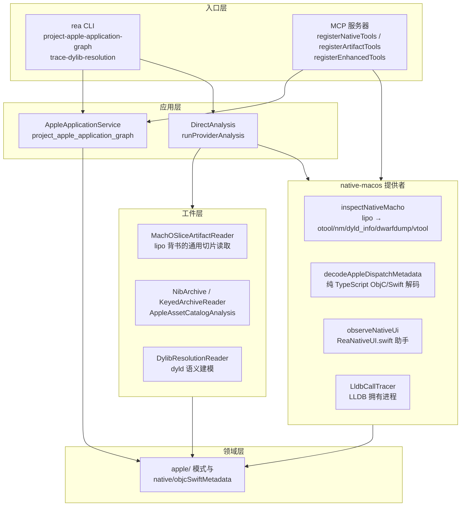
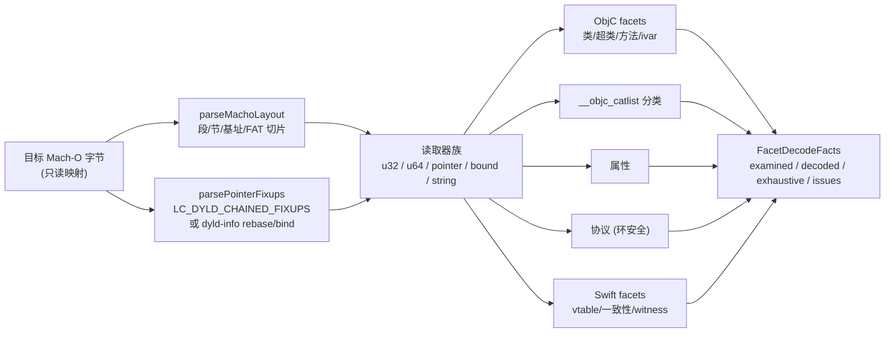
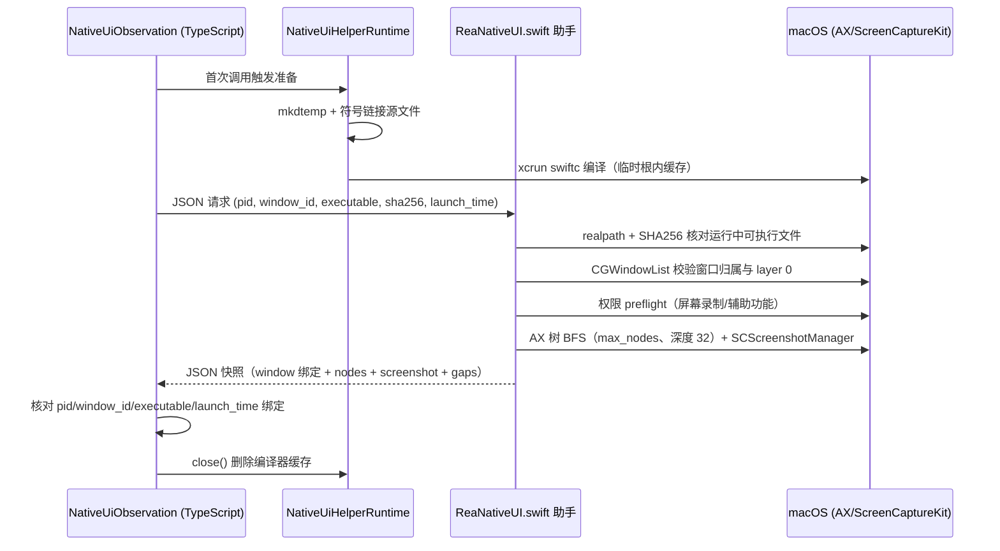

本页面解释 REA 面向 Apple 平台的两条互补分析路径：其一是**执行无关**的 Apple 应用包投影（`project_apple_application_graph`），它把已认证的 IPA/`.app`/ZIP/DMG 清单证据投影为应用图；其二是 **native-macos 提供者**，它由 Xcode 命令行工具（`lipo`/`otool`/`nm`/`dyld_info`/`dwarfdump`/`vtool`/`codesign`/`plutil`/`swift-demangle`）与纯 TypeScript 元数据解码器组成，并延伸到运行时观察（原生 UI 捕获与 LLDB 调用记录）。全文面向高级开发者，聚焦于每一层的边界承诺：什么被解码、什么被保留为不确定性、什么永远不会被执行。

## 能力分层架构

Apple 分析能力沿仓库的分层架构分布，各层之间以证据（Evidence）与模式（Schema）为契约边界。静态投影在应用层完成纯函数变换；工件层提供 Mach-O 切片读取与包内格式（NIB、Keyed Archive、Asset Catalog）的确定性解码；native-macos 提供者整合外部工具捕获与自有解码器；运行时观察则通过一次性编译的 Swift 助手进程与 LLDB 会话实现，全部以所有权（ownership）与清理租约（cleanup lease）收尾。

Sources: [apple-application-analysis.md](docs/apple-application-analysis.md#L1-L247)、[AppleApplicationService.ts](src/application/apple/AppleApplicationService.ts#L14-L28)、[NativeMacOSProviderMetadata.ts](src/native/NativeMacOSProviderMetadata.ts#L8-L27)、[MachOSliceArtifactReader.ts](src/artifacts/MachOSliceArtifactReader.ts#L37-L56)

## Apple 应用清单投影：执行无关的应用图

`project_apple_application_graph` 将同一 IPA、macOS `.app` 目录、ZIP 或 DMG 的一条或多条已认证 `inventory_artifact` Evidence 投影为 Apple 应用清单。投影的承诺是**执行无关**：它报告精确路径、内容哈希、检测到的格式、bundle 解剖、运行时家族提示与基于路径的桥接假设，但明确不解析 plist 或 CMS 语义，也不声称观察到了运行时调用。运行时家族提示匹配完整路径段（如 `React.framework`、`hermes.framework`、`Flutter.framework`、`UnityFramework.framework`），子串命中（`Preact.framework`、`MyApp.framework`）不构成识别，通用 `App.framework` 也不足以判定 Flutter——这些提示始终是清单衍生的，不是观察到的加载。

Sources: [apple-application-analysis.md](docs/apple-application-analysis.md#L6-L19)、[AppleApplicationService.ts](src/application/apple/AppleApplicationService.ts#L14-L28)

应用根的发现规则由清单根格式决定：IPA 中的每个 `Payload/<Name>.app`、目录清单的 `.app` 本身、目录/ZIP/DMG 中每个最外层 `<Name>.app` 都成为应用根。投影对候选桥接的笛卡尔展开施加 2 MiB 序列化字节预算——先计算对数与精确 UTF-8 JSON 尺寸再创建对象，超出预算时保留确定性前缀并通过 `bridge_candidate_coverage` 报告总量、发出量与省略量，整体覆盖降级为 `partial`。字节数组内容以 SHA-256 标识，同一字节可在不同路径下分别充当脚本、资源或原生附加组件而不相互覆盖。

Sources: [apple-application-analysis.md](docs/apple-application-analysis.md#L27-L58)、[projectMobileApplicationGraph.ts](src/server/registerApplicationTools/projectMobileApplicationGraph.ts#L28-L39)、[applicationCommands.ts](src/cli/applicationCommands.ts#L114-L126)

macOS bundle 解剖将每个应用根进一步分解为嵌套 bundle 的角色表：`macos-deep`（含 `Contents/`）、`versioned-framework`（含 `Versions/`）与 `shallow` 三种布局；角色判定遵循纯路径约定（`role_basis: "path-convention"`），覆盖 `*.appex`、`*.xpc`、`*.framework`、`*.dext`、`PlugIns/*`、`Contents/Library/LoginItems/*.app` 等十余种。清单同时报告 `privileged_helpers`（`Contents/Library/LaunchServices/`）、`launchd_plists`（LaunchAgents/LaunchDaemons）与 `helpers`。AppleDouble 附属文件（`._*` 与 `__MACOSX/`）作为清单事实保留，但被排除出根、角色与解剖组件。

Sources: [apple-application-analysis.md](docs/apple-application-analysis.md#L78-L122)

投影不读取 plist 的边界被显式声明：调用者应对 bundle 的 `info_plist_path` 或 launchd plist 使用 `inspect_plist` 读取 `CFBundleExecutable`、标识符、`SMPrivilegedExecutables` 等，对可执行候选使用 `inspect_signature` 获取代码签名声明。`platforms` 字段以 `Contents/` 判定 `macos`、以浅层 `Info.plist` 判定 `ios`，两者皆缺则无平台标记。

Sources: [apple-application-analysis.md](docs/apple-application-analysis.md#L124-L148)

## Mach-O 切片读取与 dyld 解析追踪

工件层的 `MachOSliceArtifactReader` 是只读的通用 Mach-O 切片读取器，以原生 `lipo` 元数据为背书：它通过 `XcrunCommandRunner` 调用 `lipo -detailed_info` 获取架构表，再以 TypeScript 实现 `readMachoImage` 加载命令读取，入口条目按切片声明生成。这条双轨设计（原生工具给权威元数据、TypeScript 做结构解析）在后续的 dylib 解析追踪中被推向完整语义。

Sources: [MachOSliceArtifactReader.ts](src/artifacts/MachOSliceArtifactReader.ts#L37-L56)

`trace_dylib_resolution` 回答“每个 Mach-O dylib load 最终到达哪个文件”这一问题。它运行在活动 Mach-O 上，或 `.app` 中**每个可执行文件**上（主程序、XPC 服务、app 扩展、登录项、特权助手与辅助工具各自构成独立进程根，拥有各自的 `@executable_path`）。加载命令在 TypeScript 中从 Mach-O 与 FAT 头解析，包括新版链接器为延迟初始化等标志发出的 `dylib_use_command` 编码。工具不执行任何代码、不要求 Apple 工具链，因此也能在 macOS 之外工作。

Sources: [apple-application-analysis.md](docs/apple-application-analysis.md#L130-L140)、[artifactCommands.ts](src/cli/artifactCommands.ts#L59-L90)

解析语义严格跟随 dyld：`@executable_path` 取进程根可执行文件目录（根为库时视为不可判定）；`@loader_path` 取持有 load command 的镜像目录；`@rpath` 先尝试加载镜像的每条 `LC_RPATH`，再回溯至加载链上游直至进程根；依赖按 load-command 顺序 dependents-first 加载，每个镜像每进程只加载一次；`Versions/Current` 类符号链接在分析根内跟随，穿越 `..` 或绝对链接则判定 `escapes-target`。每条边列出尝试过的每个候选路径及其结果（`resolved`、`absent`、`not-mach-o`、`malformed`、`unsupported`、`architecture-missing`、`outside-target`、`escapes-target`、`undetermined`）。

| 解析状态 | 含义 |
| --- | --- |
| `resolved` | 分析根内的镜像加载，且无更早候选不可判定 |
| `conditional` | 根内镜像可解析，但更早的根外候选（如 `/usr/lib/swift`）若在运行系统存在将胜出 |
| `unresolved` | 所有候选在根内确定缺失或不可用 |
| `undetermined` | 无候选在根内解析，且部分候选位于根外或依赖环境 |

Sources: [apple-application-analysis.md](docs/apple-application-analysis.md#L141-L219)

`findings` 被明确标注为**派生的而非观察的**：`required/weak/lazy-load-unresolved` 指出未解析的加载（`LC_LAZY_LOAD_DYLIB` 只解析不遍历，因为 dyld 在首次使用时才加载）；`earlier-rpath-candidate-absent` 指出放在更早建模搜索路径上的兼容镜像可能优先，但受未建模搜索输入与代码签名库验证约束；`dyld-environment-present` 保留观察到的 `LC_DYLD_ENVIRONMENT` 条目。文档明确说明这些发现不建立 dyld 最终将加载哪个镜像的断言——签名元数据应交给 `inspect_signature`。

Sources: [apple-application-analysis.md](docs/apple-application-analysis.md#L224-L239)

## 包内静态资源解码：NIB、Keyed Archive 与 Asset Catalog

Apple 包的 UI 资源通过三个确定性解码器暴露为 MCP 工具。`decode_interface_builder` 将活动 bundle 内编译后的 storyboard 与 nib 归档（含 keyed plist 与 NIBArchive 对象表）解码为有界的对象、层级与连接图，其自述强调这是**静态归档解析**——未识别的归档类与未解析的代码处理器保持显式状态。`NIBArchive` 解码器校验 magic 与头部，仅接受 format version 1，读取 object/key/value/class 四张偏移表，并在默认 128 MiB 解码预算内工作；其承诺是“解码 Apple 长度前缀 NIBArchive 表示而不加载任何 UI 类”。

Sources: [artifactToolContracts.ts](src/contracts/artifactToolContracts.ts#L84-L115)、[NibArchive.ts](src/artifacts/apple/NibArchive.ts#L24-L48)

`inspect_keyed_archive` 把 Foundation NSKeyedArchiver plist 还原为原始对象表节点、类描述符、命名根与 UID 边，保留共享与循环引用而不实例化任何类；`inspect_asset_catalog` 则检查编译后的 `Assets.car` 元数据，返回稳定分页的 catalog 与 rendition 记录（含原始 assetutil 元数据与目录摘要），但**不提取** rendition 字节。这三个工具与 `trace_dylib_resolution` 一同注册为 `artifact-provider` 类契约，其中 `inspect_artifact` 与 `decode_interface_builder` 支持保留式摘要投递。

Sources: [artifactToolContracts.ts](src/contracts/artifactToolContracts.ts#L106-L120)、[registerArtifactTools.ts](src/server/registerArtifactTools.ts#L11-L18)

## native-macos 提供者与 Mach-O 检查流水线

`native-macos` 提供者的公开身份是"macOS native inspection utilities"，其类注释自我定义为“由 Xcode 命令行工具组合而成的只读语义提供者”。能力声明在 darwin 之外的平台上整体降级为 `unsupported_host`。效果矩阵按操作精确声明：`inspect_native_dispatch_metadata` 是唯一不启动进程的操作；`capture_native_ui_scenario` 与 `observe_native_calls` 被列为“目标进程可显示 UI、使用网络并写文件”的拥有进程操作；`observe_native_ui` 因场景捕获需要写入文件系统而单独标记 `mayWriteFilesystem`。

Sources: [NativeMacOSProviderMetadata.ts](src/native/NativeMacOSProviderMetadata.ts#L8-L58)、[NativeMacOSProvider.ts](src/native/NativeMacOSProvider.ts#L128-L130)

`inspect_macho` 的流水线由精确的命令清单驱动。发现阶段运行 `lipo -detailed_info`，解析输出获得容器格式与架构表；架构选择器随后裁定请求的切片——若 `lipo` 未列出请求架构，检查立即失败并声明"refusing to read another slice"（拒绝读取另一切片），这是切片级证据位置的完整性前提。切片阶段并行启动五条必需命令（`otool -h -l`、`nm -gjU --no-dyldinfo`、`dyld_info -imports`、`dyld_info -exports`、`dwarfdump --uuid`）与一条可选命令（`vtool -show-build`）；声明顺序固定了来源归属与失败优先级。

Sources: [NativeMachoInspection.ts](src/native/NativeMachoInspection.ts#L42-L120)

流水线包含两处值得注意的性能与降级设计。其一，`nm` 显式附加 `--no-dyldinfo`：llvm-nm 默认的 dyld-info 通道会从 dyld 元数据伪造符号表缺失的名字，在大型应用上耗时数秒（注释引用 Keynote arm64 的 5.8 秒对比 0.01 秒）。其二，当被剥离的符号表缺失导出 trie 保有的名字时，仅在此条件下重跑 `nm -gjU` 补齐——精确的名字用于消解 `dyld_info` 行的歧义。`vtool` 的可选地位同样精确：它不识别变体子类型，无法拼写选择 `arm64e.x1` 切片，此时构建元数据退化为仅从 `otool` 规范化并记录 limitation。

Sources: [NativeMachoInspection.ts](src/native/NativeMachoInspection.ts#L44-L60)、[NativeMachoInspection.ts](src/native/NativeMachoInspection.ts#L120-L200)

## ObjC/Swift 分发元数据：纯 TypeScript 解码器

`inspect_native_dispatch_metadata` 是 Apple 分析中最具深度的能力：在不加载任何目标代码的前提下，解码经过验证的小端 64 位 Apple Objective-C 元数据。入口 `decodeAppleDispatchMetadata` 构造一条三级读取链——`parseMachoLayout` 解析选定架构切片的段/节布局，`parsePointerFixups` 解析指针修复流，由此派生出 `u32`/`decodePointer`/`pointer`/`bound` 读取器族。指针语义被严格区分：`pointer` 只接受 rebase（bind 到其他镜像的指针读作 0），`bound` 只返回 bind，这个二分法贯穿全部 ObjC 读取器。

Sources: [AppleDispatchMetadata.ts](src/native/AppleDispatchMetadata.ts#L50-L80)、[AppleMachoSelection.ts](src/native/AppleMachoSelection.ts#L18-L38)

指针修复解码器将 Mach-O 的修复存储抽象为 `FixupCommands`（`LC_DYLD_CHAINED_FIXUPS` 数据范围、dyld-info rebase/bind 流、按库序号排列的依赖 install name），并统一为三种指针结果：`rebase`（指向镜像内地址）、`bind`（绑定到符号，带库名、weak 标记与 addend）与 `unsupported`。支持的链式指针格式覆盖 `DYLD_CHAINED_PTR_ARM64E`、`DYLD_CHAINED_PTR_64`、`DYLD_CHAINED_PTR_64_OFFSET`、`DYLD_CHAINED_PTR_ARM64E_USERLAND` 与 `USERLAND24`。

Sources: [AppleMachoFixups.ts](src/native/AppleMachoFixups.ts#L7-L48)

解码产出按六个稳定 facet 组织，每个 facet 输出 `FacetDecodeFacts`（检查数、解码数、是否穷尽、问题清单）：`objc_class_method_ivar_metadata`、`binary_relative_pointers`、`objc_properties_categories`、`pointer_fixups`、`swift_conformances_static_witness_slots` 与 `swift_class_vtable_descriptors`。这个结构把“部分成功”变成一等公民——单个记录的解码失败不会丢弃整个 facet，而是转化为带位置与原因的 issue。

| Facet | 解码内容 | 关键防御边界 |
| --- | --- | --- |
| `objc_class_method_ivar_metadata` | 类、超类、方法列表、ivar | 空类名抛出；超类 bind 识别外部 `_OBJC_CLASS_$_Name` |
| `objc_properties_categories` | `__objc_catlist` 分类与属性 | 分类列表 8 字节对齐校验 |
| `objc_protocols` | 协议声明与必选/可选方法 | 环安全 visited 集合；20000 条上限；相对方法列表 stride 12/24 |
| `swift_class_vtable_descriptors` | 非泛型、非弹性类 vtable | 泛型/弹性超类拒绝；20000 条与 positiveWords 界；异步槽 partial |
| `pointer_fixups` | 链式修复与 dyld-info 流 | 五种链式格式；未知格式转 `unsupported` |

Sources: [AppleDispatchDecodeFacts.ts](src/native/AppleDispatchDecodeFacts.ts#L1-L27)、[AppleObjcDispatchFacets.ts](src/native/AppleObjcDispatchFacets.ts#L32-L68)、[AppleObjcProtocols.ts](src/native/AppleObjcProtocols.ts#L23-L62)、[AppleSwiftVtables.ts](src/native/AppleSwiftVtables.ts#L45-L67)

Swift vtable 解码展示了元数据边界约束的典型形态：描述符 flags 的低 5 位必须等于 16 才是类描述符；泛型类与弹性超类元数据被显式抛出不支持；元数据初始化种类（0/1/2 对应不同头部偏移）决定 vtable 头位置；vtable 数量受 20000 上限与声明的 `positiveWords` 双重约束。每个槽位解码为 `swift_dispatch_slots` 记录，其中**同步且实现可执行**的槽位才有 `implementation_address`——异步、协程、外部或未映射实现被标记为 `partial` 并附原因"Async, coroutine, external or unmapped vtable implementation is unresolved"。证据描述同时澄清语义：槽位索引是元数据字偏移，不是源码方法序号。

Sources: [AppleSwiftVtables.ts](src/native/AppleSwiftVtables.ts#L45-L126)

ObjC 侧同样体现防御性解析：协议读取器以 visited 集合保证环安全身份，方法列表按 flags 的高位判定相对编码（stride 12）或绝对编码（stride 24），空 selector 单独上报为 `protocol_method_selector_empty` 使协议及其余方法声明保持已解码记录。分类解码器处理 `__objc_catlist` 中每条 `category_t` 记录的 name、cls、实例/类方法、协议与实例属性，外部类名通过 bind 符号 `_OBJC_CLASS_$_Name` 的正则提取。这些 facet 连同 `get_objc_classes`、`get_objc_protocols`、`analyze_swift_types` 等查询，通过增强工具通道注册到 MCP 服务器。

Sources: [AppleObjcProtocols.ts](src/native/AppleObjcProtocols.ts#L23-L131)、[AppleObjcCategories.ts](src/native/AppleObjcCategories.ts#L10-L44)、[registerEnhancedTools.ts](src/server/registerEnhancedTools.ts#L61-L94)

## 原生 UI 观察与场景捕获

`observe_native_ui` 与 `capture_native_ui_scenario` 两个契约分别覆盖被动观察与显式场景：前者按 PID 与 window ID 观察已在运行的原生应用，捕获有界可访问性树与选中窗口截图；后者在同一精确窗口内执行选中元素的按压、增减滚动、AXValue 文本输入与有界等待步骤，返回有序的前后捕获。两者的共同前提是活动目标是 Mach-O 可执行文件——`observeWithHelper` 在目标不是 Mach-O 时直接返回能力不可用。

Sources: [nativeToolContracts.ts](src/contracts/native/nativeToolContracts.ts#L78-L88)、[NativeUiObservation.ts](src/native/NativeUiObservation.ts#L131-L145)、[NativeUiHelperRuntime.ts](src/native/NativeUiHelperRuntime.ts#L27-L60)

Swift 助手实现了多重的**目标身份绑定**，这是整个观察通道的安全性基石。它先以 `NSRunningApplication` 取目标可执行 URL，`realpath` 归一化后与请求的 executable 逐一比对；随后校验可执行文件字节的 SHA-256 与活动目标摘要一致（身份检查预算为 256 MiB）；`launch_time` 贯穿每次捕获以检测进程替换（PID 复用）；窗口层面通过 `CGWindowListCopyWindowInfo` 断言窗口归属 PID 且位于 layer 0。任何不匹配都以结构化边界失败（`target-mismatch`、`process-replaced`、`window-mismatch`）终止。

Sources: [ReaNativeUI.swift](bridge/native/ReaNativeUI.swift#L31-L53)、[NativeUiObservation.ts](src/native/NativeUiObservation.ts#L182-L195)

权限模型遵循“拒绝即失败、无广泛回退”的原则：截图前以 `CGPreflightScreenCaptureAccess` 预检屏幕录制权限，辅助功能前以 `AXIsProcessTrusted` 预检，失败时返回明确的指引消息（要求在系统设置的隐私与安全性中授权）而不做任何宽泛捕获。辅助功能树通过 AX 窗口几何与 CG 边界的唯一匹配来锚定选中窗口，消除多窗口歧义。允许的动作被严格收敛为三类——`click`（kAXPressAction）、`scroll`（kAXIncrement/DecrementAction）与 `key-entry`（AXValue 属性写入），且每步前校验元素归属进程。

Sources: [ReaNativeUI.swift](bridge/native/ReaNativeUI.swift#L54-L101)

可访问性树的采集是有界广度优先遍历：`max_nodes` 截断、路径深度超过 32 即停止下探、AX 子计数不可用时记录 `gaps` 并标记截断。截图使用 ScreenCaptureKit 的 `SCScreenshotManager`（要求 macOS 14+），以选中窗口为独立桌面过滤器，最长边缩放至 2048px，输出携带 MIME 类型、base64、SHA-256 与尺寸的 PNG。TypeScript 侧对此施加 64 MiB 场景输出预算，超限即以能力不可用终止。助手运行时按观察惰性编译：`mkdtemp` 建立临时根、符号链接桥接源、`xcrun swiftc` 编译并将模块缓存限制在可删除的根内，清理租约在结束时移除全部编译产物。

Sources: [ReaNativeUI.swift](bridge/native/ReaNativeUI.swift#L102-L152)、[NativeUiObservation.ts](src/native/NativeUiObservation.ts#L196-L207)、[NativeUiHelperRuntime.ts](src/native/NativeUiHelperRuntime.ts#L27-L60)

## LLDB 调用观察

`observe_native_calls` 把活动 Mach-O 作为**拥有进程**在 LLDB 下启动，记录每次进入调用者选定函数或 Objective-C 方法的事件：线程、模块、符号、加载与文件地址、原始参数寄存器、selector、接收者类与可选调用者帧。每个命中自动继续，不支持表达式求值——这是一个纯记录通道而非交互式调试器。其契约示例展示了两种断点形状：`objc-method`（类名 + selector，如 `NSURLSession` 的 `dataTaskWithRequest:completionHandler:`）与 `function`（符号名 + 模块，如 `libsystem_kernel.dylib` 的 `open`）。

Sources: [nativeToolContracts.ts](src/contracts/native/nativeToolContracts.ts#L89-L93)

实现层面，`LldbCallTracer` 依赖 Xcode 或 Command Line Tools 提供的 LLDB（不可用时以明确的 `LLDB_REQUIREMENT` 消息失败），通过 `spawnOwnedProviderProcess` 与 `ProviderProcessSupervisor` 建立进程监督，以 `PrivateRuntimeRoot` 隔离运行时，并在结束时走 `cleanupOwnedProcessGroup` 的进程组清理。目标输出按流捕获且受限存储，超出部分只计数不保存；取消路径通过 `LldbRetainedObservations` 保留已观察的日志与部分捕获，使部分结果仍可投影为有效证据。

Sources: [LldbCallTracer.ts](src/native/LldbCallTracer.ts#L33-L60)

## 工具契约速查

下表汇总本页面涉及的全部对外契约。注意三类契约的分工：`artifact-provider` 系列执行确定性归档解析；`native-provider` 系列由 macOS 工具链与自有解码器背书；应用投影系列是执行无关的纯变换。

| 工具 | 类别 | 核心承诺 |
| --- | --- | --- |
| `project_apple_application_graph` | 应用投影 | 从认证清单证据投影应用图，不解析 plist/CMS |
| `inspect_artifact` / `extract_artifact` | 工件 | 一次性内容寻址图检查与安全全量提取 |
| `decode_interface_builder` | 工件 | storyboard/nib + NIBArchive → 有界对象/层级/连接图 |
| `inspect_keyed_archive` | 工件 | NSKeyedArchiver 对象表，不实例化类 |
| `inspect_asset_catalog` | 工件 | Assets.car 元数据分页记录，不提取 rendition 字节 |
| `trace_dylib_resolution` | 工件 | dyld 加载路径建模，每条边列出候选与结果 |
| `inspect_macho` | 原生 | 切片/加载命令/导入导出/构建元数据 + 精确命令来源 |
| `inspect_signature` | 原生 | 代码签名身份、哈希、授权、需求、授权项 |
| `inspect_plist` | 原生 | 规范化 JSON 而非 plutil 文本 |
| `list_architectures` | 原生 | 切片表：偏移、大小、对齐、覆盖 |
| `demangle_swift` | 原生 | 有序 Swift 符号逐一 demangle/原样/无效 |
| `inspect_native_dispatch_metadata` | 增强 | 纯 TypeScript ObjC/Swift 元数据 + facet 覆盖事实 |
| `observe_native_ui` | 原生 | 有界 AX 树 + 选中窗口截图 |
| `capture_native_ui_scenario` | 原生 | 三类 AX 动作 + 有序前后捕获 |
| `observe_native_calls` | 原生 | LLDB 下记录函数/方法入口，自动继续 |

Sources: [nativeToolContracts.ts](src/contracts/native/nativeToolContracts.ts#L78-L130)、[artifactToolContracts.ts](src/contracts/artifactToolContracts.ts#L77-L120)、[registerNativeTools.ts](src/server/registerNativeTools.ts#L9-L26)

## 验证通道与边界

Apple 分析的验证横跨三个层面。解码器正确性由 `scripts/verify/apple/` 下的专项通道覆盖：`dispatch.mjs`（ObjC/Swift 元数据）、`macos-bundle.mjs` 与 `macos-dylib-e2e.mjs`（bundle 解剖与 dylib 解析）、`interface-builder.mjs`、`keyed-archive.mjs`、`asset-catalog.mjs`、`dyld-environment.mjs` 等。其中 dylib 解析的权威校验是双向的：`verify:macos-bundle` 将解析器对每个被追踪镜像的输出与 `otool -l` 对照，并把两个进程根的预测加载顺序与 dyld 实际加载的镜像（`DYLD_PRINT_LIBRARIES`）比对。

Sources: [apple-application-analysis.md](docs/apple-application-analysis.md#L240-L247)、[scripts/verify/apple](scripts/verify/apple)

语言元数据的回归基线由一致性测试夹具固定：`tests/conformance/objc/fixture.m` 提供 Objective-C 协议、分类与属性的真实编译产物，`tests/conformance/swift/` 则包含 `fixture.swift`、`type-inventory.swift`、`string-literals.swift` 以及针对解码器防护的汇编回归（`decoder-safeguards.S`、`unresolved-string-jump.s`）。这些夹具使“解码部分失败”路径本身成为被测对象，与 facet 解码事实的 `exhaustive`/`issues` 语义形成闭环。

Sources: [tests/conformance/objc/fixture.m](tests/conformance/objc/fixture.m)、[tests/conformance/swift](tests/conformance/swift)

使用本通道时需牢记三条边界。第一，静态元数据是**派生**的：dylib 解析的 findings、运行时家族提示与桥接假设都不构成对运行时行为的观察断言。第二，运行时观察受 OS 权限门控：屏幕录制与辅助功能被拒绝时任务失败且无回退，LLDB 依赖 Xcode 工具链存在。第三，提供者能力与文本格式依赖宿主安装的 macOS/Xcode 工具链版本，这一 limitation 在每个能力描述符中原样保留。

Sources: [NativeMacOSProviderMetadata.ts](src/native/NativeMacOSProviderMetadata.ts#L29-L58)、[apple-application-analysis.md](docs/apple-application-analysis.md#L224-L239)

## 后续阅读

掌握 Apple 静态与原生通道后，建议按以下顺序延伸：需要把 Mach-O 检查嵌入函数级逆向工作流（函数档案、引用追踪、Go/Rust 元数据）时，阅读[原生二进制调查工作流](10-yuan-sheng-er-jin-zhi-diao-cha-gong-zuo-liu-han-shu-dang-an-yin-yong-yu-go-rust-yuan-shu-ju-chi-xian-bu-ju-zhen-duan)；需要在运行时更深入地操作进程与信号时，阅读[崩溃转储与调试器桥接：pwndbg、pwntools 与 GDB/Rizin/LLDB 会话](14-beng-kui-zhuan-chu-yu-diao-shi-qi-qiao-jie-pwndbg-pwntools-yu-gdb-rizin-lldb-hui-hua)；Apple 应用图中识别出的 Flutter 框架值得在[Flutter 与鸿蒙应用分析](21-flutter-yu-hong-meng-ying-yong-fen-xi-dart-elf-zai-he-yu-harmonyos-bao-jian-cha)中继续追踪 DART ELF 载荷；`observe_native_calls` 与场景捕获返回的保留证据语义在[MCP 契约参考](8-mcp-qi-yue-can-kao-gong-ju-jie-guo-bao-liu-zheng-ju-hui-hua-fa-xian-yu-qu-xiao-hui-fu)中有完整定义；而本页面引用的全部验证通道在[测试策略与验证通道](27-ce-shi-ce-lue-yu-yan-zheng-tong-dao-yuan-ma-bian-jie-yan-shou-zhi-xing-ji-zhen-shi-gong-ju-lian-tong-dao)中有系统性梳理。