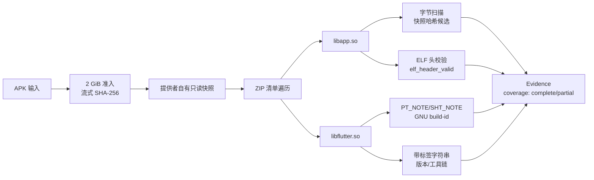
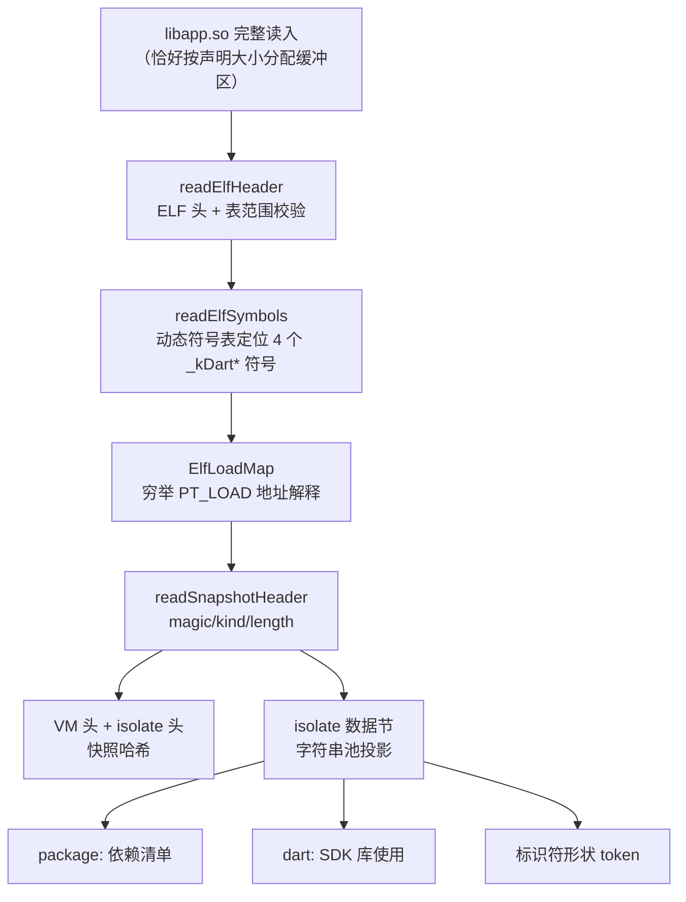
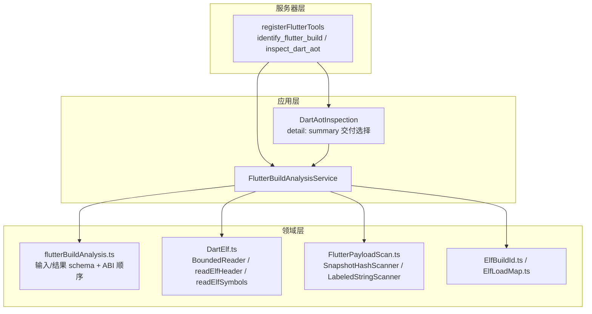
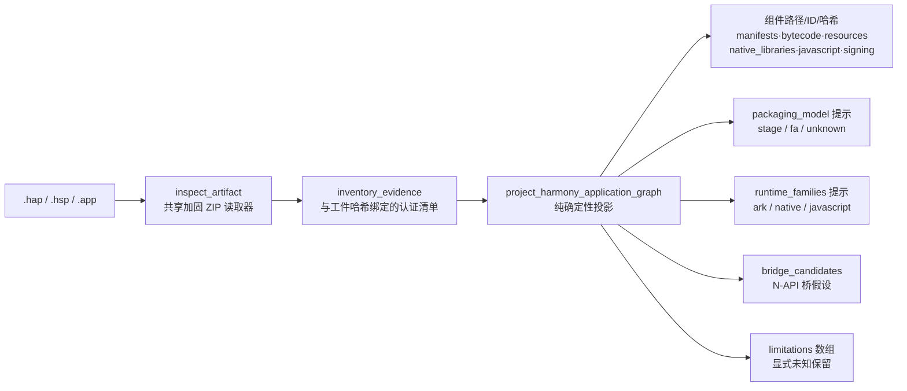

本页面介绍 REA 在移动与混合应用分析版图中的两个"执行零依赖"分析家族：**Flutter 构建识别**（`identify_flutter_build` / `inspect_dart_aot`）通过纯解析 APK 回答"这是哪个 Dart SDK 构建、载荷里有什么"；**鸿蒙静态包检查**（`inspect_artifact` + `project_harmony_application_graph`）通过加固 ZIP 读取器与确定性投影盘点 `.hap`/`.hsp`/`.app` 包的组件清单。两者都不安装引擎、不执行目标代码、不做外部查找——观察与限制全部显式保留在 Evidence 与 `limitations` 中。

Sources: [flutter-analysis.md](docs/flutter-analysis.md#L1-L13), [harmony-analysis.md](docs/harmony-analysis.md#L1-L20)

## 设计哲学：纯解析与失败闭合

两个家族共享同一条设计底线：分析结论只能来自对原始字节的直接观察，任何无法从字节确认的事实都以显式限制的形式保留，而不是靠猜测补全。Flutter 家族在文档开篇即声明"no engine, no tool installation, no execution, and no external lookups"，它回答的问题被限定为"which Dart SDK build is this, and what exactly is in the payload?"——这是 Flutter 逆向的**分诊步骤**：快照哈希是映射到 Dart SDK 发布版本的外部数据集键值，只有先拿到它，SDK 布局相关的快照解析器才变得可用。鸿蒙家族则把每一条结论约束为"path-presence only"，清单无法通过认证时整体失败闭合。

| 维度 | Flutter 构建识别 | 鸿蒙静态包检查 |
| --- | --- | --- |
| 输入 | APK（`lib/<abi>/libapp.so` + `libflutter.so`） | `.hap` / `.hsp` / `.app` 包 |
| 核心操作 | 字节模式扫描 + ELF 符号表解析 | 加固 ZIP 读取 + 确定性投影 |
| 外部依赖 | 无（哈希→SDK 映射故意留在范围外） | 无（无需 SDK、工具链或引擎） |
| 失败语义 | 冲突候选保留为 `snapshot_hash_candidates`，不静默择一 | 清单不可认证即失败闭合 |
| 覆盖表达 | `coverage: "complete" / "partial"` | `complete-within-inventory` / `partial` + `limitations` 数组 |
| 成熟度 | 完整实现，含 CLI/MCP/双平台验证 | 路线图 #1431 的第一个增量（仅识别与盘点） |

Sources: [flutter-analysis.md](docs/flutter-analysis.md#L3-L13), [harmony-analysis.md](docs/harmony-analysis.md#L54-L59), [flutter-analysis.md](docs/flutter-analysis.md#L158-L166)

## Flutter 构建识别：identify_flutter_build

该工具解析 APK 内每个 ABI 目录下的两个库：`libapp.so`（Dart AOT 载荷）与 `libflutter.so`（引擎）。识别层扫描**字节模式**：Dart 快照哈希位于快照魔数 `f5 f5 dc dc` 之后第 20 字节处，长度 32 个十六进制字符；引擎库的 GNU build-id 来自 ELF 声明的 `PT_NOTE`/`SHT_NOTE` 范围；带标签字符串（`Dart VM version:` 与 Android clang/LLVM 工具链行）作为构建出处逐字报告——发布版引擎通常剥离版本字符串，此时报告 `null` 而非猜测。CLI 与 MCP 方法一一对应，CLI 一次性输出保持完整。

| CLI 命令 | MCP 方法 | 输入 |
| --- | --- | --- |
| `rea identify-flutter-build <apk>` | `identify_flutter_build` | `path` |
| `rea inspect-dart-aot <apk> [--abi <label>]` | `inspect_dart_aot` | `path` + 可选 `abi` + 可选 `detail` |

`flutter_detected` 为真当且仅当存在任一 `lib/<abi>/libapp.so`——**否定答案同样报告完整覆盖**：缺席即答案。`snapshot_hash_sources` 计数所选操作观察到的有效记录；当不同快照节给出的哈希**不一致**时，各取值保留在 `snapshot_hash_candidates` 中，`snapshot_hash` 置为 `null` 且覆盖降级为 partial，绝不静默挑选其一。每个 ABI 还独立报告 `elf_header_valid`（小端 ELF32/ELF64 头与表范围校验，不证明表内容）以及 `libapp.so`/`libflutter.so` 缺一即降级 partial 的配对完整性。

Sources: [flutter-analysis.md](docs/flutter-analysis.md#L15-L28), [flutter-analysis.md](docs/flutter-analysis.md#L86-L119), [FlutterPayloadScan.ts](src/flutter/FlutterPayloadScan.ts#L33-L37)

## Dart AOT 快照检查：inspect_dart_aot

`inspect_dart_aot` 完整读取**一个 ABI** 的 `libapp.so`，其分析路径从字节扫描切换到结构解析：四个 `_kDart*Snapshot*` 符号通过 ELF **动态符号表**定位（支持 ELF32/ELF64、仅小端、每次读取都有界），逐一给出文件偏移、大小，数据节（携带 `f5f5dcdc` 魔数）还解析出头部的 kind 与长度。完整结构覆盖目前要求 kind 3——Dart 2.14 布局中的 FullAOT 值；kind 编号随 Dart 版本变化，其他取值保留原始字段并报告 partial 覆盖，不猜测其含义。地址解析穷举每个重叠的 `PT_LOAD` 解释：等价映射合并，冲突映射使受影响符号保持未解析；未导出快照符号的载荷直接拒绝。

**ABI 选择顺序**由领域层 schema 描述定义：默认 arm64-v8a → x86_64 → x86 → armeabi-v7a → 其余 ABI 按字母序。显式传入的 `abi` 必须与 `identify_flutter_build` 报告的目录标签逐字一致，因此非标准标签下的载荷依然可选且在结果中保留原标签。

**字符串池投影**是字节模式投影而非反序列化的集群语义：从 isolate 数据节提取去重的 `package:` 源 URI（应用自身与依赖的 Dart 文件，即依赖清单）、`dart:` SDK URI 与标识符形状 token，各自带计数上限并在截断时报告 `coverage: "partial"`。参考目标上 arm64-v8a 与 x86_64 各计数 756 个 package URI 和 201 个 dart URI，armeabi-v7a 为 212 / 48，响应中每类至多保留 500 条。`libapp.coverage` 描述结构快照检查，`string_pool.coverage` 描述有界投影，任一面为 partial 则整体为 partial。

Sources: [flutter-analysis.md](docs/flutter-analysis.md#L50-L84), [flutterBuildAnalysis.ts](src/domain/flutter/flutterBuildAnalysis.ts#L38-L57), [DartElf.ts](src/flutter/DartElf.ts#L11-L48)

### 可选保留交付：detail: "summary"

MCP `inspect_dart_aot` 在 `detail` 省略或为 `"complete"` 时保持完整输出；显式 `"summary"` 返回目标/ABI/库身份、全部快照头、结构覆盖、字符串池覆盖与原始下界计数（不含字符串列表），同时保留完整源 Evidence 并返回一个关联的 `inspect_analysis_view` 摘要。分析本身与调用方的 ABI 选择不变，CLI 一次性输出不受影响。摘要分页通过 `view: {kind: "dart-aot", collection: "package_uris" | "dart_uris" | "class_like_tokens", offset, limit}` 访问保留源；翻完整个分页序列**不会**把 partial 池变成完整池，也不会把字节模式 token 变成类型化类/函数——视图不重新打开 APK，原始 Evidence 在其既有会话生命周期内仍可导出。该交付路径在应用层实现为纯组合：schema 校验、保留服务可用性检查与摘要投影，分析执行仍委托给同一服务。

Sources: [flutter-analysis.md](docs/flutter-analysis.md#L30-L48), [DartAotInspection.ts](src/application/flutter/DartAotInspection.ts#L14-L41), [flutterBuildAnalysis.ts](src/domain/flutter/flutterBuildAnalysis.ts#L59-L62)

## Flutter 实现分层与资源预算

实现遵循仓库的分层依赖规则：**领域层**持有契约与扫描器原语，**应用层**负责交付选择，**服务器层**把命名契约绑定到 MCP 工具。`FlutterPayloadScan.ts` 中的 `SnapshotHashScanner` 是流式增量扫描器：跨 chunk 携带未完成的魔数到哈希跨度，保证分块边界不会拆散记录；仅当 32 字节字段通过小写十六进制校验时才计入 `sources`（来源一致性计数），候选上限 64 个，超限保留已见候选并报告 partial。`LabeledStringScanner` 的匹配必须等到终止定界符才提交，跨越读取块的值被保留而不发布截断前缀——工具链模式最长接受 605 个可打印字节，因此携带缓冲至少 640 字节。

| 预算项 | 上限 | 超限行为 |
| --- | --- | --- |
| APK 快照（含复制中） | 2 GiB | `resource_constraint` |
| 单库读取 | 256 MiB | `resource_constraint` |
| 识别累计库提取 | 768 MiB | 声明大小先于提取校验 |
| ZIP / ELF 元数据 | 8 MiB | `resource_constraint` |
| ABI 清单 | 32 个；每库路径 1024 字节 | 拒绝重复相关库路径 |
| 快照哈希候选 | 64 个 | 拒绝而非丢弃冲突证据 |
| 引擎 build-id / note 范围 | 64 个 / 1024 个非空范围 | 保留候选，`build_id: null` + partial |
| 字符串池保留 | 每类 500 URI / 2000 token | 计数保留，投影 partial |

两项操作都会先把通过准入的 APK 复制为**提供者自有只读快照**再消化解析——并发修改的原始文件无法混入同一次观察；复制过程固定一个准入描述符并在复制后比对身份、大小、模式与时间戳。快照仅在全部自有读取器与文件描述符成功关闭后移除，失败的读取器关闭与快照清理被保留并在 `close()` 时重试。取消检查贯穿复制、元数据/符号遍历、字符串扫描与清理之后；SHA-256 摘要以流式方式计算，块间可中止。

Sources: [flutter-analysis.md](docs/flutter-analysis.md#L121-L157), [FlutterPayloadScan.ts](src/flutter/FlutterPayloadScan.ts#L52-L115), [FlutterPayloadScan.ts](src/flutter/FlutterPayloadScan.ts#L126-L135), [FlutterBuildProvider.ts](src/flutter/FlutterBuildProvider.ts#L60-L105), [registerFlutterTools.ts](src/server/registerFlutterTools.ts#L18-L50), [flutterToolContracts.ts](src/contracts/flutter/flutterToolContracts.ts#L8-L57)

## 鸿蒙静态包检查：两步投影工作流

鸿蒙家族复用 `src/artifacts/` 中的共享加固 ZIP 工件读取器盘点包内容，再把**已认证的清单**投影为免执行的应用图——这是鸿蒙路线图（#1431）的第一个增量，只做包识别与组件盘点。识别的根格式有三种：`.hap`（可安装应用模块）、`.hsp`（运行时共享包）、`.app`（分发包 App Pack，按路径列出 HAP/HSP 子包）。App Pack 分类仅适用于根输入本身通过 ZIP 魔数校验的情形——嵌套在 IPA 等其他包内、以 `.app` 结尾的 ZIP 成员保持通用 `zip` 分类。`.har` 后缀被**有意排除**在按后缀分类之外，因为它与 HTTP Archive JSON 撞名；鸿蒙共享归档的识别需要验证 ZIP 字节，目前以显式限制延后。

| 根格式 | 含义 | 投影行为 |
| --- | --- | --- |
| `.hap` | 可安装应用模块 | 完整组件盘点 |
| `.hsp` | 运行时共享包 | 完整组件盘点 |
| `.app` | 分发 App Pack | 子包仅按路径列出，不递归盘点 |
| `.har` | 鸿蒙共享归档 | 不按后缀分类（与 HTTP Archive 撞名），显式限制 |

工作流分两步且 CLI 与 MCP 共用同一条路径：先用 `rea inspect-artifact` 产出与工件绑定的清单 Evidence，再把 `inventory_evidence` 喂给 `rea project-harmony-application-graph`（MCP 侧为 `project_harmony_application_graph`，接受相同的 `inventory_evidence` 输入）。

投影报告的内容包括：精确组件路径、工件 ID 与哈希（manifest、Ark 字节码、资源、原生库、JavaScript、签名六组）；打包模型提示——**Stage 仅从 `module.json` 条目主张、FA 仅从 `config.json` 主张**，否则 `unknown`；FA 资源目录 `assets/<module>/resources/` 与 Stage `resources/` 同等识别；无法认证内容的组件路径（含加密条目）进入 `unavailable_components` 并使覆盖降级 partial；运行时家族提示（`ark`、`native`、`javascript`）从路径与格式推断；字节码与 `libs/<abi>` 原生库之间的**基于路径的 N-API 桥假设**（`managed-and-native-content` 与 `napi-library-convention` 两类）。目录树与符号链接在源清单中保留身份但不被分类为代码文件。

**每一条主张都只是路径存在性**：manifest 语义（模块身份、abilities、入口、权限、依赖）、Ark 字节码内容与版本、资源解析、签名验证与观察到的原生边界全部超出本增量范围，保留在投影的 `limitations` 数组中直至出现专门的鸿蒙提供者。领域 schema 还内置了关键警示：签名组件仅列出 META-INF 证书条目后缀，打包工具施加的签名位于 ZIP 签名块而非归档条目，因此**空签名列表不代表包未签名**；投影对清单无法认证的包失败闭合。

Sources: [harmony-analysis.md](docs/harmony-analysis.md#L1-L20), [harmony-analysis.md](docs/harmony-analysis.md#L22-L59), [harmonyApplication.ts](src/domain/harmony/harmonyApplication.ts#L28-L68), [HarmonyApplicationService.ts](src/application/harmony/HarmonyApplicationService.ts#L11-L29), [applicationToolContracts.ts](src/contracts/applicationToolContracts.ts#L304-L319)

## 真实验证通道

两个家族各有一条真实工件验证通道，均要求编译后的 CLI 与真实 stdio MCP 双通道运行并比对 Evidence。Flutter 通道（`npm run verify:flutter`）支持以 `--expectations scripts/fixtures/flutter-gallery-expectations.json` 加载 Gallery 2.9.2 的固定 SHA-256 期望：三个 ABI 全部报告同一一致哈希 `65817c30a78bb44c3dc3771876b6010a`（来自两个快照节）、逐 ABI 引擎 build-id、无带标签 Dart 版本（发布引擎的预期表现）以及 Android clang 工具链行；可选的 plain aapt2 APK 验证否定检测同样报告完整覆盖。147 个聚焦 Flutter 测试与 Gallery 工作流已在 macOS 与 Windows（非管理员账户）上通过。

鸿蒙通道（`npm run fixtures:harmony` → `REA_HARMONY_TEST_HAP=... npm run verify:harmony`）从 MIT 许可的上游仓库下载 SHA-256 固定（pinned）的 1.0.1 HAP 发行物到被忽略的 `_reference/` 目录，验证脚本断言下载文件的哈希与 pin 记录一致后，依次检查 `inspect_artifact` 认证性、投影确定性（重复运行比对）、Stage 模型路径提示、精确 manifest/字节码/资源组件集、空原生与桥集合、完整清单覆盖以及 CLI/MCP 平价。通道明确声明其边界：固定工件的编译器/SDK 版本与可复现源构建未被独立建立，该通道不验证 Ark 解码或签名。

| 通道 | 固定工件 | 断言重点 | 明示边界 |
| --- | --- | --- | --- |
| `verify:flutter` | Gallery 2.9.2（112 MB，3 ABI） | 逐 ABI 哈希一致、引擎标签、URI 计数、结构覆盖完整 | 有界字符串池投影在截断时报 partial/未验证 |
| `verify:harmony` | harmony-next-pipeline 1.0.1 HAP | 认证、确定性、组件集、CLI/MCP 平价 | 无 META-INF 条目 ≠ 未签名；不做 Ark/签名验证 |

Sources: [flutter-analysis.md](docs/flutter-analysis.md#L168-L192), [harmony-analysis.md](docs/harmony-analysis.md#L61-L86), [analysis.mjs](scripts/verify/harmony/analysis.mjs#L18-L38)

## 边界与延伸阅读

这两个家族的能力边界是设计出来的而非未完成的偶然：Flutter 家族**不做哈希到 SDK 的查找**——该映射需要外部数据集（如 reFlutter 维护的数据），被故意留在范围外；AOT 字符串池是字节模式投影，类型化类与函数恢复需要 SDK 专属解析器（快照布局逐版本变化，这正是哈希成为键的原因），`class_like_tokens` 包含偶然匹配。鸿蒙家族在专门提供者出现之前不主张任何 manifest/Ark/签名语义。若要在分析链路中衔接上游步骤，Android APK 的获取与解码见 [Android 与 APK 分析：JADX、Apktool 与 ADB 设备取证](19-android-yu-apk-fen-xi-jadx-apktool-yu-adb-she-bei-qu-zheng)，Apple 侧的对偶实现见 [Apple 应用与原生 macOS 分析：Mach-O、ObjC/Swift 元数据与原生 UI](20-apple-ying-yong-yu-yuan-sheng-macos-fen-xi-mach-o-objc-swift-yuan-shu-ju-yu-yuan-sheng-ui)；两条验证通道在整体测试矩阵中的位置见 [测试策略与验证通道：源码、边界、验收、一致性及真实工具链通道](27-ce-shi-ce-lue-yu-yan-zheng-tong-dao-yuan-ma-bian-jie-yan-shou-zhi-xing-ji-zhen-shi-gong-ju-lian-tong-dao)。