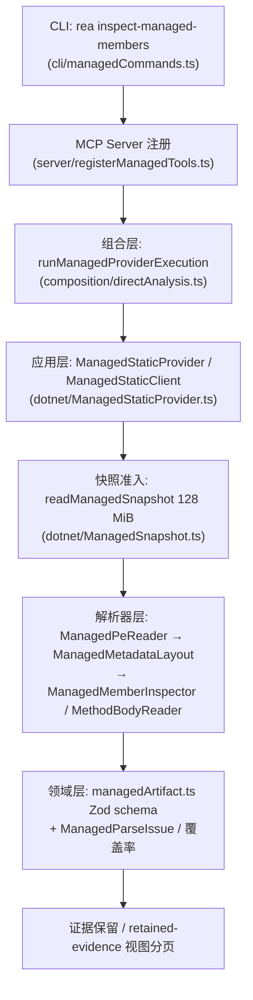
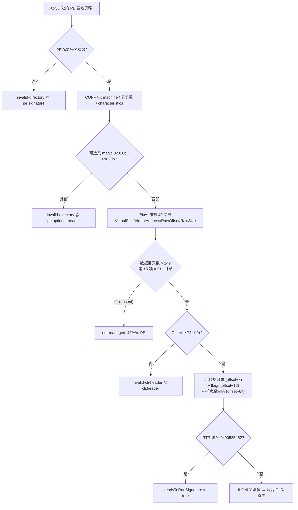

本页面向高级开发者，剖析 REA 对 .NET PE/CLI 程序集的静态分析实现：解析器如何在不加载、不执行目标代码的前提下准入 PE 字节、解码 CLI 元数据根与五个元数据流、枚举类型/字段/方法成员、按 ECMA-335 规则解码 CIL 方法体与异常区域，并通过双重摘要与表示预算控制资源与证据语义。所有结论均来自仓库源码与文档的逐行验证。

## 设计原则：无加载、无执行的静态准入

REA 对 .NET 的核心立场是：解析器只"准入（admit）"字节，绝不加载程序集或执行其代码。官方文档开篇即声明工具能识别程序集、检查元数据与 CIL、跨构建比较成员，但"原生方法体桥接映射与托管运行时执行不在当前工具集内"。这意味着整个 `src/dotnet` 目录是一个纯 TypeScript 的格式解析器——它读取字节、报告观察到的实现标记与不可用事实，而不是调用 CLR。输入若没有可准入的 CLI 元数据，不会因命名或路由猜测而"变成"托管程序集；.NET 单文件宿主解包、IL2CPP 元数据解码、从普通原生 PE 推断 NativeAOT 身份均明确排除在外。

这一立场带来一个重要的分类学：`inspect_managed_artifact` 返回的 `target_frameworks`（如 .NET Standard 目标）与 `runtime_family` 是两个独立维度——前者保留声明目标，后者仅在存在独立标记（如 ReadyToRun 签名）时才从 `unknown` 升级。这是"观察 vs 推断"证据模型在托管分析中的直接体现。

Sources: [managed-code-analysis.md](docs/managed-code-analysis.md#L1-L27), [managed-code-analysis.md](docs/managed-code-analysis.md#L118-L134)

## 七个工具与调用入口

托管分析共暴露七个 MCP 工具，其中三个是解析器直接执行的只读检查，四个是基于已保留证据的工作流操作：

| 任务 | MCP 工具 | 层次 |
| --- | --- | --- |
| 识别工件及其托管部署形态 | `inspect_managed_artifact` | 解析器（静态提供者） |
| 检查类型、签名、方法体、调用与字段访问 | `inspect_managed_members` | 解析器（静态提供者） |
| 列出声明的原生调用与原生实现指示器 | `inspect_managed_native_boundaries` | 解析器（静态提供者） |
| 跨构建比较成员并映射构建本地 token | `compare_managed_members` | 工作流（证据驱动） |
| 将原生调用声明与导出/函数证据核对 | `verify_managed_native_boundaries` | 工作流（证据驱动） |
| 将反编译代码导入到已验证的静态成员身份 | `import_managed_reconstruction` | 工作流（证据驱动） |
| 将托管发现加入应用图 | `project_managed_application_graph` | 工作流（证据驱动） |

每个工具都有同形 CLI 命令：下划线换连字符并加 `rea` 前缀（如 `rea inspect-managed-artifact /absolute/path/Assembly.dll --json`）。CLI 侧的注册代码将 `--type` 可重复选项绑定到 `type_names`，而 MCP 侧由 `registerManagedTools` 注入"路径记忆"——首次调用提供 `path` 后，后续工具可省略路径复用已选目标。

Sources: [managed-code-analysis.md](docs/managed-code-analysis.md#L9-L34), [managedToolContracts.ts](src/contracts/managed/managedToolContracts.ts#L54-L136), [managedCommands.ts](src/cli/managedCommands.ts#L24-L93), [registerManagedTools.ts](src/server/registerManagedTools.ts#L13-L73)

## 分层架构与数据流

托管分析严格遵循仓库的五层依赖规则。下图展示一次 `inspect_managed_members` 调用的完整路径——先决概念：调用从最外层的用户界面进入，逐层向内收敛到纯解析函数，领域层 schema 是唯一的结果形状权威，解析器不允许反向依赖外层。

组合层的 `runManagedProviderExecution` 刻意绕过完整配置与原生提供者候选——托管解析不需要任何外部工具链，因此它的依赖闭包只包含 `createManagedBinarySession` 一个工厂。这是"解析器随 Node 应用一起发布、无运行时依赖"这一打包承诺在架构上的落点。

Sources: [managedCommands.ts](src/cli/managedCommands.ts#L24-L48), [directAnalysis.ts](src/composition/directAnalysis.ts#L68-L91), [ManagedStaticProvider.ts](src/dotnet/ManagedStaticProvider.ts#L43-L52), [registerManagedWorkflowTools.ts](src/server/registerManagedWorkflowTools.ts#L1-L19)

## PE/CLI 字节准入：从 DOS 头到 CLI 头

PE 准入是一条严格的校验链，任何一步失败都会产生带作用域（scope）与文件偏移的结构化 `ManagedParseIssue`，而不是静默猜测。流程如下：

RVA→文件偏移映射是这条链中最防御性的部分。`resolveRva` 以 `VirtualSize`（而非含对齐填充的 raw size）作为 RVA 包含性的权威；它首先要求整个请求范围落在唯一一个节内，然后遍历其余节检测交叉重叠——**任何歧义的重叠映射直接拒绝**，文档明确写道"歧义的 PE 节映射被拒绝，而不是按节顺序解释"。随后它验证目标字节确有文件回填（`within > rawSize` 即"占据无文件数据的虚拟字节"），并计算一个受"未来重叠节起点"约束的 `rvaAvailableBytes`，供方法体读取器界定可用范围。

CLI 头自身的标志位解析也精确到比特语义：`32BITREQUIRED` 与 `32BITPREFERRED` 是同一个两位字段——仅 required 为仅 x86，两者同置为平台中立但偏好 32 位进程，仅 preferred 是保留值且不构成约束。混合 CLR/原生的判定要求"ILONLY 清位**且**无 ReadyToRun 签名"，因为 crossgen2 会在 R2R 输出上清除 ILONLY，不能把 R2R 误报为混合代码。

Sources: [ManagedPeReader.ts](src/dotnet/ManagedPeReader.ts#L120-L216), [ManagedPeReader.ts](src/dotnet/ManagedPeReader.ts#L229-L260), [ManagedPeReader.ts](src/dotnet/ManagedPeReader.ts#L40-L53)

## 元数据根、流与表布局

通过 CLI 头拿到元数据目录 RVA 后，解析器在 `ManagedMetadataLayout` 中建立元数据根的完整地图：版本字符串、流目录、以及五个具名流的偏移与大小——`#~`（表流）、`#Strings`、`#GUID`、`#Blob`，以及可选的 `#US`（无 `ldstr` 字面量的程序集可合法省略）。`#Strings`、`#GUID`、`#Blob` 的索引宽度（2 或 4 字节）由 `HeapSizes` 标志决定，而**编码索引（coded index）**的宽度则由表行数动态推导：`TypeDefOrRef` 用 2 个标签位覆盖 TypeDef(2)/TypeRef(1)/TypeSpec(27) 三表，`HasCustomAttribute` 用 5 个标签位覆盖 22 张表，全部 13 种编码索引定义与 ECMA-335 II.24.2.6 一致。

解析器承认恰好 45 张元数据表（`METADATA_TABLE_NAMES` 常量从 Module 到 GenericParamConstraint），行大小由 `computeRowSize` 按堆索引宽度与各表行数计算。两个非标准但必要的兼容点被显式处理：其一是 CLR 兼容的 `ExtraData` 扩展（`HeapSizes` 标志 `0x40`）——微软阅读器接受它但 ECMA-335 未规定，REA 在行计数后跳过固定的四字节字，且明确"该字的值不是长度"；其二是未优化的 `#-` 元数据中非空的 `FieldPtr`/`MethodPtr` 间接表，解析器将其解析为成员所有权与本地特性构造器类型的间接层，同时保留 `field_list`/`method_list` 的原始元数据坐标。

Sources: [ManagedMetadataLayout.ts](src/dotnet/ManagedMetadataLayout.ts#L16-L115), [managed-code-analysis.md](docs/managed-code-analysis.md#L400-L415)

## 堆解码：压缩长度前缀与严格 UTF-8

`#Strings`、`#Blob`、`#US` 三个堆共享 ECMA-335 II.23.2 的压缩整数长度前缀：首字节最高位为 0 即单字节长度；`10xxxxxx` 模式为两字节（6 位有效 + 8 位）；`110xxxxx` 模式为四字节（5+8+8+8 位）。解码器不仅读取该前缀，还校验其**最小性**——两字节编码的长度必须 ≥ 0x80，四字节必须 ≥ 0x4000，否则记为保留前缀违规。`#Blob` 项随后验证其编码范围不超出已准入的堆范围；`#Strings` 项要求在堆范围内找到 NUL 终止符，并以 `fatal: true` 的 `TextDecoder` 严格校验 UTF-8——无效序列直接产生 `invalid-string` 问题，而非替换字符静默通过。

每次成功的堆字符串解码都经由布局拥有的 `ManagedDecodeBudget` 计费并缓存：`cachedString(index)` 命中时零成本返回，未命中时先 `reserveString`（按编码字节数 × 6 + 2 的保守上界）再解码缓存。这个"每行/每串只读一次、只计费一次"的所有权模型，是整个解析器在恶意输入（如万条重复字符串引用）下保持有界内存的关键。

Sources: [ManagedMetadataHeaps.ts](src/dotnet/ManagedMetadataHeaps.ts#L60-L150), [ManagedMetadataHeaps.ts](src/dotnet/ManagedMetadataHeaps.ts#L10-L53)

## 双层资源预算：快照准入与表示预算

托管分析有两道相互独立的资源闸门，二者都不是 PE 格式限制，而是检查资源策略：

| 闸门 | 常量 | 作用域 | 溢出行为 |
| --- | --- | --- | --- |
| 输入快照准入 | `MAX_MANAGED_SNAPSHOT_BYTES` = 128 MiB | 整个 PE 文件的常驻字节快照 | `AnalysisResourceConstraintError`（memory），操作前拒绝 |
| 表示预算 | `MAX_METADATA_REPRESENTATION_BYTES` = 64 MiB | 元数据解码、CIL 解码与投影 JSON 的累计保留 | `resource-limit` 问题 + unavailable/partial 覆盖率 |

快照准入的设计值得细看：首次操作调用 `readManagedSnapshot` 咬合完整字节并缓存于客户端实例；后续操作改用 `hashManagedSource` 流式重算 SHA-256，若观察摘要与打开时的目标摘要不一致则抛出 `EvidenceIntegrityError`——这保证"会话内多操作"看到的字节从未改变。成员比较走相同策略但**顺序**检查两条路径，各自保留检查结果而非同时驻留两份全量字节，因此 128 MiB 是每文件规则而非聚合上限。

64 MiB 表示预算则由 `ManagedDecodeBudget` 类执行三重记账：`reserve`/`admitTransient` 在分配前先检查 `remaining - transient` 容量；`reserveRow` 保证每条物理行只记一次 256 字节簿记（重放查找不再计费）；`admitManagedProjection` 在 JSON 边界对投影值递归计费——共享堆字符串被缓存但**每次输出出现仍消耗预算**，因为序列化时它们会重新展开。被投影过的对象通过 `prepay`/`consumePrepaid` 只收一次费，后续包含性投影花掉这笔预付而非重复计数。

Sources: [ManagedSnapshot.ts](src/dotnet/ManagedSnapshot.ts#L17-L95), [ManagedDecodeBudget.ts](src/dotnet/ManagedDecodeBudget.ts#L10-L86), [ManagedDecodeBudget.ts](src/dotnet/ManagedDecodeBudget.ts#L110-L163), [managed-code-analysis.md](docs/managed-code-analysis.md#L136-L154)

## 成员清单：类型、字段、方法与签名解析

`inspectManagedMembersBytes` 是成员清单的入口。它按固定次序构建完整清单：PE 布局 → 元数据布局 → 成员列表事实（含指针间接）→ 元数据清单→ 类型范围（`typeRanges`，每类型含 token、`full_name`、字段/方法列表区间）→ 签名类型名摘要 → 类型嵌套 → 类型引用 → 字段/方法/成员引用/调用边/字段访问行解析 → 用户字符串。未选中类型的成员只保留名字供边标注，选中类型才完整解码签名与方法体。

`type_names` 选择语义有两个精确的坑：顶级类型按命名空间限定的 `full_name` 精确匹配（如 `System.Threading.Monitor`），**嵌套类型目前报告裸名**，因此一个裸名可能同时选中多个同名嵌套类型——每个类型的 `enclosing_type_token` 记录其封闭 TypeDef，`nesting_read` 三值（true/false/null）区分完整源行、不完整当前行与历史证据。成员引用 `member_refs` 与导出类型 `exported_types` 始终是程序集级清单，不被选择收窄，这正是文档警告"即使只选一个类型也可能返回兆字节"的原因。

签名采用**双重摘要**设计：`raw_sha256` 锚定原始 blob 字节（含按行引用的类型），`resolved_sha256` 把每个 TypeDef/TypeRef 操作数替换为该类型命名空间与名字的摘要后再哈希——命名空间与名字作为独立值框定，使 `A` + `B.C` 区别于 `A.B` + `C`；嵌套类型先并入封闭类型摘要（`Outer/Inner` 形态）。TypeRef 的 ResolutionScope 程序集**不参与**名字，因此跨程序集的类型转发仍能配对，代价是不同程序集中同名的两个不同类型摘要相等——比较结果内联报告这一范围限制。嵌套深度超过 64 层的链不被命名（封顶防御敌意 NestedClass 链），其签名退回原始摘要比较。

Sources: [ManagedMemberInspector.ts](src/dotnet/ManagedMemberInspector.ts#L88-L200), [ManagedMemberRows.ts](src/dotnet/ManagedMemberRows.ts#L33-L91), [ManagedTypeNameDigests.ts](src/dotnet/ManagedTypeNameDigests.ts#L20-L118), [managedArtifact.ts](src/domain/managed/managedArtifact.ts#L80-L130), [ManagedSignatureResolution.test.ts](src/dotnet/ManagedSignatureResolution.test.ts#L37-L100)

## CIL 方法体解码：tiny/fat 头、操作码与异常区域

方法体解码从首字节的低两位分派格式：`10xxxxxx` 为 tiny 头（1 字节，maxStack 固定 8，IL 大小 = 首字节 >> 2，无局部签名）；`11xxxxxx` 为 fat 头（12 字节起，头部双字高 4 位给出以双字计的大小，含 maxStack、IL 大小与局部签名 token）。RVA 为 0 的方法体直接返回 `absent` 状态且"无未扫描内容"；实现标志置位（native/runtime/unmanaged/P/Invoke）的方法体返回 `partial` 并附上明确 issue——CIL 解码对这类实现不可用。

指令解码器内置完整的单字节与 `0xFE` 前导双字节操作码表，涵盖从 `nop` 到 `blt.un` 的全部核心指令，每个操作码带名字与操作数种类（`none`/`short-var`/`i`/`i8`/`r4`/`r8`/`method`/`signature`/`short-branch`/`branch`/`switch`/`string`/`field`/`type`/`token`）。解码循环先计算操作数期望宽度并验证不越过 IL 末尾，再读取值——注释明确解释这样做是为了"截断的方法体不会抛出原始 Buffer RangeError 而丢失指令身份"。前缀操作码（`unaligned.`/`volatile.`/`tail.`/`constrained.`/`readonly.`/`no.`）与后续指令合并为单个指令起点，供异常区域校验使用。

异常区域解析支持 small（12 字节子句）与 fat（24 字节子句）两种节格式，并显式兼容 CoreCLR 接受的历史遗留格式——旧式 VB/MC++ 编译器的 DataSize 省略四字节节头的情况。解析出的区域随后由 `validateExceptionRegionRanges` 对照 IL 大小与指令起点表校验 try/handler 偏移的合法性。最终状态机为：

| 状态 | 判定条件 |
| --- | --- |
| `present` | 全部指令解码完成，异常区域无畸形 |
| `partial` | 有被截断的指令（`truncated_instructions > 0`），但无畸形 issue |
| `malformed` | 指令解码产生 issue 或异常区域状态为 malformed |
| `absent` | 方法体 RVA 为 0（无 CIL 可扫描） |

Sources: [ManagedMethodBodyReader.ts](src/dotnet/ManagedMethodBodyReader.ts#L29-L63), [ManagedMethodBodyReader.ts](src/dotnet/ManagedMethodBodyReader.ts#L68-L200), [ManagedMemberInstructionDecoder.ts](src/dotnet/ManagedMemberInstructionDecoder.ts#L440-L639)

## 双重 CIL 摘要：字节级与解码元组级

每个完整解码的方法体携带两个边界不同的哈希，这是跨构建比较的基石：

| 字段 | 输入 | 摘要排除的内容 |
| --- | --- | --- |
| `il_sha256` | tiny/fat 头之后精确的 `il_size` 原始 CIL 字节 | 方法头、局部签名 blob、对齐、含异常子句的附加节 |
| `normalized_il_sha256` | 指令序数组 `[opcode, operand_kind, operand]` 元组的 `JSON.stringify` UTF-8 输出 | 指令偏移（投影后的标量分支目标除外）、switch 目标偏移、已解析的元数据/字符串身份、方法头、局部变量、异常区域 |

元组格式在文档中被精确规范为可复现的指纹而非"规范语义 CIL 身份"：无操作数指令投影为 `["nop","none",null]` 形态；元数据与用户字符串操作数保留小写十六进制 `0x` 前缀的 8 位构建本地 token；标量分支投影为目标 CIL 字节偏移的十进制字符串；`switch` 只投影分支数；浮点用 JavaScript `String()` 的 IEEE 解码值表示。文档给出规范测试向量：`nop; ret` 方法体序列化为 `[["nop","none",null],["ret","none",null]]`，摘要为 `5e5fad7741cb44bca3a4f045546b7449990da343f612f5f34c0ca30e9eee0636`。

正因为 normalized 指纹省略了 switch 目标并折叠不同的 NaN 编码，比较逻辑要求**原始摘要与解码指纹同时相等**才构成精确 CIL/签名匹配——仅有相等的解码指纹不足以建立精确匹配。

Sources: [managed-code-analysis.md](docs/managed-code-analysis.md#L416-L447), [ManagedMethodBodyReader.ts](src/dotnet/ManagedMethodBodyReader.ts#L118-L160)

## 调用边、字段访问与用户字符串

调用边与字段访问的目标声明类型通过统一的 token 查找解析。`edgeTargets` 将字段、成员引用、方法按 token 建立索引后，扫描每个已检查方法体的锚点：操作数以 `0x2b` 开头者即 MethodSpec token，解析其 MethodDefOrRef 编码索引指向的泛型方法，校验实例化的类型参数数量与该方法声明的泛型参数数量一致，然后把泛型方法的名字与声明类型借给该 MethodSpec——字段永远不会把名字借给方法操作数。TypeSpec 父类型中的泛型实例化命名其泛型类型（如 ``System.Collections.Generic.List`1``），其他良构 TypeSpec 形态与 ModuleRef/MethodDef 父类型保持 `null`；畸形行与元数不匹配使覆盖率转 partial，但可读的名字作为部分证据保留。

用户字符串是独立覆盖率维度：只有 `ldstr` 加载字面量（恶意的 `ldtoken` 也可能携带 `0x70` token，但按规范不加载）。`parseUserStrings` 收集已检查方法体中每个不同的 `ldstr` 操作数，按 token 排序去重，逐个解码 `#US` 项——压缩长度前缀、UTF-16LE 码元（保留未配对代理项）与 ECMA-335 II.24.2.4 的终止标志字节。token `0x70000000` 命名堆的空项（偏移 0）读作 `""`，任何其他内容落在那里即为畸形。缺失 `#US` 流是一条流级 issue 而非每 token 一条；所有问题使 `user_strings.state` 变 partial 并列入 `user_strings.issues`，但**不影响**成员 `coverage` 与 `metadata.status`——可读字面量仍然保留。已检查方法的 CIL 未完全解码、或选择下可能有未检查方法时，字面量池也变 partial，因为那些方法中的 `ldstr` 未被观察到。

Sources: [ManagedMethodSpecs.ts](src/dotnet/ManagedMethodSpecs.ts#L17-L100), [ManagedUserStrings.ts](src/dotnet/ManagedUserStrings.ts#L29-L121), [managed-code-analysis.md](docs/managed-code-analysis.md#L191-L238)

## 保留摘要与证据分页

当完整交付可能超出代理令牌预算时，`detail: "summary"` 选项把完整源保留在会话中，只返回链接的 `inspect_analysis_view` 概览，调用方再凭 `normalized_result.parent_evidence_id` 以 `retained-evidence` 源分页取回原始行。工件级集合为 `references`/`resources`/`attributes`；成员级视图种类为 `managed-members`，集合为 `types`/`exported_types`/`fields`/`methods`/`member_refs`/`call_edges`/`field_accesses`/`user_strings`。每页保留原始值、null、顺序、元数据 token 与偏移，并携带源的元数据状态与覆盖率。历史证据若从未检查过导出类型或用户字符串，将报告 null 计数并**拒绝**相应分页而非返回空页——空行在 partial/unavailable 元数据下不构成缺席声明。保留视图不重放解析器，也不要求源文件继续可用。

Sources: [managed-code-analysis.md](docs/managed-code-analysis.md#L43-L116), [managed-code-analysis.md](docs/managed-code-analysis.md#L84-L116)

## 跨构建成员比较的身份阶梯

`compare_managed_members` 不把名字或语义标签当作持久身份，而是分级配对：

重映射有一条硬性禁令：绝不从另一侧"声明类型与名字仍未配对"的成员那里取配对——成员永远不会从自己已改变的对应物那里被夺走。每一轮都用 `resolved_sha256` 比较签名；当任一观察早于类型名解析（`signature_resolution` 为 null），双方退回原始摘要比较并报告该限制。匹配方法的不可用或部分方法体使体形态维度为 unknown，同时保留已观察的签名差异；完全体在原始 CIL 摘要或解码指纹任一不同时报 `cil` 维度差异（包括解码指纹相同但 switch 目标重排的情况）。方法元数据维度（MethodDef 标志或实现标志变化，如可访问性或同步变更）独立于 CIL/签名匹配阶梯报告——相同指令不等于未变的方法元数据。Token 永远通过观察到的结构重映射，调用方不能携带 `0x06001234` 进入新 MVID 并假设它指向同一方法。

Sources: [managed-code-analysis.md](docs/managed-code-analysis.md#L249-L399), [managed-code-analysis.md](docs/managed-code-analysis.md#L600-L626)

## 托管/原生边界与运行时行为的界限

`inspect_managed_native_boundaries` 枚举 ModuleRef、ImplMap/P/Invoke 声明、CLI 原生头指示器与非 IL 方法实现标志，产出的结果是"托管声明与降级的原生边界观察，而非已验证的原生导出或地址"。对应的 `verify_managed_native_boundaries` 把声明的 P/Invoke 模块与入口点身份与提供的原生导出/函数证据核对：名字/模块匹配建立**声明链接**，不建立调用已执行的证明；任一侧缺少可用模块身份时，名字匹配保持 unresolved 并保留候选证据，只有两侧身份齐备且不同才报告模块不匹配。

元数据 token 不是原生地址；C++/CLI、ReadyToRun、NativeAOT、IL2CPP 的原生方法体映射需要单独验证的格式与提供者支持，托管静态工具不恢复这些映射。NativeAOT 的两条恢复路线（内置只读快照解析器处理 x64 PE/RTR 9.1 元数据、可选的 Ghidra 适配器）属于 [Ghidra 集成](11-ghidra-ji-cheng-lin-shi-shu-ju-ku-kuai-zhao-sheng-ming-zhou-qi-yu-duo-jia-gou-yu-yi-pei-zhi)与原生分析页的职责范围，本页解析器只负责在分类中如实报告 `ready_to_run_signature` 等观察标记。运行时行为问题保持 unknown，直到收集到受支持的运行时证据——这与仓库整体的[证据与不确定性模型](6-zheng-ju-yu-bu-que-ding-xing-mo-xing-guan-cha-tui-dao-tui-duan-yu-wei-zhi-de-bao-liu-yu-yi)一致。

Sources: [managed-code-analysis.md](docs/managed-code-analysis.md#L312-L399), [ManagedNativeBoundaryInspector.ts](src/dotnet/ManagedNativeBoundaryInspector.ts#L21-L72), [managed-code-analysis.md](docs/managed-code-analysis.md#L600-L626)

## 一致性验证：字节构建夹具与可选 ILSpy 通道

生产解析器的 conformance 走源码拥有的字节构建夹具路线：`scripts/fixtures/managed/pe.mjs` 从零构造 PE/CLI 字节——手工拼接 StringHeap/BlobHeap/GUID 堆、Module/TypeRef/TypeDef/Field/MethodDef 行、节表与 CLI 头，使每个测试用例的字节布局完全确定。确定性通道用 `npm run verify:managed` 运行，比较的是**语义事实而非反编译器文本**，并检查资源上限、确定性排序、完整清理、CLI/MCP 平价、证据承诺与目标无关的 MCP 启动。验收测试进一步在 CLI 边界断言：构造 512 个空类型加 512 行 CustomAttribute 的夹具，验证 `inspect-managed-artifact` 返回完整属性清单与本地特性构造器 token（`0x06000001`），成员检查返回 `Fixture.Empty0` 到 `Fixture.Empty511` 的全部类型。

可选的真实工具通道坚持 BYO（自带）边界：仅当 `REA_ILSPY_CMD_PATH` 指向绝对可运行的 `ilspycmd` 时，验证器才运行 ILSpy oracle（版本发现、类清单、固定夹具类型的有界 C# 输出、经 `import_managed_reconstruction` 导入为重构推断），其失败会导致验证失败——因为它是显式的真实工具声明；不设置则 oracle 保持禁用。可选的 osu! 基准只接受操作员本地提供的路径与期望清单，先对目标 SHA-256、MVID、程序集名、运行时族与托管架构失败关闭，再按行直接分页声明的 MethodDef token。包内不含 .NET 运行时、SDK、ILSpy 安装、专有程序集或编译的 conformance 夹具；Setup 从不安装或升级这些工具。

Sources: [pe.mjs](scripts/fixtures/managed/pe.mjs#L1-L100), [managed-code-analysis.md](docs/managed-code-analysis.md#L449-L599), [managedCliOutput.test.ts](tests/acceptance/managedCliOutput.test.ts#L12-L60), [managedCliOutput.test.ts](tests/acceptance/managedCliOutput.test.ts#L12-L60)

## 关键解析文件导览

下表汇总解析器层各文件的职责边界，便于按问题定位代码：

| 文件 | 职责 |
| --- | --- |
| `ManagedPeReader.ts` | DOS/COFF/可选头/节表准入、CLI 头与 RVA 映射、32 位要求与混合 CLR 判定 |
| `ManagedMetadataLayout.ts` | 元数据根、五流、45 张表、13 种编码索引、行大小、ExtraData 兼容 |
| `ManagedMetadataHeaps.ts` | 行游标、压缩长度前缀、#Strings/#Blob/#US 项读取、token 组装 |
| `ManagedMetadataInventory.ts` | Module/Assembly/引用/资源/特性的清单级读取与身份表计数校验 |
| `ManagedMemberInspectorCore.ts` | 类型范围、成员核心索引、签名解析、指令/异常区域类型 |
| `ManagedMemberRows.ts` | 字段/方法/成员引用/调用边/字段访问/导出类型的行解析 |
| `ManagedMethodBodyReader.ts` | tiny/fat 方法头、IL 界定、双重摘要、异常区域校验的编排 |
| `ManagedMemberInstructionDecoder.ts` | 操作码表、前缀合并、操作数边界预检、异常子句解析 |
| `ManagedTypeNameDigests.ts` | 框定式类型名摘要（64 层嵌套封顶、环检测） |
| `ManagedMethodSpecs.ts` | MethodSpec→泛型方法的边目标命名与元数校验 |
| `ManagedUserStrings.ts` | `ldstr` 字面量池、独立覆盖率与 issue 归属 |
| `ManagedDecodeBudget.ts` | 64 MiB 表示预算、字符串/摘要缓存、投影计费 |
| `ManagedSnapshot.ts` | 128 MiB 快照准入、流式重哈希、清理失败归一化 |

Sources: [ManagedPeReader.ts](src/dotnet/ManagedPeReader.ts#L36-L67), [ManagedMetadataLayout.ts](src/dotnet/ManagedMetadataLayout.ts#L16-L115), [ManagedMethodBodyReader.ts](src/dotnet/ManagedMethodBodyReader.ts#L1-L244), [ManagedDecodeBudget.ts](src/dotnet/ManagedDecodeBudget.ts#L1-L169)

## 延伸阅读

理解了字节级解析之后，三条自然的深入路径：其一，解析结果如何进入[证据与不确定性模型](6-zheng-ju-yu-bu-que-ding-xing-mo-xing-guan-cha-tui-dao-tui-duan-yu-wei-zhi-de-bao-liu-yu-yi)的观察/推导/未知分类，以及 retained-evidence 分页如何配合 [MCP 契约参考](8-mcp-qi-yue-can-kao-gong-ju-jie-guo-bao-liu-zheng-ju-hui-hua-fa-xian-yu-qu-xiao-hui-fu)中的工具结果形状；其二，NativeAOT 与 ReadyToRun 场景下原生侧的恢复路线见 [Ghidra 集成](11-ghidra-ji-cheng-lin-shi-shu-ju-ku-kuai-zhao-sheng-ming-zhou-qi-yu-duo-jia-gou-yu-yi-pei-zhi)；其三，快照准入、截止时间与清理重试的进程监督机制见[进程所有权与生命周期监督](25-jin-cheng-suo-you-quan-yu-sheng-ming-zhou-qi-jian-du-si-you-yun-xing-shi-jie-zhi-shi-jian-yu-qing-li-zhong-shi)，而验证通道的完整矩阵见[测试策略与验证通道](27-ce-shi-ce-lue-yu-yan-zheng-tong-dao-yuan-ma-bian-jie-yan-shou-zhi-xing-ji-zhen-shi-gong-ju-lian-tong-dao)。