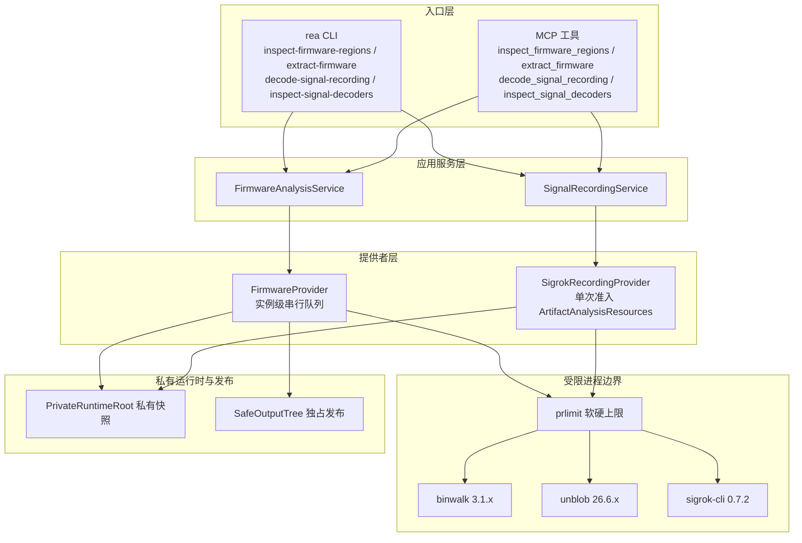
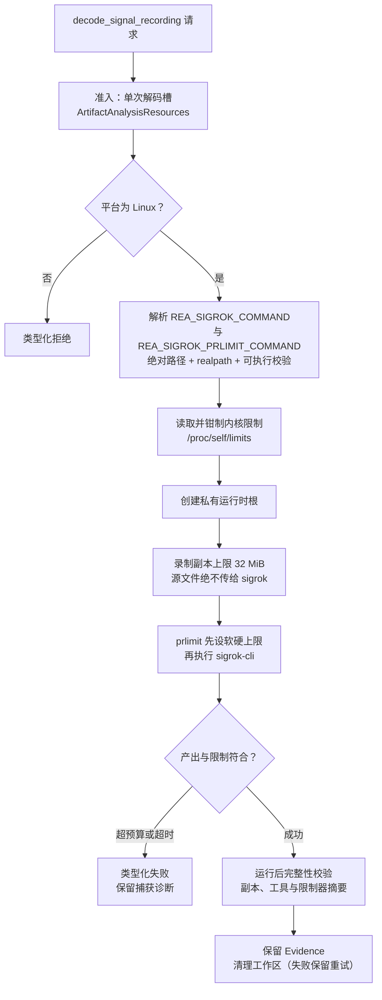

REA 对固件镜像与逻辑分析仪录制的处理遵循一条明确的设计公理：**调用者自备工具、目标永被执行**。固件通道接受 Binwalk 3.1.x 做区域签名检查、Unblob 26.6.x 做显式提取，解析器以 Binwalk 3.1.0 与 Unblob 26.6.4 验证，同主次版本线的其他构建被接受但记录为"未经该构建验证"的限制；信号通道则调用 sigrok-cli 0.7.2 解码既有录制。两条通道都只在 Linux 上运行，都拒绝安装任何依赖，都不把固件字节或提取产物交给原生可执行文件准入——需要深入子二进制时，必须将返回的 ELF 单独送入 Ghidra 等受支持的提供者。本文面向中级开发者，从分层架构出发，逐层拆解适配层的准入、限制、缺口恢复与验证机制。

Sources: [firmware-analysis.md](docs/firmware-analysis.md#L1-L18), [signal-recordings.md](docs/signal-recordings.md#L1-L14)

## 设计立场：调用者自备工具与只读边界

REA 不安装、不搜索、不打包这些引擎。Binwalk 通过绝对路径环境变量 `REA_BINWALK_COMMAND` 提供，Unblob 通过 `REA_UNBLOB_COMMAND` 提供；执行请求时 REA 会校验工具的 `--version` 横幅——Binwalk 必须输出 `binwalk <version>`，Unblob 必须单独输出版本号。检查与提取是相互独立的前置条件，二者都要求 util-linux 的 `prlimit`（默认 `/usr/bin/prlimit`，可用 `REA_FIRMWARE_PRLIMIT_COMMAND` 覆盖为绝对路径）。固件字节从不通过原生可执行文件准入，提取出的代码也从不被执行；只有常规文件会被发布，且不带可执行权限位。上游源码以可选的固定子模块形式原样保留在 `third_party/binwalk` 与 `third_party/unblob`，常规构建与 npm 包既不包含也不构建它们。

Sources: [firmware-analysis.md](docs/firmware-analysis.md#L20-L42), [FirmwareCommand.ts](src/firmware/FirmwareCommand.ts#L36-L102), [binwalk/README.md](third_party/binwalk/README.md#L1-L10), [unblob/README.md](third_party/unblob/README.md#L1-L10)

信号通道的边界同样严格：`decode_signal_recording` 只回答"某个协议解码器在既有录制中观察到了什么"，不采集样本、不与硬件通信，证据中的 `hardware_acquisition` 字段固定为字面量 `"not-performed"`。macOS 与 Windows 被显式拒绝，因为该适配器无法在这两类主机上强制执行地址空间限制。工具、其库与解码器模块被视为受信任的调用者财产——哈希标识的是字节而非发布者真实性。

Sources: [signal-recordings.md](docs/signal-recordings.md#L1-L14), [signal-recordings.md](docs/signal-recordings.md#L95-L104), [signalRecording.ts](src/domain/signals/signalRecording.ts#L139-L141)

## 分层架构：从 CLI/MCP 到受限进程

两条通道共用同一套分层规则：CLI 命令与 MCP 工具绑定到相同的领域契约，经应用服务进入提供者，最终由 prlimit 包裹的外部进程完成实际工作。组合层薄到只有构造函数——`createFirmwareAnalysisProvider` 直接返回一个不启动引擎的 `FirmwareProvider`，`createSignalRecordingService` 同样只是把环境变量传给 `SigrokRecordingProvider`。MCP 注册层也保持声明式：`registerFirmwareTools` 与 `registerSignalTools` 只做"命名契约 → 共享处理器"的绑定，不携带任何业务逻辑。



Sources: [firmware.ts](src/composition/firmware.ts#L1-L10), [signals.ts](src/composition/signals.ts#L1-L7), [registerFirmwareTools.ts](src/server/registerFirmwareTools.ts#L11-L38), [registerSignalTools.ts](src/server/registerSignalTools.ts#L13-L45)

CLI 侧的实现体现了"同工作流"原则：`registerFirmwareCommands` 用与 MCP 相同的领域 schema 构造参数对象，并把操作符相对路径先解析为绝对路径再送入共享验证；每个命令经 `withCommandCancellation` 注入中止信号，经 `finishAnalysisCommand` 保证服务关闭与证据落盘。信号 CLI 额外在参数层强制互斥——`--all` 与 `--limit` 冲突、`--all_lines` 与 `line_limit` 冲突，并在启动前用 `withinSignalRecordingSelectorBudget` 校验选择器总预算。

Sources: [firmwareCommands.ts](src/cli/firmwareCommands.ts#L11-L90), [signalCommands.ts](src/cli/signalCommands.ts#L14-L124)

## 版本准入与提供者身份

固件版本准入是一个纯函数分类器 `admitFirmwareVersion`，它把观察到的 `--version` 横幅对照已审计版本线（Binwalk 3.1.0、Unblob 26.6.4，含源码修订号与上游仓库地址）产生四种状态：与验证版本完全一致记为 `verified`；主次版本相同但补丁号不同的同线构建记为 `compatible` 并附 limitation 文案；其他版本线记为 `unsupported`；横幅缺失或无法解析记为 `unresolved`。值得注意的是 `compatible` 状态下的 limitation 明确声明"报告解析器仅对验证版本验证过"——这是把未验证性显式编码进证据，而非静默接受。

Sources: [FirmwareVersion.ts](src/firmware/FirmwareVersion.ts#L75-L117), [FirmwareRelease.ts](src/firmware/FirmwareRelease.ts#L1-L16)

结果 schema 中的 `engine` 对象把这条语义编码为结构化字段：`source_revision` 恒为 `null`（匹配的版本号不能证明安装构建的源码修订），`worker_count` 恒为字面量 `1`（Binwalk 单线程、Unblob 单 worker，无自动并行提取）。信号通道的 `SIGROK_PROVIDER_IDENTITY` 同样声明 `sigrok-cli@0.7.2`，而证据中的版本字段由实际横幅替换目录身份。

Sources: [firmwareAnalysis.ts](src/domain/firmware/firmwareAnalysis.ts#L57-L63), [FirmwareProvider.ts](src/firmware/FirmwareProvider.ts#L54-L60), [SigrokRecordingProvider.ts](src/signals/SigrokRecordingProvider.ts#L31-L35)

## 区域检查：Binwalk 报告的保留语义

`inspect_firmware_regions` 返回签名候选区域列表，每个区域携带 `provider_id`、`offset`、`reported_size`、`signature`、`description`、`reported_confidence`（0–255 的置信字节）以及一个刻意命名的字面量 `size_basis: "provider_reported_validation_unknown"`。这个命名忠实记录了一个上游事实：Binwalk 在序列化报告前可能把未知长度替换为下一个签名或 EOF，因此报告尺寸只是"提供者所述、验证未知"。偏移量始终指向原始固件字节；签名与置信字节都不证明分区有效性、加密状态或运行时映射。

Sources: [firmwareAnalysis.ts](src/domain/firmware/firmwareAnalysis.ts#L100-L113), [firmware-analysis.md](docs/firmware-analysis.md#L107-L112)

报告归一化层（`FirmwareReports.ts`）以"非严格解析 + 原样保留诊断"的策略处理生产者数据：签名扫描走 `Analysis.file_map` 结构，未知额外字段全部落入保留的 diagnostics 而不被修复或截断。这种设计使上游报告格式的演进不会静默丢失数据——无法识别的字段以原始 JSON 形式留存于证据中。

Sources: [FirmwareReports.ts](src/firmware/FirmwareReports.ts#L7-L26)

## 显式提取：发布策略、派生图与提取缺口

`extract_firmware` 的结果是一个完整的派生图：`files`（发布文件，含独立验证的 SHA-256 与生产者哈希）、`unpublished_entries`（仅记录元数据的符号链接/特殊文件）、`chunks`（块级边界与加密标记）、`derivations`（父子派生关系，经路径与 blob ID 解析——Unblob 任务报告无序）、`depth_limited_paths`、`extraction_gaps` 与 `extraction_continuations`。逻辑引用使用 `$input`、`$output` 或 `$output/<相对路径>` 前缀，确保真实文件名恰好叫 `$input` 时仍与原始输入可区分。解压子文件的 `runtime_address` 与 `original_file_range` 恒为 `null`——任务谱系不建立逐字节映射。

Sources: [firmwareAnalysis.ts](src/domain/firmware/firmwareAnalysis.ts#L141-L178), [firmware-analysis.md](docs/firmware-analysis.md#L113-L124)

发布走 `SafeOutputTree`：目标目录必须**不存在**、绝对路径、父目录已存在；发布采用独占的、抗符号链接的写入与持久摘要回读；既有目标永不被覆盖；失败未提交的输出回滚。这不是原子目录改名——新树可能在文件写入过程中可见。空目录、属主与可执行权限位不被复现。每一次重跑都要求全新的 `output_directory`，从而保留先前证据。

Sources: [firmware-analysis.md](docs/firmware-analysis.md#L125-L131), [FirmwarePublication.ts](src/firmware/FirmwarePublication.ts#L1-L16)

提取的可恢复性由**缺口-续作表**承担。六种缺口类型各自绑定一条静态续作指令，通过 `continuation_id` 让多个区域共享同一份恢复文案而不丢失区域身份：

| 缺口类型 | 触发条件 | 续作要点 |
|---|---|---|
| `missing-extractor-dependency` | 生产者报告缺失外部提取器 | 保留生产者命名的确切依赖名；REA 不安装任何东西 |
| `unknown-chunk-handler` | 未知块未被任何处理器识别 | 嵌套未知块应对**已发布子文件**运行 `inspect_firmware_regions`，而非原样重跑 |
| `encrypted-chunk` | 加密块 | 静态提取无法穿越加密；视为未检查而非空或损坏 |
| `depth-limited` | 达到深度上限 | 提高 `max_depth`（上限 10）以全新输出目录重跑 |
| `extractor-failure` | 提取器报告提取问题 | 审阅诊断后以全新输出目录重跑同一不可变输入 |
| `unpublished-entry` | 符号链接/特殊文件 | 仅保留元数据，不发布 |

深度上限的续作文案做了分级：未达上限时直接建议提高深度；已达上限且有合格已发布子文件时列出每个子文件并说明"每个子文件重启深度预算"；已达上限且无合格子文件时明确宣告"深度预算无法从该输出重启，视为未检查"。嵌套未知块的续作同样条件化——子文件超过 128 MiB 输入上限时直接拒绝作为新输入。接受但未命名依赖的报告保持为失败且依赖未知，不推断可执行身份或安装步骤。

Sources: [firmwareAnalysis.ts](src/domain/firmware/firmwareAnalysis.ts#L74-L99), [FirmwarePublication.ts](src/firmware/FirmwarePublication.ts#L17-L72)

## 资源与生命周期策略

固件通道的资源策略围绕"每进程限制而非聚合配额"展开：输入最多 128 MiB，复制并哈希进私有工作区后才开始分析，复制期间超限与已超限同样得到类型化拒绝；诊断输出（stdout+stderr 合计）超过 8 MiB 即以显式截断错误终止分析。暂存预算默认 256 MiB 与 10,000 条目，通过 `max_output_bytes` / `max_output_files`（CLI `--max-output-bytes` / `--max-output-files`）可调至 512 MiB 与 100,000；深度默认 3、范围 1–10。预算在运行中轮询并在退出后复查，因此短暂越界是可能的——文档明确这些限制不构成 cgroup/容器级遏制。

Sources: [firmware-analysis.md](docs/firmware-analysis.md#L166-L186), [FirmwareRelease.ts](src/firmware/FirmwareRelease.ts#L27-L36)

命令执行层把这些策略落进 argv 与环境：进程以 prlimit 为入口（`--as`、`--fsize`、`--core=0`、`--cpu=120` 后接真实工具），环境被收敛为固定集合（`TMPDIR` 指向工作区、各并行库线程数强制为 1、`NO_COLOR=1`）。监督循环每 100ms 检查一次输出关闭、中止信号、120 秒截止时间与输出预算；诊断截断立即升级为 `AnalysisOutputError`。进程停止状态为 `incomplete` 时，监督器被保留登记以待重试，并抛出携带 leader PID 与进程组 ID 的 `ProviderCleanupError`。

Sources: [FirmwareCommand.ts](src/firmware/FirmwareCommand.ts#L104-L250)

信号通道使用更紧凑的一组常量 `BOUNDED_PRODUCER_LIMITS`，并在生成 argv 前先读取内核 `/proc/self/limits` 报告：`clampLinuxResourceLimits` 把配置上限与继承的软/硬限制取最小值——绝不抬高任何继承策略。两个限制（软与硬）都在解码器启动前设置，因此解码器分配与压缩录制展开都无法突破每进程地址空间上限。证据记录的是生效上限而非请求上限。

Sources: [LinuxResourceLimits.ts](src/process/LinuxResourceLimits.ts#L20-L41), [LinuxResourceLimits.ts](src/process/LinuxResourceLimits.ts#L44-L89)

两条通道的限制对比：

| 维度 | 固件 | 信号录制 |
|---|---|---|
| 引擎 | Binwalk 3.1.x + Unblob 26.6.x | sigrok-cli 0.7.2 + libsigrokdecode |
| 平台 | Linux x64 | Linux（macOS/Windows 显式拒绝） |
| 输入上限 | 128 MiB | 32 MiB 副本上限 |
| 截止时间 | 120 秒 | 30 秒 |
| 诊断/输出上限 | 8 MiB 合计 | 4 MiB 合计（超限即失败，非截断成功） |
| 地址空间 | 1 GiB/进程 | 1 GiB/进程 |
| CPU 时间 | 120 秒 | 30 秒 |
| 单文件上限 | 继承的 fsize | 64 MiB（prlimit --fsize） |
| 并发 | 每提供者实例一个排队重操作 | 每次一个解码（超限得可重试容量错误） |
| 清理失败 | 保留 worker 与工作区待重试 | 保留所有权可重试；已完成观察留存于会话 |

Sources: [FirmwareRelease.ts](src/firmware/FirmwareRelease.ts#L27-L36), [LinuxResourceLimits.ts](src/process/LinuxResourceLimits.ts#L20-L28), [signal-recordings.md](docs/signal-recordings.md#L106-L122), [SigrokRecordingProvider.ts](src/signals/SigrokRecordingProvider.ts#L42-L58)

生命周期方面，固件提供者用 promise 尾链实现实例级串行：后续请求等待前驱完成后才执行，调用者的中止会立即向上传播但不会让更晚的请求绕过前驱。清理失败被合并为一个聚合的 `ProviderCleanupError`（逐资源列出引擎、操作与原因），`close()` 会重试每一个保留的所有者而不丢弃其他根。信号提供者则通过 `ArtifactAnalysisResources` 实现单次准入，关闭时先停止准入再排空已接受的工作。

Sources: [FirmwareProvider.ts](src/firmware/FirmwareProvider.ts#L85-L160), [FirmwareProvider.ts](src/firmware/FirmwareProvider.ts#L31-L50), [SigrokRecordingProvider.ts](src/signals/SigrokRecordingProvider.ts#L59-L72)

## 信号录制解码：选择器、分页与逐字保留

`decode_signal_recording` 的输入是四个严格选择器：`decoders`（sigrok 解码器栈、选项与通道指派，如 `uart:rx=RX:baudrate=9600`）、`input_format`（缺省请求自动检测）、`annotations`（缺省保留全部注释类）与输出窗口参数。缺省选择以 `null` 记录在证据中而非消失。每个选择器限 8,192 个 UTF-16 码元，总编码参数预算（UTF-8 字节 + 选项前缀 + 终止符与 64 位 argv 指针的 9 字节开销）为 32 KiB——为 Linux execve 的最小参数/环境预算预留余量；大型继承环境仍可能耗尽它。

Sources: [signalRecording.ts](src/domain/signals/signalRecording.ts#L7-L60), [signal-recordings.md](docs/signal-recordings.md#L58-L63)



输出语义是最容易被误读的部分，REA 用三重防御消除歧义：默认 50 行字面 LF 分隔行，`line_offset`/`line_limit` 支持翻页（MCP `line_limit: null` 或 CLI `--all_lines` 取全部剩余）；`output_window` 报告的 `total_lines`/`returned_lines`/`has_more` 计的是**显示行**而非注释或样本数；结果 schema 的 `superRefine` 强制注出文本、窗口计数与选择参数三者一致，不一致直接使证据无效。注释文本逐字保留——形如 `1104-1938 uart-1: 52` 的片段是覆盖样本区间的生产者显示文本，不是时间戳，也不是独立验证的协议事实。REA 不把显示文本解析为协议事实；空输出不确立"无流量"。

Sources: [signal-recordings.md](docs/signal-recordings.md#L46-L71), [signalRecording.ts](src/domain/signals/signalRecording.ts#L62-L148)

解码的文件边界同样经过设计：REA 解码的是录制的私有只读副本，解码后校验该副本与所选可执行文件及资源限制器的摘要，再在自有进程清理之后移除工作区。描述符、进程或工作区清理失败保留所有权供重试；一次性 CLI 等待重试而不替换原始失败或已完成的证据。取消或清理失败后，已完成的观察仍留在 MCP 会话中；有界的运行后完整性检查完成后才让位于迟到的中止。

Sources: [signal-recordings.md](docs/signal-recordings.md#L83-L104)

## 解码器发现：inspect_signal_decoders

`inspect_signal_decoders` 查询**已安装**的 sigrok 目录，不打开录制、不扫描设备。省略 `decoder` 参数时搜索解码器 ID 与名称；提供单个精确 ID 时返回其字面帮助文本（含必需/可选通道、选项、注释类与文档），并保留原始的一起始行号。`query` 是大小写不敏感的字面子串；`offset` 跳过、`limit` 默认 50、MCP `limit: null` 或 CLI `--all` 返回全部剩余。窗口报告 examined/matching/returned 与 `has_more`，且被过滤的空页不构成"安装没有解码器"的证据。

Sources: [signal-recordings.md](docs/signal-recordings.md#L100-L119), [signalDecoders.ts](src/domain/signals/signalDecoders.ts#L4-L30)

发现通道在解码的全部基础设施（自有进程、准入槽、资源限制、清理重试、证据交付）之上，额外增加一条独立预算：在构造记录对象前拒绝超过 65,535 个行分隔符的目录输出（65,536 行表示预算），叠加在 4 MiB 输出上限之外。返回文本被复制，使保留的页面不会让完整生产者输出存活。帮助文本是生产者文本而非独立验证的参数 schema；每次请求都重新探测，不缓存或跨安装变更声明稳定页面。

Sources: [signal-recordings.md](docs/signal-recordings.md#L121-L143), [signalDecoders.ts](src/domain/signals/signalDecoders.ts#L32-L87)

## 验证通道与真实工具链 CI

固件验证采用"生成 + 独立预言机"结构：`npm run fixtures:firmware` 用标准格式生产者（Python tarfile 的 USTAR + gzip、宿主 C 编译器）构造固件镜像——64 字节填充头部、gzip 压缩的 USTAR 归档（含 `etc/rea.conf` 与一个 x64 ELF `usr/bin/probe`）、128 字节零填充——并独立记录 gzip 偏移/长度与每个提取文件的哈希到 `oracle.json`。`npm run verify:firmware` 随后检查 CLI/MCP 一致性、全文件与选定范围提取、未知块、深度限制、内容奇偶性与源字节不变性。夹具生成为忽略目录中的公共源派生数据，不提交任何二进制。

Sources: [firmware-analysis.md](docs/firmware-analysis.md#L188-L199), [generate.py](scripts/fixtures/firmware/generate.py#L1-L44)

验证器入口先做前置检查（Linux、两个环境变量存在、PATH 上有 7z、夹具已生成），再经真实 MCP 客户端（stdio 传输）驱动完整工作流。附加通道显式可选以保持基础通道精简：`REA_FIRMWARE_VERIFY_EXT4=1` 断言 `extraction_gaps` 中的依赖名与处理器归属（该断言必须针对固定 Unblob 发布版运行才构成真实覆盖；合成夹具单独不验证 Unblob 的报告嵌套与阶段身份）；`REA_FIRMWARE_VERIFY_GHIDRA=1` 验证提取 ELF 到 Ghidra 的衔接。

Sources: [firmware-analysis.md](docs/firmware-analysis.md#L199-L216), [analysis.mjs](scripts/verify/firmware/analysis.mjs#L31-L78)

信号验证合成一个 9600 波特 8N1 UART VCD（载荷 `REA`），然后检查 CLI/MCP 奇偶性、公告 schema、存储证据、源哈希、注释过滤/自动检测、无效解码器与输入失败及清理。CI 工作流 `real-signal-recording.yml` 在 ubuntu-24.04 上安装 `sigrok-cli`，以路径过滤触发（signals 源目录、边界测试、验证脚本等），先跑聚焦测试套件再执行真实工具验证，`REA_SIGROK_COMMAND=/usr/bin/sigrok-cli`。工作流结果必须被核查后才能宣称特定 Linux 构建已验证。

Sources: [signal-recordings.md](docs/signal-recordings.md#L125-L137), [real-signal-recording.yml](.github/workflows/real-signal-recording.yml#L1-L53)

## 能力边界与延伸阅读

固件里程碑的验证范围止于 Linux x64 上生成的 gzip/USTAR/ext4 与 Linux x64 ELF 子文件；SquashFS、UBIFS、专有固件映像、其他主机与架构仍未验证。信号通道的 UART 夹具不确立其他格式、解码器与物理采集。这一页的能力刻意与原生分析保持边界：提取出的 ELF 需经 `open_binary` 单独准入 Ghidra，MIPS 与 RISC-V 的通用 ELF 通道有各自的准入边界文档。

| 后续主题 | 衔接点 |
|---|---|
| [Ghidra 集成：临时数据库、快照生命周期与多架构语义配置](11-ghidra-ji-cheng-lin-shi-shu-ju-ku-kuai-zhao-sheng-ming-zhou-qi-yu-duo-jia-gou-yu-yi-pei-zhi) | 提取 ELF 的深入反编译与多架构语义 |
| [证据与不确定性模型：观察、推导、推断与未知的保留语义](6-zheng-ju-yu-bu-que-ding-xing-mo-xing-guan-cha-tui-dao-tui-duan-yu-wei-zhi-de-bao-liu-yu-yi) | `size_basis`、`source_revision: null` 与缺口保留语义的统一框架 |
| [进程所有权与生命周期监督：私有运行时、截止时间与清理重试](25-jin-cheng-suo-you-quan-yu-sheng-ming-zhou-qi-jian-du-si-you-yun-xing-shi-jie-zhi-shi-jian-yu-qing-li-zhong-shi) | 本页依赖的 prlimit 执行、清理租约与重试基础设施 |
| [测试策略与验证通道：源码、边界、验收、一致性及真实工具链通道](27-ce-shi-ce-lue-yu-yan-zheng-tong-dao-yuan-ma-bian-jie-yan-shou-zhi-xing-ji-zhen-shi-gong-ju-lian-tong-dao) | 真实工具链通道在整体测试矩阵中的位置 |

实践起点是把两个环境变量置入 shell 作用域，随后即可从 CLI 或 MCP 发起首次检查与提取：

```sh
export REA_BINWALK_COMMAND=/absolute/path/to/binwalk
export REA_UNBLOB_COMMAND=/absolute/path/to/unblob
export REA_SIGROK_COMMAND=/absolute/path/to/sigrok-cli
rea inspect-firmware-regions /path/to/firmware.bin
rea extract-firmware /path/to/firmware.bin /path/to/new-output --max-depth 3
rea decode-signal-recording /artifacts/uart.vcd --decoders uart:rx=RX:baudrate=9600 --input_format vcd
```