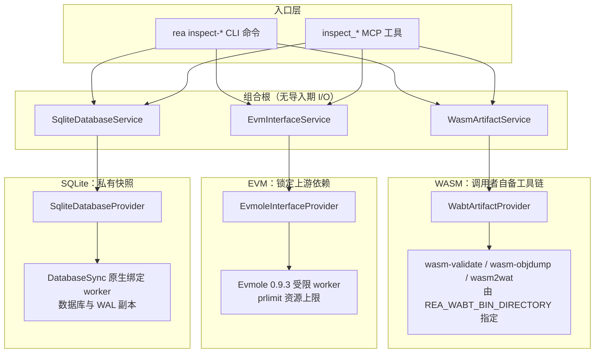
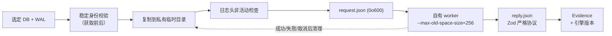

REA 将 WASM 制品、EVM 智能合约字节码与 SQLite 数据库设计为**三种无活动原生分析目标**的离线检查原语：它们不依赖 `open_binary` 打开的二进制会话，而是对显式选择的本地文件直接执行静态检查。三者共享分层架构（组合根 → 应用服务 → 提供者 → 领域契约），但在工具来源上采取了三种刻意不同的策略——WASM 使用调用者自备的 WABT 工具链，EVM 使用锁定的上游 Evmole 依赖，SQLite 则依赖宿主 Node.js 运行时的原生绑定。理解这一差异是掌握本页三个能力的前提。



Sources: [composition/wasm.ts](src/composition/wasm.ts#L7-L30), [composition/evm.ts](src/composition/evm.ts#L7-L22), [composition/sqlite.ts](src/composition/sqlite.ts#L5-L9)

## WASM 制品检查：调用者自备的 WABT 工具链

`inspect_wasm_artifact` / `rea inspect-wasm-artifact` 使用调用者通过 `REA_WABT_BIN_DIRECTORY` 显式提供的 WABT 1.0.42 检查选定的本地 WASM 字节。REA 不安装工具、不获取制品、也不执行 WASM——这是一条**目标无关**的静态检查路线。如果对可识别 WASM v1 头的文件调用 `open_binary`，结果不是分析，而是 `target_unavailable` 错误，类别为 `unsupported_target`，约束名为 `wasm_requires_static_inspection`，并在错误信息中引导调用者改用本工具。值得注意的是，WASM 头的识别优先于 `.hop` 文件名的数据库自动路由：把模块重命名为 `.hop` 仍会返回静态检查诊断，而显式的数据库或 raw/COM 格式选择则保留调用者请求的解释。

Sources: [docs/wasm-artifacts.md](docs/wasm-artifacts.md#L1-L24), [src/wasm/WabtArtifactProvider.ts](src/wasm/WabtArtifactProvider.ts#L41-L47)

提供者对工具的准入是逐文件验证的：三个可执行文件 `wasm-validate`、`wasm-objdump`、`wasm2wat`（Windows 上加 `.exe`）必须存在于绝对目录中，通过 `realpath` 解析、检查可执行权限，并以稳定制品读取器记录每个工具的 SHA-256 与版本横幅。每个子进程有 30 秒截止时间与 32 MiB 合并输出预算；每次命令执行前后都会重新校验快照与工具的摘要，任何漂移都会失败。上游准入策略要求版本横幅精确报告 `1.0.42`，但这只是识别受支持的生产者档案，**不构成发布者身份认证或操作系统沙箱**——操作者仍需自行保证可执行文件来源可信。

Sources: [src/wasm/WabtArtifactProvider.ts](src/wasm/WabtArtifactProvider.ts#L96-L176), [third_party/wabt/README.md](third_party/wabt/README.md#L1-L14)

检查流程本身是一条固定的三命令管线：`wasm-validate --enable-all` 验证模块，`wasm-objdump -h -x` 报告节区，`wasm2wat --enable-all` 解码为 WAT。选定的字节先复制到私有工作区中的只读 `module.wasm`，超过 8 MiB 的输入以 `resource_constraint` 拒绝并在 `reported_limits.maximum_input_bytes` 中报告固定字节配额——重试同一文件不会提高配额。结果保留选中字节的 SHA-256 与大小、节区载荷范围、完整的头部与详情输出、精确的导入/导出 WAT 形式，以及解码 WAT 及其 UTF-8 SHA-256。需要明确的是，**WAT 是解码表示而非原始源码**：自定义注解可以保留载荷，但 WAT 不能证明原始二进制布局或往返字节一致性，这一区分由原始字节身份与 objdump 输出保留。

| 命令 | 参数 | 作用 |
| --- | --- | --- |
| `wasm-validate` | `--enable-all module.wasm` | 模块验证，无效或截断模块报错并保留部分证据 |
| `wasm-objdump` | `-h -x module.wasm` | 节区载荷范围与详细头部输出 |
| `wasm2wat` | `--enable-all module.wasm` | 解码 WAT 及其 UTF-8 SHA-256 |

Sources: [src/wasm/WabtRelease.ts](src/wasm/WabtRelease.ts#L7-L12), [docs/wasm-artifacts.md](docs/wasm-artifacts.md#L40-L70)

检查还会派生两类附加事实。其一是**生产者拥有的类型化接口事实**：适配器从解码 WAT 中解析函数/标签签名并解析类型索引，表与内存的限额、内存页大小、全局值类型与可变性保持显式；未被准入的类型（包括 GC 引用签名）保留空签名并附带问题。其二是**可选的 JavaScript 关联**：`--glue_paths` 提供的胶水文件经 Babel 解析器与 AST 遍历提取 `.wasm` 字符串字面量及其源码坐标，相对路径匹配成为本地路径候选，URL 与不匹配路径保留 basename 候选。文档强调这些是**字面量关联而非已证明的数据流**——计算字符串、别名与动态导入需要进一步证据。

Sources: [src/wasm/WabtInterface.ts](src/wasm/WabtInterface.ts#L65-L120), [docs/wasm-artifacts.md](docs/wasm-artifacts.md#L62-L80)

`compare_wasm_interfaces` 是一个纯证据驱动的后续操作：它接受两份完整的 `inspect_wasm_artifact` 证据记录（或 MCP 会话中的保留引用）与必需的 `scope: "imports" | "exports" | "both"`，**不读取任何文件、也不需要 WABT 工具链**。结果保留双方输入证据 ID、制品路径/摘要/长度与每个选定出现项；唯一名称被归类为新增、移除、变更或未变，重复名称与不支持的签名归为未知，不完整或历史清单永远不能建立缺席结论。导入按模块/名称分组、导出按名称分组，因此种类变化可见。文档明确：静态类型相等**不**建立运行时兼容性、ABI 兼容性或链接成功；核心模块对比不含 WebAssembly 组件与规范 ABI 关系。

```bash
REA_WABT_BIN_DIRECTORY=/absolute/wabt/bin rea inspect-wasm-artifact \
  /artifacts/module.wasm --glue_paths /artifacts/glue.js \
  --candidate_paths /artifacts/other/module.wasm --format json

rea compare-wasm-interfaces comparison-input.json --json
```

Sources: [docs/wasm-artifacts.md](docs/wasm-artifacts.md#L86-L112), [src/server/registerWasmTools.ts](src/server/registerWasmTools.ts#L19-L42)

## EVM 接口推断：锁定的 Evmole 与受限 worker

`inspect_evm_interface` / `rea inspect-evm-interface` 从一个显式选择的本地字节码载体（raw 字节或 UTF-8 hex，可选 `0x` 前缀与外层 ASCII 空白）推断接口候选。REA 集成的是**未修改的** npm 依赖 `evmole@0.9.3`，带锁文件完整性校验（tag 解析到 commit `0409707c2efef11a9043f9b4505cad5719054a7e`）；REA 自身只包含载体验证、worker 适配器与可移植契约，不需要子模块或引擎分叉，也不获取签名数据库、LLM 反编译器、区块链节点或 RPC 依赖。初始验证覆盖 Linux x64 上的平坦遗留字节码；EOF 风格的 EF00 容器返回 `unsupported_target`。宿主必须已提供 util-linux 的 `prlimit`（默认 `/usr/bin/prlimit`，可用 `REA_EVM_PRLIMIT_COMMAND` 指定其他绝对路径可执行文件）。

Sources: [docs/evm-bytecode.md](docs/evm-bytecode.md#L1-L20), [third_party/evmole/README.md](third_party/evmole/README.md#L1-L14)

分析在**自有 worker** 中执行：worker 以 `evmole/no_tla` 入口初始化 WASM 引擎（`initSync` 加载 `evmole_bg.wasm`），校验包版本必须是 `0.9.3`，然后以 `contractInfo`（启用 selectors、arguments、stateMutability）执行接口推断。字节首两字节为 `0xEF 0x00` 时抛出不支持容器错误。该能力刻意串行化：提供者内部维护一个 `#tail` 承诺链，同一时刻只允许一次检查在运行，前一次未收尾则下一次直接返回错误。资源边界由 `prlimit` 应用三个选定软限制——3 GiB 虚拟地址空间、30 CPU 秒、以及等于回复预算的文件大小上限——并保留继承的更严格软/硬限制（选择器会把更紧的继承值取为生效值）；WASM 陷阱保留被禁用，使引擎能在该虚拟限额内运行，但实际内存不等于其 3 GiB 允许量。

Sources: [src/evm/EvmoleInterfaceWorker.ts](src/evm/EvmoleInterfaceWorker.ts#L29-L60), [src/evm/EvmoleInterfaceProvider.ts](src/evm/EvmoleInterfaceProvider.ts#L83-L134), [src/evm/EvmWorkerLimits.ts](src/evm/EvmWorkerLimits.ts#L10-L59)

证据语义需要分层理解。载体 SHA-256 标识原始文件（含前缀、大小写与空白），解码字节 SHA-256 标识实际选定的 EVM 字节——**两者都不是**以太坊 Keccak 代码哈希。完整字节码、上游函数偏移与原始生产者表示默认内联返回；选择器恢复期间上游还会返回终止元数据，其报告值保留在 `raw_result` 中，JS 绑定中的整数精度与非文本键覆盖保持未知。与之独立地，`bytecode.metadata` 从选定字节自行解释一个可信的终止 CBOR 根映射：整数用十进制字符串、字节串用 hex、标量键保留类型，记录的偏移/长度指向原始字节码（因此摘要投递不会复制不透明 CBOR 载荷），解码以 64 层容器与终止载荷编码大小为界。

| 事实类别 | 证据状态 | 说明 |
| --- | --- | --- |
| 选择器、参数字符串、可变性 | 推断 | 不查函数名/签名表；优化代码可能产生不同可变性候选 |
| 终止 CBOR 元数据 | 独立解析 | 嵌套容器部分标量覆盖；不支持候选项报 `not-decoded` |
| 编译器版本字节/文本 | 声明 | 不是已验证的编译器、源文件或已部署合约身份 |
| 运行时/初始化代码身份、硬分叉、发现完备性 | 未知 | 空候选不能证明无可调用接口 |

Sources: [docs/evm-bytecode.md](docs/evm-bytecode.md#L22-L46)

资源与生命周期约束同样严格：输入限 4 MiB、完整回复限 16 MiB、合并诊断输出限 1 MiB。失败（无效输入、不支持、取消、超时、畸形回复）在 `details.captured_output` 下保留有界的 stdout/stderr 及截断标记；SIGXCPU 保留 CPU 资源诊断，观察到的 EFBIG/SIGXFSZ 写失败保留文件大小资源诊断——worker 观察到 EFBIG 时以保留退出码 76 退出并写入私有失败标记，裸启动器退出或不可写标记则保留进程诊断且资源原因标注为未验证。诊断摘录仅用于约束返回的文本，底层错误原因仍保留完整子进程快照，摘录**不**意味着更低内存或更快分析。MCP 侧还提供 `detail: "summary"` 的选定投递：生成链接到完整父证据的独立派生证据，保留每个生产者返回的选择器、解码偏移与明确未知项，但不复制字节码文本或重复原始 stdout。

Sources: [src/evm/EvmoleRelease.ts](src/evm/EvmoleRelease.ts#L7-L14), [src/evm/EvmoleInterfaceWorker.ts](src/evm/EvmoleInterfaceWorker.ts#L76-L99), [docs/evm-bytecode.md](docs/evm-bytecode.md#L84-L110), [src/server/registerEvmTools.ts](src/server/registerEvmTools.ts#L24-L62)

## SQLite 快照检查：私有副本与原生绑定

`inspect_sqlite_database` / `rea inspect-sqlite-database` 检查一个显式选择的本地 SQLite 数据库快照，同样不需要活动原生分析目标，且**无需单独安装 SQLite**。它依赖 Node.js 24.x ≥24.15 或 26+ 的原生 `DatabaseSync.limits` API——worker 在查询复制的数据库前会先验证该能力；`rea capabilities` 会在不打开任何数据库的情况下报告该能力的可用性与运行时要求，不支持的运行时显示 `available: false` 与 `availability_code: "unsupported_version"`。调用者应选择静默快照：先停止写入者，或通过应用的备份工作流获得一致的数据库/WAL 对；活动文件对的普通副本不构成原子 SQLite 快照，即使检查期间未检测到变化。

Sources: [docs/sqlite-databases.md](docs/sqlite-databases.md#L1-L40)

与另外两个能力不同，SQLite 检查的核心安全设计是**源文件永不被 SQLite 打开**：REA 将选定数据库与已存在的同级 `-wal` 文件复制到自有私有临时目录后，SQLite 才打开副本，因此其锁或共享内存边车无法修改原始快照；扩展加载与模式信任被禁用，回滚日志从不被修改或复制进 worker 快照。日志头部在获取前后各检查一次（成功 `TRUNCATE`/`PERSIST` 提交留下的空文件与全零头被接受），其他保留的回滚日志因恢复超出该档案范围而被拒绝。提供者最多通过获取、worker 执行与清理准许**两次并发检查**，更多请求在读取文件或创建 worker 之前收到类型化容量错误。

Sources: [docs/sqlite-databases.md](docs/sqlite-databases.md#L84-L110), [src/sqlite/SqliteDatabaseLimits.ts](src/sqlite/SqliteDatabaseLimits.ts#L1-L8), [src/sqlite/SqliteDatabaseProvider.ts](src/sqlite/SqliteDatabaseProvider.ts#L64-L107)

模式与行选择的语义由 `schema_scope` 控制：不选表时默认 `inventory`（紧凑表元数据与索引/视图/触发器名称，不含 SQL 声明与列详情）；选择一个表默认 `selected_table`（展开该表及其索引与触发器）；显式 `database` 展开全部存储声明与受支持列。行读取是可选的：`table` 选择一个精确的普通表名，`columns` 按请求顺序选择精确的可见列名（省略则选择全部可见列，包括生成列），`row_limit` 需要表选择、默认 20、接受正安全整数。视图、虚拟表与影子表的行读取不受支持——无法解析的虚拟表的可能 backing 表标注 `kind: "unknown"` 且其行被拒绝，但无关的普通表仍可选择。

| schema_scope | 触发条件 | 覆盖内容 |
| --- | --- | --- |
| `inventory` | 未选择表（默认） | 紧凑表元数据 + 索引/视图/触发器名称 |
| `selected_table` | 选择一个表（默认） | 该表展开 + 其索引与触发器 |
| `database` | 显式指定 | 全部存储声明与受支持列 |

Sources: [docs/sqlite-databases.md](docs/sqlite-databases.md#L42-L70)

值编码刻意保证**JSON 往返无损**：SQLite 整数编码为十进制字符串（每个有符号 64 位值都存活），实数保留数字并以 `"Infinity"`、`"-Infinity"`、`"-0"` 显式穿过 JSON，文本返回解码字符串连同字节 hex 与数据库编码（保留 SQLite 绑定可能为显示替换的畸形文本），Blob 为 hex，SQL NULL 是独立的标记值。数据库与同级 WAL 有独立的原始 SHA-256 与字节数，Evidence 主体标识原始数据库文件，而 WAL 身份对解释待提交数据同样必要；引擎版本随观察结果一并报告，两个摘要都不是数据库健康、完整或可信的声明。若派生 WAL 或回滚日志路径因超长数据库名无法寻址（`ENAMETOOLONG`），REA 报告能力不可用而非假设边车不存在，补救指引是将完整已知文件集通过应用支持的导出工作流移到更短路径。

Sources: [docs/sqlite-databases.md](docs/sqlite-databases.md#L72-L82), [src/sqlite/SqliteDatabaseSnapshot.ts](src/sqlite/SqliteDatabaseSnapshot.ts#L21-L55)

worker 通过共享的自有进程监督边界执行：宿主以 `process.execPath` 启动 `SqliteDatabaseWorker.js`，附加 `--max-old-space-size=256`（256 MiB JavaScript 堆）与 30 秒检查截止时间；请求以 `wx` 模式、`0o600` 权限写入私有根内的 `request.json`，回复经 `reply.json` 返回并由 Zod 严格协议校验。数据库与 WAL 合计限 256 MiB，SQLite 值/记录、SQL 语句与完整 worker JSON 回复各限 16 MiB；SQLite 原生分配独立于 JavaScript 堆，原生堆与常驻内存总量不受限——行限制不覆盖这些字节与资源限制，资源限制失败不会以不完整模式冒充成功证据。取消在 worker 完成后到达不会抹除已完成的观察：若后续清理失败，错误保留完成证据与资源所有者以供清理重试，MCP 在投递错误前先记录该证据。



Sources: [src/sqlite/SqliteDatabaseWorkerExecution.ts](src/sqlite/SqliteDatabaseWorkerExecution.ts#L121-L160), [docs/sqlite-databases.md](docs/sqlite-databases.md#L112-L146), [src/server/registerSqliteTools.ts](src/server/registerSqliteTools.ts#L16-L32)

## 三能力横向对比

三个检查原语的契约严格性同源，但约束与证据边界因工具来源不同而系统性分化。下表汇总可直接用于选型决策：

| 维度 | WASM（WABT） | EVM（Evmole） | SQLite（原生绑定） |
| --- | --- | --- | --- |
| 工具来源 | 调用者自备，`REA_WABT_BIN_DIRECTORY` | 锁定 npm 依赖 `evmole@0.9.3` | Node.js ≥24.15/26 的 `DatabaseSync.limits` |
| 平台档案 | 已在 macOS arm64 验证 | 仅 Linux x64 | Node 版本矩阵（CI 覆盖 22.x 诊断、24.15、24.x/26.x） |
| 输入上限 | 8 MiB | 4 MiB | DB+WAL 合计 256 MiB |
| 输出/回复预算 | 32 MiB 合并工具输出 | 16 MiB 回复 + 1 MiB 诊断 | 16 MiB 回复 + 1 MiB 诊断 |
| 截止时间 | 每命令 30 s | 30 s 命令 + 30 CPU 秒 | 30 s |
| 并发模型 | 顺序命令管线，共享输出预算 | 提供者内部串行（`#tail` 链） | 最多 2 次并发检查 |
| 隔离机制 | 私有工作区快照 + 摘要前后复检 | prlimit 三软限制 + 自有 worker | 私有副本 + SQLite 不触碰源文件 |
| 证据性质 | 生产者输出 + 类型化接口推断 | 推断（选择器/可变性），完整性未知 | 观察快照（模式 + 已提交行样本） |

Sources: [src/wasm/WabtRelease.ts](src/wasm/WabtRelease.ts#L1-L12), [src/evm/EvmoleRelease.ts](src/evm/EvmoleRelease.ts#L1-L14), [src/sqlite/SqliteDatabaseLimits.ts](src/sqlite/SqliteDatabaseLimits.ts#L1-L8), [docs/wasm-artifacts.md](docs/wasm-artifacts.md#L70-L84), [docs/evm-bytecode.md](docs/evm-bytecode.md#L112-L130)

三个能力都遵循 REA 的错误契约：失败保留选中路径与有意义的原因，清理失败保留原始错误投影与捕获输出，部分证据在失败时仍保留选定字节的身份与工具溯源。它们的证据记录都可通过 `get_evidence_bundle` 读回，且 MCP 侧统一经过会话证据记录与共享验证处理器。

Sources: [src/server/registerWasmTools.ts](src/server/registerWasmTools.ts#L44-L77), [src/evm/EvmoleInterfaceProvider.ts](src/evm/EvmoleInterfaceProvider.ts#L48-L77)

## 验证通道

每个能力都有独立的真实工具链验证通道。WASM：构建后以 `REA_WABT_BIN_DIRECTORY=/absolute/wabt/bin node scripts/verify-wasm-interface-comparison.mjs` 经编译 CLI 与 stdio MCP 执行原始模块对比，使用自有 fixture 与 WABT 1.0.42，不实例化或执行任何 WASM 模块。EVM：`npm run verify:solidity:metadata` 使用调用者选择的 solc 0.8.30 模块编译自有 fixture（非优化、viaIR、无内容哈希、无 CBOR 设置）并验证观察到的 trailer 事实；真实验证通道还追踪代表性 raw/hex CLI 工作流，检查只有声明的 Node/prlimit 启动器与进程所有权检查运行，套接字追踪允许本地 stdio 套接字对并拒绝网络请求尝试——这些观察验证的是 fixture，**不是**通用网络沙箱。SQLite：`npm run test:sqlite` 准备编译运行时并运行服务、快照、检查、清理与公共 CLI/MCP 测试，可复用 CI 工作流测试 Node 版本矩阵。

Sources: [docs/wasm-artifacts.md](docs/wasm-artifacts.md#L136-L148), [docs/evm-bytecode.md](docs/evm-bytecode.md#L132-L152), [docs/sqlite-databases.md](docs/sqlite-databases.md#L148-L162)

如果需要继续深入，建议按以下顺序阅读：先回顾 [证据与不确定性模型](6-zheng-ju-yu-bu-que-ding-xing-mo-xing-guan-cha-tui-dao-tui-duan-yu-wei-zhi-de-bao-liu-yu-yi) 理解本页反复出现的"推断 vs 观察 vs 未知"语义；再通过 [MCP 契约参考](8-mcp-qi-yue-can-kao-gong-ju-jie-guo-bao-liu-zheng-ju-hui-hua-fa-xian-yu-qu-xiao-hui-fu) 了解保留证据与摘要投递的通用机制；本页大量依赖的自有进程监督与私有运行时根细节在 [进程所有权与生命周期监督](25-jin-cheng-suo-you-quan-yu-sheng-ming-zhou-qi-jian-du-si-you-yun-xing-shi-jie-zhi-shi-jian-yu-qing-li-zhong-shi) 展开；验证通道的完整分类见 [测试策略与验证通道](27-ce-shi-ce-lue-yu-yan-zheng-tong-dao-yuan-ma-bian-jie-yan-shou-zhi-xing-ji-zhen-shi-gong-ju-lian-tong-dao)。