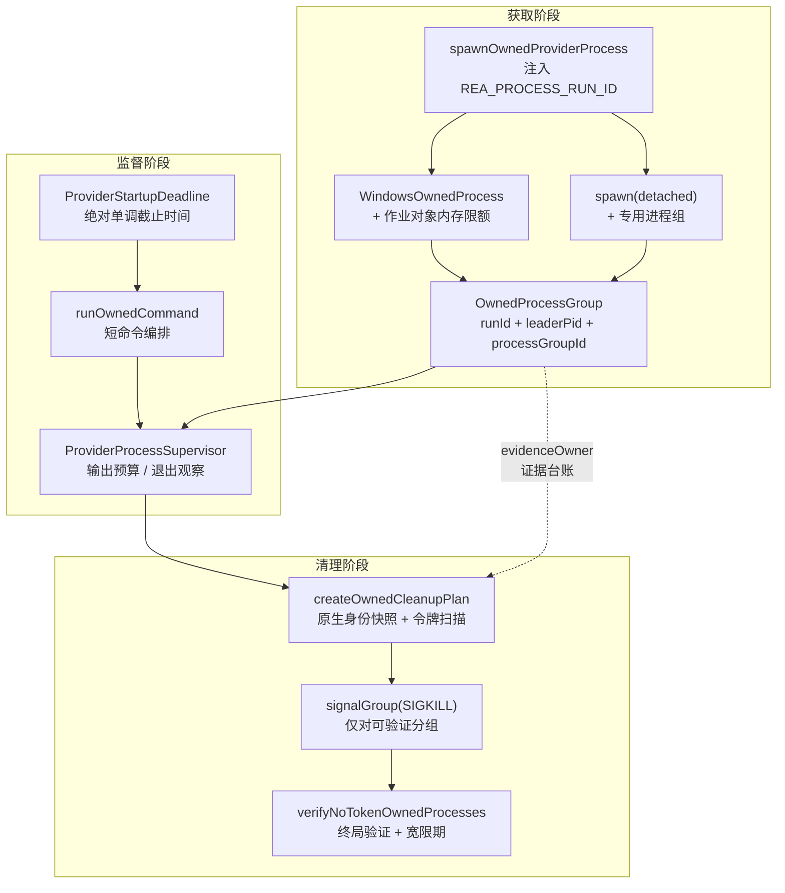
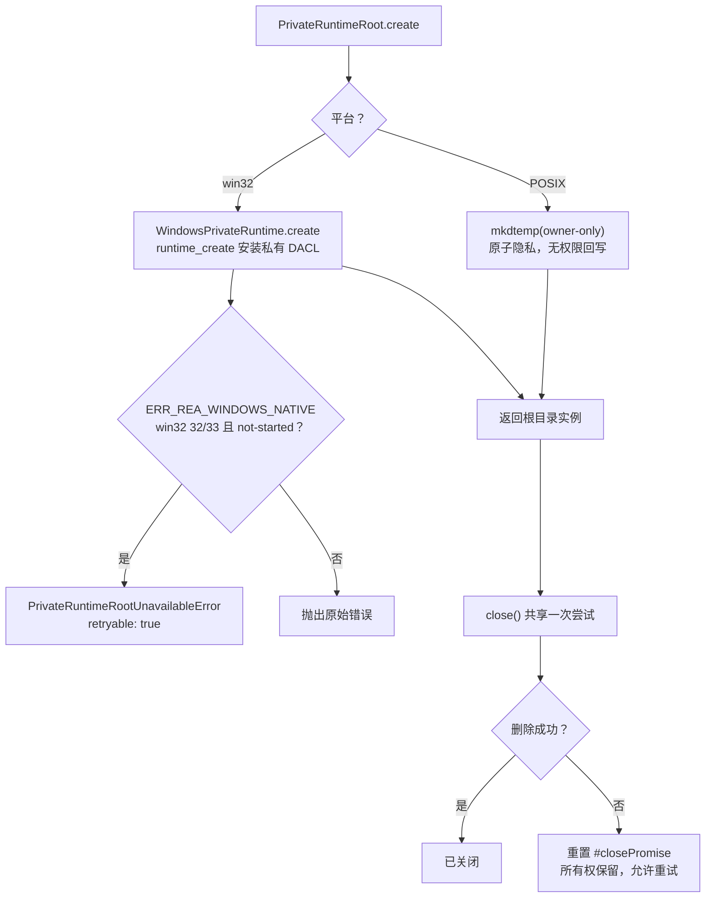
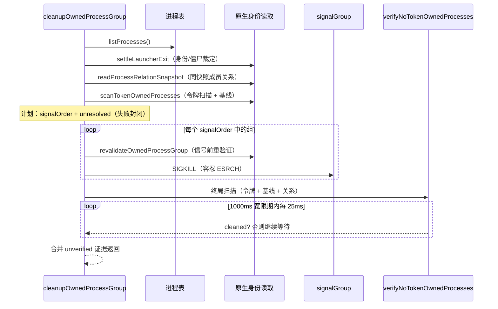
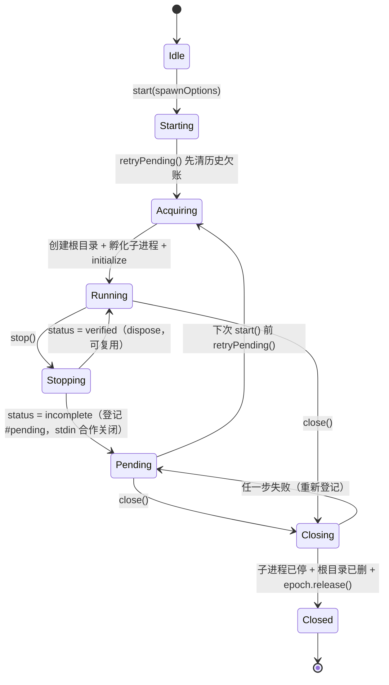

REA 对每一个由它启动的外部进程（Ghidra、Hopper、wabt、各类分析器）都执行同一条不变式：**除非能以可验证的所有权证据证明某个进程属于本次运行，否则绝不向它发送信号**。本页从三个相互咬合的机制出发，解释这条不变式如何被落实：以运行令牌（run token）锚定的所有权凭证、为启动握手分配预算的绝对截止时间、以及在失败时保留所有权并允许重试的清理协议。与依赖操作系统隐式父子关系的传统做法不同，REA 的监督模型是"凭证驱动、失败即封闭（fail-closed）"的：任何一次无法完成的验证都会转化为保留证据与可重试的清理责任，而不是一次盲目的 `kill -9`。理解本页是阅读 Ghidra 与 Hopper 会话生命周期、以及 Windows 作业对象边界的前提，建议先完成[分层架构总览](5-fen-ceng-jia-gou-zong-lan-ru-kou-zu-he-ying-yong-ti-gong-zhe-yu-ling-yu-ceng-de-yi-lai-gui-ze)的阅读。

## 所有权生命周期的整体架构

进程所有权监督由 `src/process` 目录下的一组原语构成，它们按"获取凭证 → 监督运行 → 验证清理"三个阶段组织。`spawnOwnedProviderProcess` 是唯一的进程获取入口：它将 `REA_PROCESS_RUN_ID` 注入子进程环境，在 Windows 上通过 `WindowsOwnedProcess` 加入作业对象，在 POSIX 上以 `detached` 模式创建专用进程组，并返回一份 `OwnedProcessGroup` 所有权凭证。`ProviderProcessSupervisor` 在此之上监督输出、退出与终止；`cleanupOwnedProcessGroup` 则负责终止后的令牌验证清理。长期运行的提供者（如顺序复用同一子进程的 wabt 与 sqlite worker）由 `OwnedWorkerRuntime` 统一持有私有运行时根目录与子进程生命周期。

这张图中的"证据台账"（`ProcessOwnershipEvidenceOwner`）是理解整个模型的关键：清理方案从不出自单一的进程表快照，而是由同一原生的身份/令牌/身份三段读取序列驱动，跨失败的重试保留同一份台账，使"哪些 PID 曾被验证为自有"这一事实在多次清理尝试之间保持稳定。

Sources: [ProviderProcess.ts](src/process/ProviderProcess.ts#L230-L311), [ProcessOwnership.ts](src/process/ProcessOwnership.ts#L23-L59), [ProcessOwnershipEvidence.ts](src/process/ProcessOwnershipEvidence.ts#L46-L120)

## 运行令牌：所有权的最小证明

每一次受监督的启动都会生成唯一的 `runId`，并以环境变量 `REA_PROCESS_RUN_ID` 的形式传递给子进程。POSIX 侧的清理扫描反过来读取这一变量：`ProcessOwnershipHost.runTokens`（若平台支持则单次批量读取）不可用时，逐进程回退到 `environment(pid)`，产出一个二元的 `ProcessRunTokenObservation`——`readable`（携带或不携带匹配的 runId）或 `unavailable`（附带原因）。这个窄接口是全部所有权判定的数据来源，任何"读不到"都必须进入失败封闭路径，而不是默认无主。

令牌本身只是**必要条件**而非充分条件。`OwnedProcessGroup` 凭证额外记录启动器的期望命令与期望父 PID（仅在启动器存活时校验）、捕获前的进程基线（用于令牌扫描时排除先于本次运行存在的进程），以及可选的 `sampledProcessGroupIds`——观察阶段采样的分组只会成为清理候选，绝不直接授权发信号；每个存活成员仍需令牌证明。`sweepTokenOwnedProcesses` 字段用类型系统区分了两种权威级别：普通清理只处理已知进程组，而携带 `true` 的凭证（且必然携带 `evidenceOwner` 台账）才允许全表扫描令牌匹配的后代。

| 概念 | 载体 | 权威语义 |
| --- | --- | --- |
| `runId` | 子进程环境变量 `REA_PROCESS_RUN_ID` | 令牌匹配是归属的必要条件 |
| `OwnedProcessGroup` | 凭证对象（runId、leaderPid、processGroupId、期望身份） | 标识一次受监督启动的全部可验证事实 |
| `sweepTokenOwnedProcesses: true` | 判别联合的固定字段 | 授权对全进程表执行令牌扫描清理 |
| `evidenceOwner` | `ProcessOwnershipEvidenceOwner` 台账 | 跨清理重试保留已验证的候选与覆盖统计 |
| `captureBaseline` | 启动前的进程身份快照 | 令牌扫描时区分"先于本次运行"与"本次运行产生" |

Sources: [ProviderProcess.ts](src/process/ProviderProcess.ts#L247-L252), [ProcessRunTokenObservations.ts](src/process/ProcessRunTokenObservations.ts#L10-L62), [ProcessOwnership.ts](src/process/ProcessOwnership.ts#L23-L59)

POSIX 扫描之所以必须配合基线快照，是因为环境读取存在固有的歧义：macOS 内核会扣留 Apple 平台二进制与 `CS_RESTRICT` 进程的环境（`KERN_PROCARGS2` 拒绝），跨 UID 的进程则返回 `EINVAL`。REA 将这类**可证明的系统性扣留**与真正的读取失败区分开来——前者若同时被原生关系读取证明与本运行无关，就记录为 `OwnershipSweepUnverifiedProcess` 证据（"无法验证，但并非本树成员，清理不能对它行动"），不污染本次捕获的结果；任何相关或原因不明的候选则保持失败封闭。这套分类逻辑集中在 `environmentWithheldFromInspection`，它同时比对了原生读取回报的有效 UID 与当前调用者 UID。

Sources: [ProcessOwnership.ts](src/process/ProcessOwnership.ts#L208-L219), [ProcessOwnership.ts](src/process/ProcessOwnership.ts#L1122-L1155), [DarwinProcessRunTokenReader.ts](src/process/DarwinProcessRunTokenReader.ts#L28-L78)

## 私有运行时根目录：文件系统侧的所有权边界

进程所有权只是问题的一半——提供者还需要一个私有的工作目录来存放套接字端点、暂存文件与导出物。`PrivateRuntimeRoot` 是这个边界的平台中立原语：POSIX 上它直接使用 `mkdtemp`，其原子性的 owner-only 权限即是隐私证明，因此**不做任何事后 chmod 回写**（那会引入可失败的回滚窗口）；Windows 上则委托给经过独立验证的原生 DACL 边界。能力探测函数 `privateRuntimeRootCapability` 返回平台化的安全状态，Windows 上不可用或可重试的共享冲突都会以 `PrivateRuntimeRootUnavailableError`（携带 `retryable` 标志）提前暴露。

`close()` 的协议值得注意：并发调用者共享同一次删除尝试，但**失败的尝试不会被缓存**——`#closePromise` 在拒绝时被重置为 `undefined`，使后续的 `close()` 天然成为一次重试。这个模式在 REA 的清理代码中反复出现（监督器的 `stop()`、worker 运行时的 `close()` 均同构），其含义是：清理失败只是"本次尝试未完成"，所有权仍然保留，重试权限始终存在。

Sources: [PrivateRuntimeRoot.ts](src/process/PrivateRuntimeRoot.ts#L31-L93), [PrivateRuntimeRootUnavailableError.ts](src/process/PrivateRuntimeRootUnavailableError.ts#L1-L14)

Windows 侧的原生运行时是这套协议中最严格的实现。`WindowsPrivateRuntime.create` 经由原生权威（`WindowsNativeAuthority`）分配目录并在**创建时**安装私有 DACL，随后以卷序列号加文件 ID 作为注册键记录每个运行时；`windowsPrivateRuntime` 查找时要求路径逐字符匹配，大小写变体直接失败封闭，杜绝任何基于文本路径的归属猜测。清理重试预算同样明确：只有 win32 代码 32/33（共享/锁冲突）这一**被证明的瞬态错误**才会触发至多 10 次、每次间隔 100 毫秒的重试；其余错误一次性终局。这种"只重试已证明可重试的错误"的纪律，与 admission 阶段只对 `runtimeAllocation: "not-started"` 的冲突标记 `retryable` 完全一致——一个可能已经拥有未发布目录的操作绝不会被标记为可重试。

Sources: [WindowsPrivateRuntime.ts](src/windows/WindowsPrivateRuntime.ts#L27-L56), [WindowsPrivateRuntime.ts](src/windows/WindowsPrivateRuntime.ts#L72-L92), [WindowsPrivateRuntime.ts](src/windows/WindowsPrivateRuntime.ts#L180-L215), [WindowsPrivateRuntime.ts](src/windows/WindowsPrivateRuntime.ts#L219-L246)

## 截止时间：跨阶段的绝对单调预算

`ProviderStartupDeadline` 解决的问题是：一个提供者启动握手由多个阶段（进程孵化、套接字连接、协议 ping、就绪探测）组成，各阶段共享**同一个**绝对时间预算，且必须能被调用者的取消信号打断。它内部持有一个复合 `AbortController`，外部信号触达时先查单调时钟再分类：已过截止时间记为 `timeout`（抛出 `TimeoutError` 的 `DOMException`），否则记为 `cancelled`（保留调用者原始终止原因）。这个二分法贯穿所有上层错误投影——用户看到的是"取消了"还是"超时了"，由这里的一次性分类决定。

实现中有三处防御性细节体现了对 Node 定时器语义的精确处理。其一，`remainingMs()` 在终局超时后恒返回 0，防止过期定时器在后续时钟查询中"重新获得预算"；其二，`#armDeadlineTimer` 在定时器提前触发时重查时钟并重新武装剩余预算，而不是直接断定超时；其三，`wait()` 把轮询目标（本次间隔）与截止目标取较早者，定时器早至时保留残差继续等待——两次提前触发都不会让轮询越过绝对边界。每个持有它的适配器必须在启动成功或失败后调用 `dispose()` 释放定时器与外部监听器。

| 成员 | 语义 | 失败封闭点 |
| --- | --- | --- |
| 构造参数 `timeoutMs` | 必须为正的有限数，否则 `RangeError` | 拒绝零与负预算 |
| `signal` | 复合信号：调用者中止或截止到期都会中止 | 所有阶段共享同一信号 |
| `interruption` | 首个中断路径：`cancelled` / `timeout` | 决定上层错误分类 |
| `remainingMs()` | 分配给下一阶段的剩余毫秒 | 终局超时后恒为 0 |
| `wait(ms)` | 至多一个轮询间隔的可中止等待 | 单调过期解析为 `aborted` |
| `dispose()` | 释放定时器与外部监听器 | 适配器协议义务 |

默认预算集中在配置层：Ghidra 全启动链路 330 秒、Hopper 120 秒、macOS 所有权辅助器的 `swiftc` 编译 120 秒（新鲜 Swift SDK 缓存在受支持的 Intel macOS 虚拟机上实测约 88 秒），且模式校验将上限钉在 Node 有符号 32 位定时器边界之下——超过它的延迟会被 Node 降级为 1 毫秒定时器。Ghidra 的桥接握手消费截止时间的方式是模板化的：每个请求携带 `deadline.signal` 与 `deadline.remainingMs()`，取消类错误若同时存在中断分类，则改写为对应的取消/超时失败。

Sources: [ProviderDeadline.ts](src/process/ProviderDeadline.ts#L25-L157), [ProviderDeadline.ts](src/process/ProviderDeadline.ts#L89-L119), [providerStartupTimeout.ts](src/config/providerStartupTimeout.ts#L1-L22), [GhidraClientStartup.ts](src/ghidra/GhidraClientStartup.ts#L28-L72)

macOS 的所有权辅助器本身就是一个截止时间应用的范例：读取进程身份与令牌需要编译一个 Swift 原生帮助工具，其编译预算独立于任何短命令的超时（`prepareOwnedCommand` 仅在 darwin 上执行准备），编译期间的中断使用 `SIGINT`——因为 swift-driver 的每个前端作业运行在独立进程组中，`SIGINT` 会让它们停机并删除目标文件，而 `SIGTERM` 下作业可能在 `TMPDIR` 中留下对象。这说明截止时间机制与所有权机制并非两个孤立话题：辅助器编译失败时，其自身的清理归属（`cleanupFailure`、`cleanupOwner`）会通过 `DarwinProcessOwnershipInspectionError` 原样传递给调用者。

Sources: [OwnedCommand.ts](src/process/OwnedCommand.ts#L100-L156), [DarwinProcessRunTokenReader.ts](src/process/DarwinProcessRunTokenReader.ts#L95-L100)

## 令牌验证的清理：计划、信号与终局验证

`cleanupOwnedProcessGroup` 是所有权不变式的执行者，其流水线分为四步。**第一步**读取存活的进程表；表不可读则整体失败（无法证明清空即无法宣告干净）。**第二步** `settleLauncherExit` 处理启动器退出竞争：进程表读可能保留了已退出行的旧状态，因此只有"原生身份读取回报缺席/僵尸"或"一张新鲜进程表证明该 PID 不再存活"才能裁定退出，且刷新快照时必须保留脱离进程组的存活后代谱系，不能因为启动器消失就丢弃它们。**第三步** `createOwnedCleanupPlan` 构建清理计划：进程表的祖先/分组字段只用于挑选"缺失原生事实需要失败封闭"的行，**从不**直接授权任何分组或后代关系——真正的成员关系来自同一快照内的原生身份读取（`identityBefore`/`token`/`identityAfter` 三段验证）。**第四步**按计划顺序对每个可信号组执行 `signalGroup(SIGKILL)`（自有组排在最前），容忍 `ESRCH`，其余信号失败立即封闭。

终局验证 `verifyNoTokenOwnedProcesses` 只出现在令牌扫描模式中：信号发出后，活进程可能需要短暂时间才真正消失，因此验证循环在 1 秒宽限期内以 25 毫秒间隔反复全表扫描，任何仍携带本运行令牌的存活进程都判定为 `cleaned: false`（"token-owned process remained after cleanup"）。失败的原因被归为三类枚举——`environment-unreadable`（环境读不到）、`run-token-mismatch`（令牌不匹配）、`process-identity-unavailable`（身份不可用）——每一类都对应一次明确的不可归因，而不是一个笼统的失败布尔值。

Sources: [ProcessOwnership.ts](src/process/ProcessOwnership.ts#L323-L424), [ProcessOwnership.ts](src/process/ProcessOwnership.ts#L427-L459), [ProcessOwnership.ts](src/process/ProcessOwnership.ts#L634-L793)

失败封闭并不等于永久僵局——它区分"瞬态不可读"与"结论性失败"。令牌读取失败后，`recheckOwnershipFailures` 会取一张**全新的**存活快照：只有 PID 真正缺席才能洗清一次读不到的观察，可读但不匹配的令牌永远是失败。Darwin 上还有一个特化的重试：僵尸态进程在进程表 `state` 字段中带 `E` 标记时，最多重试 3 次、每次延迟 40 毫秒（`TOKEN_READ_RETRY_ATTEMPTS` / `TOKEN_READ_RETRY_DELAY_MS`），等待内核完成收尸。令牌扫描路径上的 `settleUnreadableTokenCandidates` 同构：每轮重试都重验存活、刷新诊断、由固定次数预算封顶，仍读不到的候选保留其最新诊断进入分类。注释中的纪律值得引用："Never reuse this snapshot across identity/token reads"——每张快照只在单一阶段内有效，这是整个模型对抗 TOCTOU 竞争的根基。

Sources: [ProcessOwnership.ts](src/process/ProcessOwnership.ts#L1037-L1107), [ProcessOwnership.ts](src/process/ProcessOwnership.ts#L1489-L1539), [ProcessOwnershipEvidence.ts](src/process/ProcessOwnershipEvidence.ts#L8-L31)

## 监督器与停止协议：TERM 升级、所有权保留与重试

`ProviderProcessSupervisor` 对上呈现两个正交的观测面：输出快照（字节计数、UTF-8 有效性、截断标志、`checkpointOutput`/`snapshotOutputSince` 的零拷贝检查点）与退出观察。停止协议则按启动类型分流，其结果类型 `ProviderProcessStopResult` 精确枚举了六种处置，其中只有 `incomplete` 携带原因与可选的清理结果详情。

| 停止结果 | 触发条件 | 后续语义 |
| --- | --- | --- |
| `not-owned` | 启动未声明 `ownsProcessLifetime` | 不发任何信号，所有权在别处 |
| `already-exited` | 无自定义清理且退出已被观察 | 直接确认 |
| `verified-cleanup` | 令牌验证的组清理成功且宽限期内退出 | 最强的清理确认 |
| `terminated` | SIGTERM 后宽限期（默认 250ms）内退出 | 温和终止 |
| `killed` | 升级 SIGKILL 后宽限期（默认 1s）内退出 | 强制终止 |
| `incomplete` | 清理失败、重试后仍未退出、或 SIGKILL 后未退出 | **所有权保留，允许重试** |

`stop()` 的共享尝试协议是重试语义的枢纽：第一次调用创建 `#stopPromise`，并发调用者共享同一结果；**只有**当结果为 `incomplete` 时该 Promise 被重置，下一次 `stop()` 因此成为一次真正的新尝试。未完成时监督器对事件循环 `unref()`（不阻止宿主退出），完成时 `dispose()` 分离全部监听器。整个终止期间保留的迟滞输出被钉在 64 KiB 上限（`MAX_LATE_OUTPUT_BYTES`）——即使清理失败，内存也不会被失控的子进程输出撑爆。对于携带令牌验证清理的启动，`#stopWithin` 会执行"清理 → 等待退出 → 再清理一次 → 再等待"的完整重试对，两次都失败才返回 `incomplete` 并附上第二次的清理结果。

Sources: [ProviderProcess.ts](src/process/ProviderProcess.ts#L590-L599), [ProviderProcess.ts](src/process/ProviderProcess.ts#L636-L733), [ProviderProcess.ts](src/process/ProviderProcess.ts#L24-L27)

短命令编排 `runOwnedCommand` 把上述部件装配成一个有界的执行单元：预检取消、构造截止时间、以轮询循环（10 毫秒粒度检查输出关闭，25 毫秒等待间隔）监视中断——取消、超时、输出超预算、进程错误四类失败各自携带明确的 `reason`。关键设计在收尾：无论成功失败，`supervisor.stop()` 总会执行；若清理不完整且调用者提供了 `retainCleanup` 回调，监督器**连同其所有权**被同步移交给调用者作用域，执行结果本身照常返回或抛出——"执行结果"与"清理责任"在这里正式解耦。未提供回调时，不完整的清理升级为携带 `cleanupOwner` 的 `OwnedCommandFailure`，其 `resources` 字段记录 runId、目录、`pid:` 与 `process-group:` 标签。

Sources: [src/process/OwnedCommand.ts](src/process/OwnedCommand.ts#L158-L196), [OwnedCommand.ts](src/process/OwnedCommand.ts#L198-L396), [OwnedCommand.ts](src/process/OwnedCommand.ts#L30-L70)

## 清理责任的移交与绑定：租约、错误绑定与运行时重试

清理失败的代价不应该是一次性的信息丢失。`AnalysisCleanupLease` 把"某个资源的释放确认"与"引发失败的原始分析错误"用 `WeakRef` 双向绑定：资源关闭成功时，所有绑定的错误收到 `resolveCleanup()`；若错误先于释放被消费（投影给客户端），错误上的 `cleanupResources` 永远指向**确切的**所有者，从不按文本猜测。`AnalysisCleanupLeaseGroup` 进一步支持合取绑定——一个聚合错误覆盖多个确切所有者，全部释放后错误才算清理完成。`retainOwnedCommandCleanup` 则是移交的接收端：它把准备失败（含辅助器编译残留）与命令失败（含未完成的监督器）分别转化为带租约的 `ProviderCleanupError`，登记到资源所有者名下，使任何后续的 close 都是对同一份未完成清理的重试。

Sources: [AnalysisCleanupLease.ts](src/artifacts/AnalysisCleanupLease.ts#L7-L142), [OwnedCommandCleanup.ts](src/providers/OwnedCommandCleanup.ts#L9-L86)

`OwnedWorkerRuntime` 把这套协议推广到"顺序复用同一子进程"的长期运行时（wabt、sqlite worker 即是消费者）。它同时持有私有运行时根目录与监督器，其核心是一个进程级的待清理注册表：`stop()` 不完整时把自身加入 `#pending` 集合并合作式关闭 stdin（保留原始停止失败），下一次 `start()` 在孵化任何新子进程**之前**先 `retryPending` 清空全部历史欠账——包括高阶所有者通过 `retryCleanup` 回调承担的部分。关闭顺序严格为"先停子进程、再删根目录"，两步各自的失败都会重新登记 pending 并产生归属稳定的 `OwnedWorkerRuntimeCleanupError`；其 `cleanupEpoch` 用 `WeakRef` 持有存活错误，根目录释放时统一 resolve，即便运行时已被复用，清理归属也不会张冠李戴。

Sources: [OwnedWorkerRuntime.ts](src/process/OwnedWorkerRuntime.ts#L91-L164), [OwnedWorkerRuntime.ts](src/process/OwnedWorkerRuntime.ts#L216-L291), [OwnedWorkerRuntime.ts](src/process/OwnedWorkerRuntime.ts#L332-L382)

## 会话级收束：挂起操作与进程关停

在单个操作粒度上，`PendingOperations` 把"事件驱动的协议回复"与"有界等待"关联起来：注册表为每个键持有可选的超时定时器与取消监听器，结算、超时、取消或 `failAll` 都会在解析前移除它们，保证没有任何计时器或监听器能逃逸到解析之后。这与 `ProviderStartupDeadline` 构成两级预算：前者约束单次请求-响应，后者约束整个启动握手。进程级收束由 `registerProcessShutdown` 完成——SIGINT、SIGTERM、stdin 的 `end`/`close` 四个事件统一映射到同一个关停请求；`createShutdown` 以 `Promise.allSettled` 并行关闭 MCP 句柄、Android 与可选提供者、以及持有全部会话资源的 `BinarySession`，单个失败原样上抛，多个失败聚合为 `AggregateError`，最终以退出码 1 与投影后的分析错误落盘。任何一次失败的清理都不会被静默吞掉——这与整页的失败封闭纪律一脉相承。

Sources: [PendingOperations.ts](src/process/PendingOperations.ts#L17-L86), [processShutdown.ts](src/main/processShutdown.ts#L23-L38), [shutdown.ts](src/main/shutdown.ts#L16-L92)

## 平台对比与重试预算速查

最后，把分散在各节的重试预算与平台差异汇总成一张速查表。所有预算的共同哲学是：**重试只针对被证明可重试的失败类别，且每次重试都重新收集证据**；没有任何一处使用固定次数的盲目重试。

| 机制 | 平台 | 预算 / 间隔 | 触发条件 |
| --- | --- | --- | --- |
| 令牌读取重试（Darwin 僵尸） | darwin | 3 次 × 40ms | 进程表 state 带 `E` 标记且读取失败 |
| 不可读候选结算 | 全平台（扫描模式） | 3 次 × 40ms | 令牌读取不可用且进程仍存活 |
| 终局令牌验证 | POSIX 扫描模式 | 1s 宽限 × 25ms 轮询 | 信号后仍有令牌匹配进程 |
| 监督器停止升级 | 非 Windows 自有子进程 | TERM 250ms → KILL 1s | 温和终止未在宽限期内退出 |
| 组清理二次尝试 | 携带 cleanup 的启动 | 同一 killGraceMs 内两次 | 首次验证清理后未退出 |
| Windows 运行时删除 | win32 | 10 次 × 100ms | 仅 win32 代码 32/33 共享冲突 |
| Windows 运行时准入 | win32 | 标记 `retryable: true` | 32/33 且 `runtimeAllocation: not-started` |
| 辅助器编译 | darwin | 独立 120s 截止时间 | `swiftc` 编译所有权检查工具 |
| 迟滞输出保留 | 全平台 | 64 KiB 上限 | 终止期间继续排空管道 |
| Ghidra / Hopper 启动 | 全平台 | 330s / 120s 绝对截止 | 跨全部握手阶段共享 |

Windows 进程树终止（`cleanupWindowsProcessTree`，经 `taskkill /t /f` 实现、5 秒超时、退出码 128 视为已消失）在这个体系中定位为**有界的 P0 清理机制**而非所有权证明——对外可见的 Windows 能力报告在原生权威验证了作业对象的创建、成员与清理语义之前保持不可用状态。这一边界属于[Windows 原生边界：NTFS 准入、作业对象与普通用户权限验证](26-windows-yuan-sheng-bian-jie-ntfs-zhun-ru-zuo-ye-dui-xiang-yu-pu-tong-yong-hu-quan-xian-yan-zheng)的主题，本页不展开。

Sources: [ProcessOwnership.ts](src/process/ProcessOwnership.ts#L193-L295), [ProcessOwnership.ts](src/process/ProcessOwnership.ts#L1122-L1123), [ProviderProcess.ts](src/process/ProviderProcess.ts#L24-L27), [WindowsPrivateRuntime.ts](src/windows/WindowsPrivateRuntime.ts#L55-L56)

## 延伸阅读

所有权监督机制在两类真实工具链上承受着最严格的验证：Ghidra 与 Hopper 的会话生命周期分别展示了截止时间与目标租约如何建立在本页的原语之上，见[Ghidra 集成：临时数据库、快照生命周期与多架构语义配置](11-ghidra-ji-cheng-lin-shi-shu-ju-ku-kuai-zhao-sheng-ming-zhou-qi-yu-duo-jia-gou-yu-yi-pei-zhi)与[Hopper 集成：Python 桥、Unix 套接字协议与目标租约](12-hopper-ji-cheng-python-qiao-unix-tao-jie-zi-xie-yi-yu-mu-biao-zu-yue)。`tests/processOwnershipRunner.ts` 与 `tests/process-global` 下的清理竞争测试（如 `commandFinalizationCancellation`、`windowsOwnedCommand`）是观察这些不变式如何被端到端检验的最佳入口，详见[测试策略与验证通道](27-ce-shi-ce-lue-yu-yan-zheng-tong-dao-yuan-ma-bian-jie-yan-shou-zhi-xing-ji-zhen-shi-gong-ju-lian-tong-dao)。若要理解错误投影侧的清理责任如何最终呈现给代理客户端，[MCP 契约参考](8-mcp-qi-yue-can-kao-gong-ju-jie-guo-bao-liu-zheng-ju-hui-hua-fa-xian-yu-qu-xiao-hui-fu)中的取消与恢复章节是本页的直接下游。