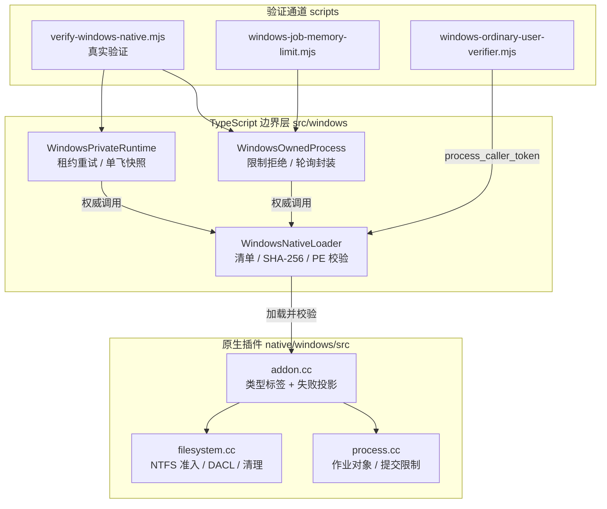

REA 在 Windows 上发布唯一一个 x64 Node-API 8 原生插件，用户既不编译它也不安装额外运行时。所有 Windows 隔离能力——重解析点安全的路径准入、私有运行时 DACL、作业对象进程所有权——都由这个打包的原生边界**证明**，而不是从 POSIX 标志、taskkill 行为或错误文本**推断**。本文面向高级开发者，剖析原生层（C++）、TypeScript 边界层与真实验证通道三层如何协作，将"Windows 控制不可用"降级为显式失败而非静默放行。

## 分层架构总览

整个 Windows 原生边界由三个层次构成：原生插件持有全部 Win32 句柄并执行安全检查；TypeScript 加载器验证工件身份后授予"权威"（authority）对象；组合层与验证脚本消费该权威并产出机器可读的能力报告。不透明 Node 对象携带原生类型标签、资源种类与关闭状态——路径字符串、序列化对象或伪造句柄都无法获得权威。

Sources: [README.md](native/windows/README.md#L1-L12), [addon.cc](native/windows/src/addon.cc#L76-L91), [WindowsNativeLoader.ts](src/windows/WindowsNativeLoader.ts#L85-L97)

原生接口刻意收窄为单一 `call(operation, arguments)` 入口：`inspect` 自检、`filesystemCall` 分派文件系统操作、`processCall` 分派进程操作。每个失败都以 `Failure` 异常携带约束名、请求路径、Win32 代码与系统消息跨越边界，TypeScript 侧永不猜测错误语义。Node-API 符号通过延迟导入解析到宿主可执行文件本身（而非 `node.exe` 文件名），使 Node.js 与 Bun 等不同宿主都能加载同一插件。

Sources: [addon.cc](native/windows/src/addon.cc#L124-L147), [addon.cc](native/windows/src/addon.cc#L183-L191), [filesystem.cc](native/windows/src/filesystem.cc#L696-L700)

## NTFS 准入：路径规范化与逐组件句柄固定

准入的第一步是 `localPath` 的强制规范化：只接受绝对本地盘符路径，拒绝备份数据流（`:` 第二次出现）、相对路径、UNC 与设备命名空间；每个组件不允许 `.`/`..`、尾点或尾空格（Windows 会静默剥除它们的拼写歧义）。随后 `GetDriveTypeW` 要求 `DRIVE_FIXED`，`GetVolumeInformationByHandleW` 要求文件系统字面量为 `NTFS` 且支持持久 ACL——非 NTFS 卷在准入阶段就被拒绝，而不是在写入时失败。

Sources: [filesystem.cc](native/windows/src/filesystem.cc#L17-L40), [filesystem.cc](native/windows/src/filesystem.cc#L74-L79)

核心反竞争机制是**逐组件句柄固定**：`openComponent` 以 `OPEN_REPARSE_POINT` 打开每个前缀，验证实际的 NTFS 对象（拒绝重解析点、校验目录/文件类型、确认 `FILE_TYPE_DISK`），并把每个句柄保留在 `File.handles` 中。一旦下一个组件被钉住（防删除共享），其父目录就不可能变空，NTFS 也无法把该父目录原地转换为重解析点——这一否认是通过独立证据确立的：`processBoundary.cc` 固定装置对非空被钉住的祖先尝试 `FSCTL_SET_REPARSE_POINT` 并观察到拒绝。

Sources: [filesystem.cc](native/windows/src/filesystem.cc#L42-L62), [filesystem.cc](native/windows/src/filesystem.cc#L80-L98), [README.md](native/windows/README.md#L17-L20)

被准入对象的身份以**双重坐标**保留：`requestedPath`（原始请求拼写）与 `finalPath`（句柄归一化路径）分开记录，加上卷序列号、128 位文件 ID、大小与目录标志。普通盘符路径接受反斜杠、正斜杠或混合分隔符，但分隔符翻译不解析点组件、不折叠重复分隔符——验证通道明确断言 `\\?\C:/...`、`//localhost/share/...` 与 `C:相对语法` 均被拒绝。

Sources: [filesystem.cc](native/windows/src/filesystem.cc#L102-L128), [verify-windows-native.mjs](scripts/verify-windows-native.mjs#L180-L207)

## 私有运行时：创建时安装的受保护 DACL

`Security` 结构在构造时读取当前用户 SID 与 `WinLocalSystemSid`，构建恰好两条 ACE（均为 `FILE_ALL_ACCESS`、对象与容器继承）的 DACL，并以 `SE_DACL_PROTECTED` 标记为受保护描述符。运行时根目录通过 `NtCreateFile` **相对于已准入的父句柄**以 `FILE_CREATE` 语义创建——创建即证明所有权，DACL 在创建调用中原子安装，而非创建后修补。

Sources: [filesystem.cc](native/windows/src/filesystem.cc#L130-L159), [filesystem.cc](native/windows/src/filesystem.cc#L161-L185)

创建后 `verifyPrivate` 按句柄读回安全描述符做独立验证：所有者必须是当前用户；根要求 DACL 受保护；ACE 计数必须恰好为 2；任何非当前用户/SYSTEM 的受托人都触发"私有 DACL 允许了无关主体"失败。子目录与私有文件继承同一边界，每个都按句柄复查。读回检查同时被真实验证通道用 PowerShell `Get-Acl` 从进程外部交叉确认。

Sources: [filesystem.cc](native/windows/src/filesystem.cc#L234-L267), [verify-windows-native.mjs](scripts/verify-windows-native.mjs#L363-L398)

清理是**句柄式遍历**而非路径遍历：`closeRuntime` 从保留的目录句柄枚举子项，对每个子项以 `FILE_OPEN_REPARSE_POINT` 相对打开——重解析条目被卸载链接而不穿越其目标；只读属性先被清除（父根句柄特意携带属性写访问以支持这一点），然后通过 `FileDispositionInfo` 按句柄删除。验证通道在运行时外部制造 junction 与哨兵文件，断言清理删除了运行时全部内容、保留哨兵、且从未穿越 junction。

Sources: [filesystem.cc](native/windows/src/filesystem.cc#L507-L587), [verify-windows-native.mjs](scripts/verify-windows-native.mjs#L699-L718)

失败清理与重试语义有精确的契约：准入失败若发生在运行时目录创建之前，失败对象携带 `runtimeDirectoryUnallocated = true` 的肯定性证明，TypeScript 层将其投影为 `runtimeAllocation: "not-started"`；只有该证明加上 Win32 共享/锁代码 32/33 才构成可重试的 `PrivateRuntimeRootUnavailableError`。清理失败则保留根句柄与祖先租约供重试——TypeScript 包装器只对 32/33 代码做最多 10 次、间隔 100 毫秒的自动重试，其他错误立即定案，耗尽预算后运行时保持为仅接受显式 close 的状态。

Sources: [filesystem.cc](native/windows/src/filesystem.cc#L187-L208), [filesystem.cc](native/windows/src/filesystem.cc#L363-L402), [WindowsPrivateRuntime.ts](src/windows/WindowsPrivateRuntime.ts#L199-L215)

快照流经 64 KiB 缓冲区在 Node 异步工作线程上执行，每次读取之间检查取消标志，SHA-256 摘要提交到实际写入的字节，完成的快照句柄保持打开（拒绝写入、替换与删除）。快照所有权按运行时**单飞**：原生层在取得取消所有权之前用 `ERROR_BUSY` 拒绝重叠请求，TypeScript 层只记录被接受的 promise 与中止监听器——中止一个被拒绝的请求绝不会取消正在进行的拷贝。该性质在验证通道中被直接演练：先接受快照再中止第二个请求，断言第二个以 `ERROR_BUSY` 失败且未产生残留文件。

Sources: [filesystem.cc](native/windows/src/filesystem.cc#L603-L694), [WindowsPrivateRuntime.ts](src/windows/WindowsPrivateRuntime.ts#L87-L113), [verify-windows-native.mjs](scripts/verify-windows-native.mjs#L273-L303)

## 作业对象：原子加入、kill-on-close 与提交内存限制

进程所有权的关键设计是**原子作业加入**：子进程以 `CREATE_SUSPENDED` 创建，`PROC_THREAD_ATTRIBUTE_JOB_LIST` 让它在第一声啼哭时就属于一个未命名的、不可继承的作业对象——不存在可被观察或竞争的"未加入"窗口。恢复执行前，`IsProcessInJob` 读回验证成员资格；验证失败则 `TerminateJobObject` 并抛出。策略读回必须与请求的标志完全一致，任何意外的 breakaway 权限都以 `ERROR_ACCESS_DENIED` 拒绝。

Sources: [process.cc](native/windows/src/process.cc#L24-L41), [process.cc](native/windows/src/process.cc#L113-L117), [process.cc](native/windows/src/process.cc#L207-L213)

kill-on-close 语义构成崩溃安全：所有者进程死亡时 Windows 自动终止作业全部成员，包括分离的孙后代。验证通道构建三层分离后代树（各自写出 PID），断言 `process_terminate` 后所有成员死亡而无关进程存活；再断言 `process_close`（关闭作业句柄）本身即足以杀死所有者子进程——不使用任何 PID 枚举。

Sources: [process.cc](native/windows/src/process.cc#L447-L453), [verify-windows-native.mjs](scripts/verify-windows-native.mjs#L719-L773)

提交内存限制是较新的控制，其准入规则严于直觉：限制必须是正的、页对齐的安全整数，`0`、负数、小数、`2^53`、`NaN`、字符串与未对齐值全部在**任何进程创建之前**以 `ERROR_INVALID_PARAMETER` 失败。选择 `JOB_OBJECT_LIMIT_JOB_MEMORY`（作业提交限制）而非 V8 堆标志的原因是根本性的：外部 `Buffer.alloc` 分配发生在 V8 堆之外，Bun 1.4.2 又忽略 `--max-old-space-size`，只有作业级提交限制能约束这类子进程。

Sources: [process.cc](native/windows/src/process.cc#L56-L69), [windows-job-memory-limit.mjs](scripts/lib/windows-job-memory-limit.mjs#L5-L14)

| 维度 | V8 堆标志 | 作业对象提交限制 |
| --- | --- | --- |
| 覆盖范围 | 仅 JavaScript 堆 | 整个进程树的全部提交内存 |
| Bun 1.4.2 | 被忽略 | 有效 |
| 外部 Buffer 分配 | 不可约束 | 可约束（验证用例即此） |
| 失败信号 | 进程内 OOM 异常 | 完成端口通知，粘性记录 |
| 越限退出码 | 因运行时而异（1 或 3） | 调用方按通知分类，不猜退出码 |

限制生效还需要**通知端口先行**：私有的 I/O 完成端口在任何进程加入前与作业关联，保证提交限制通知不可能丢失。每次 `process_poll` 以零超时排空端口，`JOB_OBJECT_MSG_JOB_MEMORY_LIMIT` 到达即置粘性 `memoryLimitReached`；排空在检查退出之前执行一次、观察到退出之后再执行一次，使两次排空之间发生的内存失败仍出现在第一份退出报告里。`peakJobMemoryBytes` 与限制通知一同报告，验证通道断言峰值不超出限制太多（内核计费允许数 MiB 超冲）且确实越过了限制。

Sources: [process.cc](native/windows/src/process.cc#L43-L54), [process.cc](native/windows/src/process.cc#L256-L274), [process.cc](native/windows/src/process.cc#L417-L439), [windows-job-memory-limit.mjs](scripts/lib/windows-job-memory-limit.mjs#L48-L77)

能力协商采取**拒绝而非降级**：`WindowsOwnedProcess` 构造函数在工件自检缺少 `jobMemoryLimit` 或 `protocolStdin` 时直接抛错，而不是启动一个无限制进程。这是安全边界的关键不对称——缺少控制时宁可失败，也绝不提供未经验证的弱化版本。

Sources: [WindowsOwnedProcess.ts](src/windows/WindowsOwnedProcess.ts#L70-L87)

进程生成还处理三类 Windows 特有的语义保真：环境变量按 Windows 序数比较（非区域排序、非 JavaScript 展开式大写转换）排序去重，重复名保留调用方最后一个值；挂起的子进程默认文件所有者被规范化为当前用户（提权令牌可能默认归属 Administrators），但调用方令牌本身不被修改；CPU 亲和性仅在调用方与子进程共享处理器组时保留，刻意的更窄掩码若无法在子进程组内表达则拒绝生成而非静默放宽。每组语义都有 `processBoundary.cc` 固定装置的独立观察证据。

Sources: [process.cc](native/windows/src/process.cc#L125-L158), [process.cc](native/windows/src/process.cc#L168-L206), [verify-windows-native.mjs](scripts/verify-windows-native.mjs#L809-L860)

## 加载器信任链：无环境覆盖的工件验证

加载器在调用原生插件之前执行完整的身份链：平台与架构检查（win32/x64 之外以 `failureStage: "host"` 失败）、Node-API 版本下限（8）、清单的严格 Zod 解析（包版本、平台、架构、ABI 版本 1、Node-API 8、工件名、SHA-256）、清单版本与 `package.json` 一致性、工件字节的 SHA-256 摘要匹配、以及 PE 头检查（`MZ` 签名、`PE\0\0`、机器码 `0x8664`、PE32+ 可选头）。任何环境变量都不能指向替代工件——不存在绕过路径。

Sources: [WindowsNativeLoader.ts](src/windows/WindowsNativeLoader.ts#L37-L58), [WindowsNativeLoader.ts](src/windows/WindowsNativeLoader.ts#L99-L176), [README.md](native/windows/README.md#L3-L8)

加载通过后，加载器立即执行 `inspect` 自检：原生层在宿主临时目录上真实创建并清理一个探针运行时，报告文件系统身份与八项安全控制（`privateDacl`、`atomicJobAssignment`、`killOnOwnerClose`、`jobMemoryLimit` 等），TypeScript 层以严格模式解析——缺失或多余的字段都会以 `failureStage: "inspection"` 失败。失败分类决定重试语义：只有原生调用自身失败（self-test 阶段）才可重试，系统化缓存的稳定准入让后续查询免于重复加载。

Sources: [process.cc](native/windows/src/process.cc#L457-L497), [WindowsNativeLoader.ts](src/windows/WindowsNativeLoader.ts#L47-L58), [WindowsNativeLoader.ts](src/windows/WindowsNativeLoader.ts#L122-L141)

能力报告层把加载结果转换为三种命名控制的可用性声明：`job_object_process_ownership`、`private_runtime_dacl`、`reparse_safe_path_admission`。每项要么以 `proof: "native-authority"` 可用，要么携带失败阶段、机器可读代码（`unsupported_host` / `runtime_missing` / `runtime_unavailable`）、重试标记与修复指引。诊断（`rea doctor`）与安全控制共享同一观察，避免两套事实来源。与之并列的 `probeWindowsCapabilities` 明确区分"命名前提探测"（符号链接创建、PTY 等）与"安全控制"：Windows 上的 Node `O_NOFOLLOW` 被显式标注为"不是 Windows 句柄权威"，防止探测结果被误读为隔离能力。

Sources: [WindowsAuthority.ts](src/process/WindowsAuthority.ts#L23-L42), [WindowsAuthority.ts](src/windows/../process/WindowsAuthority.ts#L44-L124), [WindowsCapabilities.ts](src/application/WindowsCapabilities.ts#L89-L102)

## 普通用户权限验证：从令牌观察到验证器门禁

原生边界提供一个专门的 `process_caller_token` 观察操作，读取五项令牌事实：`elevated`（提权状态）、`administrator`（管理员组成员身份，经由 `SecurityIdentification` 模拟令牌的 `CheckTokenMembership`）、`integrityLevel`（完整性级别 SID 子权限）、`defaultOwnerIsUser`（默认所有者 SID 等于用户 SID）与 `inJob`（调用方自身是否已在作业中）。这个观察是普通用户验证的原语——所有判定都来自内核令牌，而非环境变量或启发式。

Sources: [process.cc](native/windows/src/process.cc#L276-L307), [process.cc](native/windows/src/process.cc#L384-L388)

验证器门禁 `assertOrdinaryWindowsVerifierCaller` 要求 `administrator === false` 且 `elevated === false`，失败消息保留完整性级别并明确拒绝自行更改调用方权限。`requireOrdinaryWindowsVerifierCaller` 在任何 Windows 浏览器固定装置分配资源之前调用它，确保真实浏览器验证通道（`real-browser` 等工作流）在标准用户会话中运行——提权会话中的"验证通过"不能证明普通用户也能通过。

Sources: [windows-ordinary-user-verifier.mjs](scripts/lib/windows-ordinary-user-verifier.mjs#L1-L41)

开发者在提权 shell 中调试时，测试专用的 `nonAdminRunner.cc` 提供受控降级：它复制同一用户现有的非提权 Explorer 令牌，创建私有窗口站对象，并在 kill-on-close 固定作业内启动测试。它不创建账户、不修改主机策略、不改变调用方令牌。README 明确要求：真实提供者声明还必须在那个普通用户令牌上额外验证打包的 CLI 与 MCP。

Sources: [README.md](native/windows/README.md#L221-L228), [verify-windows-native.mjs](scripts/verify-windows-native.mjs#L823-L838)

## 真实验证通道：P0 级别的证据矩阵

`npm run verify:windows-native` 在真实 Windows x64 主机上运行约 950 行的验证脚本，覆盖从加载器到进程语义的完整矩阵。可选的第二个参数指向 `processBoundary.cc` 编译产物，启用需要独立可执行文件的用例：针对被钉住非空祖先的原地重解析转换尝试、breakaway 拒绝、令牌/环境语义观察。能力通道（`ci.yml`）与真实 Ghidra 证明通道（`real-ghidra-windows.yml`）都在同一 MinGW 作业中交叉编译该固定装置。

Sources: [README.md](native/windows/README.md#L195-L228), [verify-windows-native.mjs](scripts/verify-windows-native.mjs#L306-L345)

| 控制类别 | 验证用例（节选） | 断言要点 |
| --- | --- | --- |
| 路径准入 | 混合分隔符、`..`、备份数据流、UNC、junction | 前两者接受（身份等价），其余拒绝 |
| DACL | PowerShell 外部 `Get-Acl` 交叉读回 | 受保护、恰好 2 条 ACE、仅用户+SYSTEM |
| 快照不可变性 | 写入/重命名/删除已完成快照 | 全部拒绝，句柄持有期间内容不变 |
| 清理遏制 | junction 哨兵、只读属性、外部删除共享持有者 | 不穿越、清除只读、共享冲突重试 |
| 进程所有权 | 三层分离后代树 + 无关进程 | 全体终止、无关进程存活 |
| 内存限制 | 128 MiB 限制 + 64×16 MiB 外部 Buffer | 通知粘性、第一份退出报告含通知 |

Sources: [verify-windows-native.mjs](scripts/verify-windows-native.mjs#L346-L444), [verify-windows-native.mjs](scripts/verify-windows-native.mjs#L560-L659), [verify-windows-native.mjs](scripts/verify-windows-native.mjs#L719-L781)

清理重试用两个互补场景验证：前者（`cleanupFailureRetainsOwnershipForRetry`）让外部 PowerShell 持有者拒绝删除共享，断言第一次 close 以 `win32Code: 32` 失败但运行时仍在注册表中、写入被"cleanup is pending"拒绝、持有者释放后重试成功；后者（`cleanupTransientConflictRetries`）保持持有者不释放，断言 close 承诺在事件循环一转后仍未结算——证明自动重试在等待而非立即失败。

Sources: [verify-windows-native.mjs](scripts/verify-windows-native.mjs#L558-L659)

CI 另行构建一个**仅测试用**的工件（`--inspection-fixture`），注入访问拒绝处置结果：拒绝创建后验证与回滚，验证保留的所有权、后续准入的恢复、成功检查的缓存与环境拆除时的清理，甚至重命名被保留的探针并在旧路径重建目录，检查清理删除的是被拥有的 inode 而非顶替目录。该固定装置存放于 `.cache/` 且不随包发布。

Sources: [README.md](native/windows/README.md#L136-L152), [verify-windows-native-inspection.mjs](scripts/verify-windows-native-inspection.mjs)

组合层的命令所有权将边界暴露给其余代码库：`createWindowsOwnedCommand` 固定 cross-spawn 的解析与 cmd-shim 边界作为唯一兼容耦合点，把 PATH 解析结果转换为原生边界要求的绝对应用路径；`superviseWindowsOwnedProcess` 以保活重试计时器监督精确的 Job Object 关闭事件，清理失败按诊断回调上报但保持重试，直到作业真正关闭。

Sources: [windows-owned-command.mjs](scripts/lib/windows-owned-command.mjs#L17-L52), [windows-owned-command.mjs](scripts/lib/windows-owned-command.mjs#L54-L174)

## 边界声明：已验证范围之外的诚实清单

文档显式列出未验证范围：SUBST 盘符别名与变化的 DOS 设备命名空间不在已验证 P0 范围内，不会被识别为独立别名策略；报告重解析标签的挂载文件夹路径会被组件准入拒绝，但更广泛的命名空间变体仍未验证；Android 提供者的分离工作区助手提供了独立清理所有者，但助手死亡或断电仍可能留下私有文件—— abrupt 所有者死亡会杀死作业，却无法运行句柄遍历式清理。请求坐标与最终句柄坐标必须保持为两个身份，不可合并。

Sources: [README.md](native/windows/README.md#L97-L106), [README.md](native/windows/README.md#L63-L66)

错误保留是全链路契约：Windows 失败保留约束名、请求坐标、Win32 代码与系统消息；不支持文件系统/重解析路径与操作系统访问拒绝、缺失打包控制是**不同的错误类别**。分析错误沿 JavaScript、source-map 与 WABT 工作流传播生产者的重试处置——瞬态失败报告 `category: unavailable` 并保留原始原因；不完整清理阻止操作重试直至其拥有的资源结算；关闭阶段重试独立于分配与分析重试，只重复既有的清理操作，绝不重启提供者工作或创建新运行时。

Sources: [README.md](native/windows/README.md#L74-L96)

## 结语与延伸阅读

Windows 原生边界的架构立场可以压缩为一句话：**安全控制必须被证明，绝不能被推断**。NTFS 准入以逐组件句柄固定对抗文件系统竞争；作业对象以原子加入与完成端口通知对抗进程逃逸与内存失控；普通用户验证以内核令牌观察对抗提权会话中的假阳性。三层（原生检查、TS 校验、真实验证）共同保证任何控制缺失都表现为显式、可重试分类、携带修复指引的失败。

理解了 Windows 边界之后，建议沿目录继续：[进程所有权与生命周期监督：私有运行时、截止时间与清理重试](25-jin-cheng-suo-you-quan-yu-sheng-ming-zhou-qi-jian-du-si-you-yun-xing-shi-jie-zhi-shi-jian-yu-qing-li-zhong-shi) 提供跨平台的进程所有权总图；[测试策略与验证通道：源码、边界、验收、一致性及真实工具链通道](27-ce-shi-ce-lue-yu-yan-zheng-tong-dao-yuan-ma-bian-jie-yan-shou-zhi-xing-ji-zhen-shi-gong-ju-lian-tong-dao) 解释本文验证通道在整个测试体系中的位置；而 [分层架构总览：入口、组合、应用、提供者与领域层的依赖规则](5-fen-ceng-jia-gou-zong-lan-ru-kou-zu-he-ying-yong-ti-gong-zhe-yu-ling-yu-ceng-de-yi-lai-gui-ze) 说明为何原生边界被隔离在最小接口之后。