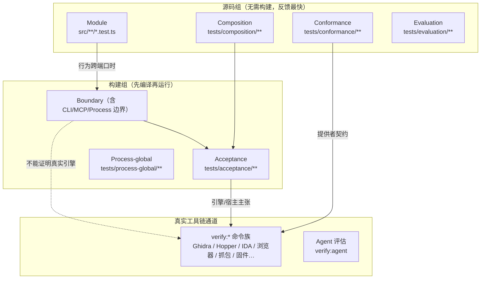
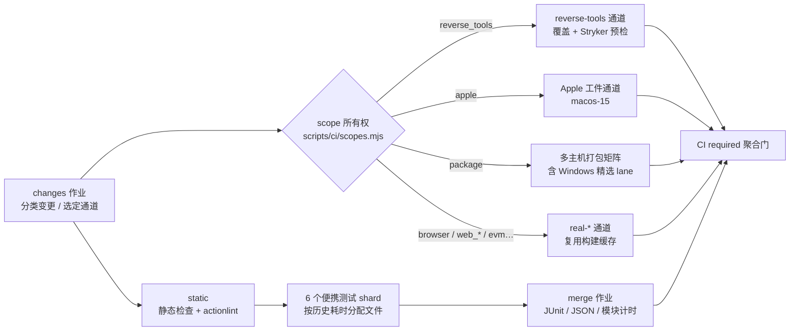

REA 的测试体系建立在一个核心前提上：**不同类型的证据不能互相替代**。一条通过的单元测试不能证明真实 Ghidra 引擎上的行为，一条真实工具链验证的通过也不能替代取消/清理语义的确定性回归。本页面向中级开发者，梳理该仓库的验证通道全景——从编辑时的源码反馈、边界与验收测试、一致性契约，到 CI 双档位与 `verify:*` 真实工具链通道——并说明"什么变更应该用哪条通道来证明"。

## 分层验证模型：行为深度决定主张强度

REA 用"行为深度"（Behavioral Depths）刻画每条测试通道能证明什么：位于 `src/**/*.test.ts` 的模块测试只证明单个领域/服务/适配器经其窄公共表面的行为；`tests/composition/**` 组装提供者中立的会话与注册表但不跨越生产文件系统；`tests/boundary/**` 精确跨越一个生产边界（文件系统、进程、网络、浏览器、CLI 或提供者）；只有 `tests/acceptance/**` 会组装完整运行时或调用编译后的产品表面；`tests/conformance/**` 验证按声明能力参数化的共享提供者契约；`tests/evaluation/**` 则只覆盖确定性评估器的解析、评分与报告生成。

| 深度 | 位置 | 能证明什么 |
| --- | --- | --- |
| Module | `src/**/*.test.ts` | 单个领域、服务或适配器经其窄公共表面的语义 |
| Composition | `tests/composition/**` | 提供者中立的会话与注册表装配；文件系统访问仅限夹具物化 |
| Boundary | `tests/boundary/**` | 恰好一个生产文件系统/进程/网络/浏览器/CLI/提供者边界 |
| MCP boundary | `tests/boundary/mcp/**` | MCP 传输与工具契约边界，隔离会话与显式清理 |
| Acceptance | `tests/acceptance/**` | 编译后 CLI 或 MCP 的完整旅程；注入提供者仍属集成测试 |
| Conformance | `tests/conformance/**` | 共享提供者契约，按声明能力与显式豁免参数化 |
| Evaluation | `tests/evaluation/**` | 确定性评估器的解析、评分与报告生成 |

Sources: [testing.md](docs/testing.md#L331-L341)

深度之间存在严格的攀登规则：同域共置测试只能向内依赖其所属领域，不得构造会话/服务器，也不得启动子进程或网络监听；边界测试只跨越一个生产边界；只有验收测试组装完整运行时。这意味着**注入了假提供者的验收用例证明的是那个集成边界，而不是真实提供者行为**——真实 Hopper、Ghidra、IDA、浏览器与受管代码主张一律归属显式的 `npm run verify:*` 通道，"缺失引擎不算通过"。

Sources: [testing.md](docs/testing.md#L343-L350)、[testing.md](docs/testing.md#L353-L359)

图中自上而下是证据强度的递增：源码组给出快速语义反馈，构建组验证装配与真实边界，最右侧的真实通道才能为引擎适配主张背书。虚线强调本体系反复重申的约束——边界测试**不**建立真实提供者覆盖。

Sources: [testing.md](docs/testing.md#L331-L350)

## Vitest 测试项目：源码组与构建组

测试文件的归属由 `scripts/lib/test-projects.mjs` 单点定义，该清单同时被 Vitest、CI 分组执行与开发期测试规划三方共享。**源码组**（`domain`、`services`、`adapters`、`composition`、`conformance`、`evaluation`）无需编译产物即可运行，对应 `test:fast` 的"无构建前置"承诺；**构建组**（`boundary`、`cli-boundary`、`process-boundary`、`mcp-boundary`、`acceptance`、`process-global`）依赖 `dist/` 编译输出。`projectForTest` 函数要求每个测试路径恰好被一个项目拥有，归属为零或多个都会直接抛错——这杜绝了"测试文件漂移进错误项目"的静默劣化。

Sources: [test-projects.mjs](scripts/lib/test-projects.mjs#L5-L70)、[test-projects.mjs](scripts/lib/test-projects.mjs#L76-L108)

每个项目都有显式的执行策略。纯领域/服务、composition、conformance 与 evaluation 项目共享不可变模块图（`isolate: false`）以省去逐文件启动成本，因为这些测试不触碰进程级全局状态、清理都在测试作用域内完成；adapter、boundary、acceptance、process-global 保持逐文件隔离；`cli-boundary` 复用命令图但对 V8 旧生代设置 384 MiB（覆盖率时 512 MiB）的**实测容量上限**——被覆盖的 ADB 夹具会耗尽普通预算，这不是全仓加速声明；`process-boundary` 因进程树采样共享宿主资源而整个 lane 串行并延后执行。

| 项目 | 池 | 隔离 | 特殊控制 |
| --- | --- | --- | --- |
| domain / services / composition / conformance / evaluation | threads | 共享模块图 | 无进程全局状态，测试级清理 |
| adapters / boundary / acceptance / process-global | forks | 逐文件 | 隔离环境与退出状态 |
| cli-boundary | forks | 共享命令图 | `--max-old-space-size=384/512`（覆盖率） |
| process-boundary | forks | 逐文件 | `fileParallelism: false`，`groupOrder: 1` |
| mcp-boundary | threads | 共享服务端图 | 每文件创建并关闭显式 MCP 会话 |

全局层面，worker 数被钳制在 `min(2, availableParallelism())`，边界测试超时 30 秒（覆盖率时 60 秒），`retry: 0`——失败不会隐藏。自定义 runner `tests/processOwnershipRunner.ts` 保证测试进程的所有权语义；CLI/MCP 的模块 mock 必须放进 `tests/process-global/` 以维持逐文件隔离，因为共享模块图的项目里后导入的消费者无法被先前的模块 mock 替换。

Sources: [vitest.config.ts](vitest.config.ts#L27-L76)、[testing.md](docs/testing.md#L88-L99)、[testing.md](docs/testing.md#L101-L119)、[vitest.config.ts](vitest.config.ts#L150-L165)

## 开发者命令与反馈循环

日常迭代遵循"源码反馈 → 显式边界 → 合并前完整 CI 证据"的三段节奏。`test:local` 通过导入图运行脏源码测试（显式给出的路径无论 Git 状态如何都会执行）；`test:focused` 只接受精确存在的仓库相对路径，未匹配路径直接失败，且编译型边界会先构建；`test:changed` 基于 `origin/main` 合并基选取受影响测试，支持 `--dry-run` 只报告选定的基线、范围与构建前置而不执行。

| 命令 | 范围 |
| --- | --- |
| `npm run test:local` | 经导入图的脏源码测试，无构建；显式路径无视 Git 状态 |
| `npm run test:focused -- PATH...` | 精确既有测试文件；编译边界先构建，未匹配路径失败 |
| `npm run test:changed` | 自 `origin/main` 合并基以来受影响的源码测试 |
| `npm run test:fast` | 全部源码组项目，无构建 |
| `npm run test:boundary` | boundary、cli/mcp/process 边界与 process-global 项目 |
| `npm run test:acceptance` | 编译后 CLI 与 MCP 验收工作流 |
| `npm run test:python` | LLDB/mitmproxy 生产者契约与效率检查（无需真实调试器） |
| `npm run check:pr` | 可选完整本地确定性门 + 生成文档检查 |

Sources: [testing.md](docs/testing.md#L8-L27)、[run-development-tests.mjs](scripts/run-development-tests.mjs#L23-L40)

两组语义约束必须记住。其一，**变更选择的盲区**：导入图看不到运行时注册、生成数据、shell 入口、桥接等关系，"空选择"意味着"没有测试被选中"而非"正确性已被验证"，跨端口的语义应显式补充相关边界文件与真实提供者通道。其二，**先前通过不等于当前验证**：仓库文件不能完整描述已安装工具内容与宿主状态，`test:run` 因此永远真实执行、不受 Turbo 缓存影响；交付 PR 前运行 `npm run check` 与生成文档检查，打包/安装类变更额外需要 `verify:package`，提供者变更需要实际提供者证据。

Sources: [testing.md](docs/testing.md#L38-L69)、[testing.md](docs/testing.md#L125-L132)、[test-group.mjs](scripts/ci/test-group.mjs#L13-L23)

## 为变更选择验证通道

`docs/testing.md` 给出一张"变更→首次检查→补充覆盖"的决策表：源码语义用 `test:local`，CLI/MCP 工作流用 `test:focused` 加真实公共调用，引擎适配器走对应的真实提供者通道，客户端配置/模式转换走原生客户端通道，代理调查质量走代理评估。核心纪律是：**注入式提供者只能证明集成边界，有真实引擎主张时必须补跑真实通道**。

| 变更或主张 | 首次检查 | 补充覆盖 |
| --- | --- | --- |
| 源码语义 | `npm run test:local -- PATH...` | 行为跨端口时补充相关边界用例 |
| CLI/MCP 工作流 | `npm run test:focused -- PATH...` | 实际公共调用；注入提供者范围有限 |
| 文档或生成元数据 | `npm run docs:check` | `docs:build` 检查渲染页面与链接 |
| 引擎适配器 | 下文对应 `verify:*` 通道 | 宿主、版本、目标身份与自有清理 |
| 代理调查质量 | Agent 评估 | 审查转写与场景化证据 |

Sources: [testing.md](docs/testing.md#L160-L169)

对资源获取、就绪、取消与清理类的变更，还有一份生命周期回归场景矩阵，逐场景规定断言与控制：例如"取消在工作负载退出后、结果读取或临时根移除期间到达"时，必须返回带部分观察与真实清理状态的类型化取消，且非中止对照组必须成功；"子进程健康/清理结果混合"时，缺失的对等健康不能抹去已观察到的失败；"清理在成功或主失败之后失败"时，公共输出必须保留完成的观察或主诊断与恢复动作。测试设计上优先真实公共 CLI/MCP 工作流，其次生产边界集成，再次来自真实生产者的黄金记录；修剪镜像实现细节的测试前必须先指认替代场景与断言，畸形格式、取消、清理、权限、容量、目标身份等独特回归必须保留。

Sources: [testing.md](docs/testing.md#L207-L222)、[testing.md](docs/testing.md#L171-L195)

仓库还将代表性回归固化为链路：进程清理期 SIGINT、迟到的已认证清理、LLDB 启动与终结、组合子进程所有权、公共 CLI 清理拒绝。这些受控探针**不**替代匹配的真实提供者通道——记录基线失败、通过的对照、精确宿主/提供者、已验证清理与不可得覆盖，缺引擎记为缺失而非通过。

Sources: [testing.md](docs/testing.md#L321-L329)

## CI 通道选择与双档位

CI 的入口是 `changes` 分类作业：`scripts/ci/plan.mjs` 依据 `scripts/ci/scopes.mjs` 的所有权表为每个作用域（`reverse_tools`、`apple`、`package`、`sqlite`、`browser`、`web_*`、`ghidra_bridge` 等）输出显式的 `true`/`false`，无主运行时代码回退到 Linux 套件加 Linux x64 安装包/Inspector 基线。显式布尔化是刻意的——`CI required` 聚合检查要求每个规范作用域非真即假，不完整的分类不能静默省略验证通道；分支保护应要求该聚合、`Static checks`、`Portable tests` 与 `Conventional PR title` 四项检查。

Sources: [ci.yml](.github/workflows/ci.yml#L33-L50)、[scopes.mjs](scripts/ci/scopes.mjs#L1-L8)、[testing.md](docs/testing.md#L1226-L1250)

档位分为两档：**快速反馈**（普通 PR 与 main 推送）运行全部六个便携 shard 但不做覆盖插桩，PR 矩阵首败即取消其余 shard；**全资格**（计划任务、手动派发、`ci:full` 标签、发布资格）保留每个 shard 的结果、强制聚合覆盖率阈值，并纳入所有原生宿主。计划资格每小时在第 23 分钟准入，每天 03:23 UTC 强制全量运行以刷新漂移；其余小时运行可复用 24 小时内同一默认分支可信 CI 产生的同源 SHA 全资格回执——过期、失败、来源不明或 API 查找失败都会回退到完整验证。原生基线覆盖五个托管 Runner：Linux x64/arm64、macOS arm64/x64 与 Windows x64，其中 macOS x64 因最慢而在普通 PR 中省略，其回归留在全资格档暴露。

Sources: [testing.md](docs/testing.md#L1201-L1224)、[testing.md](docs/testing.md#L1252-L1275)

测试分片按历史耗时分配文件（含钩子、worker 准备、环境、导入等阶段的模块计时），新文件使用确定性回退权重；只有成功完成的全档合并才发布 `test-timings` 工件供后续分片使用，缺失或不可用历史回退到 Vitest 默认分配。提供者工作流（`real-browser`、`real-web-runtime`、`real-binary-layout`、`real-evm-interface`、`real-javascript-recovery`、`real-recorded-crash` 等八个自动 lane）在构建与静态作业成功后下载 `rea-build-cache` 工件复用可移植编译输出，但其构建命令仍会校验任务哈希、提供者观察永远执行——这消除了重复编译，却把构建变成前置：构建延迟会延迟提供者准入，文档明确要求在宣称端到端加速前先比较排队与执行时间。

Sources: [testing.md](docs/testing.md#L1288-L1300)、[testing.md](docs/testing.md#L1300-L1320)、[real-browser.yml](.github/workflows/real-browser.yml#L1-L39)、[real-ghidra-windows.yml](.github/workflows/real-ghidra-windows.yml#L1-L12)

文档专属 PR（仅触碰 `README*`、`docs/`、`AGENTS.md` 等）只运行格式化与生成文档校验，不含源码测试 shard 与原生包 lane；普通 PR 还会产出**观察性**测试选择计划（候选叶适配器所有权表位于 `scripts/ci/test-selection.mjs`），六个 shard 仍执行完整套件，合并作业只是把"提议省略"与实际模块结果对比后保留报告——在完成代表性全量对比与反馈收益度量之前，不存在自动晋升为真实省略的路径。这是典型的"以观察数据驱动优化、不靠未证实的收益声明"做法。

Sources: [testing.md](docs/testing.md#L908-L999)

## 覆盖率门槛与突变测试

覆盖率由 CI 负责，阈值在 `vitest.config.ts` 中按 glob 显式维护且从不自动更新：全局 65/60/60/68（语句/分支/函数/行），`src/domain/**` 提高到 80/75/75/80，`src/contracts/**` 最高 85/80/80/85；分片模式下阈值为零（由合并作业统一汇总）。覆盖率不替代具名的边界场景或真实提供者场景——它是下限而非证据本体。

| 范围 | 语句 | 分支 | 函数 | 行 |
| --- | --- | --- | --- | --- |
| 全局 | 65 | 60 | 60 | 68 |
| `src/domain/**` | 80 | 75 | 75 | 80 |
| `src/contracts/**` | 85 | 80 | 80 | 85 |

Sources: [vitest.config.ts](vitest.config.ts#L112-L148)

突变测试聚焦反向工程工具链（`reverse_tools` 作用域）：Stryker 以 TypeScript 检查器按命名语法属主（方法、守卫、声明、try、表达式）生成突变目标，无手工维护的行号区间，缺失/歧义/畸形目标会让配置在生成突变前失败。必需 CI 保留新鲜的反向工具覆盖，并用 `--dryRunOnly` 预检两份规范 Stryker 配置——预检会解析目标、插桩源码并执行真实初始测试，但不执行任何突变体；单独的 **Mutation sweep** 工作流每日与手动派发时以两个隔离作业运行完整配置，属于发布门之外的维护检查。两轮通过分别写出 `reverse-tools` 与 `reverse-tools-semantics` 的 JSON/HTML 报告，成功 sweep 要求两个作业与其非空报告同时成立。

Sources: [testing.md](docs/testing.md#L406-L434)、[stryker.config.mjs](stryker.config.mjs#L1-L28)

## 真实工具链验证通道

真实通道有一条铁律：**每条 `verify:*` 命令只允许要求证明其声明所需的主机工具**。用宿主原生夹具做宿主/提供者验收，可选的跨目标格式或平台专属运行器放进独立命令；昂贵工作开始前先检查前置条件，失败消息必须点名缺失的命令、目标与 lane；lane 不得暗示被跳过的宿主或目标已被覆盖。提供者准入接受 Ghidra 12.1.x 与该安装声明的 JDK 区间，但下列通道仍在已验证的 Ghidra 12.1.4 + JDK 21 组合上证明行为。

Sources: [testing.md](docs/testing.md#L577-L600)

以 Ghidra 家族为例，每条 lane 都声明了精确的运行器/目标与本地工具前置：

| Ghidra 通道 | 运行器/目标 | 额外本地工具 |
| --- | --- | --- |
| `verify:ghidra` | Linux x64/arm64 ELF 或 macOS x64/arm64 Mach-O | 宿主 C 编译器、Ghidra 12.1.4、完整 JDK 21 |
| `verify:ghidra:seeds` | POSIX；raw x86 夹具；种子顺序/BSS 标签 | Ghidra 12.1.4 + JDK 21 |
| `verify:ghidra:swift` | macOS x64/arm64 Mach-O | 宿主 Swift 编译器 + Ghidra/JDK |
| `verify:ghidra:riscv` | RV32/RV64 ELF 经 CLI 与 MCP | RISC-V Clang、LLD、LLVM readelf |
| `verify:ghidra:switch` | Linux x64 ELF；GCC/Clang 优化剥离夹具 | GCC、Clang、GNU nm/objdump/strip |
| `verify:ghidra:cross-format` | 另分析 AArch64 ELF、x86-64 PE、x86-64 Mach-O | 追加 `clang`、LLD、`lld-link` |
| `verify:ghidra:windows` | 受控 Windows x64 + 原生 x86-64 PE | Ghidra 12.1.4、JDK 21、匹配原生工件 |

Sources: [testing.md](docs/testing.md#L602-L611)

Windows 原生一致性通道 `verify:windows-native` 不需要 Ghidra 或 Java，包含作业对象提交上限控制（触限受限子进程、不触限对照、无效上限拒绝）；独立的检查夹具 lane 用 Linux 交叉编译的 `.cache/windows-native-inspection-fixture` 验证同卷重命名后保留的 NTFS 所有权、句柄式恢复、准入缓存与环境拆除清理，并明确声明它既不解释间歇性宿主故障的成因、也不替代对已交付生产工件的验证。这种"每条 lane 只主张自己证明过的东西"的措辞贯穿全部通道。

Sources: [testing.md](docs/testing.md#L625-L641)

通道目录远不止 Ghidra：`verify:android` 用固定公开 ApiDemos 夹具加 jadx-headless-mcp 0.7.1 比对真实 CLI/MCP 的包、类搜索、方法反编译与入边引用；`verify:jeb` 面向调用方自行启动的 JEB MCP 客户端；`verify:pcap` 用调用方 tshark/capinfos 校验保存的抓包；`verify:binary:layout` 用 pwntools/strace 组合编译临时源码自有 ELF 夹具并核对无损地址/名称与进程所有权释放；`verify:evm:interface` 用 solc 0.8.30 私有存储编译 Cancun 夹具核对选择子证据；`verify:recorded:crash` 以 GDB 生成录制并验证无损寄存器与陌生的 PID 哨兵拒绝；`verify:wasm:artifact` 用 WABT 1.0.42 生成并验证真实模块；`verify:agent` 则经真实本地 Codex CLI 逐场景评估调查质量（串行运行、按 `REA_AGENT_EVAL_SCENARIOS` 选择）。

| 通道 | 关键前置 | 证明边界 |
| --- | --- | --- |
| `verify:android` | Java 17+、`REA_JADX_MCP_JAR`、固定 APK | 真实 CLI/MCP 分析一致性，无需 SDK/模拟器 |
| `verify:pcap` | tshark、capinfos、已保存抓包 | 解析器对真实 Wireshark 输出的契约 |
| `verify:recorded:crash` | GCC、GDB、pwndbg 钉定版本、strace | 崩溃录制检查 + 拒绝进程附加 |
| `verify:wasm:artifact` | 绝对 `REA_WABT_BIN_DIRECTORY` | 真实模块/WAT/摘要 + 清理注入故障 |
| `verify:agent` | 本地 Codex CLI、模型选择 | 真实代理调查的确定性评分 |

Sources: [package.json](package.json#L148-L200)、[testing.md](docs/testing.md#L1500-L1607)

这些通道在仓库中的对应物是 `.github/workflows/real-*.yml` 系列：自动 lane（浏览器、二进制布局、EVM、JS 恢复、录制崩溃、Web 运行时/抓包/源映射等）由 CI 按作用域选择触发，自托管或授权引擎（如真实 Ghidra Windows E2E）保留显式触发器（`repository_dispatch`），Termux Android 浏览器烟测在模拟器设置验证期间保持手动。工作流定义本身不构成通过的 Android 覆盖——必须检查执行回执。

Sources: [testing.md](docs/testing.md#L1306-L1345)、[real-ghidra-windows.yml](.github/workflows/real-ghidra-windows.yml#L3-L12)

## 一致性夹具与验证回执

`tests/conformance/` 中的源码是一批刻意精小的语义判定物：C 夹具固定已知调用链与字符串，版本对固定新增符号/变更字符串/变更调用关系，生成的大型夹具含 1,205 个唯一命名函数与字符串以验证提供者返回完整清单，Objective-C/Swift/N-API 夹具提供无包依赖的元数据输入。`npm run verify:fixtures` 将其编译到被忽略的 `build/conformance/` 并产出哈希+工具链清单；只有源文件被版本化，生成二进制与调试信息必须留在 `build/` 下。`readiness/` 子目录则为重建就绪验证器提供源码自有的 JavaScript CLI/Electron 夹具。

Sources: [README.md](tests/conformance/README.md#L1-L36)

真实通道的产出不止于"通过/失败"：重大验证以**回执文档**形式落在 `docs/verification/`，记录基线修订、对照行为、失败→修复→复验的完整链路。例如 Electron 取消验证回执明确记载：真实 Linux Joplin 工作流保持"部分或失败"，因为进程所有权/清理无法验证；同时记录了确定性回归如何暴露"取消被最终快照后的成功替换"这一引入退化、修复提交如何保留取消类别与清理优先级、以及修复后 49 个聚焦用例全部通过——这种"保留失败边界"的记录方式正是本测试哲学的缩影。

Sources: [electron-cancellation-2026-10-16.md](docs/verification/electron-cancellation-2026-10-16.md#L1-L25)

## 小结与下一步

REA 的测试策略可以浓缩为三条相互支撑的规则：**深度声明主张**（每种测试只宣称它能证明的东西）、**单点归属**（测试文件、CI lane、验证器各有唯一属主）、**缺失即缺失**（跳过的引擎、未验证的宿主都被显式命名而不是计入通过）。日常开发中，让 `test:local`/`test:focused` 承担快速反馈，让生命周期矩阵约束资源语义变更，让 `verify:*` 通道为引擎主张背书，让 CI 双档位守住合并门。

若要继续深入，建议按以下顺序阅读：

- [证据与不确定性模型：观察、推导、推断与未知的保留语义](6-zheng-ju-yu-bu-que-ding-xing-mo-xing-guan-cha-tui-dao-tui-duan-yu-wei-zhi-de-bao-liu-yu-yi) —— 理解"Evidence"为何是断言的核心单位
- [进程所有权与生命周期监督：私有运行时、截止时间与清理重试](25-jin-cheng-suo-you-quan-yu-sheng-ming-zhou-qi-jian-du-si-you-yun-xing-shi-jie-zhi-shi-jian-yu-qing-li-zhong-shi) —— 生命周期回归矩阵所约束的生产机制
- [Ghidra 集成：临时数据库、快照生命周期与多架构语义配置](11-ghidra-ji-cheng-lin-shi-shu-ju-ku-kuai-zhao-sheng-ming-zhou-qi-yu-duo-jia-gou-yu-yi-pei-zhi) —— 最大真实通道家族的被测对象
- [贡献流程与 PR 就绪规范：问题报告、人工所有权与提交约定](28-gong-xian-liu-cheng-yu-pr-jiu-xu-gui-fan-wen-ti-bao-gao-ren-gong-suo-you-quan-yu-ti-jiao-yue-ding) —— 将上述通道要求落进交付流程