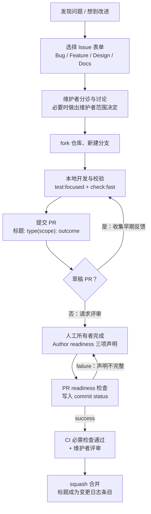
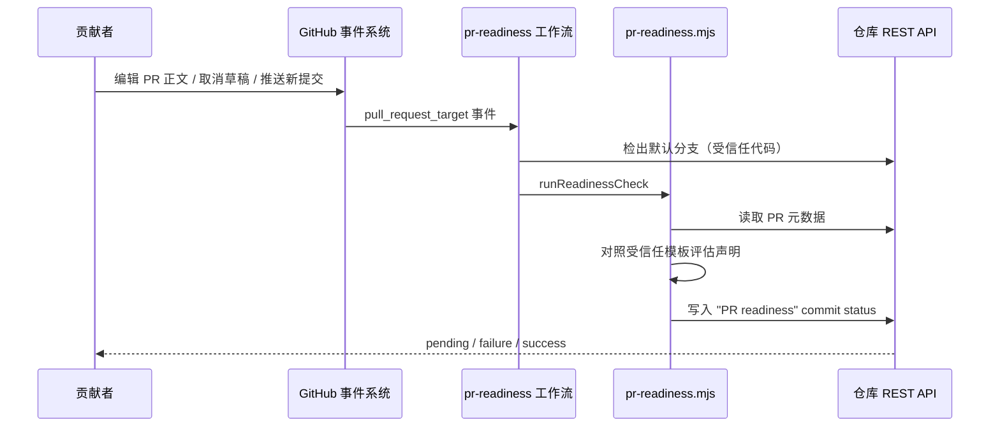

REA 是一个连接 AI 代理的逆向工程 CLI 与 MCP 服务器，它欢迎 AI 辅助的贡献，但把**责任锚定在人类身上**。本页面向首次参与贡献的开发者，完整梳理从"发现问题"到"PR 被合并"的全流程：如何选择合适的 Issue 表单报告问题、如何在 PR 中完成人工所有权声明、`PR readiness` 自动检查如何验证这些声明、PR 标题必须遵循什么提交约定，以及请求评审前应该在本地运行哪些校验命令。与测试通道选择、发布流程相关的深度内容分别由[测试策略与验证通道](27-ce-shi-ce-lue-yu-yan-zheng-tong-dao-yuan-ma-bian-jie-yan-shou-zhi-xing-ji-zhen-shi-gong-ju-lian-tong-dao)和[发布流程与文档站点](29-fa-bu-liu-cheng-yu-wen-dang-zhan-dian-release-please-sheng-cheng-mu-lu-yu-duo-yu-yan-wang-zhan)承载。

## 贡献旅程总览

一次典型的贡献会经过四个关卡：**Issue 表单**（分诊与范围讨论）、**本地校验**（Husky 钩子与选择性测试）、**PR 声明检查**（`PR readiness` commit status）、**人类评审与 CI**。其中前三个关卡都由仓库中的确定性文件驱动——Issue 表单是 `.github/ISSUE_TEMPLATE/` 下的 YAML 定义，PR 模板决定声明格式，工作流脚本对照"受信任模板"逐行校验声明。理解这条链路后，你就能在每一步预判维护者会检查什么，避免返工。

Sources: [CONTRIBUTING.md](CONTRIBUTING.md#L1-L28)

## 选择贡献：聚焦问题与维护成本意识

REA 明确欢迎聚焦的 bug 修复、文档改进、测试与逆向工程工作流；大型契约或架构变更则需要先说明预期范围并关联相关 Issue 或设计讨论。选择贡献内容时有一条朴素的经济原则：**贡献必须证明自己值得评审与维护成本**。装饰性的打磨应该与有用的修复放在一起，只有让用户指令产生混淆或错误的文档问题才值得单独修正，其余纯外观建议应收集到一个 Issue 中而不是拆成多个 PR。此外，新增或移动测试后要运行 `npm run verify:test-discovery`，解析后的导入边界则由 `npm run verify:module-boundaries`（包含在 lint 中）守卫。

不同类型的贡献还有各自的专属指南：能力组织与提供者组合要参考架构图 `docs/architecture.mermaid`（`src/composition/` 中的生产工厂只构造全新提供者，不启动引擎或获取目标）；分析工作流与代理接口要遵循 `AGENTS.md` 中的性能优先级（代理令牌 → 分析时间 → CPU/内存），成本变化时需要给出前后对比测量；新增或修改 MCP 工具时要遵循工具设计指南并保留规范契约与生成目录。这些主题的背景知识可在[分层架构总览](5-fen-ceng-jia-gou-zong-lan-ru-kou-zu-he-ying-yong-ti-gong-zhe-yu-ling-yu-ceng-de-yi-lai-gui-ze)与 [MCP 工具设计原则](7-mcp-gong-ju-she-ji-yuan-ze-liu-chong-ren-wu-xing-zhuang-yuan-yu-you-xian-yu-qi-yue-yan-ge-xing)中预先建立。

Sources: [CONTRIBUTING.md](CONTRIBUTING.md#L5-L28)

## 贡献范围与 fail-closed 集成规则

在动手写代码之前，必须理解 REA 的**产品边界**。REA 聚焦于通过通用逆向工程工作流揭示软件结构、运行时行为与证据；贡献按实际能力、副作用、默认值与完整工作流评估，工具名称或"漏洞研究/恶意软件分析/CTF"的提法不决定其归属。受支持的贡献包括格式检查、普通归档与标准压缩提取、反汇编、反编译、交叉引用、通用静态去混淆、漏洞分析与证据报告——静态的保护检测与"击破保护"是两回事。运行时调查需要显式边界：启动/附着进程、注入插桩、运行脚本、修改内存或寄存器都要经过目标选择、执行与变更权限、来源、资源限制、取消与清理的评审。

明确不集成、不分发的包括：专门用于击破商业加壳或代码虚拟化保护并自动还原受保护代码的工作流；反调试/反插桩规避，或 DRM、授权、反作弊、访问控制绕过工作流；漏洞利用或攻击载荷自动化、凭据窃取、隐蔽持久化、未授权访问或批量攻击工作流。**fail-closed 集成规则**把这条边界变成硬性闸门：若范围适配、目标或授权边界、副作用或所需验证仍有实质性未决问题，就不得合并、启用或将其纳入官方分发包——CI 通过、实现完成、上游流行或维护者沉默都不构成范围批准。涉及目标执行、注入、变更或保护恢复的新提供者，必须在关联 Issue 或设计讨论中获得显式的维护者范围决定后才能开始面向集成的实质性实现；小型探索原型和草稿 PR 可以帮助形成决定，但本身不授权集成。

发起提案的门槛刻意放得很低：描述问题与期望结果即可，短回答和表单中的"Not sure yet"选项都受欢迎，你不需要代码、完整设计、测试计划、法律分析或私有授权证明文件。表单选项只用于引导分诊，不构成授权或范围批准的证据。若报告涉及私有漏洞，请遵循 SECURITY.md 的私下报告渠道，不要在公开 Issue 中发布私有二进制、凭据或敏感目标数据。

Sources: [CONTRIBUTING.md](CONTRIBUTING.md#L106-L168), [CONTRIBUTING.md](CONTRIBUTING.md#L170-L199)

## 问题报告：四种 Issue 表单与诚实申报约定

仓库禁用空白 Issue（`blank_issues_enabled: false`），并在配置页提供三个入口链接：贡献范围说明、REA 文档、以及用于提问和讨论的 GitHub Discussions。这意味着每一份报告都必须从四种结构化表单中选择其一，表单的选择本身就会打上 `triage` 等标签，帮助维护者分流。

| 表单 | 标题前缀 | 标签 | 适用场景 | 核心必填项 |
| --- | --- | --- | --- | --- |
| Bug report | `[Bug] ` | bug、triage | 报告带有观察或源码证据的问题 | Area、观察到的行为、复现步骤、期望行为、影响与范围、REA 版本、运行时平台、接口、最早失败阶段、相关证据 |
| Feature request | `[Feature] ` | enhancement、triage | 提出聚焦的改进 | Area、期望结果与成功标准、目标交互效果（多选）、验证就绪度 |
| Design discussion | `[Design] ` | enhancement、triage | 架构、提供者、契约或范围决定的讨论 | 需要决定的问题、背景与证据、目标交互效果、验证就绪度 |
| Documentation | `[Docs] ` | documentation、triage | 报告文档不清晰、缺失或错误 | 文档位置、问题、期望内容、支持证据 |

Sources: [.github/ISSUE_TEMPLATE/config.yml](.github/ISSUE_TEMPLATE/config.yml#L1-L12), [.github/ISSUE_TEMPLATE/bug_report.yml](.github/ISSUE_TEMPLATE/bug_report.yml#L1-L6), [.github/ISSUE_TEMPLATE/feature_request.yml](.github/ISSUE_TEMPLATE/feature_request.yml#L1-L6), [.github/ISSUE_TEMPLATE/design_discussion.yml](.github/ISSUE_TEMPLATE/design_discussion.yml#L1-L6), [.github/ISSUE_TEMPLATE/documentation.yml](.github/ISSUE_TEMPLATE/documentation.yml#L1-L6)

以 Bug 报告为例，表单开头的说明就确立了贯穿整个仓库的**诚实申报文化**：一个 Issue 只报告一个主要行为；区分观察到的行为、源码推导的推理和怀疑的原因；没有实际运行过的复现不能声称"已复现"；不知道答案就写 `NOT_ENOUGH_INFO` 并说明缺什么；间歇性失败和清晰标注的"仅源码"报告都受欢迎；不要包含凭据或敏感目标数据。提交前还有两个强制勾选项：已在开放与关闭的 Issue 中搜索过相关报告；已移除凭据、令牌、私有路径与敏感目标数据。

Sources: [.github/ISSUE_TEMPLATE/bug_report.yml](.github/ISSUE_TEMPLATE/bug_report.yml#L8-L26)

表单正文进一步把"定位问题"拆解为可操作的必填字段：观察到的行为要求给出确切命令或 MCP 请求；复现要求给出你实际运行过的最短步骤，并说明复现频率，无法复现时直接说明并提供手头的观察或源码引用；期望行为要求引用文档、源码或已知良好版本，未经验证的预期要明确标注；"最早失败阶段"下拉框把失败定位到请求解析、提供者准入、捕获观察、证据注册、原生分析、传输投影、清理取消等管线阶段，未确立时可选 Unknown。Feature 与 Design 表单中的"目标交互效果"多选框（读文件、启动/附着进程、注入插桩、改内存寄存器、写文件配置、联网、恢复受保护代码等）则会直接进入后续的范围评审——表单明确提示：**这些选择帮助讨论，但不构成范围批准**，未勾选的项也不能当作"不存在"的证据。

Sources: [.github/ISSUE_TEMPLATE/bug_report.yml](.github/ISSUE_TEMPLATE/bug_report.yml#L45-L79), [.github/ISSUE_TEMPLATE/bug_report.yml](.github/ISSUE_TEMPLATE/bug_report.yml#L119-L134), [.github/ISSUE_TEMPLATE/feature_request.yml](.github/ISSUE_TEMPLATE/feature_request.yml#L74-L94)

## 人工所有权：Author readiness 声明

REA 最独特的贡献规则是**每个 PR 必须有一名人类所有者**。AI 辅助的贡献是受欢迎的，但人类所有者要对完整的变更负责——包括代码、测试、文档，以及由 AI 产生的一切声明。默认情况下 PR 作者就是所有者；若由其他人承担，必须在 PR 中具名并显式接受。这条要求同样适用于维护者自己提交的 PR。

在请求维护者评审之前，人类所有者必须完成三件事：第一，**审查最终 diff 与相关现有代码**，能够解释问题、所选方案、它如何融入 REA 以及有意义的边界情况；第二，**提供变更有效的证据**，在 PR 正文中总结检查了什么、观察到什么结果、有哪些有意义的缺口，可以使用聚焦测试、代表性 CLI/MCP 输出、CI 产物、截图等，修复类变更应展示原始失败并解释回归覆盖为何能在受影响的基线上抓住它，仅文档变更可以用源码、链接或渲染文档检查代替；第三，**在 PR 模板中完成 Author readiness 声明**，明确宣布该 PR 已准备好接受初步评审。

两个边界必须牢记：其一，就绪声明只是请求评审的信号，**不授予范围批准或合并许可**——即使 CI 和自动化评审者报告成功，人类所有 权与评审依然是必需的；其二，**AI 代理必须把人类声明留给人类所有者**，不得代替人类签署，模板注释甚至直言这是为了避免"对 REA 众多用户造成灾难性后果"。声明记录的是"初始就绪"：后续的推送不会使其失效，也不需要重新签字，但 PR 描述与验证证据要随工作推进保持最新。

Sources: [CONTRIBUTING.md](CONTRIBUTING.md#L51-L104), [.github/pull_request_template.md](.github/pull_request_template.md#L97-L112)

## PR readiness 检查的实现原理

上述声明不是靠自觉维持的：仓库部署了 `PR readiness` 工作流，在 PR 的 head commit 上写入一个名为 `PR readiness` 的 GitHub commit status。它监听 `pull_request_target` 事件（`opened`、`edited`、`synchronize`、`reopened`、`ready_for_review`、`converted_to_draft`），目标是 `main` 与 `release/*` 分支，也支持通过 `workflow_dispatch` 手动重查某个 PR。工作流的关键安全设计是**信任模型**：它以默认分支为 `ref` 检出代码来执行检查脚本（读取 PR 元数据的是受信任的默认分支代码），且只写一个 commit status、不运行贡献者代码；job 权限收敛为 `contents: read`、`pull-requests: read`、`statuses: write`。

Sources: [.github/workflows/pr-readiness.yml](.github/workflows/pr-readiness.yml#L1-L52)

评估逻辑在 `scripts/ci/pr-readiness.mjs` 中，对一个初学者来说最值得理解的是它的三种结果状态。脚本先从**受信任的 PR 模板**中提取 `## Author readiness` 小节，并断言其中恰好有三条未勾选声明（模板本身若被改动导致数量不符会直接抛错，这是对模板的完整性保护）；然后在 PR 正文的同一小节里要求：恰好一行形如 `Human owner: @GitHub-handle` 的所有者声明，且三项声明的文本与模板逐字匹配、全部勾选。值得注意的是，脚本会剔除 HTML 注释和代码围栏后再解析，所以模板里的中文提示注释不会干扰匹配。

| 状态 | 触发条件 | 含义 |
| --- | --- | --- |
| `pending` | PR 是草稿；或检查期间 PR 的 head SHA、正文、草稿状态、目标分支发生了变化；或 GitHub 尚未确认 head 关联 | 声明尚未完成，或需要等待/重跑检查 |
| `failure` | 缺少唯一合法的 `Human owner: @handle`；或三项声明未全部勾选、文本与模板不匹配；或多个开放 PR 共享同一 head commit | 声明检查未通过 |
| `success` | 存在唯一人工所有者且三项初始就绪声明全部勾选 | 声明完整——**不判断代码或证据是否正确** |

其中"开放 PR 必须拥有彼此不同的 head commits"来自 GitHub 的机制限制：GitHub 在多个 PR 间共享同一 commit 的状态，因此共享 head 会导致状态互相污染，脚本会把这种情况判为 failure。

Sources: [scripts/ci/pr-readiness.mjs](scripts/ci/pr-readiness.mjs#L51-L95), [scripts/ci/pr-readiness.mjs](scripts/ci/pr-readiness.mjs#L98-L174)

对维护者而言，合并强制（merge enforcement）在工作流合入后启用：先对既有开放 PR 运行 `gh workflow run pr-readiness.yml -f pull_request_number=NUMBER`，再把 `PR readiness` 加入分支保护的必需状态检查。对贡献者而言，实际后果很直接：如果问题缺乏支持、验证缺失或所有者无法解释变更，维护者可以将 PR 退回或关闭——完成这些工作是请求评审之前贡献者自己的责任。

Sources: [CONTRIBUTING.md](CONTRIBUTING.md#L89-L104)

## PR 模板逐段解读

PR 模板不只是"填空题"，它的每个小节都对应一条仓库不变量。从上到下依次是：

| 模板小节 | 你需要写什么 | 背后的不变量 |
| --- | --- | --- |
| Summary / Problem and expected behavior | 解决谁的问题，`Fixes #123` 关联 Issue；修复给出最小触发条件与被违反的不变量，特性给出用例与可观察结果 | 脱离私有上下文也能理解变更前后行为 |
| Change and scope | 所选方案、为何契合 REA 架构、有意不包含的内容；新提供者或涉及目标执行/注入/变更/保护恢复的能力必须链接维护者范围决定，普通边界内修复可写 "not applicable" | 未决的范围、权限、副作用或验证会阻止集成 |
| Contract and boundary impact | 七行契约影响简答（语义所有者、范围适配、CLI/MCP 契约、平台兼容、证据契约、目标选择与清理、生成元数据），未确立的事实标 "unknown"，只有确证后才能写 "none" | 不确定性必须保持可见 |
| Expected effects | 八个效果勾选框（读文件、启动进程、注入、改内存/文件、联网、恢复受保护代码、仅文档、还不确定） | 未勾选不代表"不存在"，只是未知 |
| Evidence and regression coverage | 新增/更新的测试、基线复现证据、用户可见的 CLI/MCP 输出、剩余证明缺口；证据承载的变更还需勾选"观察/推导/推断保持可区分、产物身份与来源保留、不支持或不完整的结果保持可见" | 证据语义与文档中的不确定性模型一致 |
| Validation performed | **只列出实际运行过的命令及其观察结果**，并说明相关真实提供者工作流或其不可用的原因；变更后保持更新 | 没有结果的命令不算完整验证 |
| Compatibility, safety, and release | 破坏性变更与迁移步骤（`!` 标记 + 迁移说明）、真实 Hopper/Ghidra/浏览器/OS 覆盖、包与发布元数据影响、安全与隐私评审 | 调用方可以评估兼容性影响 |
| Author readiness | 人类所有者具名 + 三项声明勾选 | 人类所有权（见上文） |
| Before merge | 合并前清单：聚焦单一结果、标题合规、关联 Issue、测试覆盖可观察行为与失败路径、文档契约与生成元数据更新、CLI/MCP 变更附代表性输出、最终 diff 无密钥/无关清理/无依据声明 | 合并前的最后一道人工确认 |

Sources: [.github/pull_request_template.md](.github/pull_request_template.md#L1-L53), [.github/pull_request_template.md](.github/pull_request_template.md#L55-L80), [.github/pull_request_template.md](.github/pull_request_template.md#L114-L126)

草稿 PR 可以带着未勾选的声明与待决问题请求早期反馈；"Before merge"中的实质范围与权限问题必须在集成前解决，但草稿阶段允许保持待定。已存在的旧 PR 可以从当前模板复制 Author readiness 小节来完成声明。这些过渡规则让新规范可以渐进落地，而不是一次性打断所有进行中的贡献。

Sources: [.github/pull_request_template.md](.github/pull_request_template.md#L22-L28)

## 提交约定：Conventional Commits 与变更日志

PR 标题由专门的工作流 `PR title` 强制校验。正则为 `^(?:feat|fix|docs|refactor|perf|test|build|ci|chore|revert)(?:\([a-z0-9._/-]+\))?!?: .+`——即"类型 + 可选的小写作用域（允许字母、数字、点、下划线、斜杠、连字符）+ 可选的 `!` 破坏性标记 + `: ` + 祈使句描述"，例如 `feat: add historical source import`。不匹配的标题会使检查失败。模板顶部的注释解释了为什么值得这样做：**PR 标题会直接成为 squash 合并的提交主题和生成的变更日志条目**，所以它必须面向最终用户书写，而不是面向评审者。

Sources: [.github/workflows/pr-title.yml](.github/workflows/pr-title.yml#L1-L30), [.github/pull_request_template.md](.github/pull_request_template.md#L1-L4)

标题中的类型之所以重要，是因为仓库使用 release-please 自动生成版本与变更日志：`feat` 进入 Features、`fix` 进入 Bug Fixes、`perf` 进入 Performance Improvements、`refactor` 进入 Code Refactoring、`docs` 进入 Documentation、`test` 进入 Tests、`ci` 进入 Continuous Integration，`chore` 被隐藏。版本策略是 `always-bump-minor`——**每次发布都递增次版本号，包括破坏性变更**；因此 `!` 或 `BREAKING CHANGE` 标记必须配合迁移说明（展示此前合法的调用/配置、新行为与迁移方式、以及为何无法通过兼容层保留），让调用方能自行评估影响，细节见 `docs/releasing.md`。破坏性变更的完整发布链路将在[发布流程与文档站点](29-fa-bu-liu-cheng-yu-wen-dang-zhan-dian-release-please-sheng-cheng-mu-lu-yu-duo-yu-yan-wang-zhan)展开。

Sources: [release-please-config.json](release-please-config.json#L1-L13), [.github/pull_request_template.md](.github/pull_request_template.md#L87-L92)

## 本地校验命令与 Git 钩子

开发环境从钉死的工具链开始：`.nvmrc` 与 `package.json#packageManager` 指定 Node 版本与 npm 版本，先 `nvm use` 再安装依赖。`npm ci` 安装精确依赖并通过 `prepare` 脚本装配 Husky 钩子（不构建项目）；需要独立 CLI 或 MCP 服务器时运行 `npm run build:cached`。改动包、锁文件或托管技能版本后，构建前要先跑 `npm run metadata:generate`。在 Windows 源码检出中还有一个常见陷阱：npm 发布包里的 Windows x64 原生插件（`rea-windows-x64.node` 与 `manifest.json`）在源码检出中并不存在，需要按 `native/windows/README.md` 的指南在 Linux 上交叉构建，且产物保持不提交。

Sources: [CONTRIBUTING.md](CONTRIBUTING.md#L201-L219), [CONTRIBUTING.md](CONTRIBUTING.md#L224-L240)

两个 Git 钩子构成第一道自动防线：`pre-commit` 通过 lint-staged 格式化并检查暂存文件；`pre-push` 运行 `check:fast`（缓存化的类型检查与 lint）。这意味着格式问题几乎不可能到达远端——如果推送被钩子拦下，先在本地跑 `npm run check:fast` 看完整输出即可。

Sources: [.husky/pre-commit](.husky/pre-commit#L1), [.husky/pre-push](.husky/pre-push#L1)

请求评审前应该按变更影响**选择性**运行校验，下表是从新手视角整理的常用命令地图（完整测试通道的分层策略见[测试策略与验证通道](27-ce-shi-ce-lue-yu-yan-zheng-tong-dao-yuan-ma-bian-jie-yan-shou-zhi-xing-ji-zhen-shi-gong-ju-lian-tong-dao)）：

| 命令 | 何时运行 | 说明 |
| --- | --- | --- |
| `npm ci` | 克隆或拉取依赖变更后 | 安装精确依赖并准备 Husky 钩子，不构建 |
| `npm run check:fast` | 日常迭代、推送前 | 缓存化 typecheck + lint，也是 pre-push 钩子内容 |
| `npm run test:focused -- <路径>` | 修改了某个源码文件 | 运行精确测试及其所需产物 |
| `npm run test:local -- <路径>` | 快速验证源码测试 | 不构建直接跑源码测试 |
| `npm run check:changed` | 想覆盖"自 merge base 以来受影响"的测试 | 缓存静态检查 + 受影响的源码测试；注意导入图选择可能漏掉运行时注册、桥接与生成数据，需显式补选边界测试 |
| `npm run verify:test-discovery` | 新增或移动测试后 | 校验测试发现约定 |
| `npm run check` | 请求评审前 | 完整静态门禁（含架构守卫） |
| `npm run docs:check` | 契约或生成元数据变更时 | 校验生成文档；对 README 变更还会跑入门示例一致性套件 |
| `npm run check:pr` | 大范围变更或诊断 CI（可选） | 复用构建与静态检查产物、全新执行测试套件（含快速 Python 生产者检查）的完整本地门禁 |
| `npm run verify:package` + `npm pack --dry-run` | 打包/安装/分发类变更 | 打包额外必需项；提供者变更还需对应真实提供者通道 |

Sources: [CONTRIBUTING.md](CONTRIBUTING.md#L281-L316), [package.json](package.json#L104-L120), [package.json](package.json#L237-L286)

最后再次强调贯穿所有验证环节的诚实要求：记录你运行过的检查**和未能覆盖的部分**；准确标注源码推导的结论与"提议的检查"；**绝不把没有运行过的检查报告为通过**。CI 负责完整的确定性套件与覆盖率，所以本地没必要跑全量——常规合并只需等待当前 PR 版本的必需检查通过即可。如果 `main` 被破坏，优先做聚焦修复再更新受影响的 PR。对 CI/测试正确性、漂移或性能的调查，仓库还提供了 `rea-ci-tests-audit` 贡献者技能来引导可比较的测量。

Sources: [CONTRIBUTING.md](CONTRIBUTING.md#L300-L316)

生成文件有明确的"命令所有权"边界：`docs/public/product-catalog.json`、`docs/verification/managed-conformance-*.json` 和 `skills/` 是被忽略的生成产物，由 CI 生成并校验，**不要提交**；你应该编辑的是源契约与 `.agents/skills/reverse-engineer-anything/` 中的授权技能说明，而 `src/generatedPackageMetadata.ts` 和 `docs/error-contract.schema.json` 这类受评审的源元数据保持跟踪并由新鲜度检查守护。

Sources: [CONTRIBUTING.md](CONTRIBUTING.md#L318-L331)

## 阅读路线建议

第一次贡献建议按以下顺序补齐背景：先通过[分层架构总览](5-fen-ceng-jia-gou-zong-lan-ru-kou-zu-he-ying-yong-ti-gong-zhe-yu-ling-yu-ceng-de-yi-lai-gui-ze)理解依赖规则，避免把提供者协议写进领域层；再按[安装与代理配置](3-an-zhuang-yu-dai-li-pei-zhi-shou-zhi-chi-ke-hu-duan-shi-wu-shi-xie-ru-yu-yuan-sheng-yin-qing-qian-zhi-tiao-jian)搭好可运行环境；动手前到[测试策略与验证通道](27-ce-shi-ce-lue-yu-yan-zheng-tong-dao-yuan-ma-bian-jie-yan-shou-zhi-xing-ji-zhen-shi-gong-ju-lian-tong-dao)确认你的变更属于哪个测试通道、需要哪些真实提供者前置条件；PR 合并后想理解版本号与变更日志如何流转，进入[发布流程与文档站点](29-fa-bu-liu-cheng-yu-wen-dang-zhan-dian-release-please-sheng-cheng-mu-lu-yu-duo-yu-yan-wang-zhan)。如果涉及 MCP 工具或生命周期语义，[MCP 工具设计原则](7-mcp-gong-ju-she-ji-yuan-ze-liu-chong-ren-wu-xing-zhuang-yuan-yu-you-xian-yu-qi-yue-yan-ge-xing)与[进程所有权与生命周期监督](25-jin-cheng-suo-you-quan-yu-sheng-ming-zhou-qi-jian-du-si-you-yun-xing-shi-jie-zhi-shi-jian-yu-qing-li-zhong-shi)能帮你提前满足 PR 模板中契约与清理相关的申报项。