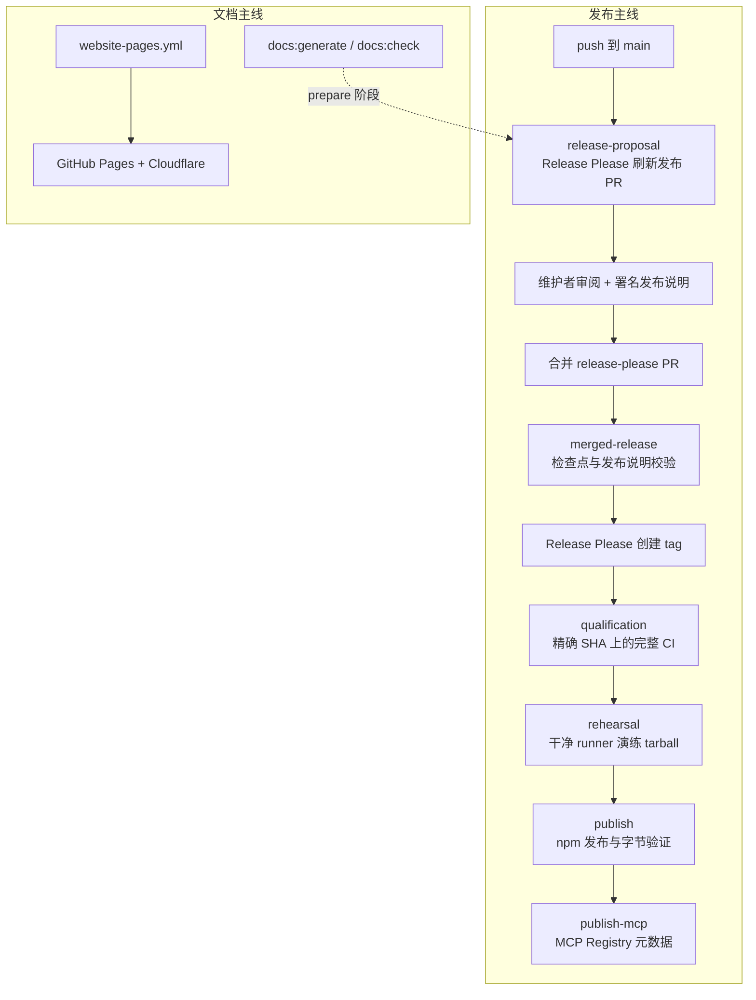
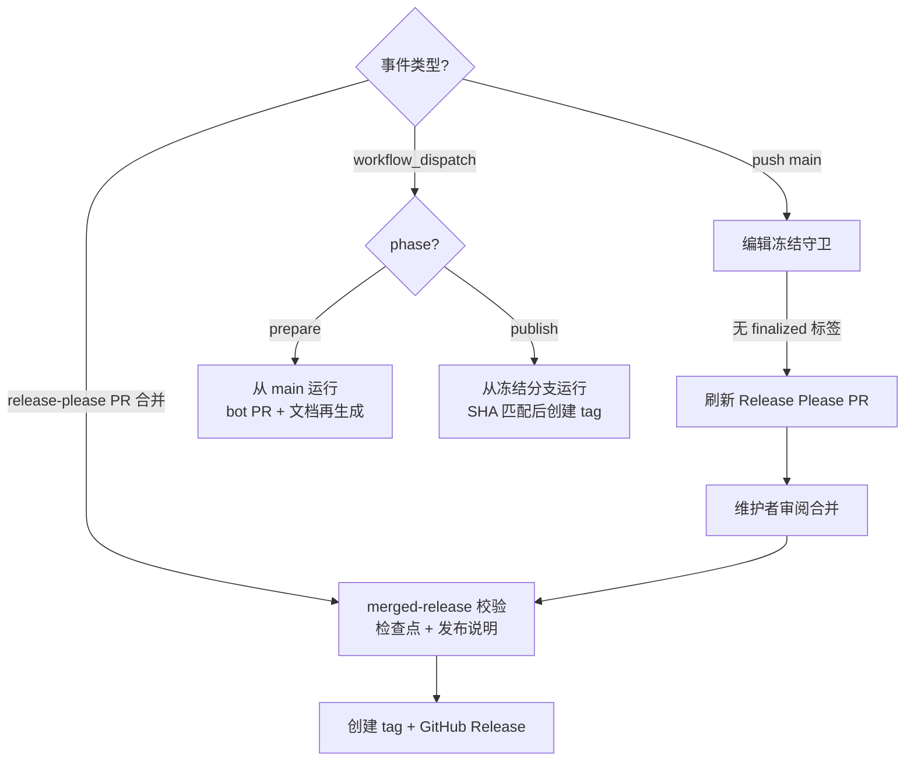
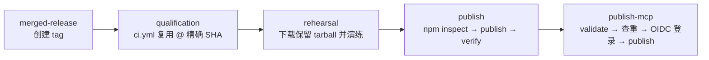
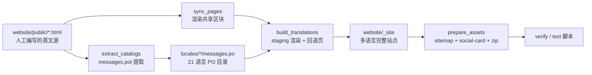
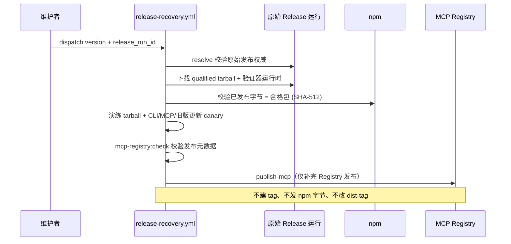

REA 的对外交付由两条主线构成：一条是 **release-please 驱动的自动发布流水线**，把 main 分支上经过审阅的 Conventional Commits 变成带 tag 的 GitHub Release、npm 包与 MCP Registry 元数据；另一条是**两套文档站点**——`docs/` 下的 VitePress 技术文档与 `website/` 下纯 Python 工具链生成的多语言营销站点。本页从架构视角拆解这两条主线：版本号如何被 release-please 自动推进并同步到多个版本锚点文件、发布前经过哪些质量门、贡献者署名如何进入发布说明、生成目录如何校验，以及 21 个语言版本的静态站点如何构建并发布到 GitHub Pages 与 Cloudflare 双主机。

## 发布体系总览

REA 没有独立的"发版脚本"，发布能力完全内嵌在 CI 工作流与校验脚本中。推送 main 会自动打开或刷新 Release Please PR；维护者审阅其迁移说明并等待 CI 通过后，合并该 PR 即自动开始发布。[docs/releasing.md](docs/releasing.md#L1-L5) 关键的架构约束是：**npm 与 MCP Registry 的发布绑定在 Release Please 返回的精确审阅合并 SHA 上**，发布前会在该精确修订上运行完整 CI 资格认证（含覆盖率、便携 provider 与所有原生包主机），之后 main 上的新提交无法改变或撤销这份证明。[docs/releasing.md](docs/releasing.md#L7-L12)

两条文档主线与发布主线的耦合方式不同：`docs/` 的生成目录在**发布 PR 的 prepare 阶段**被重新生成并校验（`npm run docs:generate` + `docs:check` + `git diff --exit-code`），而 `website/` 站点走独立的 `website-pages.yml` 工作流手动发布到 GitHub Pages 与 Cloudflare。

Sources: [docs/releasing.md](docs/releasing.md#L1-L21), [.github/workflows/release.yml](.github/workflows/release.yml#L1-L23), [package.json](package.json#L255-L263)

## release-please 配置与版本锚点

`release-please-config.json` 声明了 node 发布类型与 **`always-bump-minor` 版本策略**：每次发布递增 minor 并重置 patch，包括含破坏性变更的发布——例如 6.0.0 之后的下一个版本是 6.1.0。minor 递增不承诺向后兼容，升级前必须审阅 changelog 的 breaking-change 段落与迁移说明。[docs/releasing.md](docs/releasing.md#L145-L149) 配置同时定义了八个 changelog 分区（feat/fix/perf/refactor/docs/test/ci 可见，chore 隐藏），这是发布说明自动分组的来源。[release-please-config.json](release-please-config.json#L5-L16)

`extra-files` 机制把一个版本号同步到**六处版本锚点**，这是理解发布一致性的核心：

| 锚点文件 | 内容 | 同步方式 |
| --- | --- | --- |
| `package.json` | npm 包版本 | release-please 主版本源 |
| `.release-please-manifest.json` | 已发布基线（当前 `6.7.0`） | release-please 清单 |
| `package-lock.json` | 根与 `packages[""]` 双版本 | npm 生成，检查点校验器读取 |
| `server.json` | MCP Registry 元数据 `$.version` 与 `$.packages[0].version` | jsonpath 规则 |
| `src/generatedPackageMetadata.ts` | 编译期包元数据 | generic 注释标记 |
| `docs/installation.md` | 手动配置示例中的固定版本 `rea-agents@6.7.0` | generic 区间标记 |

jsonpath 规则直接改写 `server.json` 的两个版本字段，使 MCP Registry 元数据始终与 npm 包版本一致。[release-please-config.json](release-please-config.json#L17-L31) generic 文件则依赖源码中的注释锚点：`src/generatedPackageMetadata.ts` 第 6 行的 `// x-release-please-version` 标记版本常量，[src/generatedPackageMetadata.ts](src/generatedPackageMetadata.ts#L1-L10) 而 `docs/installation.md` 用 `<!-- x-release-please-start-version -->` 与 `<!-- x-release-please-end -->` 包住一段 JSON 配置示例，发布时自动把 `rea-agents@6.7.0` 更新为新版本号。[docs/installation.md](docs/installation.md#L1207-L1220)

这些锚点并非只被 release-please 写入，还被独立校验：检查点验证器要求 `package.json`、`.release-please-manifest.json`、`package-lock.json` 两处版本、`server.json` 两处版本与 `CHANGELOG.md` 首个版本标题全部一致，任何分歧都会在创建 tag 之前被拒绝。[scripts/lib/release-checkpoint.mjs](scripts/lib/release-checkpoint.mjs#L161-L200)

**破坏性变更的纪律**同样落在配置层：PR 必须先指出一个此前合法、现在会失败或语义改变的调用或配置，解释为何无法保持兼容并给出迁移方案，才能添加 `!` 或 `BREAKING CHANGE` footer。可选新增、兼容适配器与文档化的弃用期是优先选择；机器人只解析标记，无法推断兼容性。[docs/releasing.md](docs/releasing.md#L151-L159)

Sources: [release-please-config.json](release-please-config.json#L1-L39), [.release-please-manifest.json](.release-please-manifest.json#L1-L4), [server.json](server.json#L1-L31), [scripts/lib/release-checkpoint.mjs](scripts/lib/release-checkpoint.mjs#L100-L160)

## Release 工作流的三个触发入口

`release.yml` 用一个工作流覆盖三种发布形态，靠事件类型与 `phase` 输入区分：

| 入口 | 触发条件 | 行为 |
| --- | --- | --- |
| `release-proposal` | push 到 main | 刷新 Release Please PR，不能发布 |
| `merged-release` | release-please PR 被合并 | 校验后创建 tag，触发发布链 |
| `release-please`（dispatch） | `workflow_dispatch` + `phase=prepare/publish` | 冻结分支 `release/VERSION` 的手动检查点 |

push 入口有一个**编辑冻结守卫**：工作流先用 `gh api` 分页查询 open 状态、分支名以 `release-please--branches--main--` 开头的 PR，若任意 PR 带 `rea:release-notes-finalized` 标签，则本轮跳过 release-please action，防止自动提案覆盖人工编辑过的发布说明。[.github/workflows/release.yml](.github/workflows/release.yml#L28-L39) 移除标签即可恢复机器人再生成，但标签不冻结基础分支——新的 main 基线提交仍要求重新盘点并重新审阅发布说明。[docs/releasing.md](docs/releasing.md#L98-L103)

merged-release 入口在创建 tag 前做两道校验：一是断言审阅合并 SHA 与工作流源 SHA 一致后运行 `verify-release-checkpoint.mjs --phase publish`；二是运行 `release-notes.mjs publication` 校验发布说明。只有 Release Please 确认 `release_created=true` 且返回的 `sha` 与合并 SHA 完全相等，发布链才被放行——**"被标记的发布与审阅合并不一致"会直接拒绝错误来源的发布**。[.github/workflows/release.yml](.github/workflows/release.yml#L47-L118)

dispatch 入口服务于手动冻结检查点：`prepare` 必须从 main 运行、用 `release_branch` 选择冻结源；`publish` 必须从冻结分支本身运行，**让 npm provenance 记录真实发布提交**。工作流解析分支 tip 为 40 位提交 SHA，并在 `publish` 阶段断言 dispatch SHA 与分支 tip 相等——分支在 dispatch 后移动会在 Release Please 创建 tag 之前失败。[.github/workflows/release.yml](.github/workflows/release.yml#L124-L170)

`prepare` 阶段在此之后会检出 bot PR 分支，运行 `npm run docs:generate` 重新生成文档，再用 `npm run docs:check && git diff --exit-code` 验证生成产物无漂移；prepare 永远不能创建 GitHub Release 或发布包。[.github/workflows/release.yml](.github/workflows/release.yml#L264-L307)

Sources: [.github/workflows/release.yml](.github/workflows/release.yml#L1-L46), [docs/releasing.md](docs/releasing.md#L120-L137)

## 发布前的质量门：从合并 SHA 到已验证 tarball

发布链的后半段是四个严格串联的 job，每个 job 只消费上一个 job 留下的精确产物：

**qualification** 通过 `uses: ./.github/workflows/ci.yml` 以可复用工作流方式在精确发布 SHA 上调用完整 CI——覆盖率、便携 provider 与每个原生包主机都包含在内。它以 `contents: read`、`actions: read` 的最小权限运行。[.github/workflows/release.yml](.github/workflows/release.yml#L309-L323)

**rehearsal** 在干净 runner 上验证包的可消费性：先通过 `prepare-release-package` 组合动作下载 qualification 保留的 `verified-release-package` 工件，用 `scripts/ci/verified-package.mjs validate` 校验其来源与摘要，再恢复验证器运行时；随后 `verify-release-artifact.mjs` 把 tarball 安装进空的前缀目录，演练 CLI 帮助/发现能力与真实 stdio MCP 目录/会话契约，安装在协议截止时间开始前完成，且依赖生命周期脚本被禁用。**两个 job 使用同一个发布输入动作，都不重建或重打包归档**。[.github/actions/prepare-release-package](.github/actions/prepare-release-package/action.yml#L1-L27), [docs/releasing.md](docs/releasing.md#L13-L21)

**publish** 先用 `npm-release.mjs inspect` 检查 npm 上是否已存在该版本——查找失败或元数据畸形会中止任务；若已发布，则要求既有版本的 SHA-512 与意图 dist-tag 完全匹配才能复用，**发布永不覆盖既有版本或静默改变 dist-tag**。[scripts/ci/npm-release.mjs](scripts/ci/npm-release.mjs#L7-L67) 新版本通过 `npm publish --tag <tag>` 发布，tag 由 `release-npm-tag.mjs` 决定：无预发布段落的稳定版映射到 `latest`，预发布版映射到 `next`，确保预发布不能默认替换稳定安装。[scripts/release-npm-tag.mjs](scripts/release-npm-tag.mjs#L5-L11) 发布后再运行 `verify`（含最长 30 分钟的传播窗口重试，仅重试已确认的 registry 缺席）与 `verify-published-package.mjs` 从 npm 安装并重复 CLI/MCP 检查，还演练从旧稳定版的真实更新——`next` 上的预发布其更新器仍指向稳定 `latest`。[scripts/ci/npm-release.mjs](scripts/ci/npm-release.mjs#L69-L127), [docs/releasing.md](docs/releasing.md#L23-L31)

**publish-mcp** 复用 `publish-mcp` 组合动作：下载固定版本 v1.8.0 的 `mcp-publisher` 并校验 SHA-256，运行 `validate`，先分页查询 registry 是否已有相同版本（幂等保留）、认证走 GitHub OIDC，最后才 `publish`。npm 与 MCP 两条发布路径共享同一发布器语义。[.github/actions/publish-mcp](.github/actions/publish-mcp/action.yml#L1-L42)

发布结果的记录纪律是**三个事实分开记录**：GitHub release/tag 及其解析出的提交 SHA、npm 的精确版本与完整性（含已发布包 canary 通过）、MCP Registry 的服务器版本与 npm 包版本匹配。单独一个 GitHub tag 不能证明 npm 或 MCP Registry 发布完成。[docs/releasing.md](docs/releasing.md#L259-L271)

Sources: [.github/workflows/release.yml](.github/workflows/release.yml#L309-L411), [scripts/verify-release-artifact.mjs](scripts/verify-release-artifact.mjs#L1-L48)

## 贡献者署名的发布说明流水线

发布说明不是 release-please 草稿的直接输出，而是一条**盘点 → 记录 → 校验 → 渲染**的离线工具链，由 `scripts/release-notes.mjs` 的五个子命令支撑：

| 子命令 | 输入 | 产物/行为 |
| --- | --- | --- |
| `inventory` | `--repository --base --target --version` | 收集完整 Git 区间与分页 GitHub PR/作者/关闭 issue 元数据，写出清单 |
| `record` | `--manifest`（`--summary` 可选） | 完整署名记录，或紧凑来源链接 |
| `check` | `--manifest --notes [--pr-body]` | 校验署名与可选的 PR 正文等价性 |
| `render` | `--manifest --notes --output` | 写出已验证的发布段落（绝不覆盖已有文件） |
| `publication` | `--repository --source [--pr]` | 发布前校验：清单目标须等于审阅合并的第一父提交，且 PR 正文与 changelog 一致 |

`inventory` 先在本地解析调用方选择的 Git 边界，再发起网络请求；清单经 Zod schema 校验后用 `wx` 标志独占写入，`record/check/render` 则完全离线工作，只依赖已保存清单与完整本地 Git 历史。[scripts/release-notes.mjs](scripts/release-notes.mjs#L24-L141) 定稿的清单以 `docs/releases/VERSION.contributions.json` 保存在发布分支上——它是一份**经过审阅的快照而非签名证明**：离线检查器验证本地区间覆盖与署名一致性，但不独立验证 GitHub 的作者身份，用户可见声明的质量也不由 GitHub 元数据背书。[docs/releasing.md](docs/releasing.md#L90-L96)

署名规则有明确约定：同一贡献即使同时出现在亮点、详情与迁移中只署名一次；维护者 `@morluto` 的自署名省略；完整的作者元数据保留在清单里，不在发布正文中重复一份署名账本。[docs/releasing.md](docs/releasing.md#L76-L88) 校验器支持 GitHub 65,536 字符上限内的内联 Release Please PR 正文；溢出链接型正文需要单独集成并显式失败——**署名绝不会被静默截断**。[docs/releasing.md](docs/releasing.md#L115-L118)

Sources: [scripts/release-notes.mjs](scripts/release-notes.mjs#L1-L141), [docs/releasing.md](docs/releasing.md#L74-L118)

## VitePress 技术文档与生成目录

`docs/` 站点由 VitePress 构建，配置刻意保持精简：`base: "/rea/"` 适配 GitHub Pages 项目路径，`srcExclude: ["readme/**"]` 把 19 个 README 翻译版本排除在文档站之外，侧边栏将页面划分为入门、调查指南、provider 指南与参考/开发四组，`releasing.md` 就在最后一组里。[docs/.vitepress/config.ts](docs/.vitepress/config.ts#L1-L15)

这套文档的真正架构特点是**生成目录管线**。`docs:generate` 通过 turbo 编排 `docs:prepare`，`docs:check` 则运行对应的 `--check` 形态并附加 `readmeConsistency` 一致性测试：

| 生成器脚本 | 产物 | 校验形态 |
| --- | --- | --- |
| `generate-package-metadata.mjs` | `src/generatedPackageMetadata.ts`（含版本锚点） | `--check` |
| `generate-skill-metadata.mjs` | 随包分发的 skills 工件 | `--check` |
| `generate-product-catalog.mjs` | 产品目录（prepare 阶段归一化） | `--check` |
| `generate-completion-ledger.mjs` | 完成度账本 | `--check` |
| `generate-error-schema.mjs` | `docs/error-contract.schema.json` | 经 `artifacts:error-schema` turbo 任务 |
| `check-doc-facts.mjs` | — | 文档事实直接校验 |

Sources: [package.json](package.json#L260-L263), [package.json](package.json#L263)

这套管线与发布流程的接口在 release 工作流的 prepare 阶段：bot PR 检出后运行 `docs:generate` 再以 `git diff --exit-code` 验证——**生成的文档必须在候选提交上可复现且无漂移**，否则候选被拒绝。[.github/workflows/release.yml](.github/workflows/release.yml#L301-L307) 同步检查点回 main 时，也要求在合并树上运行 `npm run docs:generate`、`docs:check` 与发布配置测试。[docs/releasing.md](docs/releasing.md#L309-L320)

构建本身由 `pages.yml` 以纯手动 dispatch 暴露：检出、按 `.nvmrc` 安装 Node、复用 npm 缓存组合动作、`npm run docs:build`——`predocs:build` 钩子会先自动执行 `docs:generate`，因此构建产物始终建立在新生成的目录之上。该工作流只验证构建可成功，不发布任何站点。[.github/workflows/pages.yml](.github/workflows/pages.yml#L1-L31)

## 多语言营销站点的生成架构

`website/` 站点走完全不同的技术路线：**没有前端框架、没有 bundler、没有 npm 依赖**，只有 HTML、CSS 与少量交互脚本；所有维护命令由 Python 提供，构建把所有语言版本生成到 `website/_site/`，语言切换不需要 JavaScript。[website/README.md](website/README.md#L1-L15)

工具链的核心是 `scripts/website.py` 的一组子命令：

| 命令 | 作用 |
| --- | --- |
| `sync [--check]` | 从模板重渲染共享区块；`--check` 报告漂移而不改写 |
| `check` | `sync --check` + 依次运行 `prepare-website.py`、`verify-website.py`、`test-website.py` |
| `new-page <route>` | 以 `page.html` 模板脚手架新阅读页（含正确相对深度、导航与分享元数据） |
| `contributors` | 经 `gh api` 分页拉取贡献者快照，校验后原子替换 `people.json` |
| `translations extract/status/check` | 维护 gettext 目录，`--strict` 对缺失或 fuzzy 翻译报错 |
| `links` | 外链审计（`gh` + HTTP），与离线检查分离 |
| `serve` | 构建后本地预览，`--base-path /rea/` 模拟 Pages 前缀 |

共享区块机制是可维护性的关键：每页 HTML 用 `<!-- website:sharing:start -->` 等区间标记圈出头部、主题、分享与页脚区域，`sync_pages` 从 `.html.tmpl` 模板重渲染这些区间并替换；页面正文与元数据保持人工编写。每个页面必须有且只有一个非空 `<title>` 与 description，路由由文件路径推导，站点地图无需第二份页面注册表。[scripts/website.py](scripts/website.py#L212-L245) `new_page` 先在内存中完成渲染再落盘，非法输入不会留下半成品页面。[scripts/website.py](scripts/website.py#L247-L278)

多语言层由 `website_i18n.py` 实现，选择 **gettext PO 目录**作为翻译格式：源引用、审阅者注释与显式的待翻译状态都是目录的一等公民，且未来可接入 Weblate 而不必替换格式。[website/locales/README.md](website/locales/README.md#L99-L105) 提取与渲染管线有几个值得注意的工程决策：

- **保留源码跨度**：`Document` 解析器记录每个节点的精确源偏移，翻译散文时重写替换区间而从不重新序列化代码块。[scripts/website_i18n.py](scripts/website_i18n.py#L116-L165)
- **翻译单元边界**：段落是完整翻译单元；行内标记与代码以命名占位符（如 `{ph0}`）嵌入完整句子，检查拒绝缺失占位符与破坏的标签嵌套。[website/locales/README.md](website/locales/README.md#L40-L52)
- **证据保护**：`code/kbd/pre/script/style/svg/math` 子树及 `translate="no"` 元素整体跳过；标识符、产品名与数值证据（如 `0x` 十六进制、`code[n]=m`、文件名）保留为字面量。[scripts/website_i18n.py](scripts/website_i18n.py#L168-L177)
- **优雅降级**：某页缺少或含 fuzzy 必需消息时，该语言路由临时展示**完整英文页 + 可见通知**，标记 `noindex`，并从站点地图与 `hreflang` 备选中排除；补齐翻译后下次构建自动恢复。[website/locales/README.md](website/locales/README.md#L88-L97)

`languages.json` 清单定义 21 个语言版本，并强制与根 README 及 `docs/readme/` 的翻译版本集合一致：每项必须有 `code/name/readme/dir` 四个非空字段，英语必须居首，代码格式为 `[a-z]{2}(-[A-Z]{2})?`，阿拉伯语与波斯语标记为 RTL。英语保持既有路由，其他版本使用语言前缀（如 `/ja/`、`/pt-BR/`）。[scripts/website_i18n.py](scripts/website_i18n.py#L39-L72), [website/locales/languages.json](website/locales/languages.json#L1-L129) 韩语版本额外注入 Noto Sans KR 可变字体的 Google Fonts 样式表，其他版本保持系统字体。[scripts/website_i18n.py](scripts/website_i18n.py#L550-L557)

构建入口 `prepare-website.py` 调用 `build_translations`：先以 `check=true` 重新提取目录模板，为每个就绪页面渲染英文本与各语言版本，翻译插图中 `assets/figures/*.svg` 的 `text/title/desc` 标签并输出到 `assets/localized/<code>/`；随后 `finalize` 钩子补齐发布工件——**sitemap.xml 自动发现所有可索引页面**、CairoSVG 把 `social-card.svg` 栅格化为 1200×630 的 PNG、Electron Notes 示例打包为**时间戳固定为 1980-01-01** 的可复现 ZIP。staging 目录完成渲染后才原子替换 `_site/`。[scripts/website_i18n.py](scripts/website_i18n.py#L623-L659), [scripts/prepare-website.py](scripts/prepare-website.py#L1-L90)

Sources: [scripts/website.py](scripts/website.py#L1-L120), [scripts/website_i18n.py](scripts/website_i18n.py#L1-L110)

## 网站发布流水线：GitHub Pages 与 Cloudflare 双主机

网站发布由 `website-pages.yml` 手动 dispatch 触发，仅允许从 main 运行，并发组 `website-pages` 禁止取消以避免双主机状态不一致。`target` 输入支持 `both`（双主机）与 `pages`（仅 Pages，供配置 Cloudflare 期间使用）；选择 `both` 时先断言 `CLOUDFLARE_API_TOKEN` 与 `CLOUDFLARE_ACCOUNT_ID` 两个 secret 存在。[.github/workflows/website-pages.yml](.github/workflows/website-pages.yml#L18-L41)

**prepare** job 安装 Cairo 与 DejaVu 字体后运行 `python3 scripts/website.py check`——与 PR 检查完全相同的命令，随后把当前提交 SHA 写入 `website/_site/deployment.json`，再用 `upload-pages-artifact` 上传。这个一行 JSON 是后续双主机验证的锚点。[.github/workflows/website-pages.yml](.github/workflows/website-pages.yml#L42-L66)

**deploy** job 在 `github-pages` 环境中执行：`target=both` 时检出仓库、下载并解开已验证的 Pages 工件，用 Wrangler 4.149.0 执行 `deploy --cwd website --env production --assets <解压目录>` 发布到 Cloudflare 自定义域 `rea.tools`，再由 `deploy-pages` 发布到 GitHub Pages。最后一段内嵌 Python 脚本轮询两个主机的 `deployment.json?commit=<SHA>`（最长 24 次、间隔 5 秒），直到两边都返回**期望的提交 SHA** 才写成功摘要——发布完成的判据是"内容可验证"，而非"任务退出码为零"。[.github/workflows/website-pages.yml](.github/workflows/website-pages.yml#L67-L179)

| 主机 | 域名 | 发布方式 |
| --- | --- | --- |
| GitHub Pages | `deploy-pages` 返回的 URL | Pages 工件直接部署 |
| Cloudflare | `https://rea.tools/` | Wrangler `--env production` 消费同一工件 |

`wrangler.toml` 的设计支撑了这一流程：预览环境以 `website/_site` 为 assets 目录、以 `python3 scripts/website.py check` 为构建命令；而 `[env.production.build]` 显式置空 `command`——**生产环境只消费已经准备并验证过的共享工件，部署时不再重新生成本地资产**，这保证 Cloudflare 与 Pages 收到字节级相同的产物。[website/wrangler.toml](website/wrangler.toml#L1-L28)

日常 PR 验证由 `website-check.yml` 提供（`workflow_call` + 手动 dispatch），同样是 Python 3.12 + Cairo 环境下运行 `website.py check`，且完全离线可跑。[.github/workflows/website-check.yml](.github/workflows/website-check.yml#L1-L31) 外链审计则被刻意隔离在独立的 `links` 命令中：第三方服务的不可用不应阻塞每个 PR 的检查。[website/README.md](website/README.md#L138-L148)

Sources: [.github/workflows/website-pages.yml](.github/workflows/website-pages.yml#L1-L66), [website/README.md](website/README.md#L129-L137)

## 检查点恢复与失败重试纪律

发布链的另一面是**受限的故障恢复路径**。当验证器或发布工作流本身需要代码修复时，先把修复合入 main，再使用独立的 `release-recovery.yml`，而不是重复创建发布：调用时提供既有版本号与原始自动 Release 运行的 run id。恢复要求原始运行拥有成功的精确源 CI 门与 npm publish 步骤；它复用既有 tag、原始合格 tarball 与验证器运行时——工件过期或缺失会终止恢复。归档的源 SHA、版本、原始 run/attempt 与 Node 版本必须逐项匹配，其 SHA-512 必须等于 npm 已发布完整性。[.github/workflows/release-recovery.yml](.github/workflows/release-recovery.yml#L17-L86)

恢复**只做一件事**：在验证全部通过后把已发布的 `server.json` 补发到 MCP Registry。它不创建 tag 或 GitHub Release、不发布 npm 字节、不改 dist-tag。两条发布路径共享同一 MCP 发布器语义——分页 registry 查询保留完全相同的活跃版本，拒绝冲突或非活跃元数据，查询错误即失败。原始失败运行保留为历史记录，恢复运行记录新的验证与剩余的 registry 发布。[.github/workflows/release-recovery.yml](.github/workflows/release-recovery.yml#L88-L110), [docs/releasing.md](docs/releasing.md#L41-L69)

重试纪律同样成文：部分发布后**只在原始运行中重跑失败的 job**，让发布 SHA 与输出保持固定；npm 已发布时 npm job 改为验证该精确版本；只有 MCP 发布失败时，在确认 npm canary 成功后单独重试该 job。反向操作被明确禁止：不要移动 tag、不要删除 release、不要把 npm 下架作为重试——**有缺陷的公开包需要经过审阅的修正与新版本号**。[docs/releasing.md](docs/releasing.md#L322-L333)

手动冻结检查点发布后还有一道收尾：从 release 分支向 main 开同步 PR，且必须用**合并提交**——squash 与 rebase 不会把发布 tag 纳入 main 祖先；同步后用 `git merge-base --is-ancestor rea-agents-5.0.0 origin/main` 验证，并在合并前关闭已被取代的 main 提案，否则 main 会沿用旧基线并可能再次提案一个已发布的版本。[docs/releasing.md](docs/releasing.md#L273-L321)

Sources: [.github/workflows/release-recovery.yml](.github/workflows/release-recovery.yml#L1-L110), [docs/releasing.md](docs/releasing.md#L322-L333)

## 关键要点与延伸阅读

REA 的发布与文档体系可以浓缩为三个设计原则：**精确 SHA 绑定**（从 tag 创建到 npm 字节到 Registry 元数据，每个环节都锚定同一个审阅过的提交，且下游只消费上游保留的工件，从不重建）；**生成物必须可复现**（docs 目录在发布 PR 中再生成并以 `git diff --exit-code` 验证，网站构建在 staging 完成后原子替换，示例 ZIP 的时间戳固定）；**故障恢复最小授权**（恢复路径只补发 Registry 元数据，其余一切失败都导向"审阅后的新版本"而非原地修补）。

理解这套流程的前置知识分布在目录的其他页面：提交流程与审阅约定见 [贡献流程与 PR 就绪规范：问题报告、人工所有权与提交约定](28-gong-xian-liu-cheng-yu-pr-jiu-xu-gui-fan-wen-ti-bao-gao-ren-gong-suo-you-quan-yu-ti-jiao-yue-ding)；发布链中 qualification 阶段调用的完整 CI 与逆向工具变异通道见 [测试策略与验证通道：源码、边界、验收、一致性及真实工具链通道](27-ce-shi-ce-lue-yu-yan-zheng-tong-dao-yuan-ma-bian-jie-yan-shou-zhi-xing-ji-zhen-shi-gong-ju-lian-tong-dao)。