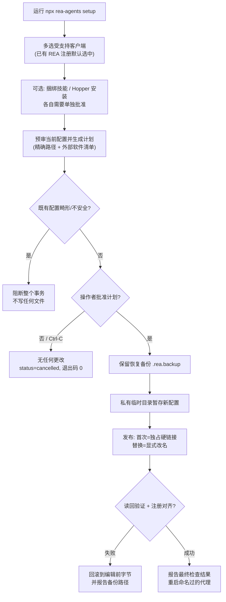
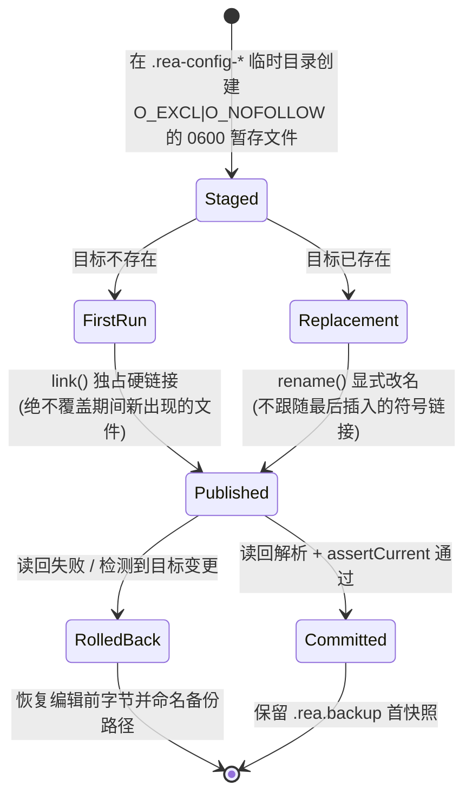
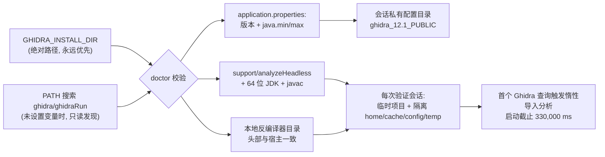

REA 是一个连接 AI 代理的逆向工程 CLI 与 MCP（Model Context Protocol）服务器。本页面向初次接触 REA 的开发者，覆盖三件事：如何安装 REA 并把它注册到受支持的 AI 客户端（代理）；`rea setup` 在修改客户端配置文件时采用的**事务式写入**安全模型；以及使用 Ghidra、Hopper 等原生分析引擎之前必须满足的主机前置条件。完成本页后，你可以继续阅读[快速开始](2-kuai-su-kai-shi-zhu-ce-dai-li-fa-qi-di-ci-diao-cha-yu-zhong-duan-zhi-yong)发起第一次调查。

Sources: [installation.md](docs/installation.md#L1-L13)

## 安装路径与运行时要求

REA 的 npm 包名为 `rea-agents`，最常见的入口是包运行器调用 `npx rea-agents setup`：npm 会先征求你对下载该包的批准（这一步与 REA 自己的 setup 审批相互独立），然后运行安装向导。如果想要显式锁定最新发布版，使用 `npx rea-agents@latest setup`；setup 完成后需要重启它提到的代理客户端才能加载新的 MCP 注册。

Sources: [installation.md](docs/installation.md#L14-L48)

运行时方面，REA 支持 Node.js 22.x（≥22.19）、24.x（≥24.11）与 26+，明确不支持 23、25 及预发布版本；`package.json` 的 `engines` 字段与 `install.sh` 中的版本检查保持同步。REA 只使用与当前运行时配对的 npm，永远不会替你升级 Node.js、npm 或 Homebrew。Bun 同样可用：`bunx rea-agents setup` 是等价入口，但 Bun 全局更新需要 Bun 1.2.17+（`bun info`），且更新器不会代为升级 Bun 本身。

Sources: [installation.md](docs/installation.md#L1259-L1271)
Sources: [package.json](package.json#L43-L47)
Sources: [install.sh](install.sh#L44-L60)

下表对比五种安装/分发路径，便于你按场景选择：

| 路径 | 命令 | 适用场景 | 关键限制 |
| --- | --- | --- | --- |
| 包运行器（推荐入门） | `npx rea-agents setup` | 快速试用、引导式配置 | MCP 注册固定为 `npx -y rea-agents@<版本> mcp` |
| npm 全局安装 | `npm install --global rea-agents && rea setup` | 多代理并发会话，省去每个连接的 npm 启动进程 | 直连注册随安装走，用 `rea update` 升级 |
| Bun | `bunx rea-agents@latest setup` | Bun 环境 | Windows 上同样用 `cmd.exe /d /c` 包装命令垫片 |
| curl 包装脚本 | `curl -fsSL .../install.sh \| bash` | 只装全局 npm 包并自动进入 setup | 支持 `--version`/`--dry-run`/`--no-setup` 等选项 |
| 仅技能安装 | `npx skills add morluto/rea --skill reverse-engineer-anything` | 只装代理工作流说明，不注册 MCP、不装引擎 | 工具缺失时需用 `doctor`/`setup --dry-run` 排查 |

Sources: [installation.md](docs/installation.md#L1228-L1298)
Sources: [installation.md](docs/installation.md#L1299-L1310)
Sources: [installation.md](docs/installation.md#L450-L478)

一个对初学者重要的细节：setup 通过 `npx` 运行时，会把注册固定写成 `npx -y rea-agents@<版本> mcp`（`bunx` 同理），版本号就是执行 setup 的那个精确版本；在 Windows 上，setup 会把这两类命令包进 `cmd.exe /d /c`，因为客户端的 stdio 启动器需要命令垫片才能拉起包运行器。持久化注册永远不要指向包运行器的临时缓存目录。

Sources: [installation.md](docs/installation.md#L1252-L1257)
Sources: [installation.md](docs/installation.md#L1222-L1226)

此外，REA 已发布在官方 MCP Registry（`io.github.morluto/rea`）。支持 Registry 发现的客户端可以直接搜索并安装；需要手工配置的客户端可使用标准的 `mcpServers.rea` JSON 形状（`command: npx`、`args: ["-y", "rea-agents@<版本>", "mcp"]`）。

Sources: [installation.md](docs/installation.md#L1195-L1226)

## 受支持客户端全景

`rea setup` 能把 REA 的本地 stdio MCP 服务器注册进 24 个客户端；源码中每个客户端由一份定义描述（名称、`displayName`、配置文件路径、探测标记路径、配置格式 `format`），setup、doctor 与 uninstall 共用这份清单。注意 Grok Bot 例外：它的连接器保存在云端账号里，本地数据目录只是探测标记，`format` 为 `unsupported`，必须在其聊天界面中手动添加。

Sources: [src/application/SupportedClients.ts](src/application/SupportedClients.ts#L481-L701)
Sources: [installation.md](docs/installation.md#L480-L516)

下表列出全部客户端、`--client` 取值与默认注册文件（`~` 表示用户主目录，括号内为可覆盖该位置的环境变量）：

| 客户端 | `--client` 值 | 默认注册文件 |
| --- | --- | --- |
| Claude Code | `claude_code` | `~/.claude.json`（`CLAUDE_CONFIG_DIR`） |
| Claude Desktop | `claude_desktop` | `claude_desktop_config.json`（按操作系统/MSIX 决定） |
| Codex | `codex` | `~/.codex/config.toml`（`CODEX_HOME`） |
| Cursor | `cursor` | `~/.cursor/mcp.json` |
| Gemini CLI | `gemini_cli` | `~/.gemini/settings.json`（`GEMINI_CLI_HOME`） |
| Windsurf | `windsurf` | `~/.codeium/windsurf/mcp_config.json` |
| Devin | `devin` | `~/.config/devin/mcp_config.json`（Windows 为 `%APPDATA%\devin`） |
| OpenCode | `opencode` | `~/.config/opencode` 下分层 json/jsonc（`OPENCODE_CONFIG_DIR`） |
| Antigravity | `antigravity` | `~/.gemini/config/mcp_config.json` |
| GitHub Copilot CLI | `copilot_cli` | `~/.copilot/mcp-config.json`（`COPILOT_HOME`） |
| Command Code | `commandcode` | `~/.commandcode/mcp.json` |
| Qwen Code | `qwen_code` | `~/.qwen/settings.json`（`QWEN_HOME`） |
| Kimi Code | `kimi` | `~/.kimi-code/mcp.json`（`KIMI_CODE_HOME`） |
| VS Code | `vscode` | 各平台 `Code/User/mcp.json` |
| Grok Build | `grok_build` | `~/.grok/config.toml`（`GROK_HOME`） |
| OMP | `omp` | `~/.omp/agent/mcp.json`（支持 profile 子目录） |
| Pi | `pi` | `~/.pi/agent/mcp.json`（`PI_CODING_AGENT_DIR`） |
| Hermes | `hermes` | Hermes 主目录 `config.yaml` |
| Qoder | `qoder` | `~/.qoder/settings.json`（`QODER_CONFIG_DIR`） |
| Factory Droid | `droid` | `~/.factory/mcp.json` |
| Trae | `trae` | 各平台 `Trae/User/mcp.json` |
| WorkBuddy | `workbuddy` | `~/.workbuddy/mcp.json` |
| ZCode | `zcode` | `~/.zcode/cli/config.json` |
| DeepSeek Harness | `dsh` | Cordis 补丁目录（`DSH_AGENTS_HOME`） |
| Grok Bot | 手动托管连接器 | 无本地注册文件（不支持自动写入） |

Sources: [src/application/SupportedClients.ts](src/application/SupportedClients.ts#L481-L701)

其中 `droid`、`dsh`、`kimi`、`qoder`、`trae`、`workbuddy`、`zcode` 七个客户端 ID 需要 `rea-agents@6.5.0` 或更高版本。Claude Desktop 还有两条特殊规则：它被标记为 `quitBeforeSetup: true`（运行中的应用可能从内存重写配置、抹掉注册，因此批准前必须完全退出）；在 Windows 上，MSIX 打包版本会读取包私有副本而非 `%APPDATA%` 文件，setup/doctor/uninstall 会解析包存储来决定正确的写入目标，无法确定时宁可报错也不回退猜测。

Sources: [installation.md](docs/installation.md#L512-L516)
Sources: [src/application/SupportedClients.ts](src/application/SupportedClients.ts#L253-L289)
Sources: [installation.md](docs/installation.md#L27-L46)

## Setup 交互流程：从检测到审批

`rea setup` 的旅程分为四步：多选客户端 → 选择可选附加项 → 审阅计划 → 批准执行。多选列表中**已有的 REA 注册默认选中**，新检测到的客户端保持可选但未选中——"检测到"只是给 setup 提供上下文，不等于授权添加新注册；`--client` 标志可跳过多选问题。setup 默认随注册安装捆绑的工作流技能（`--skill=false` 可省略）；Hopper 是独立可选项，需要自己的明确批准；setup 还可以保存已验证的现有 Ghidra 安装路径。

Sources: [installation.md](docs/installation.md#L26-L40)

审阅计划阶段，REA 会先检查当前配置，计划中列明：拟安装/已存在的 Hopper、已验证的 Ghidra 安装、每个检测到的代理配置路径、每个选中的技能目标目录，以及涉及的外部软件、网络来源、完整性证据与包管理器命令。**畸形或不安全的既有配置会在任何写入（包括 Hopper 安装）之前阻断整个事务**；拒绝或按下 Ctrl-C 则什么都不改。

Sources: [installation.md](docs/installation.md#L41-L58)

Sources: [installation.md](docs/installation.md#L26-L99)

脚本化与自动化场景有明确的旗标契约：`--dry-run` 返回只读计划（状态 `planned`、退出码 0）；`--json` 输出计划与精简的 `.doctor` 就绪投影而不应用它；`--yes` 必须搭配显式范围（如 `--client codex`），不带范围旗标时 `--yes` 只作用于已有 REA 拥有的注册，绝不会选中所有检测到的客户端；无人值守安装缺失的 Hopper 还需追加 `--install-hopper`。未获批准的真实应用会报告 `needs_confirmation` 并以退出码 1 结束。提示 UI 写到 stderr，`NO_COLOR=1` 关闭颜色，`--accessible` 提供顺序渲染的可访问提示；任何流被重定向时 setup 自动变为非交互模式。

Sources: [installation.md](docs/installation.md#L100-L130)
Sources: [installation.md](docs/installation.md#L111-L116)

技能（skill）目标目录也有防御性规则：选中客户端时安装到其个人技能目录，未选客户端而只装技能时使用 `~/.agents/skills`；setup 拒绝在选定的技能目录或其托管的 `references` 目录上出现符号链接（与 uninstall/update 的所有权规则一致），doctor 会把链接或非目录技能路径报告为 `unmanaged` 并给出替代方案。

Sources: [installation.md](docs/installation.md#L132-L148)

## 事务式写入：配置修改的安全模型

对初学者而言，可以把"事务式写入"理解为数据库事务思想在配置文件上的应用：**要么完整地、经过验证地落盘，要么恢复原样并明确告诉你去哪里找回编辑前的字节**。REA 从不就地覆写客户端配置，整条链路由三个模块协作完成：`SetupClientConfiguration` 负责读取、解析与回滚策略；`ClientConfigurationPublication` 负责暂存与原子发布；`SetupRecoveryBackup` 负责内容寻址的恢复快照。

Sources: [src/application/SetupClientConfiguration.ts](src/application/SetupClientConfiguration.ts#L230-L389)
Sources: [src/application/ClientConfigurationPublication.ts](src/application/ClientConfigurationPublication.ts#L16-L110)
Sources: [src/application/SetupRecoveryBackup.ts](src/application/SetupRecoveryBackup.ts#L21-L144)

Sources: [src/application/ClientConfigurationPublication.ts](src/application/ClientConfigurationPublication.ts#L27-L110)

具体机制可以拆成五个可验证的层面。**第一，发布原子性**：`ClientConfigurationPublication.write` 先对父目录做 `realpath` 解析，再在 `.rea-config-` 前缀的私有临时目录中创建 `O_EXCL | O_NOFOLLOW`、权限 0600 的暂存文件，写入后执行 `fsync` 并核对 inode 非零；首次发布用独占硬链接 `link()`（文件系统不支持硬链接时无法发布首次配置），替换发布用显式目标 `rename()`——两种方式都不跟随最后一步插入的符号链接。发布后还会继承原文件的属主与权限位。

Sources: [src/application/ClientConfigurationPublication.ts](src/application/ClientConfigurationPublication.ts#L27-L87)

**第二，发布前竞态检查**：暂存完成后再次断言选定的目标文件仍是计划时的那份（`assertSelectedConfiguration`）；对 Claude Desktop 这类 MSIX 客户端，应用退出前切换到包私有副本会被识别为"目标已变更"（`target_changed`）并拒绝写入。**第三，读回验证与回滚**：发布后重新解析落盘文件，逐项核对注册条目与期望一致，任何不一致或读回失败都会回滚到编辑前字节；无法验证的新建配置会被保留并报告手工恢复路径，而不是删掉一个可能已改名的路径名。

Sources: [src/application/SetupClientConfiguration.ts](src/application/SetupClientConfiguration.ts#L234-L381)
Sources: [installation.md](docs/installation.md#L61-L79)

**第四，双快照恢复备份**：setup 与 uninstall 保留既有的 `.rea.backup`（首个快照，永不覆盖）；若该快照与本次事务的原始字节不同，则把当前字节复制到内容寻址的 `.rea.backup.<sha256>.recovery` 路径（使用 `COPYFILE_EXCL` 独占复制），并在复制后再次校验快照与原始字节一致。两份快照长期共存，失败诊断会指名保存"紧邻该次编辑之前"字节的具体备份路径。

Sources: [src/application/SetupRecoveryBackup.ts](src/application/SetupRecoveryBackup.ts#L21-L144)
Sources: [installation.md](docs/installation.md#L66-L77)

**第五，无损编辑**：文档层基于 `jsonc-parser` 的语法树做最小编辑（`applyEdits`），序列化时保留无关条目、注释与既有格式；同时保留 REA 既有服务条目中的有效环境覆盖（如 `REA_MCP_INPUT_SCHEMA_PROFILE`、`REA_MCP_OUTPUT_SCHEMA_PROFILE`、`REA_MCP_MAX_RESPONSE_BYTES`），检测到的提供者设置只替换匹配的环境键。畸形的 REA 环境映射或无效运行时设置会在写入前被报告（包括 OpenCode 分层文件逐层校验后再合并），setup 不会静默丢弃其余映射。

Sources: [src/application/ClientConfigurationDocument.ts](src/application/ClientConfigurationDocument.ts#L20-L35)
Sources: [installation.md](docs/installation.md#L59-L95)

## 原生引擎前置条件：Hopper

Hopper 是独立的商业软件，拥有自己的许可：免费演示版带厂商定义的限制，付费许可可选。REA 会复用任何检测到的安装，并在卸载时保留 Hopper。自动安装器支持的平台为 macOS 12+、Ubuntu 24.04+、Fedora 41+、Nobara 44+、64 位 Arch Linux、CachyOS 与 Omarchy；REA 本体可在任何带有可识别 apt/dnf/pacman 软件包族的 Linux 发行版上运行（此时通过 `HOPPER_LAUNCHER_PATH` 选择已有启动器）。**Windows 上不提供 Hopper 安装。**

Sources: [installation.md](docs/installation.md#L526-L544)
Sources: [installation.md](docs/installation.md#L893-L898)

macOS 与 Linux 的安装路径差异明显，值得对照记忆：

| 维度 | macOS | Linux（受支持发行版） |
| --- | --- | --- |
| 安装物 | 官方 DMG | 官方 `.deb` / `.rpm` / Arch 包 |
| 完整性 | 校验发布尺寸与摘要，验证应用包 | 对 Hopper 稳定主指纹 `7C2D...1BCD` 验证分离 PGP 签名，再核对包与已装启动器的 `main_exe_hash` 一致 |
| 落盘方式 | 原子安装到 `~/Applications/Hopper Disassembler.app` | 调用原生包管理器安装 |
| 权限 | 不用 Homebrew、不用管理员权限 | 包管理器失败时报出命令与捕获输出，便于区分冲突与授权失败 |
| 证据缓存 | — | `${XDG_CACHE_HOME:-$HOME/.cache}/rea/hopper-releases/<launcher-sha256>` |

Sources: [installation.md](docs/installation.md#L539-L544)
Sources: [installation.md](docs/installation.md#L546-L799)

Linux 演示版运行时还有两个容易踩坑的前置条件。其一是**嵌入式 Python**：仅装 Python 解释器与标准库不够，Ubuntu 上 Hopper 需要匹配的 `libpython3.X` 共享库（setup 会检查 `/usr/bin/python3`、必要时由 APT 解析具体包如 `libpython3.12t64`，并验证共享库可加载）；其二是**私有显示器**：REA 在私有 Xvfb 显示上运行演示版并自动选择演示模式，无需用户桌面；若宿主把 `/tmp/.X11-unix` 挂为只读挂载，REA 会先用非特权用户加挂载命名空间在该目录上叠加私有 mode-1777 tmpfs，此回退永远不调用 `sudo`。演示运行依赖 Xvfb、Python 3、X11 与 XTEST，批准的 setup 会在受支持发行版上安装这些依赖。

Sources: [installation.md](docs/installation.md#L546-L799)

启动器发现顺序也有明确规则。macOS 依次检查：系统规范位置的应用 → `rea setup` 装到 `~/Applications` 的应用 → `/Applications` 与 `~/Applications` 中其他 `Hopper*.app`；Homebrew cask 位置只是 doctor 的诊断项，要使用它必须显式设置 `HOPPER_LAUNCHER_PATH`。Linux 依次优先 `/opt/hopper/bin/Hopper` → `~/.local/share/rea/hopper/bin/Hopper` → `/opt/hopper-v4/bin/hopper` → `/usr/bin/hopper`。启动超时默认 120,000 ms，可用 `REA_HOPPER_STARTUP_TIMEOUT_MS`（1 到 2,147,483,647 之间的十进制整数）为大目标调高，CLI 与 MCP 读取同一设置，无效值会触发配置校验失败。

Sources: [installation.md](docs/installation.md#L546-L799)

CI/无人值守场景需注意：macOS 要求在将要运行 REA 的同一用户会话里完成 Hopper 的首次运行 UI（选择演示模式或激活许可），临时 macOS runner 需要预置会话或刻意的交互引导步骤；Linux 上同一用户在各协作 REA 进程间只保留一个 Hopper 应用实例，竞争会话会在启动前收到持有会话 ID。诊断入口是 `rea doctor --provider hopper --json`。

Sources: [installation.md](docs/installation.md#L546-L799)

## 原生引擎前置条件：Ghidra

与 Hopper 不同，REA **只连接已有的 Ghidra 安装，从不下载、安装、升级或修改 Ghidra 与 Java**；setup 只在批准后保存已验证的路径与环境条目。平台支持范围为 Linux x64/arm64、macOS x64/arm64，以及实验性的 Windows x64 P0 边界。版本要求是 Ghidra 12.1.x，外加该安装通过 `application.properties` 中 `application.java.min`/`application.java.max` 声明的 64 位完整 JDK——当前 12.1 版要求 JDK 21 或更新且不设上限，桥接已在 Ghidra 12.1.4 + JDK 21 上验证。

Sources: [installation.md](docs/installation.md#L819-L840)
Sources: [installation.md](docs/installation.md#L893-L898)

JDK 准入是按安装自身声明推导的：`GhidraInstallationPolicy` 读取 `application.version`、`application.release.name` 与 Java 上下界，任何属性转义错误都会使整个文件失效并让 Java 要求"未解析"；上界小于下界同样视为未解析。doctor 会进一步验证平台、架构、headless 启动器存在性、64 位 JDK 位数、`javac` 存在性，并要求 JVM 上报的 `os.arch`/`os.name` 能映射到与宿主一致的本地反编译器目录——在 Rosetta 仿真下运行的 x86_64 JDK 即使是合格的 64 位完整 JDK 也会被拒绝。

Sources: [src/ghidra/GhidraInstallationPolicy.ts](src/ghidra/GhidraInstallationPolicy.ts#L26-L96)
Sources: [installation.md](docs/installation.md#L900-L920)

每个安装必须包含宿主架构的本地反编译器（`Ghidra/Features/Decompiler/os/<platform>/` 或对应 `build/os/<platform>/`）。REA 通过检查可执行文件自身的头部来验证这一前置条件——为其他平台构建的组件会被报告为不兼容，而不是凭目录名被准入；官方发布包在 Linux ARM64（`linux_arm_64`）上可能需要你自行构建该组件。若 macOS 上 doctor 报告 `native_decompiler` 缺失，文档提供了用 Xcode 命令行工具、`make` 与 `bison` 手工构建的配方（x64 直接 `make ghidra_opt`，arm64 追加 `ARCH_TYPE="-arch arm64" OSDIR=mac_arm_64`）。

Sources: [installation.md](docs/installation.md#L830-L840)
Sources: [installation.md](docs/installation.md#L999-L1050)

安装的指向方式是两个绝对路径环境变量：`GHIDRA_INSTALL_DIR` 与可选的 `JAVA_HOME`（当 `java`/`javac` 已在 PATH 时可省略）。显式提供的 `GHIDRA_INSTALL_DIR` 永远优先——即使无效，REA 也会报出该错误而不是悄悄换一个安装；未设置时，doctor 与提供者会在 PATH 中搜索 `ghidra`/`ghidraRun`，并通过真实路径确认它属于一个带应用元数据与 headless 启动器的 Ghidra 目录树，此发现是只读的且不会执行启动器。macOS 上 Homebrew OpenJDK 是 keg-only，需要把 `JAVA_HOME` 指到所选 formula 的 `libexec/openjdk.jdk/Contents/Home`。

Sources: [installation.md](docs/installation.md#L865-L905)

Sources: [installation.md](docs/installation.md#L900-L988)

两个运行时控制值得在装机阶段就了解。**启动截止时间**：默认 330,000 ms 覆盖导入、分析、桥接与健康就绪；大目标可设 `REA_GHIDRA_STARTUP_TIMEOUT_MS`（1 到 2,147,483,647），超时后 `provider_timeout` 错误会点名该变量与生效截止时间，并建议用 `REA_GHIDRA_DISABLED_ANALYZERS` 跳过耗时的分析器。**堆与 CPU 控制**：Linux/macOS 按 `GHIDRA_HEADLESS_MAXMEM` → `GHIDRA_MAXMEM` → `2G` 的顺序取第一个非空值作为 JVM `-Xmx`；REA 会清空继承的 `_JAVA_OPTIONS`、`JAVA_TOOL_OPTIONS`、`JDK_JAVA_OPTIONS` 与 `GHIDRA_JAVA_OPTIONS`，并自行持有 `GHIDRA_HEADLESS_JAVA_OPTIONS`——通过注入变量塞入第二个 `-Xmx` 不属于受支持配置。Windows P0 边界接受 x86、x86-64、ARMNT(Thumb-2) 与 ARM64 的 PE 及显式选择的原始 NMOS 6502 镜像，仅限固定本地 NTFS 卷，npm 包已捆绑 Job Object 进程所有权等原生能力，无需额外插件。

Sources: [installation.md](docs/installation.md#L969-L988)
Sources: [installation.md](docs/installation.md#L1096-L1151)
Sources: [installation.md](docs/installation.md#L856-L863)

## Linux 进程监督前置条件

在 Linux 上，REA 的共享进程监督器要求 PATH 上存在 procps 兼容的 `ps`，用于在启动任何子进程前执行所有权检查——Ghidra、JADX、固件工具与静态 JavaScript/Electron 分析都依赖这些检查。请安装发行版的 `procps`/`procps-ng` 包，否则相应工作流会在受监督子进程启动前被拒绝；错误码因调用方而异（`capability_unavailable`、`provider_unavailable` 或 `execution_failure`），排查提供者专属建议前应先核对该前置条件。

Sources: [installation.md](docs/installation.md#L350-L363)

## 就绪诊断、更新与卸载

`rea doctor --json` 严格只读，读取主机前置条件与代理配置而不修改它们；不带选项时审计所有检测到的注册、已装技能与可选分析引擎，可按任务范围收缩（`--provider ghidra`、`--client codex`、`--skill`）。`rea update` 只更新拥有当前 CLI 的 npm/Bun 全局安装，维护计划只选中既有 REA 注册与已装的 REA 技能，经审阅批准后应用。`rea uninstall` 保留 Hopper、Node.js、Evidence 文件、捕获数据与无关技能/服务器；`--purge-data` 只清除 `~/.rea` 下的缓存与状态。畸形、不可读或路径不安全的客户端配置会在删除任何东西之前停止操作。

Sources: [installation.md](docs/installation.md#L313-L363)
Sources: [installation.md](docs/installation.md#L365-L392)

## 下一步阅读

安装与配置完成后，建议按以下顺序深入：

1. [快速开始：注册代理、发起第一次调查与终端直用](2-kuai-su-kai-shi-zhu-ce-dai-li-fa-qi-di-ci-diao-cha-yu-zhong-duan-zhi-yong) —— 用最小路径完成第一次调查。
2. [CLI 使用与就绪诊断：rea 命令、JSON 输出与 doctor 检查](4-cli-shi-yong-yu-jiu-xu-zhen-duan-rea-ming-ling-json-shu-chu-yu-doctor-jian-cha) —— 系统掌握命令行输出契约与诊断方法。
3. [Ghidra 集成：临时数据库、快照生命周期与多架构语义配置](11-ghidra-ji-cheng-lin-shi-shu-ju-ku-kuai-zhao-sheng-ming-zhou-qi-yu-duo-jia-gou-yu-yi-pei-zhi) 与 [Hopper 集成：Python 桥、Unix 套接字协议与目标租约](12-hopper-ji-cheng-python-qiao-unix-tao-jie-zi-xie-yi-yu-mu-biao-zu-yue) —— 在前置条件就绪后进入引擎级工作流。
4. [IDA、Cutter 与 Kuna 提供者：只读绑定与上游 MCP 适配](13-ida-cutter-yu-kuna-ti-gong-zhe-zhi-du-bang-ding-yu-shang-you-mcp-gua-pei) —— 了解其余逆向工具提供者的接入方式。