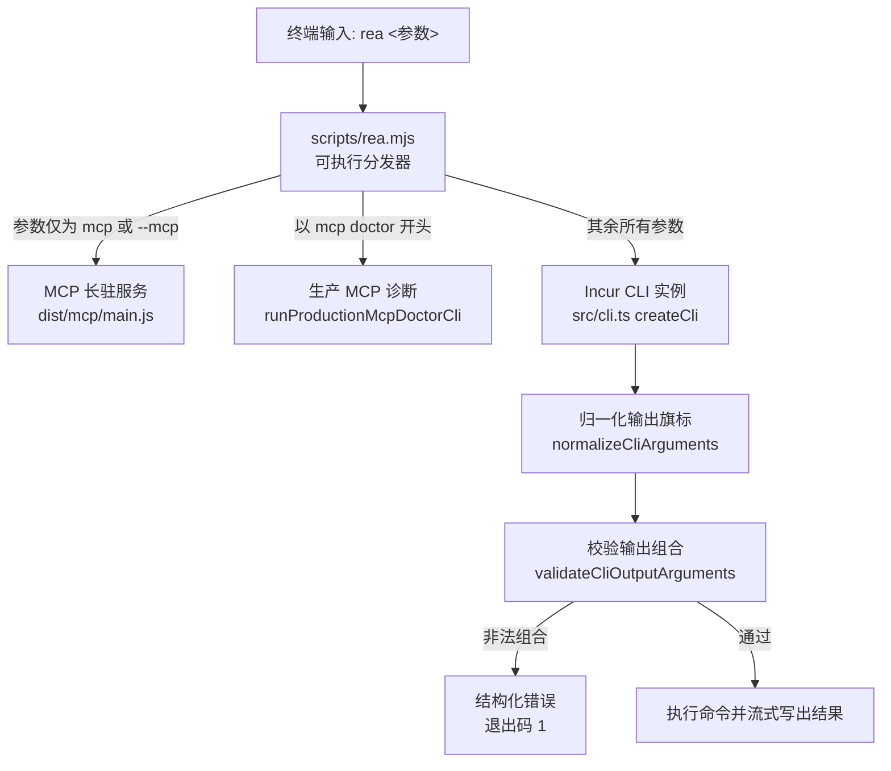
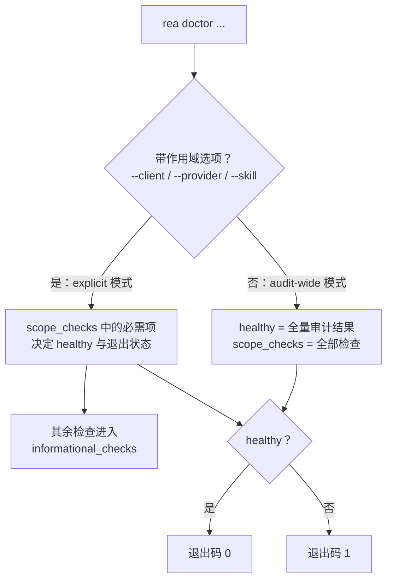

REA 的命令行界面（CLI）是与 AI 代理共用同一套应用工作流和证据契约的直接入口：每次 `rea` 调用都是一个独立进程，命令执行完毕即退出，需要后续使用的完整证据必须先保存到文件。本页面向初学者讲解三件事——`rea` 命令如何从终端输入一路分发到具体实现、结果如何以 JSON 等格式输出以及如何用输出旗标控制结果形态、以及如何用 `rea doctor` 与 `rea mcp doctor` 在动手分析之前确认环境就绪。读完本页，你应当能够独立运行第一条分析命令、读懂结构化输出与退出码，并在环境异常时自行定位原因。

Sources: [cli.md](docs/cli.md#L1-L15)

## rea 命令的入口链路：一个可执行文件，三条分发路径

安装 `rea-agents` 包后，npm 会注册两个同义的可执行文件名：`rea` 与 `rea-agents`，两者都指向同一个分发脚本 `scripts/rea.mjs`。这个脚本是你输入的每条命令的第一站，它在导入任何框架代码之前先读取参数，判断本次调用属于三种模式中的哪一种。判定规则非常简单：当参数**只有** `mcp` 或 `--mcp` 一个词时，进入 MCP 长驻服务模式；当参数以 `mcp doctor` 开头时，进入生产 MCP 诊断模式；其余所有情况都进入普通 CLI 模式。

Sources: [package.json](package.json#L36-L40) [rea.mjs](scripts/rea.mjs#L13-L15)

下方的流程图描述了这三个分支。先看图例：`rea.mjs` 是分发器本体，三个右侧节点是它可能加载的三组编译产物（位于 `dist/` 目录）；菱形表示参数判定。需要注意的是，进入任何分支之前，脚本都会检查对应的编译产物是否存在，缺失时会提示重新构建或重装包，而不是抛出令人费解的运行时错误。

Sources: [rea.mjs](scripts/rea.mjs#L31-L43)

三种模式的职责划分如下表所示。普通 CLI 模式就是本页的主角：它把归一化后的参数交给 `src/cli.ts` 中的 `createCli` 工厂函数，由后者构建一个基于 Incur 框架的命令行实例并执行。`mcp` 模式启动的是供代理客户端连接的 stdio 服务器（详见目录页 [MCP 契约参考：工具结果、保留证据、会话发现与取消恢复](8-mcp-qi-yue-can-kao-gong-ju-jie-guo-bao-liu-zheng-ju-hui-hua-fa-xian-yu-qu-xiao-hui-fu)）；`mcp doctor` 模式则是对这个服务器的启动过程做一次带截止时间的体检，后文会详细展开。

| 模式 | 触发方式 | 加载的运行时 | 典型用途 |
| --- | --- | --- | --- |
| 普通 CLI | `rea <命令> [参数]` | `dist/cli-runtime/cli.js` 等 | 人工排查、脚本、一次性分析 |
| MCP 服务 | `rea mcp` 或 `rea --mcp` | `dist/mcp/main.js` | 代理客户端的 stdio 长驻连接 |
| MCP 诊断 | `rea mcp doctor` | `dist/mcp/main.js` + `dist/cli-runtime/mcpDoctor.js` | 验证生产 MCP 适配器可正常启动并列出工具 |

Sources: [rea.mjs](scripts/rea.mjs#L31-L66) [cli.ts](src/cli.ts#L26-L63)

## 命令注册：Incur 框架与同源的 CLI/MCP 目录

`createCli` 使用第三方 CLI 框架 Incur 创建实例，实例名取自集中定义的产品身份 `PRODUCT_IDENTITY.cliBinary`（即字符串 `"rea"`），并附带版本号、描述文本以及供代理注册用的 MCP 启动说明。产品身份集中在一处定义是有意为之的设计：它保证 npm 包名、CLI 可执行名、MCP 服务器标识与技能版本不会在打包、安装、注册各环节之间漂移。随后，三十余个 `registerXxxCommands` 模块按领域逐一注册命令——从核心分析（`analyze`、`function`、`decompile`）到 Android、固件、浏览器场景、EVM 等专用族。

Sources: [cli.ts](src/cli.ts#L65-L137) [identity.ts](src/identity.ts#L1-L16)

所有命令的规范名称集中在一个冻结的目录对象 `CLI_COMMANDS` 中，超过一百八十个条目，既是命令注册的事实来源，也是生成目录文档的输入。对初学者而言，最实用的查询方式是 `rea --help` 列出全部命令，再对具体命令运行 `rea <命令> --help` 查看参数与输出选项；完整的命令与 MCP 工具对照也可以在生成目录中查阅。

Sources: [cliCommandNames.ts](src/cliCommandNames.ts#L1-L185) [cli.md](docs/cli.md#L76-L79)

值得注意的一点是 CLI 命令与 MCP 工具**同源不同形**：许多 CLI 命令只是对应 MCP 操作的别名封装，例如 `rea analyze` 在内部调用 `binary_overview` 操作，`rea decompile` 对应 `procedure_pseudo_code`。别名映射同样集中在 `CLI_COMMAND_TOOL_ALIASES` 中，因此你在 CLI 学到的操作语义可以直接迁移到 MCP 会话中，反之亦然。

Sources: [cliCommandNames.ts](src/cliCommandNames.ts#L188-L210)

## JSON 输出：默认 TOON、`--json` 与终端自动检测

REA 命令结果的默认输出格式是 TOON——一种面向令牌优化的紧凑结构化文本格式，设计目标是让代理（以及人）用更少的读取成本获得同样的信息。当你需要把结果交给 `jq` 等标准 JSON 工具，或者保存为文件供后续命令使用时，加上 `--json` 旗标即可切换到 JSON 格式；`--format` 旗标还支持 `jsonl`（每行一个 JSON 值）、`yaml`、`md` 等格式。`--json` 本质上是 `--format json` 的快捷形式。

Sources: [cli.md](docs/cli.md#L281-L333) [cliOutput.ts](src/cliOutput.ts#L4-L10)

JSON 输出有一个对初学者很容易困惑但设计上非常合理的细节：**同一份数据在终端上显示为缩进美化的格式，而在通过管道传输或重定向到文件时输出为紧凑格式**。实现位于 `writeJsonOutput` 函数——它检查输出目的地是否为终端（TTY，即交互式终端设备），仅当 `isTTY` 为真时才缩进。注释中记录了实测依据：缩进在真实结果上会多消耗 16%–45% 的模型令牌，而对管道消费者毫无信息增益。两处的数据值完全相同，如果想要缩进的文件，把管道输出再过一遍 `jq .` 即可。

Sources: [jsonOutput.ts](src/cli/jsonOutput.ts#L6-L24) [cli.md](docs/cli.md#L329-L334)

除格式选择外，写入方式也经过优化：结果不构建整文档大小的字符串，而是以**流式分段**写出。`jsonOutputParts` 生成器把 JSON 文档切成有序文本片段逐段写入目的地，这避免了大结果（可能达数百 MB）在内存中翻倍的问题；当结果实在超出运行时字符串上限时，CLI 会将原始结果替换为一个结构化的资源约束错误并附上处置建议，而不是静默截断。

Sources: [jsonOutput.ts](src/cli/jsonOutput.ts#L11-L57) [cliResultOutput.ts](src/cli/cliResultOutput.ts#L117-L162)

## 输出控制旗标与组合校验

掌握以下六个全局输出旗标，基本可以应对所有结果形态需求。它们对所有命令通用，且**只改变结果的呈现方式，不改变操作本身的成败**——也就是说，加不加 `--filter-output` 都不会把一次失败的分析变成成功。

| 旗标 | 作用 | 取值示例 |
| --- | --- | --- |
| `--format` | 选择输出格式 | `toon`（默认）、`json`、`jsonl`、`yaml`、`md` |
| `--json` | 等价于 `--format json` 的快捷方式 | 无值 |
| `--filter-output` | 只输出选中的字段路径 | `checks[].name` |
| `--token-limit` / `--token-offset` | 按令牌数开窗截取输出 | `--token-limit 4000` |
| `--token-count` | 只输出结果的令牌计数而非结果本身 | 无值 |
| `--full-output` | 用 `{ok, data/error, meta}` 信封包裹结果与元信息 | 无值 |

Sources: [cliOutput.ts](src/cliOutput.ts#L12-L17) [cliResultOutput.ts](src/cli/cliResultOutput.ts#L256-L283)

带值的旗标接受 `--flag value` 与 `--flag=value` 两种写法（这一兼容由 `normalizeCliArguments` 在进入框架解析之前完成归一化）。若带值旗标缺失了值，CLI 会在命令运行**之前**报出 `MISSING_OUTPUT_VALUE` 错误并以退出码 1 结束；若 `--filter-output` 表达式含有未闭合的切片括号，会报 `INVALID_OUTPUT_FILTER`。特别地，令牌开窗与结构化格式（json/jsonl/yaml）互斥——开窗截断会破坏 JSON 文档的语法完整性——此组合会报 `UNSUPPORTED_OUTPUT_COMBINATION`，提示你改用 `--filter-output` 或命令自带的分页。

Sources: [cliOutput.ts](src/cliOutput.ts#L27-L63) [cliOutput.ts](src/cliOutput.ts#L168-L231)

## 退出码契约与管道行为

脚本化使用 REA 时，退出码是比输出文本更可靠的成败信号。契约如下表：`0` 表示操作完成，但**不等于结果完美**——结果中仍可能携带部分证据、警告或未决问题；`1` 表示操作未能完成，结构化输出会指明无效输入、权限、取消、超时等具体原因；`128 + N` 是信号派生状态。

| 退出码 | 含义 |
| --- | --- |
| `0` | 操作完成；结果可含部分证据、警告或未决问题 |
| `1` | 操作未完成；结构化输出说明原因 |
| `130` / `143` | SIGINT（Ctrl+C）/ SIGTERM 结束的取消（经共享取消处理器的命令） |
| `141` | 管道读取方提前关闭（SIGPIPE，`128 + 13`） |

Sources: [cli.md](docs/cli.md#L329-L343)

两个对初学者最实用的特例值得单独说明。其一是 `rea ... | head` 的行为：当管道读取方提前关闭时，CLI 停止写入、不打印错误、以退出码 `141` 结束——操作本身可能已经完成，只是它的输出被拒绝接收了。其二是个别命令有自有契约：`setup` 被取消时退出 `0`（而 `--dry-run` 的计划状态也是 `0`，`needs_confirmation` 才是 `1`）；`doctor` 在其选定就绪作用域内的必需检查失败时返回 `1`。因此在编写取消敏感的脚本时，应把结构化结果与进程退出码当作两个独立信号对待，并在支持的外壳中开启 `set -o pipefail`，让下游格式化工具不会掩盖 REA 的失败状态。

Sources: [cli.md](docs/cli.md#L345-L393) [rea.mjs](scripts/rea.mjs#L121-L145)

## rea doctor：只读就绪诊断

`rea doctor` 回答一个问题："REA 现在能做我想做的事吗？"它是严格的只读检查——读取主机前置条件与代理配置但**不修改**它们，这一点与会写入配置的 `rea setup` 形成对照。命令支持四个作用域选项：`--target PATH` 检查某个目标文件的可分析性，`--client ID` 要求某个代理客户端的注册就绪（可重复），`--provider ID` 要求某个深度分析引擎就绪，`--skill` 要求已安装的 REA 技能身份对齐。

Sources: [setupCommands.ts](src/cli/setupCommands.ts#L101-L139) [installation.md](docs/installation.md#L313-L317)

doctor 报告的核心结构是 `DoctorCheck`：每条检查有名称 `name`、布尔结果 `ok`、八选一的分类 `classification`、细节 `detail`/`details`，以及最重要的 `remediation`（处置建议）。每个失败检查的 remediation 都写成可直接执行的下一步，无论阅读者是人是代理。分类枚举的含义见下表。

Sources: [Doctor.ts](src/application/Doctor.ts#L64-L79)

| classification | 含义 |
| --- | --- |
| `healthy` | 检查通过 |
| `missing_dependency` | 缺少依赖（如 Node 版本不满足） |
| `runtime_failure` | 运行时故障 |
| `unsupported_host` | 主机平台不受支持 |
| `unsupported_target` | 目标不受支持 |
| `missing_analysis_engine` | 缺少所需分析引擎 |
| `config_drift` | 配置漂移（如注册文件异常） |
| `unknown` | 状态无法判定 |

完整报告 `DoctorReport` 除检查列表外还包含：总体 `healthy` 与 `environment_healthy` 两个健康度、`scope`（本次检查的作用域）、`scope_checks` 与 `informational_checks`（必需/信息性检查的分区）、`identity`（安装包版本、技能状态、客户端注册状态等身份观察）。理解**两种模式**是读懂报告的关键，下图描述了判定流程：菱形处判断是否带有作用域选项。

Sources: [Doctor.ts](src/application/Doctor.ts#L234-L273) [DoctorScope.ts](src/application/DoctorScope.ts#L24-L35)

两种模式的语义差异直接来自 `inspectDoctor` 的组装逻辑，也是初学者最容易误读的地方。**不带选项时**进入 `audit-wide` 全量审计：它检查运行时、主机、每个检测到的注册、已安装技能与全部可选分析引擎，此时 `healthy` 反映的是"整个环境完全健康"——因此完全可能出现 `healthy: false` 而你想做的某个工作流其实一切正常（例如你只想做静态 JavaScript 分析，而报告显示未安装 Hopper）。**带上任一作用域选项后**进入 `explicit` 显式模式：只有 `scope_checks` 中的必需检查决定 `healthy` 与退出码，其余检查全部降级为 `informational_checks`，而 `environment_healthy` 字段仍然保留全量审计的摘要。单独的 `--target` 只会追加一个目标检查，报告仍保持全量模式，除非同时给出作用域选项。

Sources: [Doctor.ts](src/application/Doctor.ts#L262-L273) [installation.md](docs/installation.md#L325-L336)

全量模式下的 `environment_healthy` 计算规则同样值得了解：核心检查（node 运行时、主机平台、目标等）必须全部通过；**已配置**的提供者（配置了才检查，未配置视为可选）必须通过各自检查；并且至少要有一个分析引擎可用。这就是"未配置的可选引擎不会拖累健康度"语义的实现位置。

Sources: [DoctorDiagnostics.ts](src/application/DoctorDiagnostics.ts#L47-L81)

## 提供者检查与 `rea mcp doctor`

深度分析引擎的就绪检查可以精确到单个提供者。当前接受 `doctor --provider` 的引擎共五个：`hopper`、`ghidra`、`ida`、`jadx`、`kuna`（由 `DOCTOR_PROVIDER_IDS` 枚举固化）。CLI 组装层 `createSystemDoctorHost` 在外层组合边界注入各提供者的检查实现：Ghidra 与 JADX 走各自的安装探测、IDA 读取注册配置、Kuna 检查安装状态，Hopper 还会附加主机级检查；在 Linux 上还会探测 Hopper 演示运行时所需的私有显示策略与嵌入式 Python 共享库。例如分析原生二进制前想确认 Ghidra 可用，运行 `rea doctor --provider ghidra --json` 并按 remediation 行动即可。

Sources: [DoctorProviderIds.ts](src/application/DoctorProviderIds.ts#L1-L9) [doctorRuntime.ts](src/doctorRuntime.ts#L15-L50)

`rea mcp doctor` 与 `rea doctor` 检查的对象不同：它验证的是**生产 MCP 适配器**能否真实启动。实现上，它会以带截止时间（默认取自 `MCP_STARTUP_POLICY.doctorDeadlineMs`）的方式真正启动一个子进程 MCP 服务器，用 SDK 客户端连接，然后执行五组检查，全部通过则 `healthy` 为真、退出码 0，任一失败则退出码 1。

Sources: [mcpDoctor.ts](src/mcpDoctor.ts#L82-L133) [mcpDoctor.ts](src/mcpDoctor.ts#L287-L323)

| 检查名 | 验证内容 |
| --- | --- |
| `initialize` | 服务器名称/版本与协议版本协商正确 |
| `inventory:tools` | 实际列出的工具与契约目录一致（缺失/多余/重复均记为失败） |
| `inventory:prompts` | 提示词目录与契约一致 |
| `server-identity` | 服务器自报的包版本与目录摘要匹配 |
| `request-flow` | 无目标调用一次 `binary_session` 工具可正常应答 |

Sources: [mcpDoctor.ts](src/mcpDoctor.ts#L200-L250)

诊断期间的子进程 stderr 日志会保留在报告的 `diagnostics` 字段中：最多保留原始字节的前 64 KiB（在 UTF-8 码点边界截断），`stderr_bytes` 统计全部观测字节，`stderr_truncated` 标记是否超限。仅日志截断不会改变诊断健康度与退出状态；选择 `--full-output` 时同样的诊断会出现在报告信封内。该命令支持与全局一致的输出格式选项（`--format`/`--json` 等）。

Sources: [cli.md](docs/cli.md#L321-L328) [mcpDoctor.ts](src/mcpDoctor.ts#L29-L34)

## providers 与 capabilities：发现可用的分析能力

在 doctor 之外，还有两个轻量命令用于发现而非诊断：`rea providers --json` 列出当前已配置的分析提供者，`rea capabilities --json` 列出各提供者的能力与副作用。使用自动选择时，REA 会选用唯一一个支持当前目标的可用提供者；当多个提供者都支持同一目标时必须显式选择（`--provider`），否则会得到 `ambiguous` 选择错误，其 `details.candidate_ids` 列出候选。设置环境变量 `REA_ANALYSIS_PROVIDER` 可以表达长期偏好，显式 `--provider` 旗标优先级更高。若错误为 `provider_unavailable`，按 `message`、`remediation.action` 与 `details.rejections` 中的原始原因处置即可。

Sources: [utilityCommands.ts](src/cli/utilityCommands.ts#L154-L175) [cli.md](docs/cli.md#L81-L125)

## 排查手册：从症状到命令

下表把本页的命令组织成一张"症状 → 检查 → 处置"的速查表。共同原则是：**先跑对应的 doctor 变体拿到结构化诊断，按 `remediation` 行动，再重跑验证**；doctor 检查的是文件与前置条件而非活的连接，这一点在排查代理集成问题时尤其重要。

| 症状 | 检查命令 | 关注点 |
| --- | --- | --- |
| 想做某类分析但不确定环境是否支持 | `rea doctor --json` | `environment_healthy` 与相关 `classification` |
| 原生分析报提供者不可用 | `rea doctor --provider <id> --json` | 失败检查的 `remediation` |
| 代理客户端连不上或行为异常 | `rea mcp doctor --json` | `checks` 各项与 `diagnostics` 中的子进程日志 |
| 怀疑某个代理注册损坏 | `rea doctor --client <id> --json` | `config_drift` 与修复指引 |
| 技能身份过期 | `rea doctor --skill --json` | `identity.skill.state`（重跑 `rea setup` 可修复） |
| 结果太大导致终端卡顿 | `--json > 文件` 后用 `rea inspect-analysis-view` | 用摘要视图替代完整证据 |
| 管道脚本拿到意外退出码 | 复查退出码表并开 `set -o pipefail` | `141` 表示读取方提前关闭，非操作失败 |

Sources: [installation.md](docs/installation.md#L313-L345) [cli.md](docs/cli.md#L15-L27)

## 建议的后续阅读

本页聚焦 CLI 的"怎么用与是否就绪"。若你想继续深入，建议按以下顺序阅读目录中的相邻页面：先通过[分层架构总览：入口、组合、应用、提供者与领域层的依赖规则](5-fen-ceng-jia-gou-zong-lan-ru-kou-zu-he-ying-yong-ti-gong-zhe-yu-ling-yu-ceng-de-yi-lai-gui-ze)理解 CLI 命令背后的四层依赖规则；再做一次实战，跟随[原生二进制调查工作流：函数档案、引用与 Go/Rust 元数据、离线布局诊断](10-yuan-sheng-er-jin-zhi-diao-cha-gong-zuo-liu-han-shu-dang-an-yin-yong-yu-go-rust-yuan-shu-ju-chi-xian-bu-ju-zhen-duan)或[JavaScript 与 Electron 静态分析：ASAR 读取、模块图与源码恢复](15-javascript-yu-electron-jing-tai-fen-xi-asar-du-qu-mo-ku-tu-yu-yuan-ma-hui-fu)完成第一条完整调查；若主要经由代理客户端使用 REA，则[MCP 契约参考：工具结果、保留证据、会话发现与取消恢复](8-mcp-qi-yue-can-kao-gong-ju-jie-guo-bao-liu-zheng-ju-hui-hua-fa-xian-yu-qu-xiao-hui-fu)是 CLI/MCP 同源语义的完整参考。