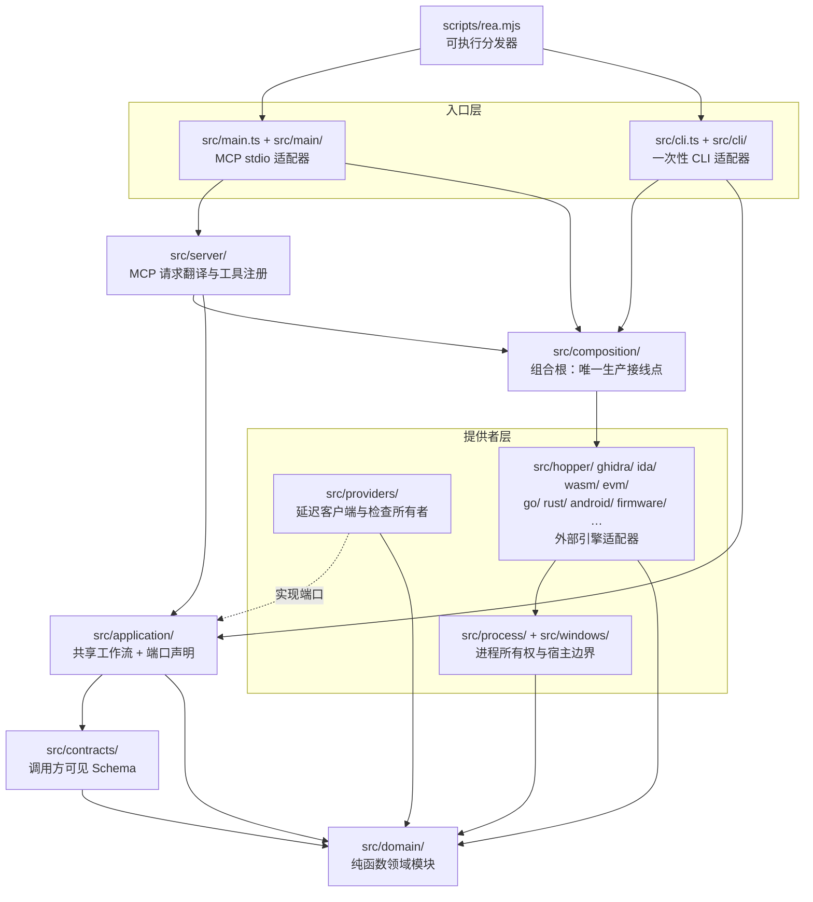

REA 的代码库采用严格的分层架构：可执行入口（CLI 与 MCP 服务器适配器）位于最外层，组合层（composition）作为唯一的生产接线点，应用层（application）承载共享工作流并以端口（port）解耦具体引擎，提供者层（providers 及各引擎目录）适配 Hopper、Ghidra、IDA 等外部工具，而领域层（domain）与契约层（contracts）则是无副作用的纯函数核心。本文档面向中级开发者，系统阐述各层的职责边界、依赖方向，以及这些规则如何被脚本自动化强制执行。仓库还在 [docs/architecture.mermaid](docs/architecture.mermaid#L1-L175) 中维护了一份官方架构图，本文的分析与之对齐。

## 五层结构：依赖只能向内流动

REA 的分层不是约定俗成的口头规范，而是一条明确的编译期导入规则：外层可以导入内层，内层绝不反向导入外层。最内层是 `src/domain/`（证据、比较、二进制目标等纯语义模块），其次是 `src/contracts/`（调用方可见的工具 Schema）；中间是 `src/application/`（CLI 与 MCP 共享的工作流）；再向外是提供者层（`src/providers/`、`src/hopper/`、`src/ghidra/`、`src/ida/`、`src/wasm/`、`src/evm/`、`src/process/`、`src/windows/` 等约二十个引擎与基础设施目录）；最外层则是 `src/cli.ts`/`src/main.ts` 两个入口和 `src/server/` 适配器，以及 `src/composition/` 组合层。官方架构图将入口、组合、适配器、应用层、提供者层、进程基础、契约层、领域层与配置划分为九个子图，并用带方向的箭头标注了每一组合法依赖，例如 `MAIN --> COMPOSITION`、`COMPOSITION --> GHIDRA`、`CONTRACTS --> DOMAIN`。

下表汇总了每一层的职责与其被允许的依赖对象，这是理解后续所有代码示例的基准框架：

| 层 | 主要位置 | 职责 | 允许依赖 |
| --- | --- | --- | --- |
| 入口层 | `src/main.ts`、`src/cli.ts`、`src/main/`、`src/cli/`、`scripts/rea.mjs` | 进程生命周期、参数解析、输出渲染 | 组合层、应用层、领域层（错误投影） |
| 适配层 | `src/server/` | MCP 请求翻译、工具注册、结果投递 | 组合层、应用层、契约层 |
| 组合层 | `src/composition/` | 构造提供者实例并绑定到应用层端口 | 应用层、全部提供者、领域层、配置 |
| 应用层 | `src/application/` | 共享工作流、端口与注册表声明 | 契约层、领域层、进程基础（类型） |
| 提供者层 | `src/providers/`、各引擎目录、`src/process/`、`src/windows/` | 外部引擎适配、进程所有权、快照生命周期 | 应用层端口（实现）、契约层、领域层 |
| 契约层 | `src/contracts/` | 工具输入/输出 Schema、错误 Schema | 仅领域层 |
| 领域层 | `src/domain/` | 纯函数、无副作用、证据与比较语义 | 无（叶子节点） |

Sources: [architecture.mermaid](docs/architecture.mermaid#L1-L175)

## 入口层：一个分发器，两种适配器

REA 的可执行入口是 `scripts/rea.mjs`，它同时是 npm 包的 `bin` 入口（`rea` 与 `rea-agents`）。分发器首先检查命令行参数：当且仅当参数恰为 `mcp` 或 `--mcp` 时进入长驻 MCP 模式，`mcp doctor` 进入诊断模式，否则走一次性 CLI 路径。这一判定发生在任何运行时模块加载之前，使得裸 `rea` 命令与 MCP 服务器共享同一个二进制却拥有完全独立的启动路径。

Sources: [rea.mjs](scripts/rea.mjs#L13-L15)、[package.json](package.json#L41-L44)

MCP 模式下，分发器动态导入 `dist/mcp/main.js` 并调用 `runEntrypoint()`；一次性模式下则导入 `dist/cli-runtime/cli.js` 与输出渲染模块。入口文件的依赖清单清晰地展示了"入口只向下依赖"的原则：`src/main.ts` 依次导入 `config/parseConfig`（配置解析）、`composition/binary`（组合根）、`server/toolResult`（投递策略）与 `main/` 下的传输、关闭逻辑，并在 `run()` 中按顺序执行——解析配置、创建 `BinarySession`、打开初始目标、启动 stdio 传输、安装关闭处理器。注意 `runEntrypoint` 刻意将意外启动异常脱敏为固定的 `SERVER_START_FAILED` 消息，避免向调用方泄漏内部细节。

Sources: [rea.mjs](scripts/rea.mjs#L44-L86)、[main.ts](src/main.ts#L40-L76)

CLI 入口 `src/cli.ts` 的形状与此对称：`createCli()` 工厂先调用组合层的 `createDirectAnalysis(environment)` 获得绑定了当前环境的一次性分析操作，再向 Incur 框架注册数十个命令模块（`registerSetupCommands`、`registerCoreAnalysisCommands`、`registerBrowserCommands` 等）。注释明确指出分析命令"各自获取并关闭自己的会话"，且裸 `mcp` 与 `--mcp` 已被分发器拦截、不会抵达此模块——两个入口由此保持了职责的互斥。

Sources: [cli.ts](src/cli.ts#L53-L68)、[cli.ts](src/cli.ts#L106-L120)

## 组合层：唯一的生产接线点

组合层的核心承诺写在 `src/composition/binary.ts` 的文档注释里："这是唯一的生产接线点，因此两个适配器共享完全相同的提供者选择、剖析、生命周期与证据语义"（sole production wiring point）。`createBinarySession` 在这里构造 `HopperProvider`、`GhidraProvider`、`IdaProvider`、`KunaProvider`、`ManagedStaticProvider` 等具体提供者实例，并将它们连同 `auxiliaryAnalysisProviderDeclarations` 交给应用层的 `composeBinarySession` 完成装配。任何提供者选择行为的差异都只能源于此处的改动，CLI 与 MCP 因此天然保持行为一致。

Sources: [binary.ts](src/composition/binary.ts#L17-L28)、[binary.ts](src/composition/binary.ts#L50-L57)

`src/composition/directAnalysis.ts` 展示了组合层绑定端口的另一个关键模式——**惰性动态导入**。它实现应用层声明的 `DirectAnalysisDependencies` 接口，但每个会话工厂（如 `createBinarySession`）的函数体内才 `await import("./binary.js")`，应用层工作流（`runDirectAnalysis`、`runProviderAnalysis`、`runSessionStatus`）同样通过动态导入延迟加载。这种写法保证了"构建 CLI 实例时不会启动 Hopper"，也让静态边界检查器能区分类型依赖与运行时构造。

Sources: [directAnalysis.ts](src/composition/directAnalysis.ts#L29-L43)、[directAnalysis.ts](src/composition/directAnalysis.ts#L60-L78)

组合层还承担子进程入口的解析职责。`package.json` 的 `imports` 字段将 `#javascript-analysis-worker` 与 `#web-bundle-analysis-worker` 两个包内导入映射到 `dist/composition/` 下的 worker 进程模块——这意味着即使是独立进程，其启动代码也归组合层所有，边界规则不会因进程拆分而失效。

Sources: [package.json](package.json#L37-L40)

## 应用层：以端口为中心的共享工作流

应用层的一切对外协作都通过**端口**表达。`DirectAnalysisDependencies` 接口只声明了配置读取器与六个会话工厂的函数签名，注释强调"读取调用方选定的配置而不咨询环境状态"（without consulting ambient state）——应用层从不触碰 `process.env`，环境快照由组合层提前固化后传入。工作流实现（如 `DirectAnalysis.ts`）接收这个接口作为第一参数，从而与具体引擎完全解耦。

Sources: [DirectAnalysisDependencies.ts](src/application/DirectAnalysisDependencies.ts#L6-L31)

MCP 服务器适配器 `src/server/createServer.ts` 是端口模式的最佳观察点：它的每一组工具注册都遵循"类型来自应用层、工厂来自组合层"的成对导入，例如 `import type { PacketCaptureService } from "../application/captures/…"` 与 `import { createPacketCaptureService } from "../composition/captures.js"`。文件头部的导入清单中，`BinarySessionPort`、`BrowserObservationPort`、`ElectronObservationPort`、`JavaScriptRuntimeObservationPort` 等十余个端口类型全部来自 `application/`，服务器对引擎的唯一接触面就是这些窄接口。

Sources: [createServer.ts](src/server/createServer.ts#L1-L2)、[createServer.ts](src/server/createServer.ts#L63-L70)

应用层同时是提供者契约的立法者。`AnalysisProvider.ts` 声明了 `AnalysisOperation`（工具操作的封闭联合类型）、`AnalysisClient` 接口与 `AnalysisExecution`（携带精确产出溯源的原子观察），其类型词汇大量取自领域层（`Result`、`AnalysisError`、`Evidence`、`BinaryTarget`）与契约层（各工具名联合类型）。这使"一次提供者调用产生什么形状的证据"成为应用层专属的语义决定，引擎适配者只能服从。

Sources: [AnalysisProvider.ts](src/application/AnalysisProvider.ts#L1-L41)

## 提供者层：可替换引擎与进程基础

`src/providers/` 目录存放跨引擎共享的客户端所有权基础设施。`DeferredAnalysisClient` 实现了应用层的 `AnalysisClient` 接口：构造时接收一个延迟加载函数，首次 `execute` 才真正拉起客户端；加载成功后发现客户端已关闭、或执行过程抛出非 `AnalysisError` 异常时，都会归一化为领域层的 `ProviderAdapterError`。这类"精确清理重试与归因失败"的所有者模式，是所有引擎提供者的公共底座。

Sources: [DeferredAnalysisClient.ts](src/providers/DeferredAnalysisClient.ts#L1-L38)

各引擎目录（`hopper/`、`ghidra/`、`ida/`、`kuna/`、`wasm/`、`evm/`、`go/`、`rust/`、`android/`、`firmware/` 等）是外部工具的适配器，它们向下依赖 `src/process/` 提供的进程所有权基础（拥有的进程组、私有运行时、截止时间、有界文件读取）与 `src/windows/` 的 Windows 宿主边界（加载器、作业对象、NTFS 准入），并最终落地为对领域层的纯语义引用。官方架构图中 `GHIDRA --> PROCESS`、`HOPPER --> HOPPER_BRIDGE`、`WINDOWS --> WINDOWS_NATIVE`（Node-API 原生实现）等边完整刻画了这条链路。

Sources: [architecture.mermaid](docs/architecture.mermaid#L37-L76)

值得强调的是**构造权与使用权分离**：应用层可以（通过端口）使用提供者，但不能构造已迁移的提供者。哪些目录被视为"已迁移提供者根"是由检查器里的 `MIGRATED_PROVIDER_ROOTS` 集合显式列出的——包括 `sqlite`、`evm`、`go`、`rust`、`wasm`、`captures`、`signals`、`android`、`firmware`、`ghidra`、`hopper`、`ida`、`inspector`、`javascript` 十四个目录，外加 `ArtifactProvider`、`ManagedStaticProvider`、`NativeMacOSProvider` 与 `browser/*Provider` 等具名提供者。应用层与服务器对这些符号的任何直接导入都会被判为 `provider-construction` 违规。

Sources: [module-boundaries.mjs](scripts/lib/module-boundaries.mjs#L6-L22)

## 纯层：领域与契约的向心约束

`src/domain/` 是整个系统的语义核心。一个典型样本是 `result.ts`——11 行代码定义了 `Result<T, E>` 判别联合与 `ok`/`err` 构造器，零依赖、零副作用、零 I/O。领域层承载证据模型、比较语义、二进制目标类型、规范摘要等所有"纯知识"，任何一层都可以导入它，而它不导入 `src/` 下的任何其他目录。契约层与之同级：检查器将 `domain` 与 `contracts` 同置于一组 `PURE_LAYERS`，规则是纯层只能互相引用，一旦导入 `src/<其他目录>/` 或 `src/cli.ts`、`src/main.ts` 即产生 `pure-layer` 违规。

Sources: [result.ts](src/domain/result.ts#L1-L11)、[module-boundaries.mjs](scripts/lib/module-boundaries.mjs#L58-L106)

纯层还受到第二重约束——**架构守卫**（architecture guards）。`scripts/verify/architecture-guards.mjs` 对全部 `src/` 源码做正则审查：领域层禁止使用 `localeCompare`（ICU 结果随宿主变化，必须改用领域自己的 `compareUnicodeCodePoints` 保证证据排序与区域设置无关）；复合去重键禁止 NUL 直接拼接（改用 `compositeKey` 唯一所有者）；透明包装器只能在 `javascriptAstValues.unwrapJavaScriptExpression` 一处解包；AST 遍历必须走 `traverseJavaScriptAst`/`childNodes` 而非自写访问器。这些规则守护的不是目录边界，而是纯层内部的**语义不变量**。

Sources: [architecture-guards.mjs](scripts/verify/architecture-guards.mjs#L1-L93)

测试基础设施同样按纯度区别对待。`vitest.config.ts` 为 `src/domain/**` 与 `src/contracts/**` 设置了显著高于全局的覆盖率阈值（语句 80%/85%，分支 75%/80%，而全局为 65%/60%），并且 `domain` 测试项目关闭了模块隔离——注释说明"领域与契约模块是纯的、不拥有进程级全局状态，逐文件隔离只会增加启动成本而不保护任何接缝"。

Sources: [vitest.config.ts](vitest.config.ts#L146-L174)、[vitest.config.ts](vitest.config.ts#L29-L45)

## 依赖规则的机器强制执行

上述所有分层规则都由 `scripts/lib/module-boundaries.mjs` 机器执行。该脚本用 Babel 解析每个 `src/` 下的 TypeScript 文件，解析全部导入声明（含 `import type`、re-export 与动态导入），把相对/绝对/`file:` 说明符解析为仓库路径，然后交给 `failedBoundary` 判定。该函数依次检查五类边界，任一命中即记录违规并使验证进程以非零码退出：

| 违规类别 | 触发条件 | 架构含义 |
| --- | --- | --- |
| `pure-layer` | `domain`/`contracts` 导入任何其他 `src` 目录或 `cli.ts`/`main.ts` | 纯层必须保持向心性 |
| `application-composition` | `application` 导入 `composition` | 应用层不能知道接线细节 |
| `provider-construction` | `application`/`server` 导入已迁移提供者根或具名提供者 | 构造权归组合层独占 |
| `process-capture` | `src/process/capture/` 导入上层（application/composition/server/cli/main） | 进程捕获不得回调业务层 |
| `artifact-acquisition` | `artifacts` 各子层（javascript/apple/inventory/extraction 等）导入上层 | 工件获取保持为被动读侧 |

Sources: [module-boundaries.mjs](scripts/lib/module-boundaries.mjs#L58-L106)、[module-boundaries.mjs](scripts/lib/module-boundaries.mjs#L109-L137)

执行入口有三条且全部挂接在既有质量门禁上：`verify:module-boundaries` 脚本被 `lint`、`lint:details`、`lint:fix` 三个命令串联调用，意味着每次 lint 都会重跑边界检查；`check` 与 `check:ci` 则额外调用 `verify:architecture-guards`，把语义守卫纳入 CI 静态检查阶段。换句话说，一次违反分层的提交无法通过 PR 门禁——规则不是文档里的愿望，而是会阻塞合并的断言。

Sources: [package.json](package.json#L112-L133)、[package.json](package.json#L182-L182)、[package.json](package.json#L286-L286)

测试套件本身也按层组织，形成与生产代码同构的验证矩阵。`scripts/lib/test-projects.mjs` 定义的 `domain` 项目恰好覆盖 `src/{contracts,domain}`，`services` 项目覆盖 `src/application`，`adapters` 项目枚举了全部提供者与 `server` 目录，`composition` 项目对应 `tests/composition/`，而入口层则由 `cli-boundary`、`mcp-boundary` 与 `process-boundary` 三个独立项目守护。层的边界在哪里，测试的隔离与并行策略就在哪里调整。

| Vitest 项目 | 测试路径 | 层对应 | 执行策略 |
| --- | --- | --- | --- |
| `domain` | `src/{contracts,domain}/**/*.test.ts` | 领域 + 契约 | 线程池、共享模块图 |
| `services` | `src/application/**/*.test.ts` | 应用层 | 线程池、录制端口 |
| `adapters` | 其余全部 `src/` 子目录 | 提供者 + 服务器 | 进程隔离（forks） |
| `composition` | `tests/composition/**/*.test.ts` | 组合层 | 提供者中立会话 |
| `cli-boundary` / `mcp-boundary` | `tests/boundary/{cli,mcp}/` | 入口层 | 独立项目、内存 MCP 会话 |
| `acceptance` | `tests/acceptance/**/*.test.ts` | 端到端旅程 | 进程隔离（forks） |

Sources: [test-projects.mjs](scripts/lib/test-projects.mjs#L4-L35)、[vitest.config.ts](vitest.config.ts#L46-L75)

## 延伸阅读路径

理解分层架构之后，建议按以下顺序继续深入：先读[证据与不确定性模型](6-zheng-ju-yu-bu-que-ding-xing-mo-xing-guan-cha-tui-dao-tui-duan-yu-wei-zhi-de-bao-liu-yu-yi)，掌握领域层最核心的证据语义；再读 [MCP 工具设计原则](7-mcp-gong-ju-she-ji-yuan-ze-liu-chong-ren-wu-xing-zhuang-yuan-yu-you-xian-yu-qi-yue-yan-ge-xing)与 [MCP 契约参考](8-mcp-qi-yue-can-kao-gong-ju-jie-guo-bao-liu-zheng-ju-hui-hua-fa-xian-yu-qu-xiao-hui-fu)，了解契约层与应用层端口如何映射为调用方可见的工具表面；若你计划参与贡献，[测试策略与验证通道](27-ce-shi-ce-lue-yu-yan-zheng-tong-dao-yuan-ma-bian-jie-yan-shou-zhi-xing-ji-zhen-shi-gong-ju-lian-tong-dao)将展开本文中测试矩阵的完整细节，[CLI 使用与就绪诊断](4-cli-shi-yong-yu-jiu-xu-zhen-duan-rea-ming-ling-json-shu-chu-yu-doctor-jian-cha)则从使用者视角补充入口层的行为契约。