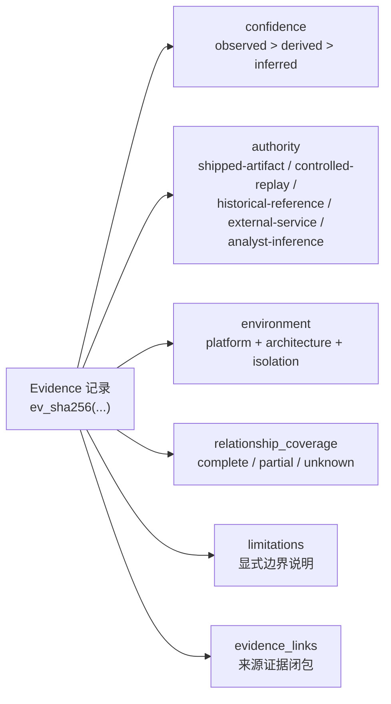
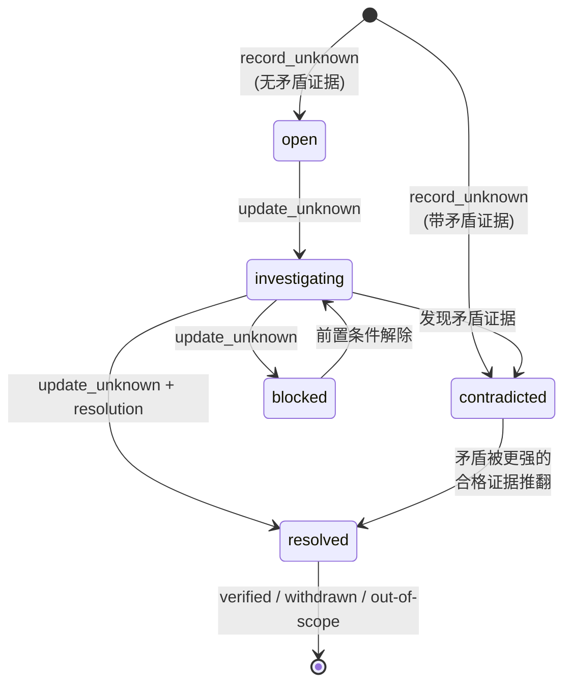

逆向工程本质上是一场在信息不完整条件下进行的推理活动：目标二进制不会主动承认它的行为，分析者得到的是不完整的反汇编、部分可用的反编译输出和偶尔才能获得的运行时观察。REA 把这种认识论约束直接编码进数据模型——每一次分析结论都以一条可认证、可追溯、可组合的 **Evidence（证据）记录** 存在，每一个尚未回答的问题都以一条带修订链的 **Residual Unknown（残余未知）** 持久保留。本页从领域层代码出发，解释这两个模型的字段语义、置信度排序、合格证据判定规则，以及它们在会话账本与证据包中的保留行为。阅读本页前，建议先了解分层架构的依赖规则（见[分层架构总览](5-fen-ceng-jia-gou-zong-lan-ru-kou-zu-he-ying-yong-ti-gong-zhe-yu-ling-yu-ceng-de-yi-lai-gui-ze)）。

## 证据记录：一次公开观察的完整快照

Evidence 的骨架是一条严格模式（`strictObject`）的 provider 中立记录，描述"谁、在什么环境下、用什么操作、对哪个目标、得到了什么结果"。`subject` 通过 SHA-256 摘要、格式与架构三元组锚定被观察的工件；`provider` 记录产生观察的引擎身份；`raw_result` 保留上游工具的原始表示（没有则为 `null`），`normalized_result` 则是归一化后的操作结果；`locations` 用五种判别联合（地址、地址区间、工件路径、文件偏移、文件偏移区间）声明结论在目标中的位置；`evidence_links` 指向本条证据所依赖的来源证据 ID。整个 envelope 还要求 `analysis_profile`（若非 null）的 provider 必须与记录本身的 provider 完全一致，防止"档案声称 A 引擎观察、记录却署名 B 引擎"的错配。

Sources: [evidence.ts](src/domain/evidence.ts#L127-L172)

每条证据的 `evidence_id` 不是随机 UUID，而是对其**语义投影**的规范化 JSON 摘要（`ev_` 前缀 + SHA-256）。投影刻意排除了展示性字段——`subject` 只保留 digest/format/architecture，丢弃 `name` 与 `local_path`；但刻意包含了 `raw_result`、`limitations`、`relationship_coverage` 等全部认识论相关字段。这个设计带来两个直接后果：其一，同一条证据可以在不同路径下重新绑定展示位置（`rebindEvidenceToTargetPath`）而身份不变，因为"文件放在哪里"不属于语义；其二，任何字段的篡改都会破坏摘要匹配，`parseEvidence` 会拒绝语法有效但语义 ID 对不上的记录，即**防篡改认证**。已认证的证据会被深冻结为不可变快照，并通过 WeakMap 复用，下游零拷贝读取时无需再次解析。

Sources: [evidence.ts](src/domain/evidence.ts#L251-L288)

还有一个容易被忽略的细节：当观察无法获得目标身份时（`target === undefined`），`subject` 为 null，且一条限制说明会被自动写入 `limitations`——要么是调用者给出的 `subjectUnavailableReason`，要么是默认的 "Artifact identity is unavailable for this observation."。也就是说，"不知道这条结论对应哪个工件"本身就是被显式记录的事实，而不是被静默吞掉的缺失。

Sources: [evidence.ts](src/domain/evidence.ts#L386-L455)

## 置信度与权威：不确定性的两个正交维度

Evidence 用两个独立字段表达结论的认识论强度。`confidence` 回答"这个结论是怎么得出的"，取三档：`observed`（直接观察，默认值）、`derived`（从已保留证据推导）、`inferred`（带假设的推断）。`authority` 回答"这个结论凭什么材料成立"，取五档：`shipped-artifact`（发行工件本身，默认值）、`controlled-replay`（受控重放）、`historical-reference`（历史参考）、`external-service`（外部服务）、`analyst-inference`（分析者推断）。两个维度正交：一条受控重放得到的观察是"observed + controlled-replay"，而一条从静态图谱推出的调用路径则是"derived + analyst-inference"。

| confidence | 语义 | 产生方式 |
|---|---|---|
| `observed` | 直接观察事实，默认档 | 提供者工具（如 `analyze_function`）的原始结果 |
| `derived` | 从已保留证据确定性推导 | 派生工作流工具（如 `build_call_path`） |
| `inferred` | 依赖假设的推断，最弱档 | `correlate_static_and_runtime` 等相关性分析 |

Sources: [evidence.ts](src/domain/evidence.ts#L138-L146)

| authority | 语义 | 典型场景 |
|---|---|---|
| `shipped-artifact` | 发行工件静态事实，默认档 | 反汇编、元数据清单 |
| `controlled-replay` | 受控场景重放的运行时观察 | 进程场景捕获 |
| `historical-reference` | 历史版本或存档参考 | 版本对比 |
| `external-service` | 外部服务返回的数据 | 链上元数据查询 |
| `analyst-inference` | 分析者/工作流自身的推断 | 所有派生工作流证据 |

Sources: [evidence.ts](src/domain/evidence.ts#L112-L118)

第三条正交轴是 `environment`：`id`/`platform`/`architecture`/`isolation` 四元组，其中 `isolation` 取 `none|process|container|virtual-machine`。这条轴稍后会在"合格证据判定"中发挥关键作用——一个问题的答案可能只在特定隔离级别的环境中才算数。

Sources: [evidence.ts](src/domain/evidence.ts#L120-L125)

下面的概念图总结了三个不确定性维度如何共同装饰一条证据记录：

## 覆盖状态与限制：显式编码的认知边界

Evidence 携带 `relationship_coverage` 字段，要求提供者对"我观察到的调用者/被调用者集合是否完整"作出三选一的显式声明：`complete`（完整）、`partial`（部分，必须给出 limitations）、`unknown`（未知，必须给出 reason）。这个设计直接支撑了契约层的一条重要语义——契约文档明确写道："A provider did not report relationship coverage" 会被翻译成一条 limitation，而"带有部分覆盖的空调用列表不能证明该函数没有调用"。

Sources: [relationshipCoverage.ts](src/domain/relationshipCoverage.ts#L8-L52)

这种"覆盖独立于诊断措辞"的原则贯穿整个模型：工件清单用 `coverage.status`（`complete`/`unknown`）与诊断文本互相独立；函数档案用 `facet_availability` 逐面声明伪代码、汇编、CFG 等切面是"观察到为空"还是"根本不可用"——观察到空集可以被声明为 available 从而保持可比较，而缺失的反编译输出只能声明为 unavailable。

Sources: [mcp-contracts.md](docs/mcp-contracts.md#L18-L66)

## 推导证据与证据闭包

REA 的四个派生工作流工具——`find_changed_behavior`、`build_call_path`、`correlate_static_and_runtime`、`verify_reconstruction`——都不直接触碰目标，而是**从会话账本中已保留的证据推导新结论**。注册流程遵循统一模式：先对输入引用的证据 ID 做闭包校验，再计算结果，最后把新证据与源链接一起原子记录。

Sources: [registerInvestigationTools.ts](src/server/registerInvestigationTools.ts#L29-L57)

`evidenceClosure` 是这个模式的守门人：它以种子 ID 为起点，在会话证据包上做图遍历，把每个种子及其 `evidence_links` 递归可达的全部证据 ID 收进一个排序去重的闭包。任何悬空链接（引用了账本中不存在的 ID）都会被拒绝为完整性错误——派生证据不允许建立在账本无法出证的来源上。

Sources: [helpers.ts](src/server/registerInvestigationTools/helpers.ts#L31-L51)

闭包通过后，派生工具用 `createEvidence` 构造新记录：`predicate_type` 标识工作流类型（如 `rea.changed-behavior`、`rea.call-path`、`rea.static-runtime-correlation`），`confidence` 与 `authority` 按推导性质设为 `derived`/`analyst-inference`（静态-运行时相关性例外地用更弱的 `inferred`），`evidenceLinks` 指向闭包，`limitations` 原样继承结果的边界说明。

Sources: [registerInvestigationTools.ts](src/server/registerInvestigationTools.ts#L78-L106)

## 残余未知：可验证的未决问题

当一个派生结论的状态是 `unknown` 或 `truncated`，工作流不会让这个问题消失，而是自动创建一条 Residual Unknown 记录。它的身份是内容寻址的：`unknown_id` 是对规范化 JSON（`domain` + 空白归一化的 `question` + `scope_digest` + 可选的对比结论范围）的 SHA-256 摘要（`unk_` 前缀）。这意味着**相同的问题+领域+调查范围只会存在一个未知**——重复提交相同结果不会产生第二条记录。

Sources: [residualUnknown.ts](src/domain/residualUnknown.ts#L25-L46)

每条未知是一个不可变的修订链节点：`revision` 从 1 递增，`previous_revision_digest` 链接上一修订的摘要（只有第 1 修订为 null），`revision_digest` 对修订内容做哈希。模式层强制这些不变量——修订 1 必须没有前驱、有前驱就必须有正确摘要，且修订历史不允许断裂或跳跃。

Sources: [residualUnknown.ts](src/domain/residualUnknown.ts#L80-L124)

未知的核心是它的**状态机**与**解答要求**：

| 字段 | 取值 | 语义 |
|---|---|---|
| `status` | `open` / `investigating` / `blocked` / `contradicted` / `resolved` | 生命周期状态；创建时若带矛盾证据则直接进入 `contradicted` |
| `severity` | `low` / `medium` / `high` / `critical` | 未决问题的严重度 |
| `required_authority` | 五档权威或 `null` | 解答所需的最低材料等级 |
| `required_confidence` | `observed` / `derived` / `inferred` | 解答所需的最低置信度 |
| `required_environment` | 四元组（字段可为 `null` 通配） | 解答所需的环境要求 |
| `recommended_probes` | `{operation, rationale}` 列表 | 建议执行的下一步探测操作 |

Sources: [residualUnknown.ts](src/domain/residualUnknown.ts#L94-L121)

状态机转换由显式的全量替换命令驱动，并带乐观并发控制——`update_unknown` 必须携带 `expected_revision`，与当前头修订不匹配即报 `revision-conflict`，避免两个代理互相覆盖彼此的解答。

Sources: [residualUnknown.ts](src/domain/residualUnknown.ts#L268-L284)

关系字段让未知之间形成有向图：`depends-on`、`related-to`、`contradicts` 三种边（不允许自指、不允许重复），且依赖图禁止成环。三种处置（disposition）终结一条未知：`verified`（已验证，必须引用至少一条证据）、`withdrawn`（撤回）、`out-of-scope`（超出范围）。

Sources: [residualUnknown.ts](src/domain/residualUnknown.ts#L63-L78)

还有一个精妙的自我指涉设计：**每一次对未知的增改本身就是一条证据**。`unknownMutationEvidence` 以 `rea.residual-unknown-mutation` 为谓词类型、`rea-unknown-registry` 为提供者身份，把这次变更的意图（记录了什么问题、要求什么等级、改成什么状态）固化为不可变证据，并通过 `mutation_evidence_ids`（至少一条）挂回未知。这条证据自带的 limitation 一语道破其语义边界："Registry mutation evidence records analyst intent, not proof of the answer."——登记"我认为问题已解决"不等于答案本身被证明。

Sources: [UnknownEvidence.ts](src/application/investigation/UnknownEvidence.ts#L16-L50)

## 合格证据判定：verified 处置的硬校验

"verified" 处置不是自由文本声明——证据包验证器会强制检查至少存在一条**合格证据**（qualifying evidence）。判定规则在 `evidenceQualifies` 中实现，它把三个置信维度的排序变成了可执行的合同：

| 检查项 | 规则 | 失败后果 |
|---|---|---|
| 支持关系 | 证据必须在 `supporting_evidence_ids` 中，且不是 `rea.residual-unknown-mutation` 记录 | 无合格证据，verified 被拒 |
| 权威匹配 | 若 `required_authority` 非 null，证据 `authority` 必须**精确等于**要求值 | 不合格 |
| 置信度排序 | 证据 `confidence` 排名 ≥ 要求值，排序为 `inferred=1 < derived=2 < observed=3` | 不合格 |
| 环境匹配 | `required_environment` 的每个非 null 字段必须与证据 environment 精确匹配（null 为通配） | 不合格 |

Sources: [evidenceBundle.ts](src/domain/evidenceBundle.ts#L489-L516)

注意权威维度用的是**精确匹配**而非排序：要求 `controlled-replay` 时，`shipped-artifact` 也不能替代——因为"更高级"的材料在不同权威之间没有全序，重放观察和静态事实是不可互换的证明类型。而置信度维度允许超集：要求 `derived` 时 `observed` 证据合格。这套校验在整包导入（`validateUnknownGraph`）与增量追加（`validateResidualUnknownAddition`）两条路径上都会执行，且矛盾证据残留时 verified 会被直接拒绝。

Sources: [evidenceBundle.ts](src/domain/evidenceBundle.ts#L392-L413)

会话层暴露的 `verify_unknown_resolution` 把这个结论以两个布尔值返回给代理：`valid` 只看状态是否为 `resolved`，`truthVerified` 额外要求处置是 `verified`——这两个值的分离让"程序上关闭了"与"被合格证据证明了"成为两个可分别报告的事实。

Sources: [EvidenceLedger.ts](src/application/investigation/EvidenceLedger.ts#L360-L377)

## 保留语义：会话账本、目标绑定与证据包传递

Evidence 与 Unknown 的"保留"发生在三个层次，各有一套精确的规则。

**第一层：会话账本（EvidenceLedger）。** 每条证据按 `evidence_id` 幂等记录——同 ID 同内容重复记录返回 `duplicate`，同 ID 不同内容（冲突）直接拒绝为完整性错误。账本随连接存活：契约文档明确了生命周期——打开另一个目标或重启当前目标都**保留**已记录的证据（即使提供者清理失败，记录仍可导出与重试），`close_binary` 清空它们，新连接有自己独立的账本。

Sources: [EvidenceLedger.ts](src/application/investigation/EvidenceLedger.ts#L43-L56)

**第二层：retained-evidence 引用。** 每个产出证据的工具成功响应都携带 `evidence_id` 与 `evidence_reference: {"kind":"retained-evidence","evidence_id":"ev_..."}`；后续工具可以用这个精确引用替代内联完整记录，例如把 `analyze_function` 的证据直接喂给 `compare_functions`。两种输入形式走同一套语义、身份、权威与来源校验，不会重复运行生产者。引用缺失时报错给出确切 ID 与 `details.reason: "missing"`，且服务器**刻意不推断**缺失原因——是从未记录、被清理、还是别的连接保留的，服务器无法知道。

Sources: [toolResult.ts](src/server/toolResult.ts#L61-L79)

**第三层：目标绑定的证据包（bundle）。** `export_evidence_bundle` 把账本序列化为规范 JSON 文件：七类清单（artifacts/providers/environments/scenarios/captures/unknowns/records）排序去重、顺序无语义，整包必须与规范化投影逐字节一致，否则拒绝为非规范包。导包是原子的——先完整验证（每条证据重新认证、未知修订链连续且哈希链完整、所有被引用的证据与未知存在、verified 处置有合格证据、依赖图无环），再合并新增；验证失败时保留的会话状态一字不变。

Sources: [evidenceBundle.ts](src/domain/evidenceBundle.ts#L295-L332)

`evidenceBundleForTarget` 实现了最精细的保留规则——**按目标摘要裁剪**。一条未知的历史要被保留，必须满足：它的**每一个修订**的 `scope_digest` 都等于该目标的 SHA-256，且它引用的全部证据（支持、矛盾、变更、处置）要么本身属于该目标，要么是变更登记记录（变更的主体记录的是编辑当时的活动目标，不必等于问题的调查范围）。合格未知的关系闭包再走一轮级联删除——若某条未知的关系指向被淘汰的未知，它自己也出局。幸存未知的变更证据随之保留。这让"换一个目标继续调查"不会携带无关目标的未知问题，同时保证保留下来的问题仍然出得了证。

Sources: [evidenceBundle.ts](src/domain/evidenceBundle.ts#L155-L220)

## 自动化未知生成：派生工具的提问协议

四个派生工具在结果不完整时，把一个结构化问题连同其**不可变结果证据 ID** 自动写入未知登记表。`workflowUnknownInput` 把结果证据 ID 拼进问题文本（`"... (Evidence ev_...)"`）并设为唯一支持证据——因为问题由该结果的摘要寻址，重复计算同一结果不会产生第二个未知；而显式调用 `record_unknown` 的代理则保留自己选择的身份，重复创建会被拒绝。

Sources: [WorkflowUnknown.ts](src/application/investigation/WorkflowUnknown.ts#L17-L30)

各工具的自动提问协议如下表所示。注意问题的措辞本身就是认识论声明：`find_changed_behavior` 要求 `observed` + `controlled-replay`——静态对比永远不能证明"两个版本行为相同"；`build_call_path` 只要求 `derived` + `shipped-artifact`——完整的静态调用者档案就足以关闭路径可达性问题。

| 工具 | 触发条件 | 领域 | required_authority | required_confidence | 建议探测 |
|---|---|---|---|---|---|
| `find_changed_behavior` | `behavior_status` ∈ {unknown, truncated} | `changed-behavior` | `controlled-replay` | `observed` | `capture_process_scenario` |
| `build_call_path` | `status === "unknown"` | `call-path` | `shipped-artifact` | `derived` | `analyze_function` |
| `correlate_static_and_runtime` | `status` ∈ {unknown, truncated} | `static-runtime-correlation` | `null` | `derived` | `capture_process_scenario` |
| `verify_reconstruction` | `status === "unknown"` | `reconstruction-verification` | `null` | `derived` | 结果自带的 `recommended_probes` |

Sources: [registerInvestigationTools.ts](src/server/registerInvestigationTools.ts#L107-L120)

记录路径由 `recordDerivedEvidence` 统一收口：带未知时走 `recordEvidenceWithUnknown` 的原子双写，不带时仅记录证据——要么都成功，要么都失败，不会出现"证据在、问题丢了"的中间态。

Sources: [recordDerivedEvidence.ts](src/server/recordDerivedEvidence.ts#L7-L20)

同样的模式也出现在边界层：调用路径追踪把每次受限的展开记入 `residual_unknowns` 并置 `truncated: true`，目标未达时 `goal_status` 为 `unknown` 而展开穷尽则是 `not_reached`——未完成的遍历与被否定的结论保持了类型上的区分。

Sources: [mcp-contracts.md](docs/mcp-contracts.md#L81-L91)

## 面向代理的查询与超限恢复

未知登记表通过四个 MCP 工具暴露：`list_unknowns`（按 status/severity/domain 过滤，稳定 ID 序分页，`total` 计数，`next_offset` 翻页）、`record_unknown`、`update_unknown`（乐观并发）、`verify_unknown_resolution`。分页反映当前会话状态，契约建议遍历期间保持账本不被变更。

Sources: [registerSessionRecordTools.ts](src/server/registerSessionRecordTools.ts#L160-L236)

保留语义还延伸到两条恢复路径。其一是**超限保留**：超出 stdio 响应预算的结果不会被截断——完整的分析证据保留在会话中，错误响应携带 `evidence_reference` 指回它，原生的伪代码结果还附带一段可直接调用的 `inspect_analysis_view` 续读请求；同样，执行失败但已捕获部分观察时，错误详情里的 `partial_observation` 引用让代理能找回已完成的部分。其二，超大的错误诊断本身也会先保留为证据，再投递有界的可恢复诊断与导出引用。

Sources: [toolResult.ts](src/server/toolResult.ts#L22-L35)

派生证据还有一个终端形态——**完成账本（completion ledger）**。`verify_reconstruction` 的验证器为每条声明记录一个五值终态：`pass`、`fail`、`unsupported`、`truncated`、`unknown`。注意 `unknown` 与 `unsupported` 的分工：前者是"验证器无法回答"，后者是"声明超出验证器能力"。账本 ID 是记录集的哈希（`ecl_` 前缀），汇总统计含 `complete` 布尔值，且整本账本无路径依赖，可独立于生成它的会话流转。

| 状态 | 含义 |
|---|---|
| `pass` | 声明被合格验证器证实 |
| `fail` | 声明被证伪 |
| `unsupported` | 验证器不支持该声明的验证 |
| `truncated` | 验证被预算截断 |
| `unknown` | 验证器无法给出结论 |

Sources: [evidenceCompletionLedger.ts](src/domain/evidenceCompletionLedger.ts#L14-L52)

最后，这套模型向下游的重建义务账本输出保守性：`build_reconstruction_obligation_ledger` 生成的每条义务都携带 `residual_unknown_ids`，而未决的残余未知正是保持义务无法关闭的原因之一——"Conservative by design"在这个代码库里不是口号，而是从 `confidence` 排序到 `evidenceQualifies` 判定、再到义务闭合条件的一条贯穿始终的证明链。

Sources: [reconstruction-obligation-ledgers.md](docs/reconstruction-obligation-ledgers.md#L1-L16)

## 小结与延伸阅读

REA 的证据与不确定性模型可以压缩为四条不变量：**结论必须出证**（每条结论是一条防篡改、可重绑定的 Evidence）；**来源必须闭包**（派生证据的链接图不允许悬空）；**未知必须持久**（未决问题是内容寻址、修订链完整、可并发更新的持久记录）；**关闭必须合格**（verified 处置需要通过权威精确匹配、置信度排序、环境匹配三重校验的支持证据）。理解了这套语义，下一步可以沿着两条路径深入：横向看工具契约如何把这些语义暴露给代理，见[MCP 契约参考：工具结果、保留证据、会话发现与取消恢复](8-mcp-qi-yue-can-kao-gong-ju-jie-guo-bao-liu-zheng-ju-hui-hua-fa-xian-yu-qu-xiao-hui-fu)；纵向看真实调查中证据如何积累与消解，见[原生二进制调查工作流：函数档案、引用与 Go/Rust 元数据、离线布局诊断](10-yuan-sheng-er-jin-zhi-diao-cha-gong-zuo-liu-han-shu-dang-an-yin-yong-yu-go-rust-yuan-shu-ju-chi-xian-bu-ju-zhen-duan)。若你想从设计动机回溯这套模型，[MCP 工具设计原则：六种任务形状、原语优先与契约严格性](7-mcp-gong-ju-she-ji-yuan-ze-liu-chong-ren-wu-xing-zhuang-yuan-yu-you-xian-yu-qi-yue-yan-ge-xing)解释了为什么证据记录被选为派生工具的公共交换格式。