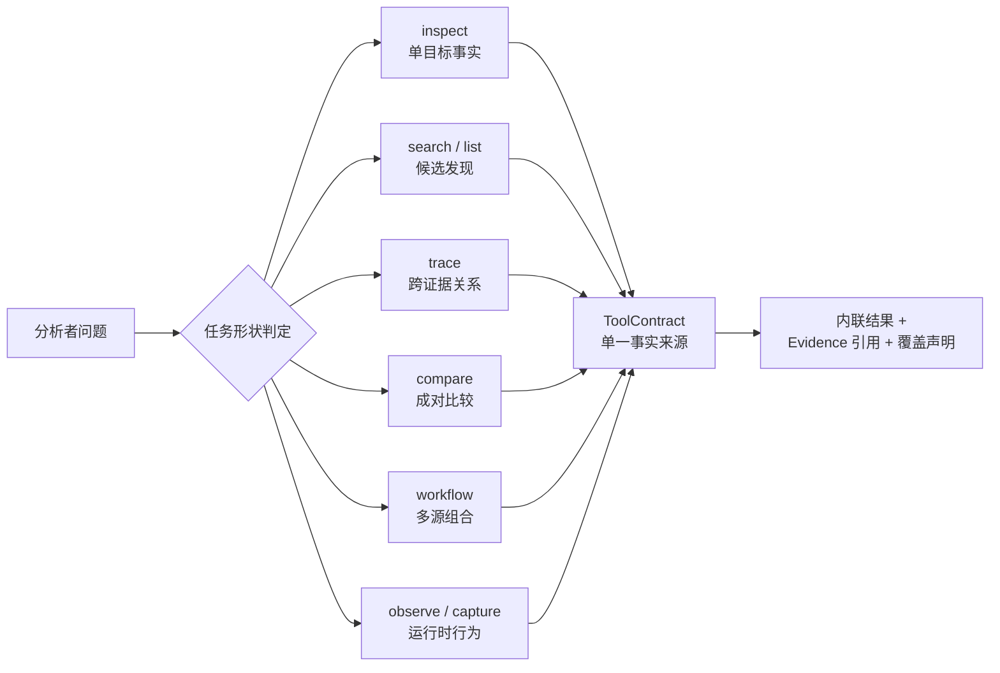
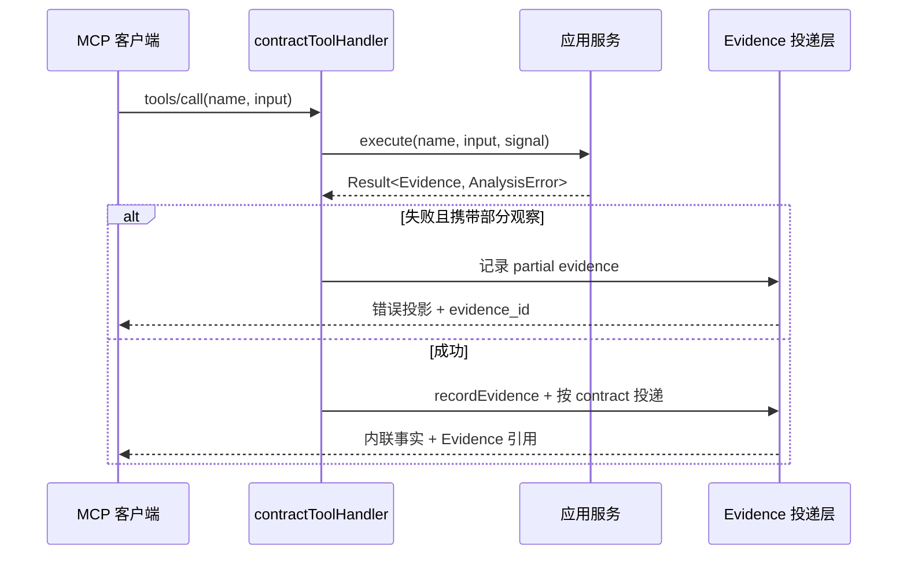

REA 的 MCP 工具面不是外部引擎 API 的机械映射，而是一套以**分析者问题**为起点、以**契约单一事实来源**为终点的设计体系。本页阐述该体系的三根支柱：工具必须归结为六种**任务形状**之一；功能新增遵循**原语优先、工作流组合**的排序规则；所有公开工具必须通过**严格契约**声明输入、输出、效果与信任边界。本页聚焦设计原则本身及其在代码中的落地形态；已发布工具的运行时行为详见 [MCP 契约参考：工具结果、保留证据、会话发现与取消恢复](8-mcp-qi-yue-can-kao-gong-ju-jie-guo-bao-liu-zheng-ju-hui-hua-fa-xian-yu-qu-xiao-hui-fu)。

Sources: [tool-design.md](docs/tool-design.md#L1-L13)

## 设计起点：以分析者问题决定工具边界

新增或修改工具的第一个判据不是提供者有什么能力，而是分析者要回答什么问题。仓库规范要求：改变工具面之前必须检查当前的规范化契约、提供者能力声明，以及最接近的现有工具。判定的分界线是**意图与结果契约**——当两者都匹配时扩展现有工具，当产出是截然不同的结果或需要实质上不同的权限时才新增工具。公开名称与语义保持提供者中立，具体覆盖范围由每个提供者在结果中如实报告。

目录完整性是第二条硬性约束：代理看到的工具目录必须完整报告能力与会话可用性，而不是通过截断模式（schema）来"藏起"不可用功能。序列化后的字节本身不能证明对代理可用——这是整份设计文档反复出现的立场。

Sources: [tool-design.md](docs/tool-design.md#L3-L13)

## 六种任务形状：结果形态决定工具形态

REA 将所有 MCP 工具归结为六种任务形状。形状由**它返回什么**决定，而不是由调用动词决定：`inspect` 返回单目标的相关字段、位置与切面可用性；`search`/`list` 返回稳定排序的候选集与必要的分页；`trace` 返回类型化的边、支撑事实与未解析路径；`compare` 返回成对对象的身份、可比较覆盖面与受支持的差异；`workflow` 返回内联答案、贡献证据与部分切面；`observe`/`capture` 返回权限声明、启动/附加效果、生命周期与清理状态。

| 形状 | 适用问题 | 结果形态 |
| --- | --- | --- |
| `inspect` | 关于单个目标、对象或资源的事实 | 相关字段、位置与切面可用性 |
| `search` / `list` | 候选发现 | 稳定排序与上下文；查询或格式需要时提供分页 |
| `trace` | 跨证据的关系 | 类型化边、支撑事实、未解析路径 |
| `compare` | 显式成对的工件或观察 | 身份、可比较覆盖面、受支持的差异 |
| `workflow` | 需要组合的重复性产出 | 内联答案、贡献证据、部分切面 |
| `observe` / `capture` | 运行时行为 | 权限、启动/附加效果、生命周期、清理状态 |

规范明确指出这些是**任务形状而非强制前缀**：工具命名应围绕调用者推理所用的动作与对象。单个工具内部禁止混杂无关的发现、执行与变更模式。这套分类在代码中有直接投影——`src/contracts/toolEffects.ts` 中的效果审计表按名称逐一登记了每个公开工具，其中 `compare_artifacts`、`compare_functions`、`compare_bundles` 等正是 `compare` 形状的实例，而 `list_unknowns`、`trace_web_module_imports`、`inspect_go_binary`、`observe_web_execution` 分别对应其余形状的命名风格。

Sources: [tool-design.md](docs/tool-design.md#L14-L27), [toolEffects.ts](src/contracts/toolEffects.ts#L702-L715)

上图的判定流程体现了一个关键架构事实：形状是契约的**上游约束**——先确定调用者拿到什么结果，再进入统一的契约定义，而不是每个工具各自发明返回结构。

Sources: [tool-design.md](docs/tool-design.md#L14-L27)

## 原语优先与工作流组合

"原语"（primitive）的定义被精确限定为：**报告一个已标识对象或关系的可复用事实**。格式特定的解码器符合原语资格；而某个应用程序的业务解释必须留在通用契约之外。这条规则的边界划得非常清楚——REA 暴露的是可复用的分析事实层，不是对某个被分析应用的产品级理解。当提供者 API 提供现有工具无法表达的有用能力时才予以暴露。

工作流的晋升门槛同样刻意设高：只有当**重复使用**证明了一个 REA 可以在**不隐藏调用者选择或不确定性**的前提下连接的多源产出时，才组合一个 workflow 工具。批量同质读取在消除重复工作的同时必须保留逐项结果。提示（prompt）保持可选，且禁止规定直接工具即可替代的调用序列。

对代理自主实验的支持采取了"默认放行、例外设限"的姿态：代理可以用普通命令、脚本和本地 fixture 服务器组合实验；自定义编排语言、重放引擎或独立的"准备/执行"两阶段计划，必须先有原语无法满足的**被观察到的需求**才被考虑。最后一条是认识论约束：没有执行的计划不能证明运行时行为。

Sources: [tool-design.md](docs/tool-design.md#L29-L44)

## 契约严格性：从输入到投递的单一事实来源

每个公开工具在代码中对应一个 `ToolContract`，它是该工具的**单一事实来源**，聚合名称、标题、描述、适配器族（17 种 `TOOL_KINDS` 之一）、输入模式、输出模式、效果、注解、目标内容信任标记与验证过的示例请求。契约的严格性从三个维度同时收紧。

**输入端**：使用严格输入（strict inputs），要求显式目标身份与必填字段，同时保留有意义的目标、动作、捕获与输出选择；被忽略的选项和重复的权限声明会被移除。具体实现采用 Zod 的 `strictObject`——例如证据包导出工具的 `path` 字段要求绝对路径并拒绝相对路径，错误消息直接给出正反两个示例。跨工具共享的目标身份字段（`document`、`address`、`procedure`）被抽取为公共输入原语，统一携带标准化语义描述。

**输出端**：每个会话工具的输出模式通过 `requireOutputSchema` 从命名模式组解析，**缺失即抛出错误**——任何契约漂移（新增工具忘记注册输出模式）在启动阶段就会失败，而不是在运行时静默降级。

**投递端**：契约绑定的处理器将执行收敛为共享的 log→execute→record→deliver 流水线。当操作失败但已产生部分观察时，投递层会先把部分证据落库，再返回携带 `evidence_id` 的错误结果——失败也遵守契约，而不是退化为自由文本。

Sources: [toolContractTypes.ts](src/contracts/toolContractTypes.ts#L45-L68), [sessionToolContracts.ts](src/contracts/sessionToolContracts.ts#L37-L66), [toolContractHelpers.ts](src/contracts/toolContractHelpers.ts#L7-L33), [toolOutputSchemaPrimitives.ts](src/contracts/toolOutputSchemaPrimitives.ts#L40-L51), [contractToolHandler.ts](src/server/contractToolHandler.ts#L28-L54)

## 效果声明与注解派生：不撒谎的元数据

契约严格性最重要的维度是**效果必须如实声明**。`ToolEffects` 用十个布尔字段封闭枚举一个工具在其全部输入（含临时工作）上可能产生的副作用：

| 效果字段 | 语义 |
| --- | --- |
| `mutatesTarget` / `mutatesSession` | 修改分析目标 / 修改会话（含证据追加、导航状态、未知项更新） |
| `writesFilesystem` / `launchesProcess` | 写文件系统 / 启动进程 |
| `accessesNetwork` / `changesUiState` | 访问网络 / 改变 UI 状态 |
| `mayDiscardData` | 可能覆盖、清除或丢弃调用者无法从 REA 恢复的状态 |
| `executesForeignCode` | 运行或驱动 REA 不拥有的代码（被分析目标、调用者选定的可执行文件） |
| `mutatesDevice` | 变更已附加的 Android 设备 |
| `idempotent` | 重复调用幂等 |

这些字段不是仅供文档参考的注释，而是**注解的唯一推导源**：`annotationsFromEffects` 从效果集合机械推导 MCP 的 `readOnlyHint`、`destructiveHint`、`idempotentHint`、`openWorldHint`，并且明确禁止按工具名或工具族做启发式判断。推导规则本身就是设计决策的编码：任一副作用字段为真则不可只读；运行外来代码或改设备**本身就是破坏性的**——即使没有数据丢失，因为两者的环境影响无法被限定为增量；进程启动或网络访问则开放世界。派生注解的完整契约语义在第 8 页展开。

信任边界同样由审计驱动：工具结果若包含来自分析目标的文本（字符串、符号、代码、页面文本、捕获日志等），投递层必须将其标记为**不可信数据**。默认姿态是"未审计即不信任"——`TARGET_CONTENT_FREE_TOOLS` 白名单之外的所有工具一律携带目标内容标记，新工具在被审计加入白名单之前永不失去该标记，未知名称也按目标内容处理。

Sources: [toolEffects.ts](src/contracts/toolEffects.ts#L1-L52), [toolEffects.ts](src/contracts/toolEffects.ts#L717-L764), [toolContractTypes.ts](src/contracts/toolContractTypes.ts#L7-L12)

## 结果语义：内联事实、覆盖状态与未知保留

契约规范对返回值的规定直接服务于代理的认知效率：返回所请求的事实时要**内联**携带工件/提供者身份、源位置、Evidence 引用、覆盖面、相关置信度与限制；调用者不应需要额外的查找才能理解答案或其来源。当选择、摘要或视图能回答问题时使用它们，但必须保留对完整源证据的访问。

其中最精微的语义是**关系覆盖的措辞纪律**：`relationship_coverage` 只描述提供者**已观察到的**直接关系集合；`complete` 仅表示该集合在无已知读取限制下被完整返回，绝不声称穷尽所有可能的运行时边。提供者与执行层面的注意事项留在 `limitations` 中，且不暗示关系覆盖不完整；缺失的覆盖始终是 `unknown`。这条措辞规则在类型层面被固化为三态判别联合——`complete`、`partial`（必须携带至少一条限制）、`unknown`（必须携带原因），缺失覆盖报告本身也会被投影为明确的"提供者未报告关系覆盖"提示。

更一般的规则是**观察、推导与推断保持相互独立**：保留未解析的边与部分提供者事实，而不是强制每个提供者供应相同的元数据。输出模式层通过 `evidenceResultOf` 将这个语义实现为类型——它把 Evidence 记录结构与一个规范化的专用结果字段组合，并用交叉校验保证分析档案与提供者身份一致。证据模型的完整分类语义详见[证据与不确定性模型：观察、推导、推断与未知的保留语义](6-zheng-ju-yu-bu-que-ding-xing-mo-xing-guan-cha-tui-dao-tui-duan-yu-wei-zhi-de-bao-liu-yu-yi)。

Sources: [tool-design.md](docs/tool-design.md#L46-L69), [relationshipCoverage.ts](src/domain/relationshipCoverage.ts#L1-L52), [toolOutputSchemaPrimitives.ts](src/contracts/toolOutputSchemaPrimitives.ts#L30-L33)

## 线缆级严格性：固定元组与模式呈现预算

契约严格性必须穿透到 JSON Schema 线缆格式。Zod 的元组投影存在一个具体缺陷：它省略了隐式长度边界与 Draft 2020-12 的 `items` 关键字，而部分客户端即使同时看到 `prefixItems` 仍要求 `items`。因此公共契约中的固定元组必须通过 `fixedTupleSchema` 构造：它保留位置模式、用联合 rest 模式给只理解 `items` 的客户端提供元素指引，并以精确的最大长度保证不接受任何 rest 元素。带 rest 模式的元组还必须声明显式最小长度。规范要求对空、过短、过长、畸形值同时在输入与输出投影上检查解析器/模式的一致性。

另一个线缆级约束是**模式呈现的体积预算**。实测数据表明 Moonshot 的函数调用 API 在单个工具参数模式超过约 13.7 KB 时拒绝请求（约 15 KB 时确定失败），因此 REA 设置了 `REA_MCP_INPUT_SCHEMA_PROFILE` 配置在 `full`（默认）与 `compact` 之间切换，紧凑预算取 13 KiB 以留出安全余量。紧凑投影的降级策略被精确界定：只剥离携带指引而无验证语义的注解键（`description`、`examples`、`default`、`title`），将空模式展开为完整的 JSON 值类型枚举（空模式接受一切值，否则客户端可能推断为字符串），并将深度限制在严格客户端普遍接受的十层以内。关键的不变量是：**紧凑只改变广告形式，服务端规范化验证保持不变**——即使 Kimi 这类客户端在发送前展开 schema 本地引用导致体积膨胀，验证语义也不受影响。

Sources: [tool-design.md](docs/tool-design.md#L184-L188), [fixedTupleSchema.ts](src/domain/fixedTupleSchema.ts#L1-L15), [mcpInputSchemaProfile.ts](src/config/mcpInputSchemaProfile.ts#L6-L21), [compactInputSchema.ts](src/contracts/compactInputSchema.ts#L1-L60)

## 生命周期所有权：工具面的第二半契约

对于获取资源的工具（临时文件、一次性命令、持久引擎会话），设计规范要求在契约之外同时回答"谁是所有者"以及"确立每次状态转换的观察是什么"。核心原则包括：目标准入、提供者就绪、活跃工作、已观察的进程退出与资源释放保持相互独立——一个有效的进程句柄或成功的启动器只确立它自己的事实；进程退出不确立输出闭合；客户端取消不证明原生工作已停止；只释放自有资源，附加的连接除非提供者契约明确建立目标所有权否则归附加方所有。这些规则与清理重试、错误归属绑定一起构成完整的生命周期监督体系，实现细节在[进程所有权与生命周期监督：私有运行时、截止时间与清理重试](25-jin-cheng-suo-you-quan-yu-sheng-ming-zhou-qi-jian-du-si-you-yun-xing-shi-jie-zhi-shi-jian-yu-qing-li-zhong-shi)中展开；本页只需记住：生命周期规则是工具契约的另一半，新增工具必须通过适用的生命周期回归场景验证。

Sources: [tool-design.md](docs/tool-design.md#L71-L163)

## 实施与评估：让原则可被证伪

设计原则的最后一段是评估纪律，它把前面的每条规则都变成可检验的断言。实现层面，提供者协议与解析放入适配器层，共享的 CLI/MCP 工作流放入应用层，证据来源、未知投影与会话保留语义必须共享——**仅凭载荷相同不能证明等价**。

预算与完备性的判定也有机械规则：先测量资源再选择预算，在昂贵步骤之前强制执行；值备选、追踪帧乘积、保留记录、序列化膨胀与临时文件增长必须分开核算；切面完备性必须从**已检查的记录数与穷尽性**推导，而不是诊断性文字或空失败列表；观察独立于清理成败被保留。资源开销的度量方法论详见[性能优化优先级：代理令牌、分析时间与资源开销的度量方法](9-xing-neng-you-hua-you-xian-ji-dai-li-ling-pai-fen-xi-shi-jian-yu-zi-yuan-kai-xiao-de-du-liang-fang-fa)。

变更纪律要求规范化契约、输出模式、示例、生成产物与相关文档**同步更新**，并通过受影响的消费方验证转换后的广告模式以及成功、畸形、不可用、取消与部分五种结果。发现性变化必须在目标宿主上用宽泛、直接、负面三类代表性任务实测，记录宿主/模型/目录、选中工具、参数、错误、重试与任务结果——**模式有效性与关键词启发不能证明工具被成功选中**。真实引擎的主张需要匹配的提供者验证通道，测试通道的分层见[测试策略与验证通道：源码、边界、验收、一致性及真实工具链通道](27-ce-shi-ce-lue-yu-yan-zheng-tong-dao-yuan-ma-bian-jie-yan-shou-zhi-xing-ji-zhen-shi-gong-ju-lian-tong-dao)。

Sources: [tool-design.md](docs/tool-design.md#L165-L195)

## 小结与延伸阅读

REA 的工具设计体系可以压缩为一条因果链：分析者问题确定任务形状，形状约束结果契约，契约通过 `ToolContract` 成为单一事实来源，效果审计机械派生注解与信任标记，线缆级修正（固定元组、紧凑预算）保证严格性穿透到最挑剔的客户端，最后由实测发现性与生命周期回归场景证伪。下一步建议按以下顺序深入：

- 已发布工具的运行时行为——投递格式、保留证据、会话发现与取消恢复：[MCP 契约参考：工具结果、保留证据、会话发现与取消恢复](8-mcp-qi-yue-can-kao-gong-ju-jie-guo-bao-liu-zheng-ju-hui-hua-fa-xian-yu-qu-xiao-hui-fu)
- 结果中观察/推导/推断三态的证据模型基础：[证据与不确定性模型：观察、推导、推断与未知的保留语义](6-zheng-ju-yu-bu-que-ding-xing-mo-xing-guan-cha-tui-dao-tui-duan-yu-wei-zhi-de-bao-liu-yu-yi)
- 契约所依赖的资源获取与清理规则：[进程所有权与生命周期监督：私有运行时、截止时间与清理重试](25-jin-cheng-suo-you-quan-yu-sheng-ming-zhou-qi-jian-du-si-you-yun-xing-shi-jie-zhi-shi-jian-yu-qing-li-zhong-shi)