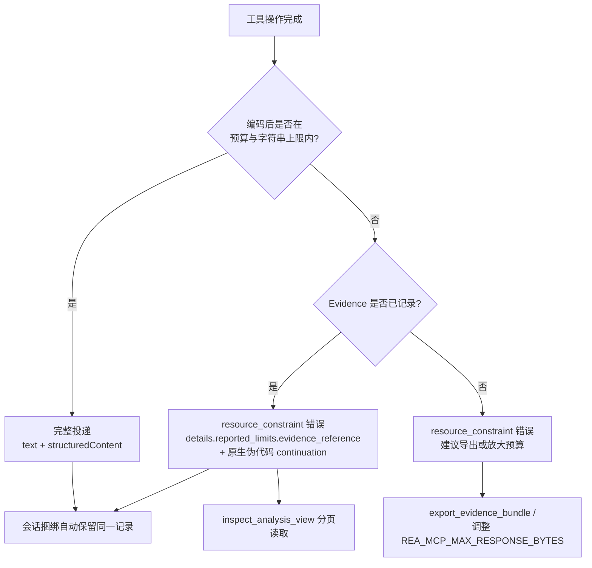
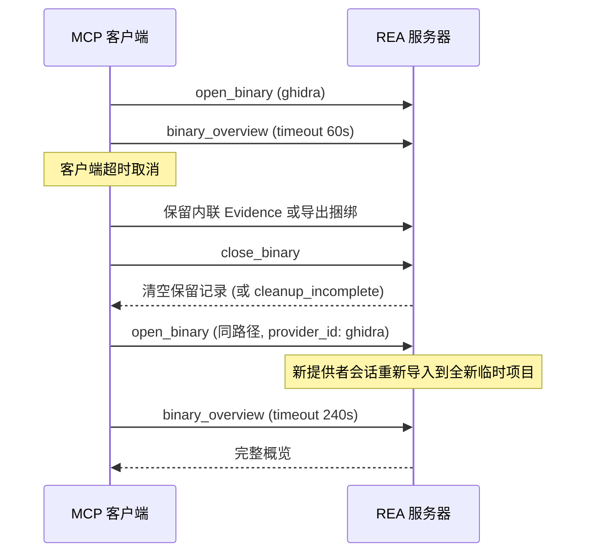

本页是 REA MCP 运行时的权威契约参考，面向直接在一条 MCP 连接上调用 REA 工具并解释其应答的高级开发者。范围覆盖四个正交维度：**工具结果的编码与投递策略**、**保留 Evidence 的发现与消费路径**、**会话身份与目录发现语义**，以及**进度通知、取消与恢复语义**。每个维度都遵循同一设计不变量：完整分析结果永不截断——要么完整送达，要么以可恢复引用的形式保留在会话中。设计动机与六种任务形状的分层原理见 [MCP 工具设计原则](7-mcp-gong-ju-she-ji-yuan-ze-liu-chong-ren-wu-xing-zhuang-yuan-yu-you-xian-yu-qi-yue-yan-ge-xing)。

## 工具结果契约：成功与失败的双形态投递

产出 Evidence 的工具在**同一次应答**中同时返回完整规范 Evidence 的文本投影与结构化投影。调用方从 `structuredContent.normalized_result` 读取操作结果，从 `structuredContent.evidence_id` 读取其身份；`raw_result` 持有与该结果不同的提供者表示（例如上游工具的原始报告），不存在时为 `null`。`analysis_profile` 始终存在——具体档案对象或 `null` 均参与语义身份，省略该字段的记录会被拒绝。同一记录会自动保留进会话捆绑中。

失败路径采用完全不同的形状：工具执行失败返回 `isError: true`，并将完整的规范 `{ "error": ... }` 诊断作为 JSON 放入文本 `content`，同时**省略 `structuredContent`**——因为每个通告的 `outputSchema` 只描述成功结果。诊断中包含错误码、目标详情、部分观察与补救指引。

| 维度 | 成功结果 | 失败结果 |
|---|---|---|
| `content` | 规范 JSON 的完整文本投影 | 规范 `{error}` 诊断 JSON |
| `structuredContent` | 完整 Evidence（含 `normalized_result`） | 省略 |
| `isError` | 省略（false） | `true` |
| `_meta` | 按工具契约决定是否携带来源标记 | 同一标记同样携带 |

实现上，`ToolResultDelivery.toCallToolResult` 是唯一入口：会话类契约的结果被包裹为 `{ result: value }`，Evidence 类结果走 `toEvidenceToolResult` 并携带生产者显式的记录确认；错误经 `projectAnalysisError` 投影后以 `error-text` 表示编码，结构化副本仅作为私有载体存在，传输层在自己的预算检查后将其移除。

Sources: [mcp-contracts.md](docs/mcp-contracts.md#L9-L79), [toolResult.ts](src/server/toolResult.ts#L55-L87), [toolResult.ts](src/server/toolResult.ts#L129-L150)

## 响应预算与超限恢复

REA 在固定 stdio 客户端的 **10 MiB 接收缓冲区**预算内准备完整 MCP 结果，预算同时计入文本与结构化两种表示以及 JSON-RPC 信封的空间。构造函数中 `resultBudgetBytes = maximumResponseBytes - 1024` 显式预留 1024 字节信封余量；编码器 `encodeToolResult` 逐段累加信封字节、转义文本字节与 UTF-16 码元数，在分配完整字符串**之前**即可判定超限，约束分为 `receive-buffer`（字节预算）与 `string-length`（Node 单字符串上限）两种。

当结果无法装入预算时，REA 返回 `resource_constraint` 错误且 `details.resource: "transport"`，**在构造文档级字符串之前**发出，分析 Evidence 仍完整保留在当前会话中。恢复引用分两级：`details.reported_limits.evidence_reference` 提供保留记录的精确引用，可交给 `inspect_analysis_view` 获取摘要、单节或稳定分页；对超大的原生函数 Evidence，`details.reported_limits.continuation` 还会内嵌一个可直接调用的 `inspect_analysis_view` 请求（`source.kind: "retained-evidence"`，`facet: "pseudocode"`，`offset: 0`），调用方按 `normalized_result.coverage.next_offset` 翻页即可。只有会话记录已被确认后才会提供续读建议。

| 恢复路径 | 适用场景 | 机制 |
|---|---|---|
| `evidence_reference` + `inspect_analysis_view` | 任意超限结果 | 保留记录的分页视图 |
| `continuation` 内嵌请求 | 超限原生伪代码 | 即用型调用参数 + `next_offset` |
| `export_evidence_bundle` | 需要完整记录 | 流式写入原子发布文件 |
| `REA_MCP_MAX_RESPONSE_BYTES` | 客户端显式配置了更大缓冲 | 安全十进制整数，≥ 10485760，启动时读取 |

`get_evidence_bundle` 支持无需大载荷的发现模式：`detail: "summary"` 时 `result.records` 只含 Evidence ID、工件/提供者身份、分析档案摘要与原生过程元数据；可选 `filters` 按 `evidence_id`、`operation`、`target_sha256`、`analysis_profile_digest` 或 `procedure_address` 精确匹配。省略 `detail` 保留完整规范捆绑投递，而 filters 要求 summary。发现与保留选择都不会启动提供者。



Sources: [toolResult.ts](src/server/toolResult.ts#L23-L52), [toolResult.ts](src/server/toolResult.ts#L152-L205), [toolResultEncoding.ts](src/server/toolResultEncoding.ts#L6-L119), [mcp-contracts.md](docs/mcp-contracts.md#L93-L155)

## 不可信目标内容标记

字符串、符号、反编译代码、页面文本、脚本体、网络捕获、日志与文件清单都来自**分析目标**，而目标可以嵌入伪装成指令的文本。REA 把这些文本视为数据，并在可能返回此类内容的工具结果 `_meta` 上附加稳定标记，无论调用成功还是失败：

```json
{ "provenance": { "untrusted_content": true, "source": "analysis_target" } }
```

标记由工具契约的 `returnsTargetContent` 声明一次，默认开启：只有结果与错误仅含 REA 会话状态或调用方供给值的 `export_evidence_bundle` 与 `record_unknown` 例外。`binary_session`、`close_binary`、`inspect_adb_client`、`update_unknown` 等因结果或错误可能包含提供者、启动器、设备输出而保持标记。错误结果（`isError: true`）同样携带标记，因为失败可能包含目标派生文本——错误消息、捕获输出，或被取消的 `capture_process_scenario` 保留的 `partial_observation`。实现上标记字节数被固定计入响应预算，且不改变 `content` 或 `structuredContent`；宿主与钩子可据此应用更严格处理，例如在读取目标内容后对进程启动类工具要求审批。

Sources: [mcp-contracts.md](docs/mcp-contracts.md#L157-L194), [toolResultEncoding.ts](src/server/toolResultEncoding.ts#L24-L47)

## 保留证据投递：detail、引用与捆绑

六个入口工具（`analyze_javascript_application`、`inspect_binary_layout`、`inspect_artifact`、`inspect_wasm_artifact`、`inspect_macho`、`decode_interface_builder`）接受 `detail` 参数：`complete`（默认）返回完整分析 Evidence；`summary` 将完整 Evidence **记录进会话**后返回派生的 `inspect_analysis_view` 摘要 Evidence，其 `normalized_result.parent_evidence_id` 与 `evidence_links` 指向保留的分析。投递选择**永远不触及工具引擎或 Evidence 身份**——`withoutDeliveryDetail` 在参数到达处理函数前剥离 `detail` 字段。无会话保留能力的服务器以 `capability_unavailable` 拒绝 summary。

后续工具通过 `retained-evidence` 引用消费保留记录，每个引用属于**当前连接**的 Evidence 账本：

```json
{ "kind": "retained-evidence", "evidence_id": "ev_<64 小写十六进制字符>" }
```

引用的关键生命周期事实：打开另一目标或重启当前目标**保留**记录（即使提供者清理失败，记录仍可导出与重试）；`close_binary` 清空它们（即使无活动二进制）；新连接拥有自己的账本。缺失引用报告精确 ID 与 `details.reason: "missing"`，服务器无法推断它是从未记录、已被清除还是属于另一连接。

部分失败同样可恢复：失败且已记录部分 Evidence 时，`toRecordedPartialErrorToolResult` 在错误 `details.partial_observation` 中附加 `retained-evidence` 引用。注意其边界——部分原始观察只有随错误送达才能恢复；若客户端取消导致 SDK 压制了错误应答，这些原始观察不可恢复，此时应改用 `get_evidence_bundle` + 操作过滤器发现部分记录。

| 输入形式 | 适用工具 | 语义检查 |
|---|---|---|
| 完整内联 Evidence | 所有比较/追踪/验证工具 | 语义、身份、权威、来源全套检查 |
| `retained-evidence` 引用 | 应用图比较左右两侧等 | 同一套检查，不重复运行生产者 |

CLI 应用工作流继续读取可移植内联 Evidence；一次性 CLI 调用无法解析另一 MCP 连接的保留记录，便携导出捆绑通过 `rea inspect-evidence-bundle '{"path":...,"detail":"summary","filters":{...}}' --format json` 共享同一投影。

Sources: [mcp-contracts.md](docs/mcp-contracts.md#L196-L345), [retainedSummaryDelivery.ts](src/server/retainedSummaryDelivery.ts#L29-L62), [toolResult.ts](src/server/toolResult.ts#L106-L127), [registerSessionRecordTools.ts](src/server/registerSessionRecordTools.ts#L42-L89)

## 会话发现：binary_session 与目录身份

`binary_session` 是会话发现的权威入口：以 `{}` 调用并读取 `result.tool_availability`，即可为当前目标、提供者、主机与协商的客户端能力选出可调用操作。其实现并行探测 Android/ADB/Apktool/JEB 提供者可用性，再结合可用性策略构建能力清单，同时生成含目录计数与 schema 摘要的 `server_identity.catalog`，并支持 `expected_package_version`、`expected_catalog_digest`、`expected_server_path` 三个可选输入将活动会话与调用方期望比对。

发现语义中最重要的不变量是：**`tools/list` 始终返回完整规范工具清单，包括当前不可用的工具**。打开/关闭目标或提供者健康状态转换不改变目录，也不发出 `notifications/tools/list_changed`。可用性事实按组聚合在 `tool_availability.groups` 中，组共享 `client_requirements` 基线，组的可选覆盖替换基线；展开每组的 `names` 得到逐工具的表面、可用性、原因、补救与模式事实。

`effects` 与 `annotations` 数组适用**仅真封闭词表**规则：已知成员从数组中省略即为 false——该规则只对这两个封闭标志集成立，不适用于省略的工具、提供者、模式或限制。深层引擎发现由 `analysis_provider_candidates` 权威承载：每个候选的能力集描述该**可能的**提供者，但不选择它；顶层 `capabilities` 描述当前路由，`analysis_provider_binding` 标识具体选中的路由，二者不可互换。成功深开后暴露一个不可变提供者、具体版本、选择来源与完整分析档案；**运行时失败后绝不自动替换已选提供者**。

`binary_session.cleanup_pending` 报告会话是否仍保留清理未成功的提供者客户端、会话文件资源或提供者候选资源——它可以为 `true` 且 `open: false`，目标退役不等于资源释放。对保留的提供者客户端，健康、活动与谱系仍可在其原始 `analysis_run.run_id` 下获取。

| 发现事实 | 承载字段 | 语义 |
|---|---|---|
| 工具目录 | `tools/list` | 完整定义与 input/output schema 的规范来源 |
| 可用性分组 | `tool_availability.groups` | 名称集 + 逐工具当前事实 |
| 目录身份 | `server_identity.catalog` | 计数与 schema 摘要 |
| 可能提供者 | `analysis_provider_candidates` | 描述性，不选择 |
| 选中路由 | `analysis_provider_binding` | 不可变的具体选择 |
| 清理状态 | `cleanup_pending` | 与 `open` 状态独立 |

Sources: [mcp-contracts.md](docs/mcp-contracts.md#L347-L444), [registerSessionStatusTool.ts](src/server/registerSessionStatusTool.ts#L50-L140), [sessionAvailabilityPolicy.ts](src/server/sessionAvailabilityPolicy.ts#L30-L77)

## 进度与取消：观察语义与恢复边界

REA 接受普通 `tools/call` 进度令牌。数值 `progress` 计算**已发出的状态观察数**并严格递增——即使在等待阶段没有额外工作时也如此；更新以最多每 100ms 一次为界限速，且始终允许终止更新；`total` 被省略，因为未来状态观察的数量未知。REA 不伪造百分比，`message` 承载阶段与观察到的作业。适配器实现明确：无令牌时返回静默报告器，传输失败被吞掉——**进度是观察性的，不能改变工具真相**。

取消在协议层是**工具错误**，与超时严格区分。提供者调用接收请求取消信号；工件遍历、哈希、版本比较、Hopper 请求与进程捕获检查同一信号。清理失败使用 `cleanup_incomplete` 并只列出仍存续的受管资源种类；一旦这些属主确认清理，组合失败会恢复其原始类型化主结果与恢复指引，历史组合诊断保留在 `details.cleanup_history`。两个需要记住的精细边界：

- **发布回执**：原子 Evidence 捆绑或快照写入可能在暂存清理失败**之前**已发布完整输出，此时 `details.published: true`、`details.published_path`、`details.bytes` 保留发布回执，用于区分"已完成发布"与"从未提交的写入"；暂存资源保持受管直至清理验证完成。
- **部分观察**：原生调用追踪与进程捕获在失败时（包括清理成功时）将可用观察保留在 `details.partial_observation`；取消发生在结果定稿或受管清理期间时同样返回带可用观察的类型化取消。派生比较与重建验证在计算前、发布前就先让步（yield），使取消无法与成功 Evidence 竞争。

取消一个导出会停止后续序列化并移除其暂存文件；目的地只在完整导出原子发布后才改变。直接 CLI 分析调用无需进度令牌，将 SIGINT/SIGTERM 翻译为提供者使用的同一 AbortSignal，信号防护在提供者清理期间持续有效，包括包运行器的重复递送——REA 绝不杀死它无法证明自己拥有的进程。

Sources: [mcp-contracts.md](docs/mcp-contracts.md#L446-L515), [mcpProgress.ts](src/server/mcpProgress.ts#L13-L39)

## 冷启动截止时间与 close/reopen 恢复

成功的 MCP initialize 握手建立连接后，`open_binary` 选择目标与提供者绑定，但**不**代表 Ghidra 已完成导入。首个 Ghidra 后端查询（如 `binary_overview`）启动引擎并等待导入、默认自动分析、桥接连接与健康就绪。各截止时间的所有权不同：

| 截止时间 | 所有者与效果 |
|---|---|
| MCP initialize | 客户端限定传输/REA 连接启动，先于任何目标查询 |
| Hopper 启动 | REA 默认 120,000 ms，`REA_HOPPER_STARTUP_TIMEOUT_MS` 可配 1–2,147,483,647 |
| Ghidra 启动 | REA 默认 330,000 ms，`REA_GHIDRA_STARTUP_TIMEOUT_MS` 可配同范围 |
| Darwin swiftc 助手 | REA 默认 120,000 ms（所有权助手编译） |
| 单次工具调用 | **客户端**限定等待（固定 SDK 默认 60,000 ms，可早于 REA 启动期限取消） |

已连接客户端使用固定 SDK 时，请求选项是 `callTool` 的**第二个**参数：`timeout: 240000` 与 `onprogress` 回调；原始客户端则发送 `_meta.progressToken` 并处理 `notifications/progress`。Ghidra 启动待定期间，REA 在请求带进度令牌时每十秒发送一次等待通知，其消息给出已等待时间；等待通知不度量引擎完成的作业，也不延长客户端期限——除非客户端显式实现该策略（如 `resetTimeoutOnProgress: true`，此时需注意 `maxTotalTimeout` 只在进度重置时被检查，静默区间可能超出声明总额，绝对期限应加 `AbortSignal.timeout(totalBudgetMs)`）。

若客户端在启动期间超时或取消，恢复遵循固定三步流程，**同一连接**内完成：



第 2 步的 `close_binary` 结果必须检查：它排空受管作业、关闭提供者并清空保留的会话记录；`cleanup_incomplete` 结果须按其报告的受管资源处理后才能重试。实现上关闭处理器用 `Promise.allSettled` 并行执行会话关闭与进程捕获资源清理，任一失败都通过 `analysisErrorWithCleanupFailure` 组合并绑定清理依赖，保持类型化结果而非吞掉异常。实测参照（非通用超时）：受控 Linux x64/WSL2 夹具在 NTFS 挂载安装、原生 JDK 21、双核 CPU、512 MiB Java 堆上完成首次概览约 64 秒；Windows x64 stdio 运行中 60 秒默认超时后 close 成功，240 秒请求下冷概览约 163 秒完成，下一次概览仅约 19 ms——每个新提供者会话仍将目标导入全新临时项目。REA 只清理它拥有的资源，且绝不自动切换到另一提供者；提供者超时、安装失败或主机权限拒绝需要各自报告的恢复路径，单纯加大客户端期限无法修复这些失败。

Sources: [mcp-contracts.md](docs/mcp-contracts.md#L587-L703), [registerCloseLifecycleTool.ts](src/server/registerCloseLifecycleTool.ts#L15-L110)

## 小结与下一步

这四组契约共享同一骨架：**完整结果在服务端保留，客户端只会在两种形态之间选择**——完整内联投递，或精确引用加恢复动作。工具结果编码以 1024 字节信封预留与双约束（缓冲区/字符串）判定超限；保留 Evidence 以连接级账本和 `retained-evidence` 引用构成消费闭环；`binary_session` 以不可变目录与封闭词表承载发现；进度与取消以观察性通知与类型化错误守护恢复边界。当超限诊断出现时，优先使用 `details.reported_limits` 中的现成恢复参数而非重新分析；当 `cleanup_pending` 为真时，先跟随清理错误报告的资源再重开目标。

深入理解这些契约背后的分层约束，请继续阅读[分层架构总览](5-fen-ceng-jia-gou-zong-lan-ru-kou-zu-he-ying-yong-ti-gong-zhe-yu-ling-yu-ceng-de-yi-lai-gui-ze)与[证据与不确定性模型](6-zheng-ju-yu-bu-que-ding-xing-mo-xing-guan-cha-tui-dao-tui-duan-yu-wei-zhi-de-bao-liu-yu-yi)；实际的冷启动恢复操作手册见[Ghidra 集成](11-ghidra-ji-cheng-lin-shi-shu-ju-ku-kuai-zhao-sheng-ming-zhou-qi-yu-duo-jia-gou-yu-yi-pei-zhi)，响应预算与 schema 通告在客户端侧的配置方法见[安装与代理配置](3-an-zhuang-yu-dai-li-pei-zhi-shou-zhi-chi-ke-hu-duan-shi-wu-shi-xie-ru-yu-yuan-sheng-yin-qing-qian-zhi-tiao-jian)。