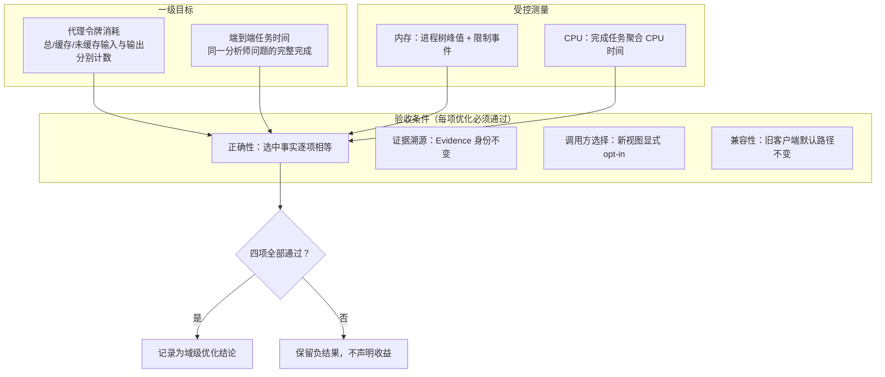
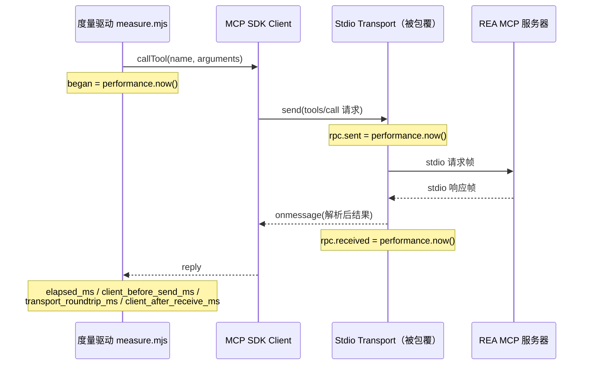
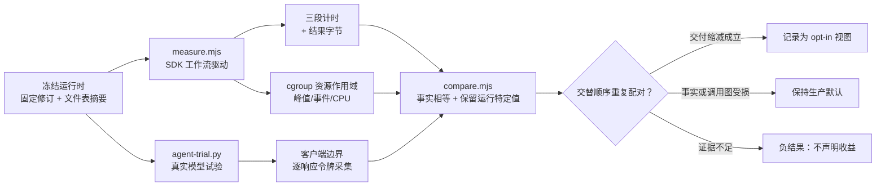

REA 的性能工程不是基于直觉的局部调优，而是一套以真实工件与真实模型试验为依据的**度量纪律**。本页解释三层内容：优化目标如何排序（代理令牌与端到端任务时间为一级目标，内存与 CPU 为受控测量）；每个维度如何被度量（SDK Transport 边界三段计时、cgroup v2 瞬态作用域、客户端边界令牌采集）；以及一个观测在何种证据条件下才允许被记录为结论（配对比较、交替顺序、负结果保留）。全部机制源自 `experiments/analysis-efficiency/` 的检查点研究与 CI 计时基础设施，二者共同构成仓库关于"什么才算一次性能改进"的操作性定义。

Sources: [README.md](experiments/analysis-efficiency/README.md#L1-L10)

## 优先级模型：两级目标与四项验收条件

效率研究的主声明只有一句话，但它划定了所有后续度量的坐标系：**代理令牌消耗与端到端任务时间是一级目标；内存与 CPU 消耗同样被度量并受控；而正确性、证据溯源、调用方选择与既有用户兼容性是每一项优化的验收条件**。这意味着一个"更快"的方案如果改变了选中事实、破坏了 Evidence 身份、或让旧客户端的默认路径静默变化，它在度量框架内就不是优化，而是回归。

Sources: [README.md](experiments/analysis-efficiency/README.md#L88-L110)

四个维度各自有独立的度量语义，且项目刻意在语言上阻止最常见的偷换——把"回复字节变小"直接说成"令牌节省"：

| 维度 | 目标定位 | 度量单位 | 关键规则 |
| --- | --- | --- | --- |
| 代理令牌 | 一级目标 | 总输入/缓存输入/未缓存输入/输出，分别计数 | 计入发现、重复调用、错误、重试与后续轮次；紧凑 JSON 字节只是交付度量，**不是令牌计数** |
| 任务时间 | 一级目标 | 同一分析师问题完整完成的时间 | 包含启动、提供者工作、传输、客户端处理与模型纠正；分离阶段与冷/热状态；重复可比试验后才可泛化 |
| 内存 | 受控测量 | 进程树聚合峰值 + 限制/清理事件 | 计入保留 Evidence 与表示膨胀；保留宿主安全阀 |
| CPU | 受控测量 | 完成任务的聚合 CPU 时间 | 单 CPU 配额是实验控制手段，它本身不证明 CPU 消耗降低 |

Sources: [README.md](experiments/analysis-efficiency/README.md#L88-L110)

这一层级结构可以用下图表达——一级目标决定优化方向，验收条件决定结论能否被记录，两级之间不存在绕行通道：

迁移策略与优先级配套：**按领域逐个推进**，每个领域要求真实的工件检查与相关的共享契约检查，且"通过一条通道不等于所有已宣传的平台/提供者都已通过"。目录故意获得更精确的附加 schema，因此其字节与摘要**不被冻结**——测得运行时 `259e99dd9` 的完整目录 JSON 比冻结基线大约 2.6%，这种膨胀被如实记录而不被隐藏。旧客户端用既有请求访问候选版本时保留完整默认路径；新的摘要/视图选项必须显式选择。

Sources: [README.md](experiments/analysis-efficiency/README.md#L110-L126)

## 令牌度量：交付字节不是令牌计数

这是整套度量框架中最反直觉、也最被反复强调的一条规则。`model-context.md` 用一个真实诊断观测证明了为什么原始回复字节与聚合模型用量**不可互换**：一个真实的 Codex CLI 0.161.0 对照试验，尽管请求配置标记为 `direct`，实际观察到客户端执行了三次 JavaScript `exec` 调用——先过滤并打印全部工具元数据（客户端报告截断了一个 164,005 令牌的原始输出），再调用完整托管检查并选择性打印，最后调用原生边界检查。持久化的三个自定义工具输出值仅为 41,704 / 2,154 / 13,489 UTF-8 字节，但追踪报告了四次每响应用量观测——两次 MCP 调用完全无法描述客户端的发现/执行轮次。

Sources: [model-context.md](experiments/analysis-efficiency/model-context.md#L17-L46)

该诊断的四次响应观测与公开轮次用量精确对账（总输入 76,433、缓存 49,408、未缓存 27,025、输出 2,374 令牌，观测墙钟 61.436 秒），这一逐响应分解是令牌度量的标准形态：

| 响应 | 输入 | 缓存输入 | 输出 |
| --- | ---: | ---: | ---: |
| 1 | 10,400 | 0 | 132 |
| 2 | 19,992 | 9,984 | 456 |
| 3 | 21,242 | 19,200 | 251 |
| 4 | 24,799 | 20,224 | 1,535 |

Sources: [model-context.md](experiments/analysis-efficiency/model-context.md#L29-L46)

首个提交的捕获配对进一步击碎了"字节缩减必然带来令牌缩减"的假设：完整交付对照消耗 52,656 输入令牌，而摘要候选反而消耗 56,655——候选更小的原始元数据回复**没有**换来更小的打印客户端值（对照 2,086 字节 vs 候选 22,770 字节）。因此 README 明确要求：令牌度量必须计入发现、重复调用、错误、重试与后续轮次，并分别报告总/缓存/未缓存输入与输出。

Sources: [model-context.md](experiments/analysis-efficiency/model-context.md#L82-L106)、[README.md](experiments/analysis-efficiency/README.md#L88-L92)

采集机制同样遵循最小暴露原则。`agent-trial.py --capture-tool-context` 仅为显式选择的临时试验省略 `--ephemeral`，默认行为不变；配置文件在 `finally` 中消失，包括采集失败时。`codex_context.py` 的 `token_counts` 校验六类计数字段（`input_tokens`、`cached_input_tokens`、`cache_write_input_tokens`、`output_tokens`、`reasoning_output_tokens`、`total_tokens`），保留每响应用量、累计轮次/线程用量与原始响应 ID，同时排除账户元数据、世界状态、用户/开发者消息与加密推理。回执记录源/保留摘要、事件计数、畸形行失败与缺失 rollout 的不可用状态——采集是对持久化客户端条目的**观测**，不是对远程模型服务实际接受请求的证明。

Sources: [agent-trial.py](experiments/analysis-efficiency/agent-trial.py#L53-L303)、[codex_context.py](experiments/analysis-efficiency/codex_context.py#L8-L56)、[model-context.md](experiments/analysis-efficiency/model-context.md#L48-L60)

## 分析时间度量：SDK Transport 边界的三段计时

理解时间度量需要一个前提：MCP 客户端 SDK 通过可替换的 Transport 对象与 stdio 服务器通信，度量驱动 `measure.mjs` 不侵入引擎内部，而是**包覆公共 SDK Transport 接缝**来观测时间。README 明确声明其边界语义：每次工具调用在公共 SDK Transport 边界测量三个区间，其中传输/服务器往返**不是**仅 Ghidra 或仅提供者的计时器。

Sources: [README.md](experiments/analysis-efficiency/README.md#L210-L233)

实现的接线方式验证了这一语义：驱动保存 `transport.send` 与 `transport.onmessage` 的原引用并包覆之，在 `tools/call` 请求发出时记录 `rpc.sent`，在带 `result`/`error` 的响应到达时按消息 ID 记录 `rpc.received`。`call()` 函数随后计算五个字段：

| 字段 | 区间边界 | 包含内容 |
| --- | --- | --- |
| `client_before_send_ms` | `began → rpc.sent` | 客户端前置工作，含首次使用的 schema 准备 |
| `transport_roundtrip_ms` | `rpc.sent → rpc.received` | 帧封装、I/O、服务器工作、客户端 JSON 解析 |
| `client_after_receive_ms` | `rpc.received → 调用结束` | 解析响应到达 `onmessage` 之后的客户端工作 |
| `client_result_json_utf8_bytes` | — | 解析后客户端结果的紧凑 JSON 字节；**非原始线上字节，非令牌** |
| `runner_encoding_ms` | — | 驱动自身的编码与磁盘写入，显式排除在每次调用之外 |

Sources: [measure.mjs](experiments/analysis-efficiency/measure.mjs#L240-L286)、[measure.mjs](experiments/analysis-efficiency/measure.mjs#L1111-L1137)、[measure.mjs](experiments/analysis-efficiency/measure.mjs#L1251-L1254)

时间度量还有两条防伪注记。其一，进度通知保留其实际到达时间，但**不**暗示比生产者实际发出的更精确的内部引擎计时；作用域 CPU 时间与进程树内存来自资源包装器的最终 JSON 行。其二，冷/热状态必须分离：初始观测显示某次 Obsidian 试验在第一个请求发出前花费约 21.9 秒，而该请求的传输/服务器往返仅约 0.77 秒——其他冷启动运行差异巨大，这类单一观测只用于标识测量边界，不构成加速声明。目录发现时间（`connectedMs`/`catalogMs`）单独记录，因为首次使用 schema 准备属于客户端前置工作。

Sources: [README.md](experiments/analysis-efficiency/README.md#L228-L280)、[measure.mjs](experiments/analysis-efficiency/measure.mjs#L1139-L1147)

## 资源开销度量：cgroup v2 瞬态作用域与计数器语义

内存与 CPU 的度量由 `resource-run.py` 承担：它在 Linux cgroup v2 与用户 systemd 管理器上拥有一个唯一命名的瞬态作用域，把整个进程树限制在单核 CPU 上，并以 100 毫秒周期采样 `memory.current`、`pids.current` 与 `cpu.stat`。控制参数一旦设定便不可放宽——这是一切内存/CPU 数值可比性的物理前提：

| 控制项 | 值 | 行为 |
| --- | --- | --- |
| `CPUQuota` | 100% + `taskset` 单核绑定 | 实验控制配额，不证明 CPU 消耗降低 |
| `MemoryMax` | 4 GiB | 硬顶，触发即终止 |
| `MemoryHigh` | 3 GiB | 软阈值；采样峰值超过即 `scope_memory_early_stop` |
| `MemorySwapMax` | 0 | 禁用交换 |
| `TasksMax` | 默认 192，`--task-ceiling` 可调 | 观测到 `pids.events` 的 `max` 事件即早停 |
| 宿主保护 | 启动需 ≥ 8 GiB 可用；运行中 < 4 GiB 即 `host_available_memory_early_stop` | 早停保留清理回执 |

Sources: [resource-run.py](experiments/analysis-efficiency/resource-run.py#L88-L96)、[resource-run.py](experiments/analysis-efficiency/resource-run.py#L150-L160)、[README.md](experiments/analysis-efficiency/README.md#L200-L208)

计数器语义的核心是一条诚实的未知规则：**瞬态 cgroup 可能在监督者读取终态计数器之前消失**，因此 `resource_events_final` 与 `resource_counters_verified` 保留其原始的未知状态；采样到零个限制事件**不是**最终无 OOM 的证明。最终 JSON 回执打印作用域单元名、采样峰值字节、耗时、中止原因、硬顶/早停字节、CPU 配额与核亲和、任务上限、最后观测到的 `memory.events`/`pids.events`/`cpu.stat`——错误的属主、畸形或矛盾的回执保持未知，残留的参与者显式保留且不能证明清理完成。

Sources: [resource-counters.md](experiments/analysis-efficiency/resource-counters.md#L1-L12)、[resource-run.py](experiments/analysis-efficiency/resource-run.py#L190-L215)

针对"终态计数器不可知"这一限制，`--observe-payload-exit` 模式在同一拥有作用域内加入一个观察者：它等待直接载荷退出，记录内核 `memory.peak`、CPU 与内存/任务事件，并在向外部监督者确认完成前报告剩余进程。回执阶段被命名为 **payload-exited-observer-alive**：监督者验证拥有单元令牌、数值字段、cgroup 身份、存活观察者成员资格、载荷退出状态与无额外进程后，才将该观测标记为已验证。该模式要求至少两个任务槽位（观察者+载荷），且观察者的 CPU/内存被计入新测量——可比运行必须使用相同模式。五个语义 Python 用例加上真实 cgroup/systemd 探针（16 MiB 有界分配产生内核峰值、载荷遗留子进程时拒绝验证、任务上限早停以退出码 125 观测）构成聚焦验证；这些是计量/生命周期探针，**不是**新的模型/提供者性能声明。

Sources: [resource-counters.md](experiments/analysis-efficiency/resource-counters.md#L5-L40)、[resource-counters.md](experiments/analysis-efficiency/resource-counters.md#L42-L62)

## 配对比较与统计纪律

度量产物的可信度来自运行环境的完全固化。复现流程要求使用仓库锁定的 Node/npm，构建选定修订后把 `dist/`、`bridge/`、`scripts/`、`skills/`、`package.json` 与 `package-lock.json` 复制到独立运行时目录再度量；初始冻结基线固定为 `42b0ed126df7d5b908ac369715378d5e519051b7`，研究不静默替换为更新的 `main`。`summary.json` 记录选定工件的修改前后 SHA-256、运行时文件表摘要、分发器与锁文件摘要、驱动源摘要、Node/SDK 版本、目录大小、调用方参数与生产者 Evidence ID；`runtime-files.json` 逐文件标识被度量的精确编译产物。

Sources: [README.md](experiments/analysis-efficiency/README.md#L122-L210)

环境控制同样双向：驱动在启动受测服务器**之前**拒绝未声明的继承提供者配置键（对照 `provider-environment.json` 的命名空间前缀与附加键清单），只持久化所选设置的摘要而不记录值；同时指纹化有效提供者 `PATH` 而不记录其值，SDK 比较器拒绝不同或未记录的搜索路径。进程环境通过导出固定——`NODE_OPTIONS=--max-old-space-size=512`、`UV_THREADPOOL_SIZE=1`、`GOMAXPROCS=1`、`GOMEMLIMIT=2GiB`——使配对两侧的系统条件可比。

Sources: [README.md](experiments/analysis-efficiency/README.md#L158-L196)

配对裁决由 `compare.mjs` 执行：它检查所有选中的分析师事实（清单源 ID、精确路径记录、清单、计数、完整性、矛盾、覆盖、未探索分支与限制），只排除交付观测 ID 与命名的恢复路径描述；Binwalk 的每次调用区域 UUID 与 JavaScript 父堆依赖字节预算这两类运行特定值先双值保留再从相等性中排除。其 CLI 行为由 `tests/evaluation/analysisEfficiencyComparison.test.ts` 用合成度量目录验证：事实差异使 `facts_match` 为假，包/信号选择计划变化同样使比较失败，而等价配对必须在 `preserved_run_specific_values` 中保留两侧的原始观测。

Sources: [README.md](experiments/analysis-efficiency/README.md#L246-L262)、[analysisEfficiencyComparison.test.ts](tests/evaluation/analysisEfficiencyComparison.test.ts#L37-L99)

统计纪律是最后也是最常被违反的一关，仓库把它写成显式指令：**在交替顺序下使用重复运行，之后才可声称一个分布或一次加速；单配对只是单次观测**。重负载构建、提供者与模型试验串行执行，防止并发噪声污染配对。

Sources: [README.md](experiments/analysis-efficiency/README.md#L256-L262)

## 检查点档案：结论如何被记录

把上述机制串联起来，就得到完整的度量流水线——冻结运行时供给两种驱动（SDK 工作流驱动与真实模型试验驱动），三个度量通道（Transport 计时、资源作用域、令牌采集）各自产生回执，比较器裁决事实等价性，最终结论只能落在三格之一：采纳为 opt-in 视图、保持生产默认、或不声明收益：

已记录的检查点展示了这一裁决机制在真实数据上的运作，尤其值得注意的是负结果与正结果享有同等的记录地位：

| 检查点 | 关键度量 | 记录结论 |
| --- | --- | --- |
| Obsidian 交付配对 | 工具结果紧凑 JSON 937,404 → 16,322 字节（约 −98.3%）；目录 JSON 2,326,609 → 2,370,505（约 +1.9%）；两次耗时配对 11.04→10.23 s、10.57→10.18 s | 交付缩减成立；耗时观测**不**构成统计性提速；调用数 3→4；库存覆盖与上游字节获取不变 |
| SQLite 选择性交付 | 调用 42→3；工作流时间 292.64→63.79 s；报告输入令牌 304,698→74,387；12 项请求事实全部保持 | 单一随机模型配对，不作统计或一般因果声明 |
| 引导式工具发现 | 引导侧发现输出 41,709→12,336 字节且无截断；可接受配对中输入约 −43.5%、未缓存约 −34.0%、墙钟约 −16.0% | 每处理两次试验属初步信号；提示保持 opt-in，需更广问题/领域验证后才可推广 |
| jq 禁用 Switch Analysis | 174.77 vs 276.23 s；被调 `0x40daa0` 默认 604 字节/8 区间 vs 禁用后 164 字节/4 区间 | **拒绝**：顶层计数相等不证明调用图等价，保持生产默认；该控制仅用于调用方已核查所需事实的选定任务 |
| Android 保留清单 | 回复字节下降，旧请求/Evidence 不变 | 模型令牌/时间收益**未确立**，仅记录字节下降 |
| 原生 PE/DOS 入口视图 | 小函数案例中四次选择回复的字节**超过**完整档案 | 负结果：选择视图可能比完整交付更昂贵 |

Sources: [README.md](experiments/analysis-efficiency/README.md#L282-L301)、[README.md](experiments/analysis-efficiency/README.md#L390-L399)、[model-context.md](experiments/analysis-efficiency/model-context.md#L108-L168)、[README.md](experiments/analysis-efficiency/README.md#L302-L316)、[README.md](experiments/analysis-efficiency/README.md#L64-L72)

## CI 时间度量：遥测不是门禁

分析时间度量不止于实验驱动——CI 自身的排队与执行时间也有一套按小时采样的观测设施，但其定位被刻意限定为遥测而非门禁。`ci-timings.yml` 由每小时一次的 cron 触发，从可信默认分支执行批处理代码，依次运行 PR CI 健康诊断（`pr-ci-health.mjs`）、排队/执行/匹配步骤计时采集（`job-timings-batch.mjs`）、以及对主干的静态失败归因（`failure-report.mjs`），全部步骤 `continue-on-error`，产物保留 14 天。

Sources: [ci-timings.yml](.github/workflows/ci-timings.yml#L3-L47)

`job-timings.mjs` 的聚合语义同样精确到自我设限：它按作业状态推导排队时长与执行时长（跳过或未开始的作业显式记为未知），对完成的执行秒数输出分位数摘要；`npm ci`、产物上传/下载三类步骤按步骤名正则匹配归集，并注明这些**不是**总产物传输成本。最关键的防误读标签直接写在报告里——已完成作业时长的求和值"不是 CPU 时间、不是计费、也不是工作流墙钟时间"，且时间戳未知时该求和显式标记为不完整。

Sources: [job-timings.mjs](scripts/ci/job-timings.mjs#L12-L16)、[job-timings.mjs](scripts/ci/job-timings.mjs#L150-L190)

CI 数据的解读纪律在 README 的 CI 归因章节得到示范：审查者对照主干与 PR 的实际作业日志，把 PR 相关的两处描述/测试不匹配与主干既有的失败分离，并用表格逐项链接两侧的失败作业；字节级相同的四个实现/夹具文件被明确指出，主干自身的失败"为主干评审保留"，且最后声明"CI 失败并非全是基础设施故障，失败的 CI 门禁不会被呈现为通过"。

Sources: [README.md](experiments/analysis-efficiency/README.md#L490-L516)

## 与工具设计预算原则的衔接

实验侧的度量纪律与生产侧的工具设计原则是同一枚硬币的两面。`tool-design.md` 把顺序写成硬规则：**在选择预算之前先度量资源，并在昂贵步骤之前强制执行预算**；值替代方案、追踪帧乘积、保留记录、序列化膨胀与临时文件增长必须分别核算。更关键的是预算的正当性来源——"假定的代理预算不足以成为设置限制的正当理由"，限制只能为真实的格式、协议、权限或**已度量**的资源约束而设；配套的还有"序列化字节本身不能确立代理可用性"——目录保持完整并报告能力/会话可用性，而不是截断 schema。

Sources: [tool-design.md](docs/tool-design.md#L150-L156)、[tool-design.md](docs/tool-design.md#L70-L74)、[tool-design.md](docs/tool-design.md#L21-L22)

生产配置中的具体实例印证了"先度量再设限"：`REA_MCP_MAX_RESPONSE_BYTES` 的下限定为 10 MiB（`MINIMUM_RESPONSE_BYTES`），注释明确说明这是为更大帧的客户端提供的覆盖项，且一致性验证必须对照锁定 SDK 的实际默认接收缓冲区尺寸核对该下限——预算不是拍脑袋的整数，而是绑定到协议栈实测事实的约束。

Sources: [mcpResponseBudget.ts](src/config/mcpResponseBudget.ts#L1-L20)

最后，`latest-main-audit.md` 的能力矩阵展示了优先级框架如何驱动增量路线：每个新增能力（Flutter/Dart AOT、SQLite、TShark、sigrok、保留未知头结果）都登记两列——"既有控制"与"所需的下一批证据"——并在 Dart AOT 一节重申全局规则："回复字节不能确立令牌或延迟改进"；附加的 IDA/Frida 等活跃运行时工作流因涉及独立的权限与生命周期问题而被明确排除在本静态解析延续之外。

Sources: [latest-main-audit.md](experiments/analysis-efficiency/latest-main-audit.md#L7-L13)、[latest-main-audit.md](experiments/analysis-efficiency/latest-main-audit.md#L15-L40)

## 阅读路径

本页是"架构与设计哲学"分支的度量收束点。建议按以下顺序延伸：先读 [MCP 工具设计原则](7-mcp-gong-ju-she-ji-yuan-ze-liu-chong-ren-wu-xing-zhuang-yuan-yu-you-xian-yu-qi-yue-yan-ge-xing)理解预算与契约的设计前提，再读 [MCP 契约参考](8-mcp-qi-yue-can-kao-gong-ju-jie-guo-bao-liu-zheng-ju-hui-hua-fa-xian-yu-qu-xiao-hui-fu)查看保留证据与取消恢复的运行时行为；进入具体分析领域后，[原生二进制调查工作流](10-yuan-sheng-er-jin-zhi-diao-cha-gong-zuo-liu-han-shu-dang-an-yin-yong-yu-go-rust-yuan-shu-ju-chi-xian-bu-ju-zhen-duan)展示了被度量对象的真实形态；最后以[测试策略与验证通道](27-ce-shi-ce-lue-yu-yan-zheng-tong-dao-yuan-ma-bian-jie-yan-shou-zhi-xing-ji-zhen-shi-gong-ju-lian-tong-dao)收尾，理解本文描述的度量结论如何映射到仓库的验证通道体系。